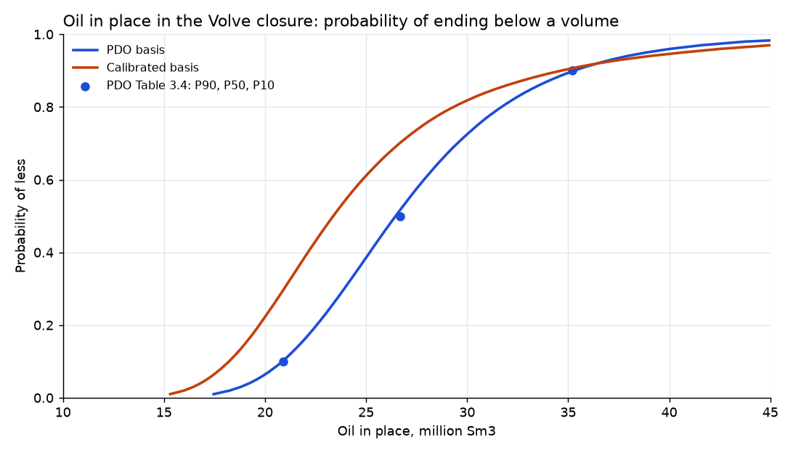
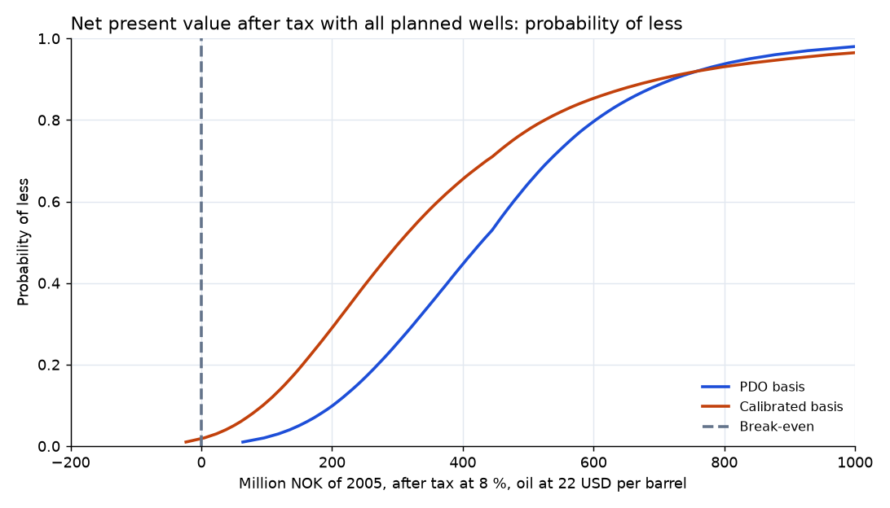
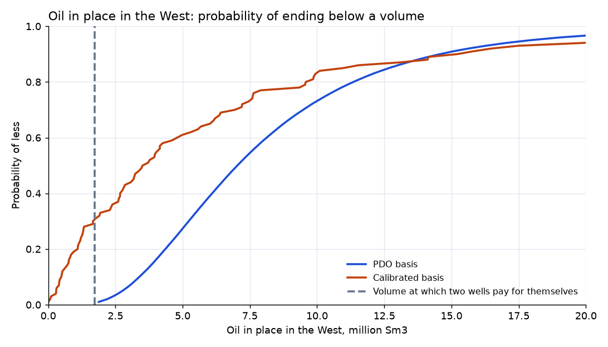
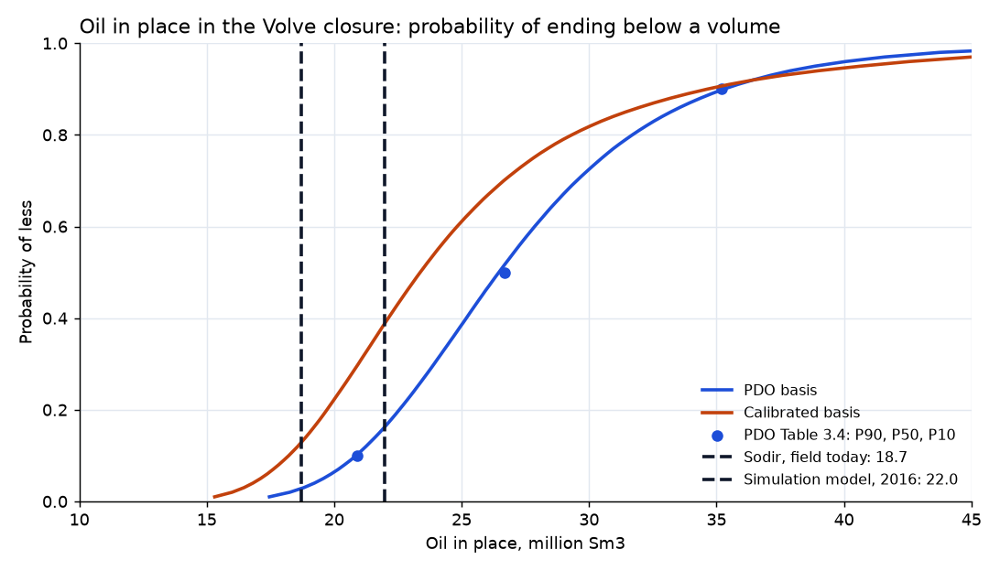

# Volve concept selection on a recalibrated volume basis

The development solution chosen for Volve in 2005 rested on an estimate of 27.5 million Sm3 of oil in place. This report rebuilds that estimate from the outside view — the record of how such estimates have turned out on the Norwegian shelf — and asks what a decision-maker should have changed in the concept with the recalibrated numbers in hand.

## Summary

Recalibrated, the central estimate of oil in place falls from 26.5 to 23.4 million Sm3 (−12 %) and the low case from 20.9 to 18.2. The high case hardly moves. The chance of ending below the PDO's own low case is 30 %, not 10 %.

The whole difference lies in one place. The PDO's volume has two parts: an East, mapped with little uncertainty, and a West whose stated range spans a factor of four, whose expected volume is nearly twice its base model, and which carried 30 % of the expected volume. The West is uncertain in the way an undrilled prospect is, and the record of such estimates is clear: on the shelf they have come in at less than half, with a spread several times wider than stated. For the East there is no record to hold it against, and it is left as stated.

This is not enough to support a different concept. The East alone carries the project — about 205 million NOK after tax at the PDO's oil price, the same as the PDO's low case — and a smaller, less certain volume speaks for leased facilities with their own drilling rig even more than the PDO's basis did. It is enough to support a different development plan within that concept: build on the East, and make the wells for the West a decision to be taken after the West has been appraised from the platform. How strongly depends on how the West is treated: as a prospect, its wells fail to pay 31 % of the time; with only the PDO's uplift over its base model taken back, 8 %.

| | | |
|---|---|---|
| Oil in place, central estimate | 26.5 → 23.4 | Million Sm3; PDO basis and calibrated basis. Low case 20.9 → 18.2, high case 35.3 → 34.6 |
| Chance of less than the PDO's low case | 10 % → 30 % | Less than 20.9 million Sm3 in place |
| Oil in the West, central estimate | 7.0 → 3.5 | Million Sm3; the 10–90 % range widens from 3.4–14.6 to 0.5–15.2 |
| Chance that the West well pair does not pay | 1 % → 31 % | West below 1.7 million Sm3 in place |
| Expected value, all wells committed | 450 → 372 | Million NOK 2005 after tax at 8 %, oil at 22 USD per barrel |
| Value in the low case | 201 → 94 | Chance of a loss 0.2 % → 1.8 % |

> Percentiles are named as in the PDO: P90 is the low case (a 90 % chance of more), P10 the high case. Everything up to the section *Hindsight* uses only what was on record when the concept was chosen.

## The decision and its volume basis

*The decision in time (PDO p11–12, p34; Sodir).*

| When | What |
|---|---|
| 1993 | Well 15/9-19 SR finds oil: 18 m of Hugin sandstone, tested |
| 1996 | Sidetrack 15/9-19 A: 88 m of oil-filled reservoir, deeper than expected; oil down to 3 101 m, no oil-water contact |
| 1997 | 15/9-19 B in the saddle to the south-east: water; sealed from Volve, so it limits the structure to the east |
| 2002 | Ocean-bottom seismic acquired; basis for the mapping in the PDO |
| November 2003 | Concept screening report (not in the dataset) |
| November 2004 | Concept selection report (not in the dataset) |
| February 2005 | PDO delivered; approved 22 April 2005 |

The concept selection report is not available, so the volume basis is taken from the PDO, delivered three months later. What was chosen: a leased jack-up rig, Mærsk Inspirer, fitted with a process plant and used as production platform; wells drilled from it, with 13 slots; oil to a leased storage vessel and on by shuttle tanker; gas to Sleipner A. Of the eight facility alternatives the PDO lists, two were taken to tender: this one, and a leased production vessel with subsea wells.

| Element of the solution | PDO | Depends on the volume through |
|---|---|---|
| Oil in place, Volve closure | Mean 27.5; P90 20.9, P10 35.2 | — |
| Reserves | Mean 11.4; P90 9.0, P10 15.3 | Oil in place and permeability are the two largest factors (PDO 4.6) |
| Wells | 3 producers high on the structure, 3 water injectors on the flanks; a near-horizontal producer and an injector in the west | Where the oil is: each part of the field has its own wells |
| Capacity | Oil 9 000 Sm3/d; three producers at 2 500–4 500 Sm3/d each; plateau 19 months | Length of plateau, not its height |
| Field life | 63 months to an economic cut-off; lease for 3 years, then six months' notice | Reserves; the leases are 58 % of all cost and run with time |
| Value | 443 million NOK after tax; 203 with the P90 profile, 718 with the P10 profile | Reserves |
| Reason for the choice | Best profitability; “positive economics at low reserves (P90)”; much of it already built; own drilling rig throughout; a base for the prospects nearby | The low case, and the upside in the area |

Two things about the cost structure matter for what follows. Investments are 2 043 million NOK of a total cost of 7 493; the rest is paid as the field produces. And the right to end the lease begins after three years, by which time 4 670 million NOK — investments and three years of lease — are committed and, in the PDO's mean case, 70 % of the oil has been produced. The concept limits what is sunk before production starts; it does not make the commitment small.

## How the PDO's volume is built

*Oil in place, million Sm3 (PDO Table 3.4). The base model uses the most likely contact, 3 120 m.*

| Area | Base model | Mean | P90 | P50 | P10 | Coefficient of variation |
|---|---:|---:|---:|---:|---:|---:|
| East | 19.9 | 19.2 | 15.9 | 19.1 | 22.8 | 14 % |
| West | 4.6 | 8.3 | 3.4 | 7.5 | 14.6 | 52 % |
| Volve closure | 24.5 | 27.5 | 20.9 | 26.7 | 35.2 | 20 % |

The PDO divides the field into areas that “differ particularly in the seismic uncertainty”, and sums them into an East and a West. It does not say where the boundary runs or which wells lie in which area.

- *The East is well determined.* Its P90–P10 range is 15.9 to 22.8, a factor of 1.4; its mean (19.2) is slightly below its base model (19.9).
- *The West is not.* Its range is 3.4 to 14.6, a factor of 4.3. The PDO calls the interpretation uncertainty on the western flank “considerable”. Its base model holds 4.6; the uncertainty study nearly doubles that to a mean of 8.3, because a deeper oil-water contact is judged more likely than a shallower one (Table 3.5: 55 % for a contact below the base model's 3 120 m, 24 % above it).
- *The closure's mean exceeds its base model by 3.0, and all of that is in the West.* The plan's expected reserves, value and wells are built on the mean.
- *No contact had been found.* Neither oil well reached the oil-water contact; oil is proven down to 3 101 m. Whatever lies below that depth is a prognosis in the same sense as a prospect's, and it is this that lifts the mean above the base model.

## What the record says about such estimates

The reference class study (`agents/rcf/out/volve-rcf-study.md`) compared estimates with outcomes at each stage on the Norwegian shelf. Three of its results bear on a volume in place estimated at sanction:

| Record | Result | Bearing on the Volve estimate |
|---|---|---|
| Volume in place prognosed without a well, against the volume recorded after drilling; 130 discoveries from wells spudded before 2005 | Median outcome 0.43 of the prognosis; one in ten below 0.06, one in ten above 1.8 | Applies to a volume whose estimate rests on mapping, as the West's does |
| The factors of the volume equation, before and after drilling | Rock volume 0.50 and hydrocarbon column 0.81 of prognosis in the median; porosity, net-to-gross and saturation unbiased | The PDO's uplift from base model to mean comes from a deeper contact — a longer column. The record's columns come in shorter. Its low uncertainty on petrophysics agrees with the record |
| Stated P90–P10 ranges of volume in place | Held 31 % of outcomes instead of 80 %; 56 % fell below the low value | A typical prognosis range spans a factor of 3; the West's spans 4.3 and the East's 1.4. By its own stated uncertainty the West is a prognosis and the East is not |
| Reserves at sanction against final recovery, 16 other fields that have shut down | Median 0.88 | No class of in-place estimates at sanction exists in public data; this is the nearest check on the centre of the result below |

The rule used here follows from the first and third rows: *calibrate the part of an estimate that is as uncertain as an undrilled prognosis with the record of undrilled prognoses, and leave the well-determined part as stated.* The parts are told apart by the uncertainty the PDO itself states for them. For the well-determined part there is no public record to calibrate against, and the paper's finding that operators' ranges are too narrow concerns production, not volume in place. Leaving the East untouched makes the recalibration as small as the evidence allows.

## The alternative basis

### Method

- East: as in the PDO — a lognormal distribution through its P90 and P10 (15.9 and 22.8).
- West: the PDO's mean, 8.3, multiplied by the ratio of result to prognosis of a discovery drawn from the class (130 discoveries on record at the end of 2004). The class is conditional on there being a discovery, which is granted to the West: it is not given a chance of holding no oil.
- Closure: the sum, over 400 000 draws. Under the PDO basis East and West are drawn with a correlation of 0.2, which reproduces the PDO's closure percentiles (20.9, 26.5, 35.3 against 20.9, 26.7, 35.2); under the calibrated basis the West is drawn independently.

### Result

*Oil in place, million Sm3. The PDO rows are the reconstruction used here; they agree with Table 3.4 to within 0.5.*

| Area | Basis | P90 (low) | P50 | Mean | P10 (high) |
|---|---|---:|---:|---:|---:|
| East | PDO | 15.9 | 19.0 | 19.2 | 22.8 |
| East | Calibrated | 15.9 | 19.0 | 19.2 | 22.8 |
| West | PDO | 3.4 | 7.0 | 8.3 | 14.6 |
| West | Calibrated | 0.5 | 3.5 | 6.3 | 15.2 |
| Volve closure | PDO | 20.9 | 26.5 | 27.5 | 35.3 |
| Volve closure | Calibrated | 18.2 | 23.4 | 25.5 | 34.6 |

*Read across at 0.5 for the central estimate, at 0.1 for the low case. Blue: the PDO's distribution as reconstructed, with its published percentiles as points. Orange: the same East with the West recalibrated. The two curves meet at the high end: the record has a long upper tail as well.*

The calibrated mean, 25.5, is close to the PDO's base model, 24.5: the outside view takes back most of what the uncertainty study added to the West. The centre moves more than the mean, because the class is skewed: most undrilled volumes come in well under their prognosis, a few far over. The calibrated median is 0.85 of the PDO mean; reserves at sanction ended at 0.88 of plan in the median field that has shut down, and the paper finds production at about 0.8 of the mean forecast in a field's first years. Three separate records point the same way.

### How firm is it?

*The result under three definitions of the class, and with no class at all: the PDO's own distribution for the West, scaled so that its mean is the base model's 4.6. The first row is the one used: it holds only what was on record when the concept was chosen. The last column is explained under *Modification*.*

| Treatment of the West | Discoveries | West P50 | Closure P90 | Closure P50 | Closure mean | Closure P10 | West pair does not pay |
|---|---:|---:|---:|---:|---:|---:|---:|
| Class: discoveries on record at the end of 2004 | 130 | 3.5 | 18.2 | 23.4 | 25.5 | 34.6 | 31 % |
| Class: all discoveries to 2024 | 226 | 2.7 | 17.8 | 22.7 | 24.4 | 32.5 | 38 % |
| Class: all discoveries to 2024, phase as prognosed | 98 | 3.6 | 18.2 | 23.4 | 25.3 | 34.5 | 33 % |
| PDO range around the base model | — | 3.9 | 18.9 | 23.3 | 23.8 | 29.3 | 8 % |

Resampling the 130 discoveries puts the calibrated P50 between 22.8 and 24.0 and the P90 between 17.9 and 18.6 (90 % intervals). The P10 is loose, 32 to 38: it hangs on a handful of discoveries that came in several times above prognosis. The low and central estimates do not depend on which class is used. Nor does the central estimate depend on using a class at all: taking back only the uplift that the uncertainty study added to the West gives a closure P50 of 23.3. What the class adds is the width of the West's range, at both ends.

## What the alternative basis does to reserves and value

Both bases are put through the PDO's own figures: its three pairs of in-place and reserves percentiles give reserves for a volume in place (a recovery of about 43 %), and its three profile cases give value for reserves (Table 12.9). With the PDO basis this returns an expected value of 450 million NOK against the PDO's 443.

*Volumes in million Sm3; value in million NOK of 2005 after tax at 8 %, oil at 22 USD per barrel, all planned wells drilled.*

|  | PDO basis | Calibrated basis |
|---|---:|---:|
| Oil in place: P90 / P50 / P10 | 20.9 / 26.5 / 35.3 | 18.2 / 23.4 / 34.6 |
| Reserves: P90 / P50 / P10 | 9.0 / 11.3 / 15.4 | 7.9 / 10.0 / 15.1 |
| Chance of reserves below the PDO's P90 | 10 % | 30 % |
| Value after tax: P90 / P50 / P10 | 201 / 428 / 721 | 94 / 303 / 700 |
| Expected value after tax | 450 | 372 |
| Chance of a loss | 0.2 % | 1.8 % |

*The project loses money only below about 7 million Sm3 of reserves, which the East nearly rules out by itself. The calibrated basis moves the middle of the curve, not its foot.*

The project stays sound: the chance of a loss rises from 0.2 % to 1.8 %. What changes is the margin. The PDO's argument that the concept has “positive economics at low reserves” rested on 201 million NOK in the low case; the calibrated low case leaves 94. The expected value falls by 78, a sixth. Oil price, which the PDO shows to matter more than volume (−233 at 15 USD per barrel), is outside this report.

## Does the alternative basis support a different concept?

No, on the evidence available. The PDO gives no cost, production or value for any alternative it rejected, so none can be evaluated on either basis. What can be said is which way a smaller and less certain volume pushes:

| Alternative in the PDO | Effect of the calibrated basis | Basis for saying so |
|---|---|---|
| Owned facilities: a fixed platform at Volve, in three variants | Against. More is sunk before production, for facilities that outlive the field | The PDO's own reasons for leasing; no numbers for these alternatives |
| Tie-in to Sleipner A: subsea wells, or modification of Sleipner A | Cannot be said | The PDO states that no concept using existing infrastructure for the oil was shown to be economic; it does not say why |
| Leased production vessel with subsea wells (the other tendered concept) | Against. Subsea wells are drilled before or apart from production; the calibrated basis makes two of the six wells a decision with a 31 % chance of not paying, and calls for appraisal while producing | Section below; the PDO names the rig on the platform a key element |
| Leased jack-up with process plant and own rig (chosen) | For. Low sunk cost; wells can be added, moved or dropped as the West is tested | The East alone is worth 205 million NOK |

The middle column is reasoning from the cost structure and from the well decision below; it is not a valuation.

The estimates are, in the terms of the task, too similar to the original basis to overturn the concept: the East is unchanged, and the East decides. They are different enough to change the reason for the concept and the plan built on it. Under the PDO basis the jack-up wins on cost and the West's wells are a matter of course. Under the calibrated basis it wins on the freedom to decide the West later, and that freedom should be used.

## The modification: build on the East, decide the West later

### The West well pair as a decision

Each million Sm3 in place is worth about 41 million NOK after tax by the PDO's figures, and the PDO puts the effect of two wells at 70 million NOK. A producer and an injector for the West therefore pay for themselves if the West holds more than 1.7 million Sm3.

*Blue: the PDO's West, lognormal through its P90 and P10. Orange: the PDO's mean for the West times the class ratio. Dashed: the volume at which a producer and an injector pay for themselves. Where each curve crosses the dashed line is the chance that the pair does not pay. The steps in the orange curve are the 130 discoveries of the class.*

*Expected value in million NOK of 2005 after tax. C assumes the appraisal settles the West's volume and leaves out its cost, which the PDO does not give.*

|  | PDO basis | Calibrated basis |
|---|---:|---:|
| West oil in place: P90 / P50 / P10 | 3.4 / 7.0 / 14.6 | 0.5 / 3.5 / 15.2 |
| Chance that the pair does not pay | 0.7 % | 31 % |
| Expected gain from the pair | 245 | 167 |
| Median gain from the pair | 208 | 72 |
| A: commit all six wells | 450 | 372 |
| B: East wells only | 205 | 205 |
| C: East first, West pair if appraisal supports it | 450 | 384 |
| Most an appraisal of the West is worth (C less the better of A and B) | 0 | 12 |

It is assumed here that the near-horizontal producer and the injector that the PDO places in the western part of the field are the wells that drain the West of Table 3.4; the PDO does not link wells to volume areas.

Under the PDO basis there is nothing to decide: the pair fails to pay in 0.7 % of cases and an appraisal is worth nothing. Under the calibrated basis the pair still has a positive expected gain, but it fails to pay about one time in three, and its median gain is 72, not 208. Knowing the West's volume first is worth up to 12 million NOK after tax — about a third of what the PDO implies for one well. That is small against the project, and it is cheap to obtain on this concept: the rig is on the platform, and the PDO already plans a sidetrack from the western injector to test prospects further west. With the milder treatment of the West the pair fails to pay 8 % of the time and the information is worth 1 million NOK: the case for appraising first rests on taking the record of prognoses seriously for the West.

### The modified solution

| Element | PDO | Modified | Reason in the volumes |
|---|---|---|---|
| Concept | Leased jack-up with process plant, storage vessel, gas to Sleipner A | Unchanged | The East alone carries it; a wider range favours its low sunk cost and own rig |
| Volume the plan is built on | Closure mean, 27.5 | East, 19.2, as the committed case; West as an option valued at its calibrated range, 0.5–15.2 | The West is as uncertain as an undrilled prospect |
| Wells committed at sanction | Three producers, three injectors | Two producers and two injectors. The near-horizontal producer and the injector that the PDO places in the western part held back | 31 % chance that they do not pay |
| Appraisal of the West | A sidetrack from the western injector, for the prospects beyond | A pilot into the West from the platform, early in the drilling sequence, with a stated criterion: drill the pair if the West holds more than about 2 million Sm3 | Worth up to 12 million NOK; decides two wells |
| Capacity | 9 000 Sm3/d oil | Unchanged | Two producers at up to 4 500 Sm3/d each fill it; lease cost runs with time, so a lower rate would cost more than it saves |
| Expectations given to owners and authorities | Reserves 11.4; value 443 | Reserves about 10 with a low case of 7.9; value 303 in the central case | 30 % chance of less than the PDO's P90 |
| Value put on prospects near Volve | 15.4 million Sm3 in place, risked (Table 13.1) | 7 to 12 | Chances of discovery are sound in the record; volumes are 0.43 (median) to 0.77 (mean) of prognosis |

With the West held back, the committed plan stands on 8.3 million Sm3 of reserves and 205 million NOK — the level of the PDO's own low case, reached here without relying on the part of the volume that the PDO itself marks as poorly determined.

## Hindsight: what happened

> Nothing in this section was known in 2005, and none of it was used above. It shows how the two bases compare with the outcome.

*The same curves as before, with the two later estimates of oil in place: Sodir's figure for the field, which is the operator's geological model of 2010, and the history-matched simulation model of 2016.*

*Where the outcome falls in each distribution. An outcome near 50 % is one the basis saw as typical; one below 10 % it saw as a low case.*

| Outcome | Oil in place | Chance of less, PDO basis | Chance of less, calibrated |
|---|---:|---:|---:|
| Sodir field table | 18.7 | 3 % | 13 % |
| Simulation model, 2016 | 22.0 | 16 % | 39 % |

- The field's oil in place today, 18.7 million Sm3, is below what the PDO carried for the East alone (19.2). How the outcome divides between the PDO's East and West is not known.
- In the 2016 simulation model the main structure has a region labelled north-west with 4.35 million Sm3, one labelled south-west with 0.17, and one labelled “aquifer west” that holds water. How these map onto the PDO's West has not been established.
- At the end of 2010 recoverable oil was put at 8.15 million Sm3: an outcome the PDO basis gave a 3 % chance of falling below, the calibrated basis 13 %.
- Wells: the first phase (2007–2009) gave 3 producers, 2 injectors and 4 observation wellbores; the third producer, F-15 C, followed three observation wellbores from the same slot. A second phase in 2013–2014 added 3 producers, 1 injector and 4 more observation wellbores: 17 wellbores in all, against 6 planned.
- Final recovery was 10.17 million Sm3, after the second phase and more than twice the planned investment.

By Sodir's figure the outcome lies near the calibrated basis's low case; by the simulation model's, a little under its centre. On the PDO basis both are low cases. The development that took place — observation wellbores from the platform, then each producer — resembles the modified plan, arrived at after sanction instead of before it. One field proves nothing about a method; the support for the method is the record it is built on.

## Model specification

| Element | Value | Source |
|---|---|---|
| Decision | Volume basis for the concept; within the concept, when to commit the western producer and injector | This report |
| Alternatives for the West | A: commit with the others. B: never. C: appraise, then decide | This report |
| Uncertainty: oil in place, East | Lognormal, P90 15.9, P10 22.8 | PDO Table 3.4, p19 |
| Uncertainty: oil in place, West, PDO basis | Lognormal, P90 3.4, P10 14.6; correlation with East 0.2 | PDO Table 3.4; correlation fitted to the closure row |
| Uncertainty: oil in place, West, calibrated basis | 8.3 × ratio drawn from 130 discoveries, wells spudded before 2005 | PDO Table 3.4; `rcfkit.inplace.prognosis_ratios` |
| Reserves from oil in place | Lines through (20.9, 9.0), (26.7, 11.35), (35.2, 15.31), continued outside | PDO Tables 3.4 and 4.5 |
| Value from reserves | Lines through (9.0, 203), (11.4, 443), (15.31, 718), continued outside | PDO Tables 4.5 and 12.9 |
| Two wells | 70 million NOK after tax (239 before tax) | PDO Table 12.9, “two extra wells” |
| Value measure | Net present value after tax at 8 %, million NOK of 2005, oil at 22 USD per barrel Brent | PDO Table 12.7 |
| Calculation | 400 000 Monte Carlo draws, seed 2005 | `dmxkit.volve_basis` |

## Assumptions and limits

- The West is treated as an undrilled prognosis because its stated uncertainty is that of one. The PDO does not say whether a well lies in it; the discovery well was drilled in what the 1993 report called the western segment of the structure. It is also part of a proven accumulation mapped on new seismic. If the class is too harsh for it, the truth lies between the two bases; the table of treatments shows a milder one.
- The East is left as stated. If its range is too narrow as well, the low case is lower than shown here and the conclusions on the concept are unchanged.
- The class compares prognosis with the volume recorded soon after drilling, not with the volume finally established.
- Reserves and value are read off straight lines through three PDO cases each and continued beyond them. Below the PDO's low case the true value may fall faster (fixed costs) or slower (earlier stop); the PDO gives no case there.
- The West's oil is assumed to be produced only by the two wells the PDO places in the western part, and those wells to produce nothing else; the effect of removing two wells is taken as the reverse of the PDO's effect of adding two. A near-horizontal producer is likely to cost more than an average well, which would raise the break-even volume.
- The appraisal is assumed to settle the West's volume. A real pilot narrows it.
- Price, cost and schedule uncertainty are left out on purpose: the question here is what the volume basis alone changes.
- No alternative concept can be valued. The concept screening and concept selection reports, which held the comparison, are not in the dataset.

## How this was made

- Inputs: the fact register (`data/facts/pud2005.csv`, `sodir.csv`, `sim2016.csv`) and the reference class tables of `rcfkit`. No number was read from a document for this report.
- Code: `dmxkit.volve_basis` (distributions, relations, decision) and `dmxkit.volve_concept` (this report); `make dmx-volve` rebuilds it. Tables: `agents/dmx/out/data/`.
- Checks: the reconstruction returns the PDO's closure percentiles within 0.5 million Sm3 and its expected value within 7 million NOK; the calibrated result is shown for three class definitions and with a resampling interval.
- Not done: a simulation of an East-only development; a decision model with price and cost; a valuation of the rejected concepts.

---

Generated 2026-11-20 by `python -m dmxkit.volve_concept build`.
