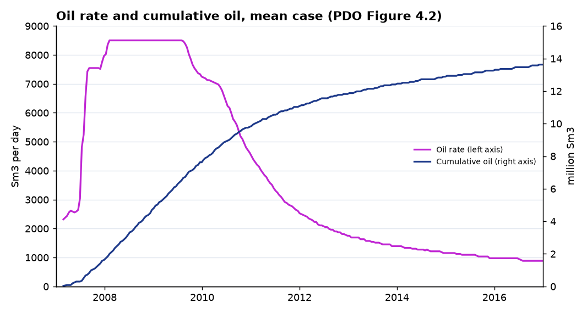
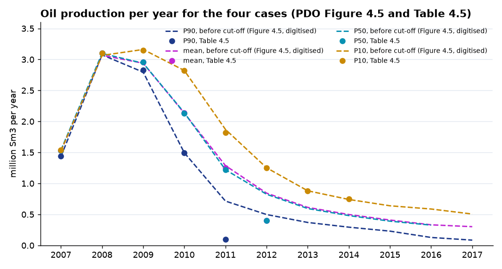
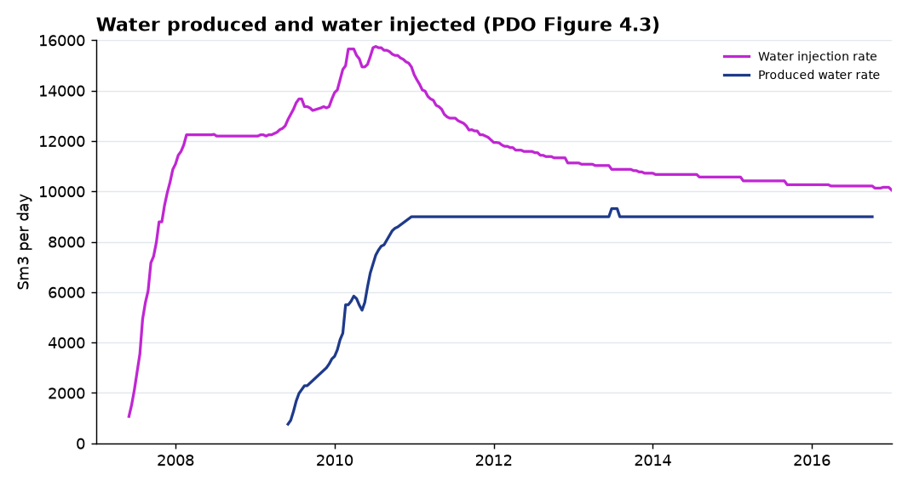
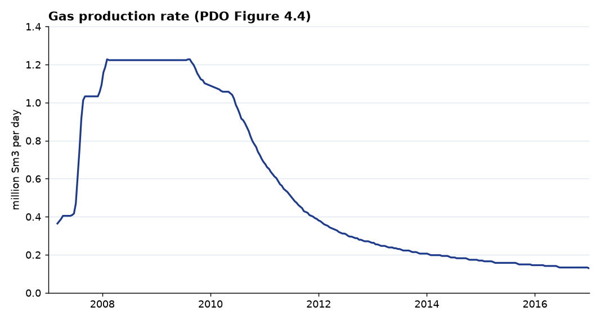
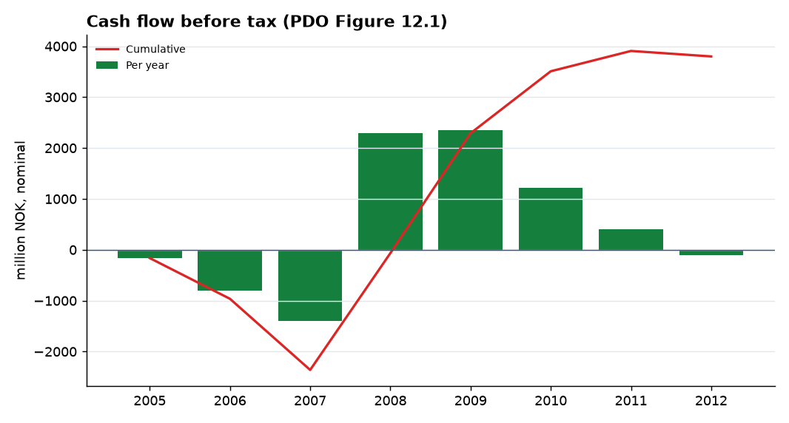

# Analysis of the Volve plan for development and operation (PDO)

Source: `Volve_PUD_cmt.pdf`, "Plan for utbygging og drift av Volve", Statoil,
February 2005, 53 pages, Norwegian. English conversion:
`data/volve/reports/md/Volve_PUD_cmt.md`. Page numbers below are PDF pages.
Numbers quoted here are in the fact register, `data/facts/pud2005.csv`.

The document uses the Norwegian percentile convention: **P90 is the low
case**, P10 the high case.

This analysis reports what the PDO says. Where the PDO is silent, that is
stated; nothing is inferred.

## 1. Concept selection

### The chosen solution

A leased jack-up drilling rig used as a production platform, with a leased
storage vessel (p8, p34–38):

| Element | Solution |
|---|---|
| Platform | Jack-up rig Mærsk Inspirer, completed in Korea in 2004 as a drilling rig; fitted with a process plant and a wellhead area for up to 13 wells; leased from and operated by Maersk Contractors |
| Wells | Drilled from the platform, Christmas trees on the platform; drilling and well intervention possible while producing |
| Oil export | 8" flexible pipe, 2.5 km, to the storage vessel Navion Saga (1 million barrels, moored to a submerged turret loading buoy), then shuttle tankers; vessel leased from Navion Offshore Loading (Teekay) |
| Gas export | Rich gas in a 7.4" flexible pipeline, 5.5 km, to Sleipner A via the Sleipner D subsea template |
| Water | Water produced from the Utsira formation and reinjected produced water; no seawater injection |
| Capacity | Oil 9 000 Sm3/d, total liquid 13 000 Sm3/d, gas 1.5 million Sm3/d, water injection 16 000 Sm3/d (Table 7.1) |
| Contract | Three-year lease, six months' notice, minimum 36 months on the field (p47, p48) |

### Alternatives considered

The PDO lists the alternatives in section 7.2 (p34):

| Group | Alternative |
|---|---|
| Leased facilities | Production and storage vessel (FPSO) with subsea wells |
| | FPSO with wellhead platform |
| | **Jack-up platform with process module and storage vessel — chosen** |
| Owned facilities | Fixed steel-jacket platform at Volve |
| | Fixed steel-jacket platform with tie-in of subsea wells on Volve |
| | Fixed steel-jacket platform connected to Sleipner A, with wellhead platform on Volve |
| | Modification of Sleipner A with subsea wells on Volve |
| | Subsea development tied in to Sleipner A |
| Gas export | **To Sleipner A via Loke or the Sleipner D template — chosen (via Sleipner D)** |
| | To Sleipner T via Alpha Nord |
| | CO2 reduction plant for the Volve gas and export via Loke |
| | Deferred gas export by simultaneous water and gas injection (SWAG) |
| Oil export | To Sleipner |
| | **By shuttle tankers — chosen** |
| | Via the Forties pipeline system in the British sector |

Tenders were obtained from the market for the two most profitable
alternatives: a leased production vessel with subsea wells, and the jack-up
platform with a process module (p34).

### Reasons the PDO gives for the choice

| Reason stated | Where |
|---|---|
| It gives the best profitability for the field | p34, 7.1 |
| It gives positive economics at low reserves (P90) | p10, 1.12 |
| The risk of cost overruns is reduced considerably, because large parts of the concept are already built | p10, 1.12 |
| Drilling and intervention are possible throughout production; access to own drilling equipment is called a key element of increased recovery | p26, 4.8; p35, 7.4.2 |
| It establishes oil processing in the Volve area and allows cost-effective exploration of nearby prospects; the platform is prepared for more wells | p10, 1.13; p52, 13.1 |
| No concept has been documented that can economically use existing infrastructure, except gas export to Sleipner A | p10, 1.13 |
| Lease costs do not start until production starts, so cash flow turns positive early | p50, 12.2.4 |
| The lease can be terminated at six months' notice after 36 months | p47, 11.1 |

### Drawbacks the PDO states for the chosen solution

| Drawback stated | Where |
|---|---|
| Risk of delayed start-up from weather during tow-out in winter | p8, 1.6; p23, 4.5 |
| The project is not robust at low prices: negative net present value at 15 USD per barrel Brent | p9, 1.12; p51, Table 12.9 |

### What the PDO does not give

- **No pros and cons for the alternatives that were not chosen.** The PDO only
  says they were evaluated and that the chosen one is the most profitable.
- **No numbers for the alternatives:** no cost, production or value estimate
  for any rejected concept.
- It refers to two documents for this: "Volve Field Development Concept
  Screening Report" (20.11.2003) and "Volve concept selection report"
  (04.11.2004). Neither is in the dataset.

## 2. Production strategy and forecasts

### The strategy in plain terms

Put three producers near the top of the tilted reservoir and three water
injectors down on its flanks (p22, 4.4). The water does two jobs:

1. **It keeps the pressure up.** The pressure is to stay above the oil's
   bubble point for the whole field life, so that gas stays dissolved in the
   oil in the reservoir and the wells keep flowing by themselves.
2. **It pushes the oil towards the producers.** The reservoir dips 10° to
   20°; with gravity, the injected water spreads along the flanks and sweeps
   the oil upwards.

Further points of the strategy:

- **Two segments, each with its own wells.** Fluid samples and tests indicate
  a northern and a southern part that do not communicate (p21, 4.1).
- **Start with one producer, drill the rest while producing.** Early
  production data then guide where the remaining wells go (p22, 4.5).
- **A near-horizontal well in the west.** Faults there may be larger than
  assumed and cut the reservoir up; a well drilled across them is expected to
  help (p22, 4.4).
- **Gas lift as insurance.** It is meant for restarting wells after
  shut-downs, and secures production if communication is poorer than assumed
  (p23, 4.5; p27, 5.2).
- **Injection water from the Utsira formation, not the sea.** Seawater mixed
  with the formation water would deposit barium and strontium sulphate in the
  reservoir, wells and process plant (p28, 5.3.1, 5.4).
- **Produce to an economic limit.** Production stops when the oil rate falls
  to 2 100 Sm3/d, the rate at which income no longer covers cost at a Volve
  oil price of 18.7 USD per barrel (p23, 4.5.1).

Gas injection methods (WAG, SWAG) were evaluated and rejected: little extra
oil for considerably higher investment on the platform (p26, 4.8).

### Assumptions behind the forecasts

*Field and well constraints (PDO Tables 4.3 and 4.4, p23)*

| Constraint | Value |
|---|---|
| Assumed production start | March 2007 |
| Liquid capacity | 13 000 Sm3/d |
| Oil capacity | 9 000 Sm3/d |
| Gas capacity | 1.5 million Sm3/d |
| Water injection capacity | 16 000 Sm3/d |
| Maximum water cut | 0.80 |
| Maximum gas lift rate, field | 0.45 million Sm3/d |
| Oil rate per well | 2 500–4 500 Sm3/d |
| Minimum oil rate per well | 100 Sm3/d |
| Minimum wellhead pressure | 40 bar |
| Maximum gas lift rate per well | 0.15 million Sm3/d |
| Regularity | 94 % |

### Oil

After about a year of build-up the field is to produce at a plateau of
9 000 Sm3/d for about 19 months, then decline as water production rises.
Cumulative oil to the economic limit is 11.4 million Sm3; expected recovery is
about 43 % (p23, 4.5.1; p26, 4.8).

*Redrawn from PDO Figure 4.2 (digitised). The plateau in the figure is at
about 8 500 Sm3/d, which is 9 000 Sm3/d at 94 % regularity.*

*Reserves, oil in place and oil production per year (PDO Table 4.5, p25),
million Sm3*

| | Mean | P90 | P50 | P10 |
|---|---|---|---|---|
| Reserves | 11.40 | 9.0 | 11.35 | 15.31 |
| Oil in place | 27.50 | 20.9 | 26.70 | 35.2 |
| 2007, from March | 1.53 | 1.44 | 1.53 | 1.54 |
| 2008 | 3.10 | 3.10 | 3.10 | 3.10 |
| 2009 | 2.96 | 2.83 | 2.96 | 3.15 |
| 2010 | 2.14 | 1.49 | 2.13 | 2.82 |
| 2011 | 1.25 | 0.10 | 1.22 | 1.82 |
| 2012 | 0.40 | – | 0.40 | 1.25 |
| 2013 | – | – | – | 0.88 |
| 2014 | – | – | – | 0.75 |
| Total | 11.40 | 9.00 | 11.35 | 15.31 |

The table stops each case at the economic limit. Figure 4.5 of the PDO shows
the same cases without that cut-off, to 2017:

*Redrawn from PDO Figure 4.5 (lines, digitised) with the values of Table 4.5
(dots). Where a dot lies below its line, the table has cut the year short at
the economic limit.*

*Oil production per year before the economic cut-off (digitised from PDO
Figure 4.5; about ±0.02), million Sm3*

| Year | P90 | Mean | P50 | P10 |
|---|---|---|---|---|
| 2007 | 1.43 | 1.52 | 1.54 | 1.52 |
| 2008 | 3.07 | 3.07 | 3.10 | 3.07 |
| 2009 | 2.80 | 2.94 | 2.94 | 3.16 |
| 2010 | 1.49 | 2.13 | 2.14 | 2.82 |
| 2011 | 0.72 | 1.29 | 1.22 | 1.87 |
| 2012 | 0.50 | 0.84 | 0.83 | 1.25 |
| 2013 | 0.37 | 0.61 | 0.60 | 0.88 |
| 2014 | 0.29 | 0.50 | 0.48 | 0.74 |
| 2015 | 0.23 | 0.41 | 0.39 | 0.64 |
| 2016 | 0.13 | 0.33 | 0.33 | 0.59 |
| 2017 | 0.09 | 0.30 | not legible | 0.51 |

### Water

Injected water breaks through in the producers after about two years, when
about 6 million Sm3 of oil has been produced. About 12 000 Sm3/d of Utsira
water is needed for injection at first; the need falls as produced water is
reinjected (p23, 4.5.2).

*Redrawn from PDO Figure 4.3 (digitised; about ±100 Sm3/d). The PDO gives no
table of these rates.*

### Gas

All gas comes out of solution at the surface; no free gas forms in the
reservoir. The highest gas rate is 1.2–1.3 million Sm3/d on plateau, and
cumulative rich gas is 1.5 billion Sm3 (p24, 4.5.3).

*Redrawn from PDO Figure 4.4 (digitised; about ±0.01 million Sm3/d).*

*Expected sales products from the gas (PDO Table 4.6, p26)*

| Year | Dry gas (million Sm3) | NGL (tonnes) | Condensate (tonnes) | Ethane (tonnes) |
|---|---|---|---|---|
| 2007, from 6 March | 170 | 25 570 | 10 228 | 1 705 |
| 2008 | 371 | 55 608 | 22 243 | 3 707 |
| 2009 | 359 | 53 874 | 21 550 | 3 592 |
| 2010 | 272 | 40 844 | 16 338 | 2 723 |
| 2011 | 133 | 19 921 | 7 969 | 1 328 |
| 2012 | 33 | 5 015 | 2 006 | 334 |
| Total | 1 338 | 200 832 | 80 334 | 13 389 |

### Cost and value

*Investments (PDO Table 12.1, p48), million NOK in 2005 money*

| Item | Amount |
|---|---|
| Wells | 937 |
| Mobilisation of platform | 291 |
| Export system including storage vessel | 391 |
| Project management including project reserve | 349 |
| Total | 1 968 |

*Costs per year (PDO Table 12.6, p49), million NOK nominal; 2012 covers five
months*

| | 2005 | 2006 | 2007 | 2008 | 2009 | 2010 | 2011 | 2012 | Total |
|---|---|---|---|---|---|---|---|---|---|
| Wells | 7 | 67 | 828 | 189 | | | | | 1 091 |
| Mobilisation, subsea equipment, project management | 156 | 720 | | | | | | | 876 |
| Unforeseen costs | | 76 | | | | | | | 76 |
| **Total investments** | 163 | 863 | 828 | 189 | | | | | 2 043 |
| Lease of platform and storage vessel: capital element and process tariff | | | 508 | 734 | 717 | 513 | 384 | 142 | 2 998 |
| Lease of platform and storage vessel: operation and maintenance | | | 157 | 250 | 261 | 268 | 275 | 116 | 1 327 |
| Operator's operating costs, onshore support | 5 | 32 | 170 | 165 | 167 | 168 | 173 | 74 | 954 |
| Decommissioning | | | | | | | | 61 | 61 |
| Plugging of wells | | | | | | | | 110 | 110 |
| **Total operating costs** | 5 | 32 | 835 | 1 149 | 1 145 | 949 | 832 | 503 | 5 450 |
| **Total costs** | 168 | 895 | 1 663 | 1 338 | 1 145 | 949 | 832 | 503 | 7 493 |

Investments are 27 % of the total cost; the leases are 58 %.

*Redrawn from the labels printed in PDO Figure 12.1. The 2008 label is blurred
and reads 2 295 or 2 296.*

*Economic assumptions and results (PDO Tables 12.7–12.9, p50–51)*

| Item | Value |
|---|---|
| Expected oil price, Brent | 22 USD per barrel (18.70 for Volve oil) |
| Low and "forward" price paths, Brent | 15 and 35 USD per barrel |
| Exchange rate; inflation | 6.75 NOK per USD; 2.5 % |
| Economic production period | 63 months, to May 2012 |
| Net present value before tax at 7 % | 2 534 million NOK 2005 |
| Net present value after tax at 8 %; internal rate of return | 443 million NOK 2005; 18.3 % |
| Break-even price, Brent | 17.50 USD per barrel |

## 3. Main uncertainties

### Oil in place

*Result of the uncertainty study (PDO Table 3.4, p19), million Sm3*

| Area | Base | Mean | P90 | P50 | P10 | Coefficient of variation |
|---|---|---|---|---|---|---|
| East | 19.9 | 19.2 | 15.9 | 19.1 | 22.8 | 14 % |
| West | 4.6 | 8.3 | 3.4 | 7.5 | 14.6 | 52 % |
| Volve closure | 24.5 | 27.5 | 20.9 | 26.7 | 35.2 | 20 % |

| Uncertainty | What the PDO says | Where |
|---|---|---|
| **Oil-water contact** | The largest contributor. No well has met a contact; oil is proven down to 3 101 m. The base model uses 3 120 m; six possible contacts from 3 105 to 3 330 m are given probabilities (24, 21, 28, 14, 7, 6 %). A deeper contact is judged more likely than a shallower one, which is why the mean (27.5) is above the base case (24.5) | p13; p19, Table 3.5 |
| **Seismic interpretation** | A significant contributor, "considerable" on the western flank. The West area has a coefficient of variation of 52 %, against 14 % for the East | p13; p19–20 |
| Depth conversion | Affects the field only to a small degree | p13; p20 |
| Petrophysics | Low: ±12 % on the hydrocarbon pore fraction (P90 0.132, mode 0.15, P10 0.168) | p19–20, Table 3.6 |
| Formation volume factor | Minor: 1.27 to 1.5, most likely 1.385 | p20, Table 3.7 |
| Prospects around Volve | Whether they hold oil at all; discovery probabilities 0.20 to 0.56 | p20; p52, Table 13.1 |

Stated mitigation: depth-migrated seismic was being processed, to be used for
optimising the well positions before drilling (p13).

### Production strategy

| Uncertainty | What the PDO says | Where |
|---|---|---|
| **Oil in place and permeability** | The two factors with the largest effect on recovery | p25, 4.6 |
| Communication in the reservoir | Vertical and horizontal communication, segment boundaries and depositional environment are in the uncertainty analysis. Faults in the west may be larger than assumed | p22; p24–25, 4.6 |
| Relative permeability | Varied as a function of wetting preference | p24, 4.6 |
| Resulting range | Reserves P90 9.0, mean 11.40, P10 15.31 million Sm3, from a Monte Carlo simulation of the production profiles | p25, Table 4.5 |
| Scale | The barium content of the formation water is not measured on Volve; Sleipner Vest samples are assumed representative. Judged to stay within the P90–P10 range, so not a separate sensitivity | p27, 5.3.1; p51, 12.3.1 |
| Asphaltenes | Precipitation possible 10–20 bar below initial pressure; inhibitor injection planned | p28, 5.3.4 |

Stated mitigations: wells drilled in sequence so that production data guide
later wells; a reservoir model update on new seismic; gas lift; a drilling
rig on the platform throughout (p22, p23, p26).

### Development plan

| Uncertainty | What the PDO says | Where |
|---|---|---|
| **Oil price** | The project is "sensitive to the oil price": net present value after tax −233 million NOK at 15 USD per barrel, 443 at the expected price, 1 196 at the forward price | p51, Table 12.9 |
| Reservoir outcome | Net present value after tax 203 with the P90 profile, 718 with the P10 profile | p51, Table 12.9 |
| Investment cost | ±300 million NOK changes the value after tax by about ±83; two extra wells reduce it by 70 | p51, Table 12.9 |
| Start date | Weather during tow-out may delay production start beyond March 2007 | p8; p23 |
| Field life | Depends on production and price; the lease can be ended at six months' notice after 36 months. Design life is 10 years, expected production three to four years | p34; p47 |
| Gas export | If Sleipner A is shut down, export gas can be injected into Sleipner Øst wells | p37, 7.4.6 |

## 4. Inconsistencies inside the document

| Item | Values | Where |
|---|---|---|
| Net present value before tax at 7 % | 2 350 in the summary; 2 534 in the tables | p9; p50–51 |
| Net present value after tax, forward price | 1 190 in the summary; 1 196 in the tables | p9; p50–51 |
| Total investments | 1 968 (2005 money); 2 043 (nominal). Different bases, both stated | p48; p49 |
| Plugging of wells | 93 in the text; 92 in Table 12.5; 110 in Table 12.6 (nominal) | p47; p49 |
| Oil per year against totals | The yearly values of Table 4.5 sum to 11.38 (mean), 8.96 (P90) and 11.34 (P50); the totals given are 11.40, 9.00 and 11.35. P10 agrees (15.31) | p25 |
| Plateau oil rate | 9 000 Sm3/d in the text; about 8 500 in Figure 4.2 (9 000 at 94 % regularity) | p23 |
| Expected recovery | "Around 43 %" in the text; 11.40 / 27.50 = 41 % from Table 4.5 | p26; p25 |
| Expected production period | "Three to four years" (7.3.1); "approx. 5 years" (11.1); 63 months (12.2.1) | p34; p47; p50 |
| Figure numbering | Two figures numbered 1.2; the first figure of chapter 2 is numbered 2.2; Figure 10.1 has a caption but no picture in the file | p7–8; p11; p45 |

## 5. How this analysis was made

- Text and tables: translated page by page from the PDF's text layer and page
  images; digits compared automatically with the source text on every page.
- Figures 4.2–4.4: curves traced by colour in the embedded pictures. Figure
  4.5: read from its vector shapes. Yearly values of Figure 4.5 agree with Table 4.5
  within about 1 %, except P10 in 2011 (2.8 % high); those of Figure 4.2 within
  1.3 %, except 2010 (5.5 % high). Data:
  `data/volve/reports/md/Volve_PUD_cmt.xlsx`.
- Not done: the supporting volumes the PDO refers to (geology, reservoir,
  production engineering, drilling, concept description) and the impact
  assessment are not in the dataset and were not read.
