# Debiasing probabilistic oil production forecasts

Source: LIB_2022_ENERGY_debiasing_production-forecasts_ENesvold+RBratvold.pdf

- Nesvold, E. & Bratvold, R.B. (2022). Energy 258, 124744. doi:10.1016/j.energy.2022.124744. Open access, CC BY 4.0.
- Equations are written in LaTeX, read from the page images. Table 2 is a picture in the source and was read from it.

<!-- page 1 -->
<!-- type: text -->

# Debiasing probabilistic oil production forecasts

Erik Nesvold*, Reidar B. Bratvold

IER, University of Stavanger, Kristine Bonnevies vei 22, Stavanger, 4021, Norway

## Article info

Article history:
Received 7 February 2022
Received in revised form 1 July 2022
Accepted 2 July 2022
Available online 10 July 2022

Keywords:
Production forecasting
Debiasing methods
Decision analysis
Reference class forecasting
Project valuation

## Abstract

Exploration and production companies in the hydrocarbon industry have every interest in producing unbiased production forecasts at the time of the investment decision, since it is an intrinsic part of making oil field development profitable. However, recent results show presence of significant biases in the uncertainty models which support these decisions. Some important questions which are addressed in this study are i) whether there are simpler and more robust approaches to forecasting than what is the practice in this industry today, ii) whether forecasts can be calibrated for bias, and iii) what the consequences are for valuation of investments in new oil fields. In this study, 71 oil fields on the Norwegian continental shelf with production start between 1995 and 2020 are analyzed. Three robust bias reduction methods are proposed: a pure reference class forecast and two calibration models for the field operators' own forecasts. These show that expected production early in the field lifetime must be shifted down and that the uncertainty range must be expanded. The results are also consistent across field sizes and over time. The findings in this study demonstrate the need to draw on results in behavioral economics to improve uncertainty quantification - reference class forecasting is an inexpensive and powerful way to avoid cognitive biases. An important conclusion is also that the discounted revenue stream from new oil fields is far more uncertain and has a lower expected value than companies lay to ground.

© 2022 The Authors. Published by Elsevier Ltd. This is an open access article under the CC BY license (http://creativecommons.org/licenses/by/4.0/).

## 1. Introduction

Over the past decades, an abundance of empirical results in behavioral sciences have shown that individuals, teams and organizations do not make rational decisions [1]. This is problematic for the energy industry, since overestimating future benefits and underestimating uncertainty leads to misinformed investment decisions and value erosion. Key findings in behavioral economics show that the inside view by no means guarantees better forecasts [2], and that cognitive factors have a bigger impact on bias in forecasts of costs and benefits than the details behind and the mathematics of the forecasting methods [3,4]. With the ongoing global energy transition, the importance of pursuing rational and well-informed investments has not been reduced. Calibration of systematic, persistent bias is therefore of high importance. Experience from other fields also indicates that there are significant differences with respect to bias between industries and project types - for example, ICT projects have more cost upside risk than road construction projects [3]. One can therefore hypothesize that the same types of differences exist between different types of energy projects. Quantifying these biases statistically may help companies and policy makers to better informed decisions.

It is well-documented that oil and gas projects are subject to large cost and time overruns ([5–7]). However, there are few results on benefit shortfalls in individual projects: a study by Nandurdikar and Wallace [8] from 2011 shows low production attainment relative to deterministic production plans, and a recent article by Bratvold et al. [9] on probabilistic production forecasts on the Norwegian Continental Shelf (NCS) confirms the presence of optimism bias and also shows strong evidence of overprecision bias. There are several studies on aggregated (e.g. global) oil production forecasts [10,11], but this is different from forecasts used in decision making about isolated projects. Well-calibrated, field-level production forecasts is therefore the most important goal of this study. There is a long list of known biases which are relevant (e.g. strategic misrepresentation, the base rate fallacy and political bias) [1,12], but we focus on mitigating the visible effects, namely optimism bias and overprecision bias [13]. Fig. 1 illustrates these two forms of bias in the context of probability densities: the expected

Abbreviations: NCS, Norwegian Continental Shelf; NPD, The Norwegian Petroleum Directorate; RCF, Reference class forecasting; PDO, Plan for development and operation; RNB, Revised National Budget; FID, Final investment decision; CRPS, Continuous ranked probability score.

Footnote *: Corresponding author. E-mail address: erik.nesvold@uis.no (E. Nesvold).

https://doi.org/10.1016/j.energy.2022.124744

<!-- page 2 -->
<!-- type: mixed -->

value is too high and the modeled range of possible outcomes is too narrow.

Hydrocarbon reservoir forecasting typically involves development of ensembles of predictive reservoir models which honor a variety of data (e.g. geological expert knowledge, well logs and geophysical survey data) [14]. The geospatial distributions of rock and fluid properties and the multiphase flow response are not known with certainty, so much of the workforce is devoted to different aspects of subsurface uncertainty quantification. Stochastic reservoir modeling was first introduced in the 1980s [15] and many advanced probabilistic modeling techniques have been developed and put into use since then [16]. A second question which we address is therefore whether there are other approaches to forecasting which are both more reliable and less resource-demanding.

The “ground truth” is the production curve (the subsurface flow response), which is known only many years after the forecast is issued. This is a significant difference from other fields, such as weather forecasting [17] and financial forecasting [18], where empirical data is plentiful. Statistical and cognitive debiasing methods have received much attention in different areas of research [19,20] as well as in popular literature [1,21,22] over the past decades. For a small data set, as in this study, advanced bias correction methods are not likely to add much value. Occam's razor [23] also tells us to buy the simplest model if it is compatible with the set of observations.

The opposite alternative to the complexity and the details of the inside view is to take the outside view, simply by looking at how analogue projects have performed in the past [24]. Although such reference class forecasting (RCF) may be perceived as a blunt hammer, Kahneman [1] refers to RCF as “the single most important piece of advice to increase accuracy in forecasting.” In this study, we propose two alternatives: i) a reference forecast based only on production data from abandoned fields; and ii) calibration of the operators' forecasts with two simple, multiplicative models. The former is a free-of-charge, zero-skill forecast which serves as a useful base rate. The latter strikes a balance between the inside and the outside view, and thus uses some of the skills of the organization.

This work is a continuation of the study by Bratvold et al. [9], but includes more data. The data set has been made available by the Norwegian Petroleum Directorate (NPD) under a confidentiality agreement and is described in Section 2. Section 3 concerns the metrics and methods used to assess forecast quality and to calibrate the forecasts. Results, conclusions and a discussion about the consequences for the hydrocarbon industry follow in Sections 4, 5 and 6, respectively.

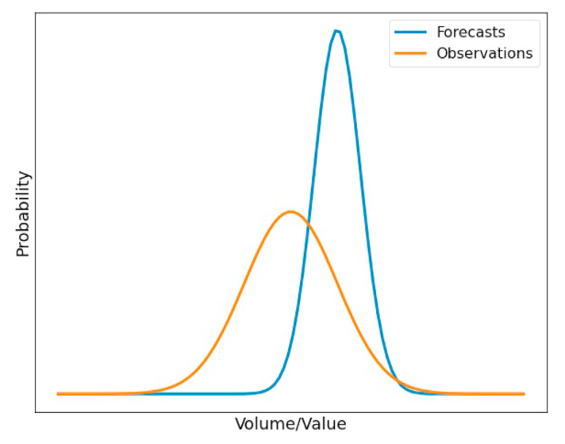

Figure content: line chart with two bell-shaped curves; x-axis Volume/Value (no scale), y-axis Probability (no scale); legend entries Forecasts (blue curve) and Observations (orange curve).

## 2. NCS data

A total of 125 oil and gas fields, all offshore, have been approved for production on the NCS between 1972 and 2021 [25]. However, much more than 125 investment decisions have been made on the NCS: a decision to develop a deposit which is close to existing facilities and which is within an existing license area can allow for an exemption to submit a detailed plan for development and operation (PDO) to the authorities. Additionally, a field which is already in production is subject to continuous re-investment. Thus, satellite developments and investment decisions in mature fields are not included in this data set. As of early 2022, 94 fields were in production and 6 fields had been approved [25]. Included in our data are also two fields which have previously been abandoned and where new PDOs have been submitted (Yme and Tor). A rush of new projects and old fields being redeveloped is expected on the NCS in the near future, due to a new and favorable tax regime introduced in Norway in 2020.

Operators must submit forecasts to the authorities for the annual revised national budget (RNB) from the time of the investment decision until field abandonment. Neither the PDO nor the field-level RNB forecasts are publicly available, but the RNB forecasts have been made available by the NPD under conditions of field and operator anonymity. Since this study has been sponsored by Equinor, the largest operator on the NCS, it has also been possible to compare many of the internal PDO forecasts with RNB forecasts. In almost all cases, there was perfect agreement between the two, so an underlying assumption of the study is that the field level RNB forecast which is closest in time to each project sanction date is the same as the PDO forecast. However, it has not been possible to include all new fields since 1995 in the analysis. The requirements are described in the next section.

### 2.1. Requirements for inclusion in study

Since the mid-1990s, forecasts submitted to the authorities have been required to include a “low”, mean and “high” prognosis for oil and gas production. In this study, only the oil forecasts are considered, since this hydrocarbon fraction is usually more valuable than gas and is produced first. Furthermore, only forecasts and production from the second year onwards are compared, since forecasted production start in the data set is reported by calendar year and not by month: in general, the actual production start month does not coincide with forecasted production start month. Thus, it is not always meaningful to compare production year 1 (PY1) with forecasted production year 1 (FY1) - if forecasted production start is in January and production starts in November, production attainment becomes artificially low. However, after two calendar years of production, this discrepancy is less important. Fields were included in this study subject to the following requirements:

- Year one of the field's production history is between 1995 and 2020, since the first forecasts in the data set are from 1995 (i.e. PY2 in 1996 or later).
- A triplet of production forecasts with either cumulative production rates, annual production rates, or both. The time series represent the 10th percentile ($F_{10}$), the expected value ($F_m$) and

<!-- page 3 -->
<!-- type: mixed -->

the 90th percentile ($F_{90}$) of the forecast density for each production year.

- For a few cases where cumulative forecasts were not available, these were computed based on the annual rates. See Section Appendix A.1 in the appendix for further details.
- Valid forecasts. By “valid”, we mean $0 \le F_{10} < F_m < F_{90}$. In theory, the expected value may cross $F_{10}$ or $F_{90}$, but this would imply very fat tailed distributions and is not deemed realistic.
- Minimum two calendar years of oil production or field abandonment without any successful production (two cases, where we set zero oil production for the first five years).

Table 1 shows the size of the data set as a function of the number of years of production. In the study by Bratvold et al. [9] in 2020, only 32 fields were included in PY4. Here, an effort was made to include forecasts which were previously discarded due to misprints and errors, and more recent data from the last two years are also included, so there are now twice as much data.

The central forecast that has been reported to the authorities has always been meant to be the expectation, and the low and high profiles are suggested to represent 10% and 90% probability, respectively, that the recovered volume falls short of a certain value [26]. At the end of 2020, 24 exploration and production companies were listed as operators and another 13 as partners on the NCS - and there are necessarily differences between organizations in how the guidelines are interpreted. A stochastic approach to reservoir modeling with ensembles of 3D models of the subsurface was introduced in the early 1980s [15], but some operators have probably also worked with less advanced workflows in the 1990s.

### 2.2. Production forecasts are still optimistic and overconfident

This study includes more data than the work of Bratvold et al. [9], so it is of interest to compare some of the results. First, we consider measuring production attainment either by computing the volume weighted ratio or as the median normalized attainment ratio. Thus, in the former case, large fields are weighted by volume, and in the latter case, all fields have equal importance. The volume weighted ratios of cumulative production $P$ to the forecasts $\{F_{10}, F_m, F_{90}\}$ for $n$ fields after production year $y$ are

$$
\begin{aligned}
r^{vw}_{F_{10},y} &= \frac{\sum_{i=1}^{n} P_{i,y}}{\sum_{i=1}^{n} F_{10,i,y}} \\
r^{vw}_{F_{m},y} &= \frac{\sum_{i=1}^{n} P_{i,y}}{\sum_{i=1}^{n} F_{m,i,y}} \\
r^{vw}_{F_{90},y} &= \frac{\sum_{i=1}^{n} P_{i,y}}{\sum_{i=1}^{n} F_{90,i,y}}
\end{aligned}
\tag{1}
$$

whereas the median normalized ratios are

$$
\begin{aligned}
r^{norm}_{F_{10},y} &= \mathrm{Med}\left(\left\{\frac{P_{1,y}}{F_{10,1,y}}, .., \frac{P_{n,y}}{F_{10,n,y}}\right\}\right) \\
r^{norm}_{F_{m},y} &= \mathrm{Med}\left(\left\{\frac{P_{1,y}}{F_{m,1,y}}, .., \frac{P_{n,y}}{F_{m,n,y}}\right\}\right) \\
r^{norm}_{F_{90},y} &= \mathrm{Med}\left(\left\{\frac{P_{1,y}}{F_{90,1,y}}, .., \frac{P_{n,y}}{F_{90,n,y}}\right\}\right)
\end{aligned}
\tag{2}
$$

Fig. 2 shows the volume weighted ratios and the normalized ratios against time. Clearly, volume weighting does not seem to matter much - the degree of optimism bias is about the same, and it cancels out around PY10. But after 10 years of production, fields with disappointing results have been abandoned and large additional investments have been made in well-performing fields. If we consider only the first five years, the shortfall is around 20%. The distribution after PY4 is shown in Fig. 3: almost 70% of the fields have delivered less oil than expected. Practically all of these projects can be considered as megaprojects (defined as capital expenditure on the order of 1 billion USD or more, multiple private and public stakeholders being involved and a project over many years [3]), so the analysis is restricted to the normalized data in the rest of the paper - each investment decision is highly important.

*Table 1. Size of data set by number of years with production history and valid forecasts.*

| Production year | 2 | 3 | 4 | 5 | 6 | 7 | 8 | 9 | 10 |
|---|---|---|---|---|---|---|---|---|---|
| Number of fields | 71 | 69 | 66 | 64 | 55 | 50 | 44 | 42 | 37 |

To adjust for optimism bias, each forecast triplet is shifted down by a term $\delta_{i,y}$ which uses the average normalized attainment ratio $r^{norm}_{F_{m},y}$ in Eq. (2):

$$
\delta_{i,y} = F_{m,i,y}\left(1 - r^{norm}_{F_{m},y}\right)
\tag{3}
$$

Fig. 4 shows performance statistics for PY2-PY10, with and without such adjustment:

- Optimism bias, as measured by the deviation of the average attainment factor from 1.0, is significant in the first years of production. These numbers are in agreement with the study by Nandurdikar and Wallace [8] from 2011, who found an attainment ratio of about 80% after PY4. Additionally, the fraction of outcomes below $P_{10}$ is almost 60% after PY2 and about 40% after PY4. From the point of view of the operators, these results are slightly better than those of Bratvold et al. [9], but still not very encouraging.
- Overprecision bias, as measured by the surplus of outcomes outside the $F_{10} - F_{90}$ range is seen to persist over time. Strikingly, this fraction is almost exactly the same whether we adjust for optimism bias or not. When the optimism bias is adjusted for, the outcomes above $F_{90}$ increase by the same amount as the decrease in outcomes below $F_{10}$. After PY2, less than 30% of

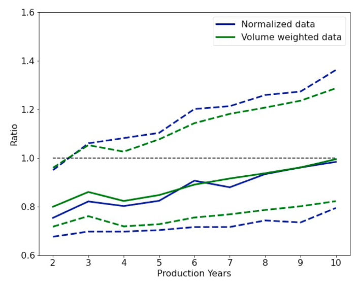

Figure content: line chart; x-axis Production Years, 2–10; y-axis Ratio, 0.6–1.6; legend entries Normalized data (blue) and Volume weighted data (green); for each colour one solid line and two dashed lines (one above and one below the solid line); thin horizontal dashed reference line at ratio 1.0.

<!-- page 4 -->
<!-- type: mixed -->

outcomes are within the $F_{10} - F_{90}$ range, and this share stays more or less constant at around 50% between PY4 and PY10. Additionally, the number of fields with cumulative production below $F_{10}$ never falls below 25% during the first 10 years.

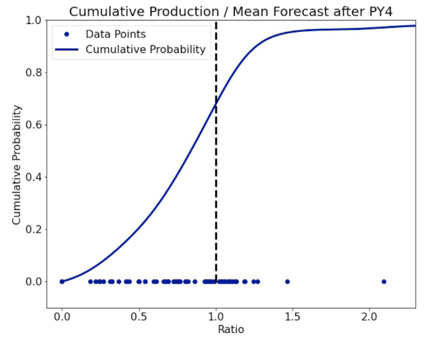

Figure content: chart titled "Cumulative Production / Mean Forecast after PY4"; x-axis Ratio, 0.0–2.0; y-axis Cumulative Probability, 0.0–1.0; legend entries Data Points (blue dots plotted along the horizontal line at cumulative probability 0.0) and Cumulative Probability (blue S-shaped curve); vertical black dashed line at ratio 1.0.

A question of interest is also whether bias has changed over time. Consider the plot of attainment ratio versus FID year in Fig. 5, still after four years of production. Two regression models are shown: ordinary least squares and support vector regression [27]. The latter is less sensitive to outliers than the former. However, both models indicate a worsening trend over the past three decades.

## 3. Metrics and methods

The primary objective in this study is to find calibration models which can be applied to field-level oil production forecasts. It is therefore necessary to define what we mean by a well-calibrated forecast. Benchmarking and evaluation of forecast performance must vary with the type of forecast and outcome data. There are many types of probabilistic forecasts, for example:

- Point forecasts: the outcome is a random binary variable and the forecast is the probability of one or the other occurring (precipitation/no precipitation, increase/decrease etc.).
- Interval forecasts: the outcome is a random continuous variable and the forecast is a lower and an upper bound.
- Percentile forecasts: the outcome is a random continuous variable and the forecast is a set of percentiles.
- Density forecasts: the outcome is a random continuous variable and the forecast is a probability density function [28].

Accuracy metrics for probabilistic forecasts in general are referred to as scoring rules [29]. Proper scoring rules are such that the score is maximized when the forecast density $F$ is the same as the actual density $G$ of the random variable being modeled [30]. There exist many possible scoring rules for probabilistic forecasts [29], and a full review will not be given here. Each forecast consists of two percentiles and the expected value per production year, so it is possible to frame it as an interval forecast. But companies usually spend most resources on developing a “base” or “expected” case. Density forecasts are often used when skewness and tails are of high importance, such as in finance, economics and weather forecasting [31,32]. Considering the financial stakes involved in development of oil and gas fields, it seems like density forecasts would also be useful. Workflows in production forecasting often, but not always, involve development of ensembles of possible 3D models of

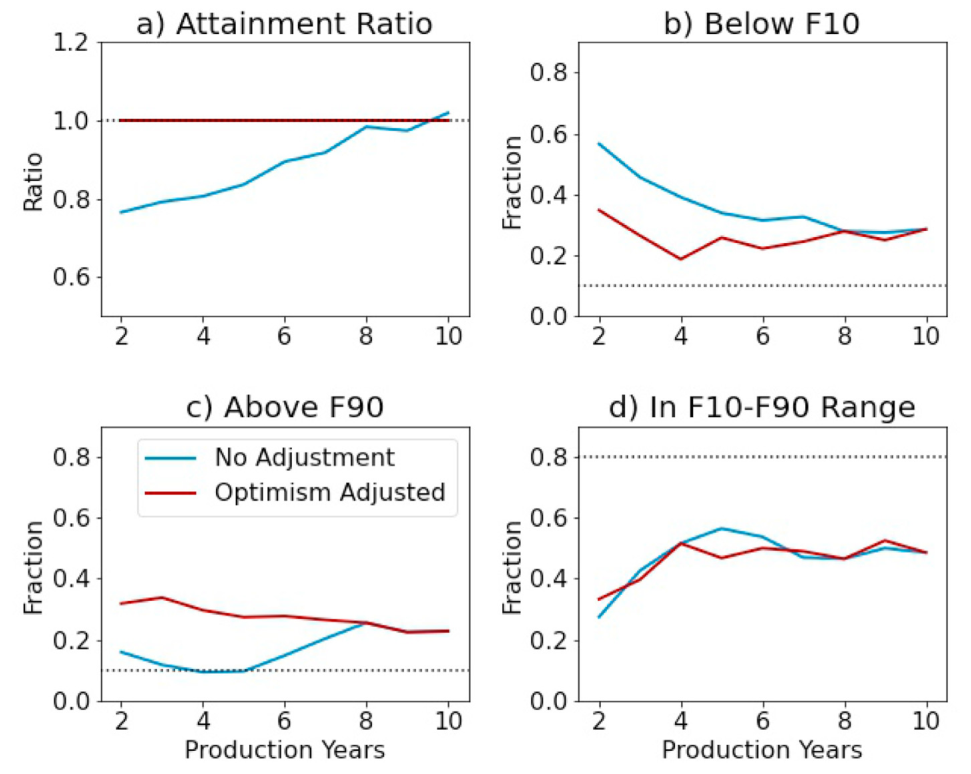

Figure content: four line-chart panels in a 2 × 2 grid, titled "a) Attainment Ratio" (y-axis Ratio, 0.6–1.2), "b) Below F10" (y-axis Fraction, 0.0–0.8), "c) Above F90" (y-axis Fraction, 0.0–0.8) and "d) In F10-F90 Range" (y-axis Fraction, 0.0–0.8); x-axis in every panel 2–10, labelled Production Years under the lower two panels; legend (in panel c) entries No Adjustment (blue line) and Optimism Adjusted (red line); each panel has a horizontal grey dotted reference line.

<!-- page 5 -->
<!-- type: mixed -->

the subsurface (100 or more) and subsequent simulation of fluid flow. In the view of these authors, it is therefore reasonable to assess forecast quality with density forecast metrics. Since the output of the flow simulations is not available to us, we fit a probability density to the three statistics which are reported. The metalog distribution [33] is used for this purpose (details in Appendix A.3). In the analysis of forecast performance, we focus on two types of bias, as described in Section 2.1:

- Optimism bias: the ratio of actual production to the mean forecast should be close to one, on average. If this is not the case, the forecaster is either systematically optimistic or pessimistic in her predictions.
- Overprecision bias: The outcome range should match the forecast percentiles. If a much higher percentage of outcomes than 20% fall outside the $F_{10}$-$F_{90}$ interval, the forecaster is overprecise [13]. To distinguish between optimism and overprecision biases, we show results both with and without adjusting for the former.

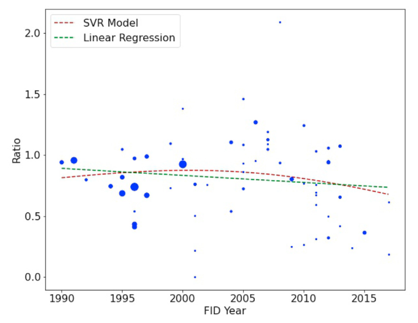

Figure content: scatter plot; x-axis FID Year, 1990–2015; y-axis Ratio, 0.0–2.0; blue circular markers of varying size; two dashed curves with legend entries SVR Model (red) and Linear Regression (green).

If the above requirements are satisfied, it is also a goal to maximize the sharpness [29] (or what is referred to as the refinement by Winkler and Murphy [30]) of the forecast density. The continuous ranked probability score (CRPS) [32] is a strictly proper scoring rule which assigns weight to both calibration and sharpness. We use several metrics for performance assessment, since they convey somewhat different information.

### 3.1. Percentile statistics

The percentile forecasts allow for some straightforward sanity checks: does the observed frequency distribution match up with the forecast? Do approximately 10% of the outcomes fall below $F_{10}$ and 10% above $F_{90}$? Fig. 4 shows these statistics, in addition to the mean attainment factor, for the uncalibrated data. These are simple but important tests of forecast quality.

### 3.2. Skill score

In atmospheric science, the so-called skill score [30,31] is used to measure forecast quality $S^{f}$ relative to a reference forecast $S^{ref}$ and a hypothetical, optimal forecast $S^{opt}$ [29]:

$$
SS = \frac{S^{ref} - S^{f}}{S^{ref} - S^{opt}}.
\tag{4}
$$

For this study, we use we use a modified version of the CRPS as the forecast score $S$, described in Appendix A.2. Scale independence is needed because the absolute numbers vary considerably with field size. The optimal $S$ is zero (higher scores are worse), so based on Equation (4), we can deduce that the best possible skill score is 1. A “zero skill” forecast results in a skill score of 0, and forecasts which are worse than the reference forecasts yield negative skill scores. The optimal forecast in Equation (4) is simply set to zero. What is a reasonable reference forecast for future oil production? For a temperature forecast, the reference could be the climatic mean with a standard confidence interval. But oil production forecasts differ with respect to weather forecasts and forecasts of stock prices. The latter areas often have tens of thousands of empirical data points available [17], whereas there is only one cumulative production curve for an oil field.

### 3.3. Reference forecast

To establish the reference forecast, we use the production history from fields on the NCS which have been abandoned, which have produced more than 0.5 million Sm3 of oil and where the entire production curve is known. Each curve is normalized to a time interval of [0, 1] and scaled so that the area under the curve integrates to one (Fig. 6). There are 19 such fields, so we get 19 empirical production profiles $\{f_1, f_2, \ldots, f_{19}\}$. Linear regression is used to estimate the expected number of production years until abandonment as a function of total produced volume. The expected ultimate recovered volume at the time of the FID is used as a predictor variable. Subsequently, a reference forecast for a particular field is found by:

1. Computing weights $w_1$, $w_2$, …, $w_{19}$ based on a Gaussian distribution, such that the weights sum to one. The fields which are closest in rank order by field size are given more weight. The underlying assumption is that time to plateau production and tail production varies with the size of the field.
2. Scaling production time to match the expected number of production years from the linear regression model.

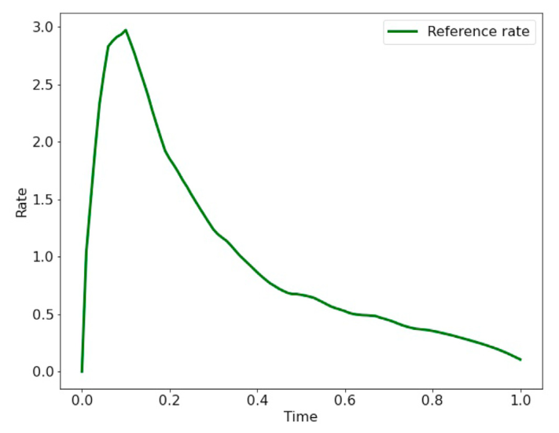

Figure content: line chart; x-axis Time, 0.0–1.0; y-axis Rate, 0.0–3.0; one green curve with legend entry Reference rate.

<!-- page 6 -->
<!-- type: mixed -->

3. Scaling the cumulative reference rate to match the expected recovered volume $V_f$: $f_{ref} = V_f \sum_{i=1}^{n} w_i f_i$

Thus, the shape of the reference forecast is a function of the total expected volume to be produced from a field, but requires no input or expertise other than using empirical data. An example normalized production profile $\sum_{i=1}^{n} w_i f_i$ is shown in 6. To compute the reference $F_{10}$ and $F_{90}$ profiles, constant factors of 0.4 and 1.6, respectively, are used for the cumulative reference forecast. An example of a reference forecast triplet is shown in Section 4.1.

### 3.4. Calibration models

The results of Bratvold et al. [9] and the additional data presented above provide a convincing argument for attributing more weight to the external view through RCF. In a survey paper, Zellner et al. [34] discuss human generated forecasts, data-driven forecasts and combination methods of these two. They find that neither approach is always better than the other - it depends, among other things, on the quality and the representativeness of the data. Because of the heterogeneous nature of oil fields, it seems like a good idea to strike a balance between the inside view and the outside view for production forecasts. A possible approach is to adjust operator forecasts based on empirical data from other fields' performance. Two such calibration models are proposed below.

#### 3.4.1. Calibration using only the mean forecast

Because of the time, resources and expert knowledge needed to develop ensembles of possible subsurface models, most resources are usually spent on developing a “base case” [35]. Sometimes, the low and high value scenarios only have slightly different geological facies and petrophysical properties. One possible hypothesis is therefore that most of the statistical information is in the expected production curve, $F_m$, and that the $F_{10}$ and $F_{90}$ forecasts do not add significant value. The simplest possible calibration model may therefore be to find three factors $\{a_m, b_m, c_m\}$ for the mean, such that the debiased RCF triplet $\{F^*_{10}, F^*_m, F^*_{90}\}$ becomes:

$$
\begin{aligned}
F^*_{10} &= a_M F_m \\
F^*_{m} &= b_M F_m \\
F^*_{90} &= c_M F_m
\end{aligned}
\tag{5}
$$

#### 3.4.2. Calibration of the forecast triplet

There should be more information in the forecast triplet $\{F_{10}, F_m, F_{90}\}$ than in only the statistical mean. Oil companies have the expertise to include a wide array of geological scenarios to compute realistic uncertainty estimates of the reservoir flow response. A possible calibration model which uses the forecast triplet is:

$$
\begin{aligned}
F^*_{10} &= a_T F_{10} \\
F^*_{m} &= b_T F_m \\
F^*_{90} &= c_T F_{90},
\end{aligned}
\tag{6}
$$

where again $\{F^*_{10}, F^*_m, F^*_{90}\}$ is the debiased forecast and the three calibration factors are $\{a_T, b_T, c_T\}$.

#### 3.4.3. Optimization of calibration factors

An objective function is needed to compute the factors in Equations (5) and (6). The simplest objective function may be to calibrate the forecasts so that the triplet statistics match what they are supposed to represent, namely the expected value and two percentiles:

1. Compute the normalized attainment ratios for production year $y$ and estimate the adjustment factor $b_{T,y} = b_{M,y}$ so that the expectation of the calibrated ratios is 1.
2. Round 0.1 of the sample size in year $y$ to the nearest integer, e.g. to 5, and compute $a_{M,y}$, $a_{T,y}$, $c_{M,y}$ and $c_{T,y}$ so that the number of outcomes below $F_{10}$ and above $F_{90}$ match this number.

These steps are repeated independently for each year of production history. The results shown in Section 4 are the tenfold cross-validation test results. Confidence intervals for the parameters are obtained by bootstrap sampling.

## 4. Results

Shortfalls in production have a big impact on project valuation. In an investment case, one usually makes some assumptions about future market prices of hydrocarbons, but it is also possible to compute the discounted volume stream without converting to monetary value. Fig. 7 shows the distributions of discounted volume streams after PY4 relative to the forecasts. For example, if there are two years between the investment decision and forecasted production start, mean forecasted production for FY1-FY4 is {1, 2, 7, 5} and actual production is {0.1, 1.5, 3, 6}, then discounted volume is 10.3 in the former case, 7.06 in the latter case and the ratio is 0.69. Production start is aligned with forecasted production start: delays in production start delays are not included, so the observed shortfalls are mainly due to poor understanding of the subsurface. Median discounted produced volume is below 3/4 of the discounted mean forecast, while $F_{10}$ looks like an unbiased forecast. Although fluctuations in hydrocarbon prices can help mask such production shortfalls, the impact on project valuation is clear. These data span 25 years and several major oil producers, so the results can be assumed to be representative of the general status in the oil industry. The results of applying the reference forecast and the two calibration models follow.

### 4.1. Reference forecast

Fig. 8 shows an example operator forecast for a field in the data

Figure content: box plot titled "Forecasts and Production Aligned"; y-axis Ratio of Discounted Volume to Forecast, 0.00–2.00; three categories on the x-axis, P10 Forecast, Mean Forecast and P90 Forecast, each with a blue box, an orange line inside the box and black whiskers; horizontal black dashed reference line at ratio 1.00.

<!-- page 7 -->
<!-- type: mixed -->

set and the corresponding reference forecast triplet. The reference $F_{10}$ and $F_{90}$ forecasts are simply $F_{ref}$ multiplied by 0.4 and 1.6. Most frequently, the result is a lower mean forecast and a wider $F_{10}$-$F_{90}$ range than in the operator forecast. Performance statistics are shown below, along with the two calibration models.

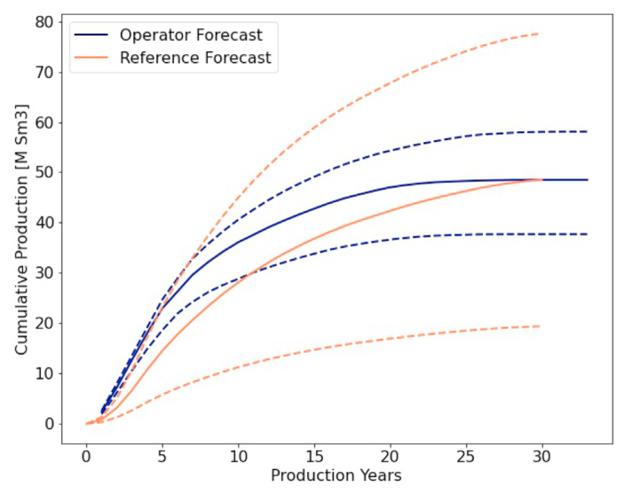

Figure content: line chart; x-axis Production Years, 0–30; y-axis Cumulative Production [M Sm3], 0–80; legend entries Operator Forecast (dark blue) and Reference Forecast (orange); for each colour one solid curve and two dashed curves (one above and one below the solid curve).

### 4.2. Calibrating for optimism and overprecision bias

The first model, in Equation (5), is used to find a calibrated forecast triplet based on the mean forecast only. The calibration factors are random variables, so a confidence interval can be estimated by bootstrap sampling from the data set. Fig. 9 shows the 90% confidence interval for these factors when optimism and overprecision biases are accounted for simultaneously. Expected cumulative production needs to be multiplied by a factor $b_M$ of [0.7–0.9] between production years 2 and 5. In the same period, the factor for $F_{10}$, $a_M$, is around 0.3, and the $F_{90}$ factor, $c_M$, is between 1.1 and 1.3. After 10 production years, the expected production volume is more or less on target, and both $a_M$ and $c_M$ have increased (but for most fields, this is after significant additional investments).

The underlying assumption of the second calibration model, in Equation (6), is that the $F_{10}$ and $F_{90}$ forecasts carry useful information, and that despite being biased, their inclusion would improve performance. These calibration factors are also shown in Fig. 9. Only $a_T$ and $c_T$ differ from $a_M$ and $c_M$; $b_T$ is the same as $b_M$. We see that the operators' $F_{10}$ forecast is more than twice too high in FY5, whereas the $F_{90}$ forecast is on the low side in the first years of production, but is quite unbiased in FY3-FY6. In summary,

- the calibrated expected cumulative production $F^*_m$ needs to be adjusted down relative to $F_m$;
- the calibrated $F^*_{10}$ is lower than $F_{10}$;
- the calibrated $F^*_{90}$ is slightly higher than $F_{90}$.

The data in Fig. 9 are also found in Table B.3. The $a_M$ and $c_M$ factors indicate that the natural distribution of production outcomes is skewed: in FY4, $F^*_m$ is two times closer to $F^*_{90}$ on average than to $F^*_{10}$. This skewness is also observed in the original forecasts, and may be due to the limitations of production equipment, valves and topside installations.

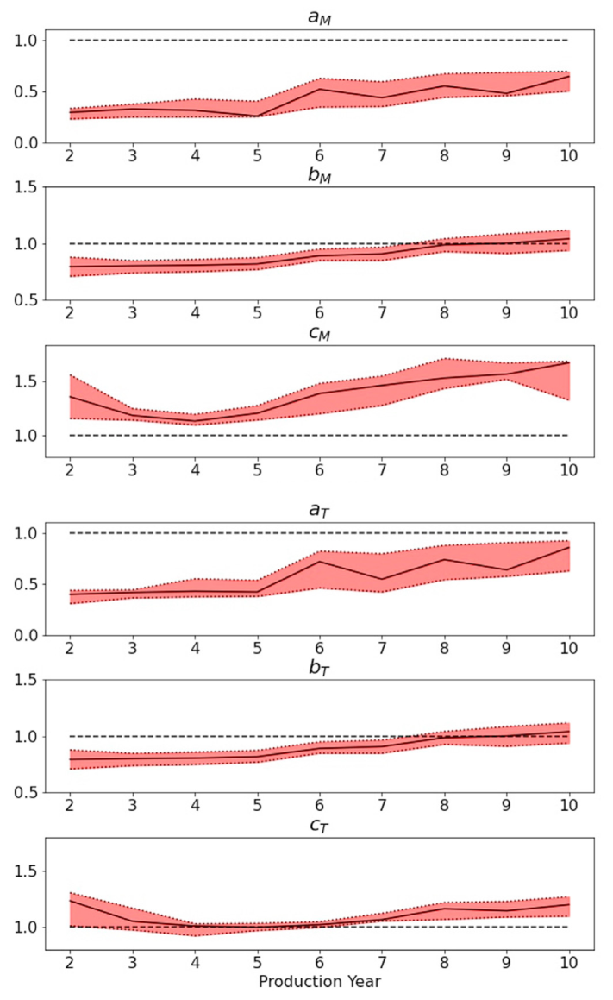

Figure content: six line-chart panels stacked vertically, titled $a_M$, $b_M$, $c_M$, $a_T$, $b_T$ and $c_T$; x-axis in every panel 2–10, labelled Production Year under the lowest panel; y-axes without label (tick ranges 0.0–1.0 for $a_M$ and $a_T$, 0.5–1.5 for $b_M$ and $b_T$, 1.0–1.5 for $c_M$ and $c_T$); each panel shows a solid dark line inside a red shaded band bounded by dotted lines, and a horizontal black dashed reference line at 1.0; no legend.

If we adjust for optimism bias in a first step, as in Section 2.2, the overprecision bias is also seen more explicitly. The forecast triplet is shifted down by the difference $\delta = F_M*(1 - b)$ before computing $a$ and $c$. If there was only presence of optimism bias and no significant overprecision bias, $a_T$ and $c_T$ should be close to 1. However, Fig. 10 shows that $a_T$ and $c_T$ are both shifted up relative to Fig. 9. The original forecast range $F_{90} - F_{10}$ is much too narrow and must be widened significantly.

These results show (at least) two things: optimism bias, as measured by the deviation of $b_M$ and $b_T$ from 1.0, and overprecision bias, as measured by $(c_T - a_T) > 0$ after adjustment for optimism bias, are statistically significant over time.

<!-- page 8 -->
<!-- type: mixed -->

Figure content: six line-chart panels stacked vertically, titled $a_M$, $b_M$, $c_M$, $a_T$, $b_T$, $c_T$; x-axis Production Year, 2 to 10, in every panel; y-axis unlabelled, with ticks 0.0–1.0 ($a_M$, $a_T$), 0.5–1.5 ($b_M$, $b_T$) and 1.0–1.5 ($c_M$, $c_T$); each panel shows a solid line inside a shaded band bounded by dotted lines, and a dashed horizontal line at 1.0; no legend.

### 4.3. The test results have all the hallmarks of well-calibrated forecasts

To assess the performance of a prediction model, it is necessary to test on out-of-sample data. Therefore, all results shown here are based on tenfold cross-validation [27] (10% test data in each fold). The simplest, but very informative, tests of calibration performance are perhaps the attainment ratio and the percentile statistics (Section 3.1). From Fig. 11, it is clear that both forms of bias are reduced significantly relative to the original forecasts in all cases. The reference forecasts perform much better than the operator forecasts with respect to optimism bias: average cumulative production relative to the reference mean is almost equal to 1. This is despite the reference forecast being based on production profiles of fields on the NCS which mostly started producing before 1995. Due to technological improvement over the past decades, one might expect there to be some discrepancies, but that is not the case. For the two calibration models of the operator forecast, optimism bias, as measured by average production attainment, is eliminated in the cross-validation results. The overprecision bias is also completely eliminated both for the reference forecast and for the calibrated forecasts.

While the three statistics are quite informative on their own, fitting a metalog CDF to each forecast allows for more analyses. Fig. 12 shows the outcome percentiles against the sorted plotting probabilities [36]. A well-calibrated forecast should lie approximately on the diagonal line. Here, low percentiles are strongly overrepresented in the operator forecasts, i.e. the data are seen to fall far under the 45-degree line for production years 2–5. There are also disproportionately many outcomes with zero cumulative probability. But again, we observe a slight improvement over time (compare PY5 with PY2), as the sample distribution gets a bit closer to the theoretical distribution. However, both the reference forecast and the calibrated forecasts are seen to be very close to the 45-degree line, a clear sign of unbiasedness. This can also be tested more rigorously: the inverse cumulative probabilities should follow a uniform distribution. Table 2 shows the results of a Kolmogorov-Smirnov test of uniformity. For the uncalibrated forecasts, the null hypothesis can be firmly rejected. For the reference, the mean calibrated and the triplet calibrated forecasts, it cannot.

### 4.4. Splits by year and field size

To challenge the propositions that forecasts have improved over time and that field size has an influence on forecast quality, one can test how calibrated forecasts perform across splits by field features. Instead of random splits into training and test data, we split the data by production start year and field reserves. In Fig. 13, fields with production start in the period 1995–2013 are used as training data (about 70% of the data set) and the resulting model is tested on fields with production start after 2013. Average production attainment is seen to be well below 1 also for the calibrated forecasts, whereas overprecision bias has been reduced significantly. However, the fraction of outcomes below $F^*_{10}$ is overrepresented with respect to both the reference forecast and the calibrated forecasts. The reference forecast is based on fields outside the data set with production start prior to 1995. The results in Fig. 13, like those in Fig. 5, indicate that optimism bias has been even stronger in the last decade than at any time before on the NCS.

In Fig. 14, the split is between “small” fields (70%) and large fields (30%). Here, the reference forecast is slightly too pessimistic, whereas the calibration methods perform very well. Although the larger fields perform about 10% better than expected after production years 2 and 3, this discrepancy is gone at the end of production years 4 and 5. Furthermore, the calibrated $F^*_{10}$ and $F^*_{90}$ show no signs of overprecision bias in the same period.

What do these results tell us? Well scheduling, project organization, improvements in seismic imaging over time and technological advances are factors which should have an impact on forecast quality and time to reach plateau production. But the reference forecast represents empirical production data dating several decades back, and the training data for the calibration models are separate from the test data. The calibration factors indicate that bias has certainly not been reduced over time, but if anything, worsened: calibration models trained on forecasts from the 1990s seem to be too optimistic for present-day investment decisions. Furthermore, small fields seem to be quite representative of optimism and overprecision bias in forecasts for large fields. Hence bias seems to be remarkably consistent across field sizes and persistent over time.

<!-- page 9 -->
<!-- type: mixed -->

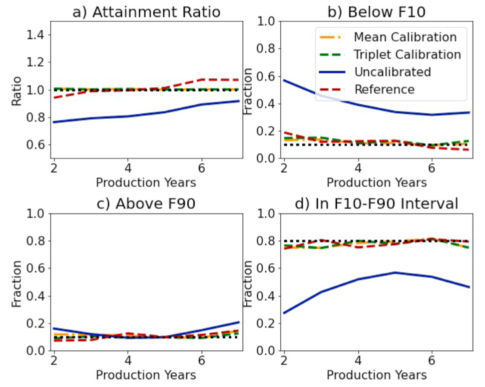

Figure content: four line-chart panels in a 2 × 2 grid, titled "a) Attainment Ratio", "b) Below F10", "c) Above F90" and "d) In F10-F90 Interval"; x-axis Production Years (ticks 2, 4, 6) in every panel; y-axis Ratio (ticks 0.6–1.4) in panel a and Fraction (ticks 0.0–1.0) in panels b, c and d; series, from the legend in panel b: Mean Calibration (orange dash-dotted line), Triplet Calibration (green dashed line), Uncalibrated (blue solid line), Reference (red dashed line); each panel also has a black dotted horizontal line that is not in the legend.

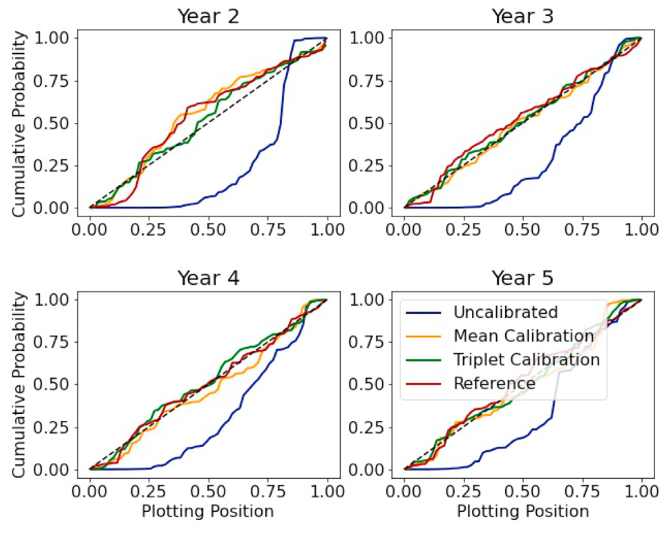

Figure content: four line-chart panels in a 2 × 2 grid, titled "Year 2", "Year 3", "Year 4" and "Year 5"; x-axis Plotting Position (ticks 0.00–1.00); y-axis Cumulative Probability (ticks 0.00–1.00); series, from the legend in the Year 5 panel: Uncalibrated (blue line), Mean Calibration (orange line), Triplet Calibration (green line), Reference (red line); each panel also has a black dashed diagonal line that is not in the legend.

### 4.5. Do the $F_{10}$ and $F_{90}$ forecasts add value?

In the results above, all three RCFs show clearly improved performance relative to the operator forecasts. Since the triplet calibration incorporates more expert knowledge from the original forecast, one should also expect it to perform better. Judging by the results above, it is hard to claim that it does. The skill score in Equation (4) compares performance relative to the reference forecast. The underlying metric penalizes both distance to the outcome and the width of the forecast (see Equation (A.3)). The skill scores

<!-- page 10 -->
<!-- type: mixed -->

*Table 2. Kolmogorov-Smirnov probabilities of uniformity of the inverse cumulative probabilities of the test samples.*

| Forecast Year | 2 | 3 | 4 | 5 |
|---|---|---|---|---|
| Uncalibrated | $2 \cdot 10^{-15}$ | $3 \cdot 10^{-10}$ | $3 \cdot 10^{-7}$ | $1.5 \cdot 10^{-6}$ |
| Reference | 0.25 | 0.99 | 0.78 | 0.10 |
| Mean Calibration | 0.04 | 0.99 | 0.54 | 0.32 |
| Triplet Calibration | 0.49 | 0.92 | 0.77 | 0.87 |

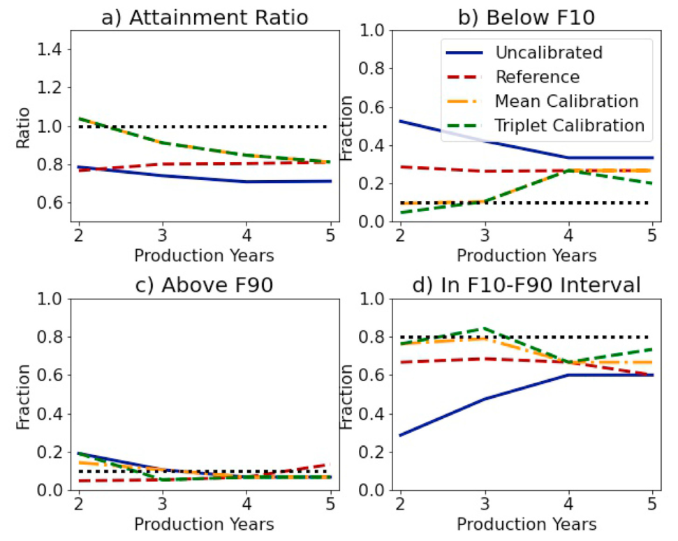

Figure content: four line-chart panels in a 2 × 2 grid, titled "a) Attainment Ratio", "b) Below F10", "c) Above F90" and "d) In F10-F90 Interval"; x-axis Production Years (ticks 2, 3, 4, 5) in every panel; y-axis Ratio (ticks 0.6–1.4) in panel a and Fraction (ticks 0.0–1.0) in panels b, c and d; series, from the legend in panel b: Uncalibrated (blue solid line), Reference (red dashed line), Mean Calibration (orange dash-dotted line), Triplet Calibration (green dashed line); each panel also has a black dotted horizontal line that is not in the legend.

for these forecasts are shown in Fig. 15. The uncalibrated skill score remains negative throughout, i.e. they perform worse than the reference forecasts. However, the overall forecast quality is seen to be especially poor in the first part of the field lifetime. On the other hand, the two calibration methods show almost identical performance, and both are just slightly better than the “no-skill” reference forecast. The sample probability plots in Fig. 12 and the performance statistics in Fig. 11 also show no significant differences. Clearly, using the triplet instead of just the mean as input to these calibration models does not seem to improve forecast quality by much, if anything at all.

## 5. Conclusions

In this study, data from 71 fields on the NCS are used to confirm and solidify the findings of Bratvold et al. [9] that oil production forecasts provided by the operators at the time of the final investment decision are strongly biased. We align production history with the forecasts in time, so the observed biases are mainly a result of poor subsurface uncertainty quantification. Including the production start delays in the analysis, where there is also strong presence of optimism bias, would make the calibration needed even higher than the results of this study indicate.

The results indicate that the least complicated approach, namely reference class forecasts based only on empirical data, by far outperforms the extremely resource-demanding forecasting methods used in industry. Considering the amount of expertise and money which is spent on this purpose, this is a somewhat dispiriting finding. But it should at the very least serve as a useful benchmark for decision makers.

The calibration models proposed in Section 3.4 also show impeccable cross-validated performance relative to the

<!-- page 11 -->
<!-- type: mixed -->

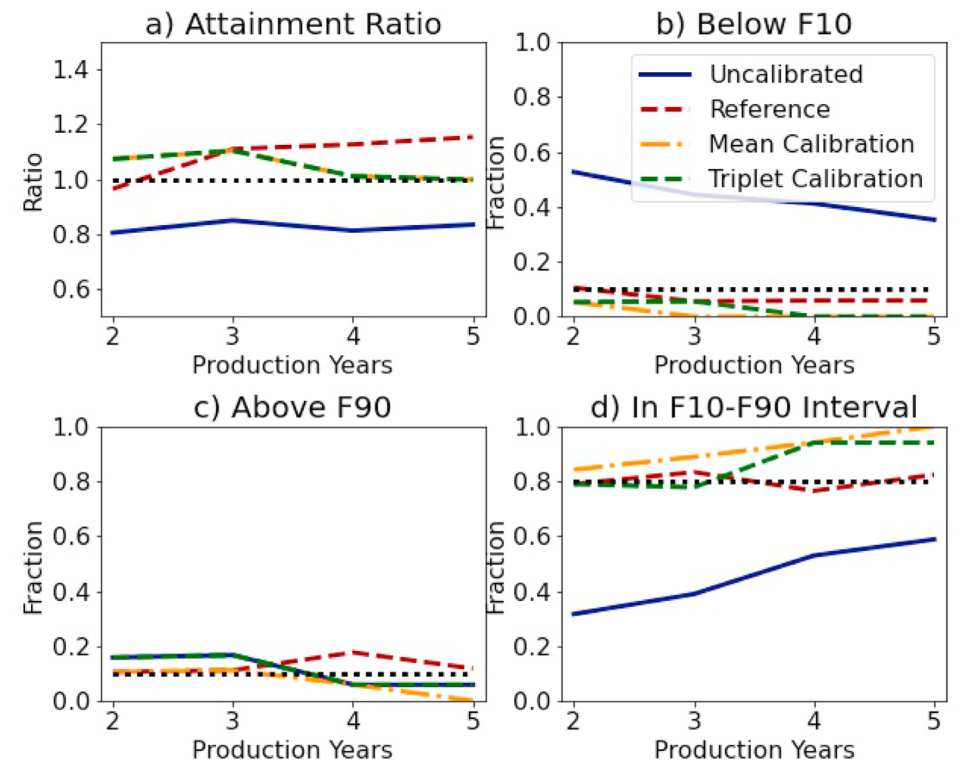

Figure content: four line-chart panels in a 2 × 2 grid, titled "a) Attainment Ratio", "b) Below F10", "c) Above F90" and "d) In F10-F90 Interval"; x-axis Production Years (ticks 2, 3, 4, 5) in every panel; y-axis Ratio (ticks 0.6–1.4) in panel a and Fraction (ticks 0.0–1.0) in panels b, c and d; series, from the legend in panel b: Uncalibrated (blue solid line), Reference (red dashed line), Mean Calibration (orange dash-dotted line), Triplet Calibration (green dashed line); each panel also has a black dotted horizontal line that is not in the legend.

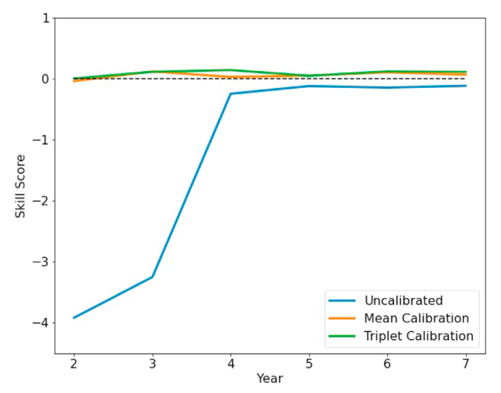

Figure content: line chart; x-axis Year (ticks 2 to 7); y-axis Skill Score (ticks −4 to 1); series, from the legend: Uncalibrated (blue line), Mean Calibration (orange line), Triplet Calibration (green line); a black dashed horizontal line at 0 that is not in the legend.

uncalibrated forecasts. These models strike a balance between the “inside” and the “outside” view. However, the improvement is marginal relative to the reference forecast, and calibrating the operator forecast triplet does not improve performance relative to only using the operator mean forecast. Thus, it seems like there is a limit to how much of the expert knowledge and inside information that is actually useful. The great advantage of RCF is that it is an approach based on past results, and can hence be expected to be free of both unconscious and conscious forms of bias. Taking an outside view for investment in green fields can be expected to contribute to significant bias reduction for future decision-making.

## 6. Discussion

The consequences of these results for the hydrocarbon industry are clear: expected production is lower and the uncertainty is much higher in new oil fields than exploration and production companies believe when they approve the investments. Both project complexity, scope changes, technological uncertainty, drilling delays, and unexpected geological features are often listed as causes of production shortfalls. There are probably valid cause and effect relationships here, but the root cause is the fact that project planners systematically underestimate or ignore such risks [3].

The disadvantage of optimism bias with respect to production rates is obvious: since annual discount factors of 8–10% on investments are the norm, the present value of future revenue streams from oil fields is significantly lower than what most oil and gas companies assume (see Fig. 7). But overprecision bias is also costly. While production over $P_{90}$ may seem beneficial, there are topside constraints (pipes, valves, processing capability etc.) which limit production. Production capacity is costly, so field operators do not pay for equipment, dimensions and installations they do not believe they will need. Thus, overprecision in forecasts leads to significant value erosion. If the probabilistic forecasts had been unbiased and well calibrated, different projects or different concepts for the selected projects would have been chosen.

Tversky and Kahneman [37] argue that decision makers and forecasters fall victim to what they called the planning fallacy. The result is a tendency to overlook the potential for mistakes and miscalculations, leading to optimistic and overconfident forecasts. Lovallo and Kahneman [4] demonstrate that these biases are often the result of an inside view in forecasting: forecasters have a strong tendency to consider projects as unique and thus focus on the particulars of case at hand when forecasting. Adopting an outside view has been shown to reduce delusions.

A more cynical view is that deliberate choices may be an

<!-- page 12 -->
<!-- type: mixed -->

important root cause. People compete for funding, positions and attention. For megaprojects like oil and gas fields, forecasters and decision makers will often have moved on before production start, and may not be held accountable for historical bias. Flyvbjerg [12] argues that behavioral economics itself suffers from a “psychology bias” and proposes strategic misrepresentation as the number one form of bias in project management.

The conclusion from this study is not that probabilistic forecasting does not work and should be abandoned. We also fully realize that the RCF methods proposed here are deeply unsatisfactory to most geoscientists and subsurface engineers. Rather, the argument is that the current approach, with a focus of developing ever more sophisticated methods for quantifying uncertainty in future production, is not the right approach. The weather forecasting industry serves as a useful contrast, with a focus on tracking performance of their forecasting methods and documenting improvement over time [20].

## Credit author

Erik Nesvold: Data curation, conceptualization, methodology, investigation, visualization, writing. Reidar Bratvold: Project administration, funding acquisition, conceptualization, reviewing.

## Declaration of competing interest

The authors declare the following financial interests/personal relationships which may be considered as potential competing interests: Erik Nesvold reports financial support was provided by Equinor ASA.

## Data availability

The authors do not have permission to share data.

## Acknowledgments

- We thank Equinor for generously funding this research project on production forecasting methods.
- We are also very grateful to the Norwegian Petroleum Directorate, both for providing access to the data set with probabilistic forecasts for this study and for the tremendous job that has been done over the years in structuring information about petroleum activites on the NCS.

## Appendix A. Details on Data and Methods

### Appendix A.1. Cumulative and Annual Production Forecasts

Given an ensemble of $n$ realizations $X = \{x_i(y),\ i = 1, 2, \ldots, n\}$, where $x_i(y)$ is the production in year $y$ of ensemble member $i$, the $p$-percentile values of the annual rate and the cumulative production are respectively:

$$
P_p^A(X, y) = P_p(\{x_i(y), i = 1, .., n\}), \tag{A.1}
$$

$$
P_p^C(X, y) = P_p\left(\left\{\sum_{t=1}^{y} x_i(t), i = 1, .., n\right\}\right). \tag{A.2}
$$

As seen from Equations A.1 and A.2, $\sum_{t=1}^{y} P_p^A(X, t) \neq P_p^C(X, y)$ unless the rank order of the ensemble stays equal each year, and in general the sum of annual $p$-th percentiles have a larger spread than the $p$-th cumulative forecasts. For example,

$$
\begin{aligned}
P_{90}^A(X, 1) + P_{90}^A(X, 2) + P_{90}^A(X, 3) &\geq P_{90}^C(X, 3) \\
P_{10}^A(X, 1) + P_{10}^A(X, 2) + P_{10}^A(X, 3) &\leq P_{10}^C(X, 3)
\end{aligned}
$$

On the other hand, the expected values are the same if the forecasts are statistically consistent. Figure A.16 shows a statistically plausible example. However, this is not always the case in the NPD data set. For the fields where both cumulative and annual profiles were reported, the annual profiles add up to the cumulative profiles in about 80% of the cases. A possible explanation for this anomaly is that decision makers in the organization have picked two realizations from the ensemble with particular well schedules and simulated reservoir flow to represent $P_{10}$ and $P_{90}$. For this study, only the cumulative profiles are used. For seven fields where cumulative forecasts were not present, the annual forecasts were added up to get cumulative numbers, in consistency with most of the data set.

Figure content: line chart; x-axis Production Year (ticks 2 to 12); y-axis Cumulative Oil Production [M Sm3] (ticks 0 to 14); series, from the legend: Annual Forecasts (black dashed lines), Cumulative Forecasts (blue solid lines); three curves of each kind.

### Appendix A.2. Forecast Quality Score

The continuous ranked probability score (CRPS) is a strictly proper scoring rule [32,38] for density forecasts defined in terms of the forecast CDF. The integral (Equation (A.3)) is a function of a density forecast $F(x)$ and the outcome $y$:

$$
CRPS(F, y) = \int (F(x) - \mathbb{1}[x \geq y])^2 dx. \tag{A.3}
$$

The score increases both with distance to the outcome and with forecast width. Note that the best possible score is zero, which is when the density forecast is a Heaviside function exactly on the scalar outcome $y$. It is also clear that CRPS depends on scale, which is problematic for our data, since the final volume estimates span three orders of magnitude (0.5–500). Equation (A.3) implies that multiplying the forecast and the outcome by a factor of ten also results in a score which is ten times higher.

To make a modified, scale-independent CRPS, a CDF is first fit to the forecast triplet (Section Appendix A.3). Then, a log transform is applied to the percentiles of the CDF, and the CRPS in Equation (A.3) is computed. We refer to this term as $S_{CRPS_{log}}$. Since this operation makes the score asymmetric about the outcome $y$ - forecasts above

<!-- page 13 -->
<!-- type: mixed -->

$y$ would be penalized less than forecasts below $y$ - a symmetric CRPS is computed by averaging the score above and below the forecast mean $M$ by the distance $|y - M|$. Additionally, since the score for zero production is undefined, a Winkler term [31] is used below $F_{01}$ and above $F_{99}$. In summary, the density forecast score used in this study is:

$$
S(F, y) =
\begin{cases}
S_{CRPS_{log}}(F, y^+) + S_{CRPS_{log}}(F, y^-) + \dfrac{P_{01} - y}{P_{99} - P_{01}} & \text{if } y < F_{01} \\
S_{CRPS_{log}}(F, y^+) + S_{CRPS_{log}}(F, y^-) & \text{if } y \in [F_{01}, F_{99}] \\
S_{CRPS_{log}}(F, y^+) + S_{CRPS_{log}}(F, y^-) + \dfrac{y - P_{99}}{P_{99} - P_{01}} & \text{if } y > F_{99}
\end{cases}
, \tag{A.4}
$$

where $y^+ = y$ and $y^- = \max\{0, 2F_m - y\}$. Figure A.17 shows this score. This modified, scale-independent version of the CRPS is used in this study.

Figure content: line chart with two y-axes; x-axis Production [M Sm3] (ticks 5 to 25); left axis Cumulative Probability (ticks 0.0 to 1.0); right axis Forecast Score (ticks 0.0 to 2.5); series, from the two legends: Forecast CDF (blue solid line), Forecast Triplet (black dashed horizontal and vertical lines), Score (red solid line).

### Appendix A.3. Fitting a CDF

To compute the metric in Section Appendix A.2, a density function is needed. Thus, it is necessary to make assumptions about the probability distribution. The forecast data show some variation with respect to skewness, but on average, the mean is closer to $F_{90}$ than to $F_{10}$. Most standard analytic distributions are unfit for this purpose (e.g. a normal distribution or a lognormal distribution). Furthermore, fitting an analytic distribution to the data is not always a convex optimization problem, so even if one assumes a certain distribution, it may be difficult to find the global optimum. To fit a cumulative density function to each forecast triplet, we therefore resort to the metalog distribution [33], developed specifically for this purpose. It is based on a series expansion of the logistic quantile function $M(y)$, i.e.

$$
M(y) = a_1 + a_2 \ln\left(\frac{y}{1 - y}\right) + a_3 (y - 0.5) \ln\left(\frac{y}{1 - y}\right) + \ldots, \tag{A.5}
$$

where the number of terms depends on $n$, the number of data points available. The metalog parameters $\mathbf{a}$ are determined by solving a simple inverse problem. The metalog distribution is quite flexible with respect to shape and can easily be fit to a set of percentiles such as ($F_{10}$, $F_{50}$, $F_{90}$). However, given $F_{10}$ and $F_{90}$, there is a lower and an upper bound on $F_{50}$ to get an analytic answer. In this study, we hold $F_{10}$ and $F_{90}$ fixed and optimize $F_{50}$ so that the mean of the distribution is as close as possible to the forecast mean, $F_m$. For a few cases in the data set, it is not possible to obtain a matching mean without crossing the lower or upper bound, in which case $F_{50}$ is set to the respective bound. Figure A.18 shows the so-called symmetric triplet (SPT) metalog distribution functions for a range of values for $F_{50}$ between the lower and upper bound, while $F_{10}$ and $F_{90}$ are held fixed.

It may seem like a strong assumption to generate an entire CDF based on only three statistics. However, at the time of the FID, which is at an advanced stage in the decision process, there are rarely diametrically opposite geological interpretations and the initial field development strategy is more or less settled. On the NCS, production forecast updates are often made using the Ensemble Kalman Filter [39], which requires an assumption of Gaussianity. Thus, we consider the assumption of a unimodal distribution with thin tails as very reasonable.

![Fig. A.18. Semi-bounded (bounded below to 0) symmetric triplet metalog CDFs for $F_{10} = 5$ and $F_{90} = 15$. For these $F_{10}$ and $F_{90}$ values, $F_{50}$ must be in the range [6.00, 12.49]. The range of feasible CDFs between these bounds is shown here. Compare with Figure A.17, where the forecast triplet is $\{F_{10}, F_m, F_{90}\} = \{5, 10.5, 15\}$.](../figs/LIB_2022_ENERGY_debiasing_production-forecasts_ENesvold+RBratvold_p013_figA-18.png)

Figure content: line chart; x-axis Production [M Sm3] (ticks 5 to 30); y-axis Cumulative Probability (ticks 0.0 to 1.0); a family of solid curves in different colours, without legend; black dashed horizontal and vertical lines.

## Appendix B. Results

### Appendix B.1. Calibration Factors

*Table B.3. Median estimate for calibration factors in Fig. 9*

| Year | 2 | 3 | 4 | 5 | 6 | 7 | 8 | 9 | 10 |
|---|---|---|---|---|---|---|---|---|---|
| $a_M$ | 0.291 | 0.324 | 0.311 | 0.282 | 0.537 | 0.434 | 0.549 | 0.628 | 0.642 |
| $b_M$ | 0.781 | 0.795 | 0.793 | 0.82 | 0.883 | 0.917 | 0.955 | 0.997 | 1.048 |
| $c_M$ | 1.359 | 1.186 | 1.131 | 1.225 | 1.314 | 1.45 | 1.511 | 1.57 | 1.677 |
| $a_T$ | 0.346 | 0.413 | 0.424 | 0.379 | 0.717 | 0.545 | 0.737 | 0.833 | 0.855 |
| $b_T$ | 0.781 | 0.795 | 0.793 | 0.82 | 0.883 | 0.917 | 0.955 | 0.997 | 1.048 |
| $c_T$ | 1.2 | 1.01 | 0.993 | 1.00 | 1.022 | 1.065 | 1.164 | 1.145 | 1.2 |

## References

- [1] Kahneman D. Thinking, fast and slow. first ed. New York: Farrar, Straus and Giroux; 2011.
- [2] Flyvbjerg B, Rasmussen VK. Heuristics for masterbuilders: fast and frugal ways to become a better project leader. 2021.
- [3] Flyvbjerg B. What you should know about megaprojects and why: an overview. Proj Manag J 2014;45(2):6–19. https://doi.org/10.1002/pmj.21409. URL, https://journals.sagepub.com/doi/abs/10.1002/pmj.21409.

<!-- page 14 -->
<!-- type: text -->

- [4] Lovallo D, Kahneman D. Delusions of success. Harv Bus Rev 2003;81(7):56–63.
- [5] Rui Z, Peng F, Ling K, Chang H, Chen G, Zhou X. Investigation into the performance of oil and gas projects. J Nat Gas Sci Eng 2017;38:12–20. https://doi.org/10.1016/j.jngse.2016.11.049.
- [6] Merrow EW. Oil and gas industry megaprojects: our recent track record. Oil Gas Facil 2013;1(2):38–42. https://doi.org/10.2118/153695-PA.
- [7] Olaniran OJ, Love PE, Edwards D, Olatunji OA, Matthews J. Cost overruns in hydrocarbon megaprojects: a critical review and implications for research. Proj Manag J 2015;46(6):126–38.
- [8] Nandurdikar N, Wallace L. Failure to produce: an investigation of deficiencies in production attainment. In: SPE annual technical conference and exhibition. Society of Petroleum Engineers; 2011.
- [9] Bratvold RB, Mohus E, Petutschnig D, Bickel E. Production forecasting: optimistic and overconfident—over and over again. SPE Reservoir Evaluation and Engineering; 2020.
- [10] Bentley R, Boyle G. Global oil production: forecasts and methodologies. Environ Plann B Plann Des 2008;35(4):609–26.
- [11] Sorrell S, Speirs J, Bentley R, Brandt A, Miller R. Global oil depletion: a review of the evidence. Energy Pol 2010;38(9):5290–5.
- [12] Flyvbjerg B. Top ten behavioral biases in project management: an overview. Proj Manag J 2021;52(6):531–46.
- [13] Hoffrage U. Overconfidence. second ed. Hove, UK: Psychology Press; 2016. p. 291–314. book section 16.
- [14] Deutsch CV, Hewett TA. Challenges in reservoir forecasting. Math Geol 1996;28(7):829–42.
- [15] Haldorsen HH, Damsleth E. Stochastic modeling. J Petrol Technol 1990;42(4).
- [16] Scheidt C, Li L, Caers J. Quantifying uncertainty in subsurface systems, vol. 236. John Wiley & Sons; 2018.
- [17] Bickel JE, Kim SD. Verification of the weather channel probability of precipitation forecasts. Mon Weather Rev 2008;136(12):4867–81.
- [18] Amisano G, Giacomini R. Comparing density forecasts via weighted likelihood ratio tests. J Bus Econ Stat 2007;25(2):177–90.
- [19] Petropoulos F, Apiletti D, Assimakopoulos V, Babai MZ, Barrow DK, Taieb SB, Bergmeir C, Bessa RJ. Forecasting: theory and practice. 2020. arXiv:Statistics.
- [20] Panagiotelis A, Athanasopoulos G, Gamakumara P, Hyndman RJ. Forecast reconciliation: a geometric view with new insights on bias correction. Int J Forecast 2021;37(1):343–59.
- [21] Tetlock PE, Gardner D. Superforecasting: the art and science of prediction. Broadway Books; 2015.
- [22] Silver N. The signal and the noise: why so many predictions fail-but some don't. Penguin; 2012.
- [23] MacKay DJ. Information theory, inference and learning algorithms. Cambridge university press; 2003.
- [24] Kahneman D, Tversky A. Intuitive prediction: biases and corrective procedures, Report. Office of Naval Research; 1977.
- [25] Norsk petroleum. https://www.norskpetroleum.no/fakta/felt/. [Accessed 20 April 2022].
- [26] Tech. rep. Revised national budget 2020 general guidelines. Stavanger, Norway: Norwegian Petroleum Directorate; 2020.
- [27] Hastie T, Tibshirani R, Friedman J. The elements of statistical learning. In: Springer series in statistics. second ed. Springer; 2009. https://doi.org/10.1007/b94608.
- [28] Flyvbjerg B. From nobel prize to project management: getting risks right. Proj Manag J 2006;37(3):5–15.
- [29] Gneiting T, Raftery AE. Strictly proper scoring rules, prediction and estimation. J Am Stat Assoc 2007;102(477):359–78. https://doi.org/10.1198/016214506000001437.
- [30] Murphy AH, Winkler RL. Diagnostic verification of probability forecasts. Int J Forecast 1992;7:435–55.
- [31] Hyndman RJ, Athanasopoulos G. Forecasting: principles and practice. third ed. Melbourne, Australia: OTexts; 2018.
- [32] Gneiting T, Balabdaoui F, Raftery AE. Probabilistic forecasts, calibration and sharpness. J Roy Stat Soc B 2007;69:243–68.
- [33] Keelin TW. The metalog distributions. Decis Anal 2016;13(4):243–77. https://doi.org/10.1287/deca.2016.0338.
- [34] Zellner M, Abbas AE, Budescu DV, Galstyan A. A survey of human judgement and quantitative forecasting methods. R Soc Open Sci 2021;8(2):201187.
- [35] Floris F, Bush M, Cuypers M, Roggero F, Syversveen AR. Methods for quantifying the uncertainty of production forecasts: a comparative study. Petrol Geosci 2001;7:87–96.
- [36] Cunnane C. Unbiased plotting positions—a review. J Hydrol 1978;37(3–4):205–22.
- [37] Tversky A, Kahneman D. Judgment under uncertainty: heuristics and biases. Science 1974;185(4157):1124–31.
- [38] Zamo M, Naveau P. Estimation of the continuous ranked probability score with limited information and applications to ensemble weather forecasts. Math Geosci 2018;50:209–34.
- [39] Aanonsen SI, Nævdal G, Oliver DS, Reynolds AC, Vallès B. The ensemble kalman filter in reservoir engineering–a review. SPE J 2009;14(3):393–412.
