# Estimates against outcomes on the Norwegian shelf, and what they say about Volve

A reference class study: how probabilities of discovery, volumes in place, sanctioned reserves and production build-up have turned out for exploration wells and fields on the Norwegian continental shelf, and how the Volve plan of 2005 and its outcome sit in that record. Same data as the expert study in `agents/rcf/study`, recalculated.

## Summary

The record separates cleanly into what the industry estimates well and what it does not. The chance of finding hydrocarbons is estimated well. The amount is not: discoveries hold a third of the volume prognosed, and the ranges given are several times too narrow. Once a field is sanctioned, its reserves are on the whole recovered, with the help of later investments, but how fast they are produced varies between fields by a factor of four to five — far more than a development plan's range admits.

For Volve, a forecast made in 2005 from the oil fields then on record, knowing only the field's sanctioned reserves, would have put production five years after first oil at 6.8 million Sm3, with a 10–90 % range of 3.1 to 11.1. The plan said 11.1, with a range of 9.0 to 12.6. The field produced 7.7. The record to date, with fields of Volve's size only, gives 7.4 (3.1 to 12.0).

| | | |
|---|---|---|
| Discoveries: expected and made | 242 and 244 | Sum of stated probabilities over 869 drilled prospects, and the number that were discoveries |
| Volume in place found, as a share of prognosis | 0.33 | Median of 226 discoveries; 82 % found less than prognosed |
| Discoveries inside the prognosed range | 31 % | The range claims 80 %. 56 % were below the low value |
| Ultimate recovery over sanctioned reserves | 1.17 | Median of 91 fields; 0.83 for the 17 that have shut down |
| Sanctioned oil produced after five years | 0.62 | Median of oil fields of Volve's size; one in ten below 0.26, one in ten above 1.01 |
| Volve against its plan after five years | 0.70 | Below the plan's low case in years 2 to 6; inside the reference class range in every year |

## Question, data and method

Reference class forecasting answers a forecasting question with the record of comparable cases instead of the details of the case in hand. The study applies it at the decisions where a volume estimate carries the decision: drilling an exploration well, and sanctioning a development. At each, it measures two things in the record — *bias*, the typical ratio of outcome to estimate, and *spread*, how far outcomes scatter around that — and tests whether a range built from the record would have held for cases that were not used to build it.

| Stage | Estimate | Outcome | Cases | Source |
|---|---|---|---|---|
| Exploration | Probability of discovery before drilling | Discovery or dry | 869 prospects in 609 wells, 1989–2024 | Prognosis-and-result file of the expert study |
| Exploration | Volume in place prognosed, with low and high values | Volume in place recorded after drilling | 226 discoveries; 98 with a P90–P10 range | Same |
| Appraisal | Volume in place recorded for the discovery well | Sodir's estimate of volume in place in the field today | 36 fields | Same, and Sodir field tables |
| Development | Oil and gas reserves in the resource account of the year the PDO was approved | Sodir's latest estimate of ultimate recovery | 91 fields approved 1990–2021 | `RCB_reserves.xlsx`, Sodir reserves table |
| Development | The same reserves | Production by month from first production | 91 fields; 57 oil fields | Sodir monthly production, snapshot 19.11.2026 |

### Conventions

- *Low* and *high* mean the values with 10 % of outcomes below and 10 % above. The Volve PDO calls them P90 and P10; the reference paper F10 and F90.
- Volumes are in million Sm3 of oil; a billion Sm3 of gas counts as a million Sm3 of oil equivalent (o.e.).
- One case is one prospect: a prospect with an oil case and a gas case gets the sum of the two probabilities and the probability-weighted volume. The rule and its exceptions are in `rcfkit.data.discovery_probability`.
- Field time is counted in 12-month periods from the first month of production after PDO approval, so that a late start is not counted as a production shortfall and the month of start does not matter.
- Intervals are 90 % intervals: Wilson for shares, bootstrap (resampling cases) for medians and quantiles.

## Exploration: is the chance of discovery estimated well?

Yes. Over 869 drilled prospects the stated probabilities add up to 242 discoveries; 244 were made. Class by class, the share of discoveries follows the stated probability from 6 % up to about 70 %; above that there are too few prospects to tell.

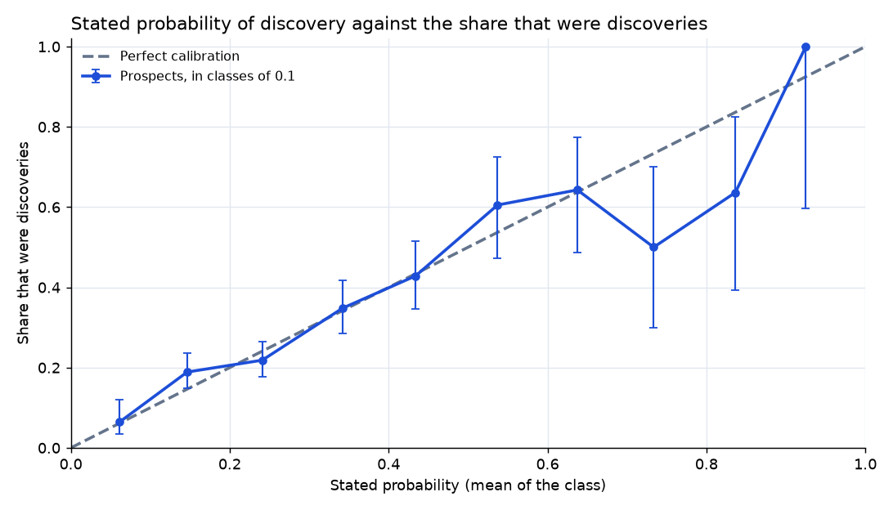

*Each point is a class of stated probability 0.1 wide; bars are 90 % Wilson intervals; hover for the number of prospects. 869 prospects with a stated technical probability and a recorded result. Data: prognosis-and-result file.*

Two refinements. First, high probabilities are somewhat too high and low ones too low: a calibration line fitted to the outcomes has a slope of 0.82 (90 % interval 0.66–0.98) where 1 would be perfect. The effect is small: on prospects held back from the fit, recalibrated probabilities score no better than the stated ones (Brier score 0.1804 against 0.1795), and both beat the plain base rate (0.2026) by 11 %. The stated probabilities carry real information and need no correction.

Second, the overall agreement hides a drift. For wells spudded up to 1999, 26 % was stated and 33 % found; from 2010, 29 % stated and 19 % found. Explorers were cautious in the 1990s and have been optimistic since 2010; the two cancel in the total.

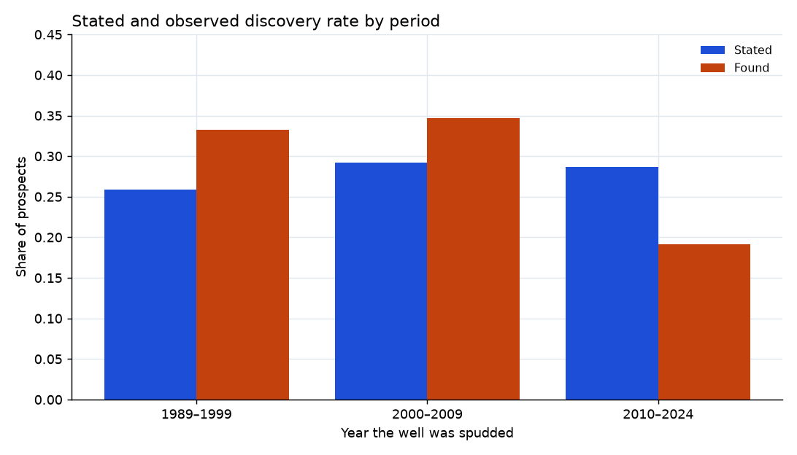

*Mean stated probability and share of discoveries, by the year the well was spudded: 1989–1999: 307 prospects; 2000–2009: 222 prospects; 2010–2024: 340 prospects.*

*z is the difference between discoveries made and expected, in standard deviations; beyond ±2 is unlikely to be chance.*

| Group | Prospects | Stated | Found | Expected discoveries | Made | z |
|---|---:|---:|---:|---:|---:|---:|
| All prospects | 869 | 27.8 % | 28.1 % | 242 | 244 | +0.2 |
| Primary target of the well | 638 | 30.9 % | 30.9 % | 197 | 197 | +0.0 |
| Secondary target | 231 | 19.5 % | 20.3 % | 45 | 47 | +0.3 |
| Spudded 1989–1999 | 307 | 25.9 % | 33.2 % | 80 | 102 | +3.2 |
| Spudded 2000–2009 | 222 | 29.2 % | 34.7 % | 65 | 77 | +1.9 |
| Spudded 2010–2024 | 340 | 28.7 % | 19.1 % | 97 | 65 | −4.1 |
| One prognosis case | 775 | 27.8 % | 26.6 % | 216 | 206 | −0.8 |
| Several prognosis cases | 94 | 27.9 % | 40.4 % | 26 | 38 | +3.0 |

Prospects with several prognosis cases are the one group where the count depends on how the cases are combined; leaving them out changes nothing in the conclusions above.

## Exploration: is the volume estimated well?

No. For the 226 discoveries with a prognosed and a recorded volume in place, the median discovery holds 0.33 of what was prognosed (90 % interval 0.27–0.42). 82 % hold less than prognosed, and 25 % less than a tenth. Only 34 % are within a factor of two either way.

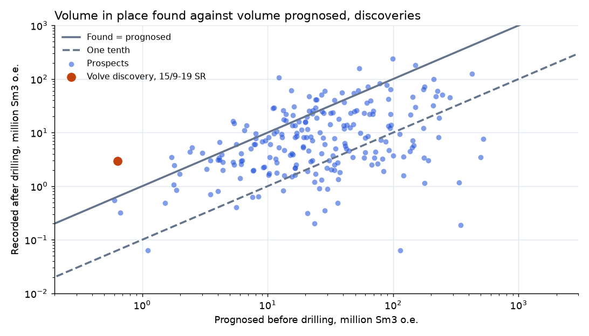

*One point per discovered prospect; both axes logarithmic; hover for well and prospect. The orange point is the oil found by 15/9-19 SR in a prospect prognosed as gas. Data: prognosis-and-result file, in-place columns, oil and gas with associated phases.*

*Volume recorded after drilling divided by volume prognosed, for discoveries.*

|  | Discoveries | Median | 10 % below | 10 % above | Ratio of totals | Below prognosis |
|---|---:|---:|---:|---:|---:|---:|
| Volume in place, all | 226 | 0.33 | 0.04 | 1.49 | 0.32 | 82 % |
| Volume in place, spudded 1989–1999 | 94 | 0.43 | 0.06 | 1.70 | 0.44 | 74 % |
| Volume in place, spudded 2000–2009 | 72 | 0.32 | 0.06 | 1.65 | 0.33 | 83 % |
| Volume in place, spudded 2010–2024 | 60 | 0.14 | 0.02 | 0.87 | 0.13 | 93 % |
| Volume in place, central value labelled mean | 112 | 0.24 | 0.04 | 0.99 | 0.19 | 90 % |
| Recoverable volume, all | 149 | 0.25 | 0.03 | 1.29 | 0.29 | 86 % |

The over-estimation has grown: the median was 0.43 in the 1990s and is 0.14 for wells since 2010. It is not a matter of what the central value is called: where the file labels it a mean, the result is the same or worse.

### The ranges are several times too narrow

98 discoveries had a single prognosis with a low (P90) and a high (P10) value for the phase that was found. Such a range should hold 80 % of outcomes. It held 31 %; 56 % of discoveries were smaller than the low value. The typical range spans a factor of 3 from low to high. A range that does hold 80 % — from 0.07 to 1.8 times the central value — spans a factor of 25.

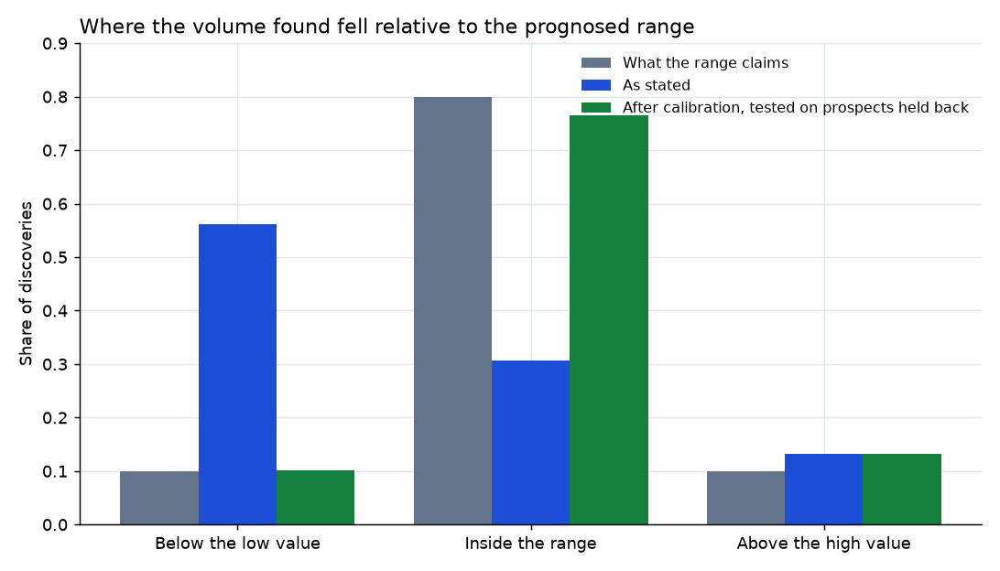

*98 discoveries with a P90–P10 range. Green: low and high values multiplied by factors estimated on nine tenths of the prospects and applied to the remaining tenth, in turn (ten-fold cross-validation).*

*Calibration factors for pre-drill volume in place of the main phase, from the 98 discoveries with a stated range and the phase as prognosed. Leaving out discoveries in another phase is why the median factor is higher here than the 0.33 of all discoveries. The form follows Nesvold and Bratvold (2022), equations 5 and 6.*

| To obtain | Multiply | By |
|---|---|---:|
| A median estimate | the central value | 0.43 |
| A low value (10 % below) | the central value | 0.07 |
| A high value (10 % above) | the central value | 1.80 |
| A low value | the stated low value | 0.17 |
| A high value | the stated high value | 1.07 |

### Where the volume goes missing

The file holds the factors of the volume equation before and after drilling. The shortfall is in the container, not the rock: rock volume comes in at 0.50 of prognosis in the median discovery, through a smaller area and a shorter hydrocarbon column. Porosity and net-to-gross are unbiased, and saturation nearly so.

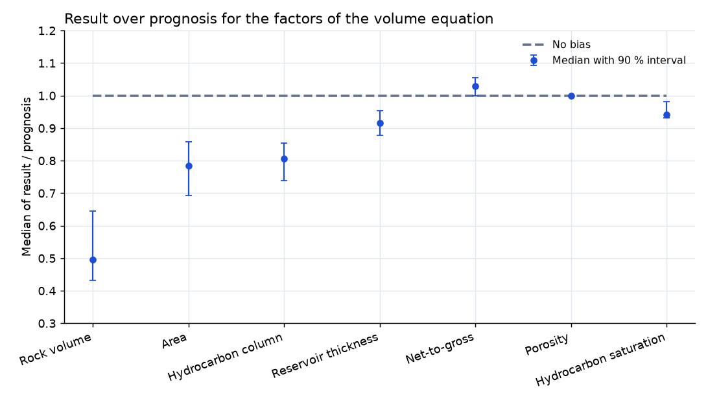

*Median of result over prognosis among discoveries that report the parameter both times; bars are 90 % bootstrap intervals; hover for the number of prospects.*

### Chance and volume together

Multiplying each prospect's probability by its prognosed volume gives the volume a drilling programme expects. Over 841 prospects that is 14 400 million Sm3 o.e. in place. The discoveries delivered 3 659, or 0.25 of it (90 % interval 0.20–0.31). Since the probabilities are sound, the whole shortfall is volume. In 21 % of 191 discoveries the main phase found was not the one prognosed.

## From discovery to sanction

36 fields have a discovery well in the prognosis file with a recorded volume, and a volume in place in Sodir's field table today. The field today holds 1.8 times the volume recorded for its discovery well in the median case; a quarter hold less than 1.0 times, a quarter more than 4.6 times.

This is the reverse of the pre-drill picture. A volume recorded straight after a discovery well describes what the well has proven; appraisal, neighbouring segments and later discoveries tied into the same field add to it. The comparison cannot say how much of the growth is revision and how much is addition, because Sodir publishes today's volume in place only, not its history.

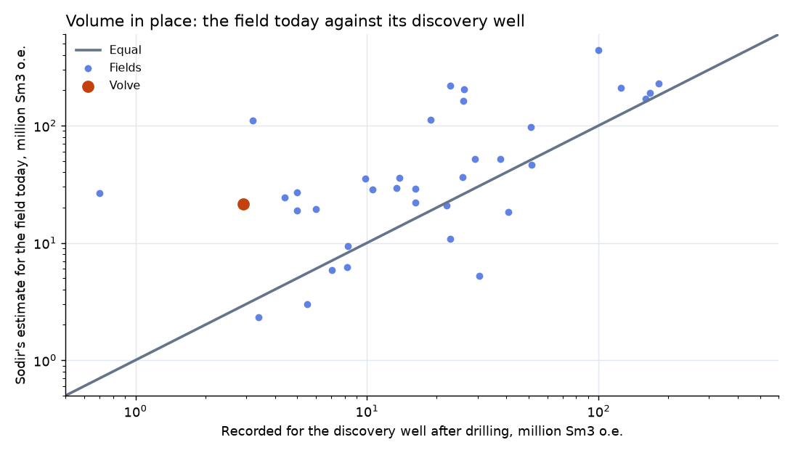

*One point per field; hover for the name. Horizontal: oil equivalents in place recorded in the result rows of the field's discovery well. Vertical: Sodir's current figure for the field (oil, associated liquid, associated and free gas).*

How much of what is in place a plan promises to recover can be put beside the same field table. For the 88 fields of the production class, sanctioned reserves are 0.33 of today's volume in place in the median, and above 0.67 for one field in ten. Oil and gas are mixed in these numbers, and gas recovers more.

## Development: are sanctioned reserves recovered?

On the whole, yes, and more. For 91 fields with a PDO approved from 1990 and a reserves figure from the approval year, the latest estimate of ultimate recovery is 1.17 times the sanctioned reserves in the median (90 % interval 1.04–1.30). The spread is wide: one field in ten ends below 0.42, one in ten above 2.42.

The growth is not evidence of cautious plans. It contains everything decided after the first PDO — infill wells, new phases, tie-ins of other discoveries — and each of those was a new investment. And it is a view of survivors: the 17 fields that have shut down, whose recovery is final, ended at 0.83 of sanctioned reserves in the median, and 53 % of them below 1.

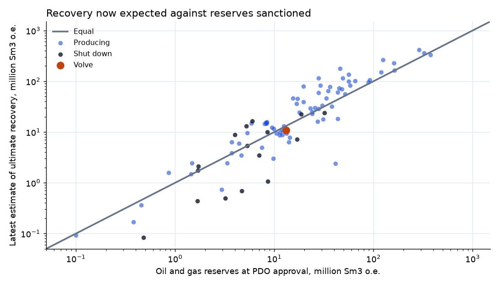

*One point per field; both axes logarithmic; hover for the name. Reserves: oil and gas in the resource account of the year of approval (or the year after or before). Recovery: Sodir's reserves table, version 2025.*

*Latest estimate of ultimate recovery over reserves sanctioned at the first PDO, oil and gas.*

| Group | Fields | Median | 90 % interval | 10 % below | 10 % above | Below 1 |
|---|---:|---:|---:|---:|---:|---:|
| All fields | 91 | 1.17 | 1.04–1.30 | 0.42 | 2.42 | 35 % |
| Shut down | 17 | 0.83 | 0.42–1.18 | 0.15 | 2.34 | 53 % |
| Producing | 74 | 1.27 | 1.08–1.42 | 0.58 | 2.40 | 31 % |
| Oil fields | 57 | 1.16 | 1.03–1.44 | 0.42 | 2.71 | 33 % |
| Gas fields | 34 | 1.19 | 0.95–1.35 | 0.46 | 2.10 | 38 % |

## Development: how fast are sanctioned reserves produced?

### The reference class

The rules of membership were written before the fractions were computed. A field is a member if:

- its first approval is a PDO (not an exemption from one), dated 1990 or later — the resource accounts in the data start in 1990;
- the resource account holds oil and gas reserves for it in the year of approval, or failing that the year after or the year before;
- less than 5 % of those reserves had been produced before the approval;
- it has started to produce.

*All 142 fields in Sodir's field list. Year 1 is the first 12 months from the first month of production on or after approval.*

| Fields | Number |
|---|---:|
| In the class | 91 |
| Left out: approved before 1990 | 26 |
| Left out: no reserves estimate within a year of approval | 19 |
| Left out: first approval is a PDO exemption | 4 |
| Left out: no PDO approval recorded | 1 |
| Left out: produced before approval | 1 |

For each member the outcome is cumulative production divided by sanctioned reserves after 1, 2, … 10 years. A horizon is used only where the field has completed it by August 2026, the last month in the data. Fields that have shut down stay in with their final production.

### What the class depends on

Size matters. Large fields produce their reserves more slowly: the rank correlation between sanctioned reserves and the fraction produced after three years is −0.40 (p = 0.0001; 88 fields), and −0.32 after five. The main product does not: oil fields and gas fields have the same median after three years (0.34 and 0.34; p = 0.53). Nor does the period: there is no trend with the year of first production (rank correlation −0.08, p = 0.45).

The class used for Volve is therefore narrowed by size: oil fields with sanctioned reserves within a factor of 4 of Volve's 13.2 million Sm3 o.e. Oil fields are kept apart because the comparison with the PDO is in oil, not because the product matters.

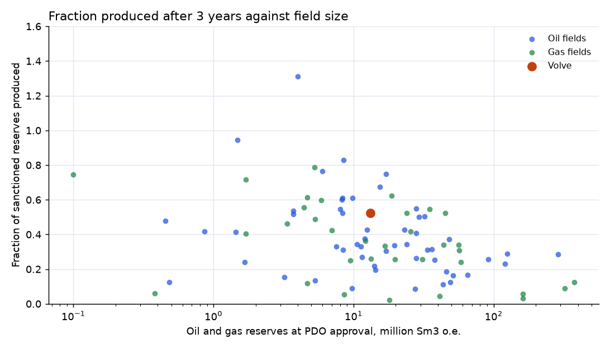

*One point per field; horizontal axis logarithmic; hover for the name. Oil and gas produced in the first 36 months over sanctioned oil and gas reserves.*

### The distribution

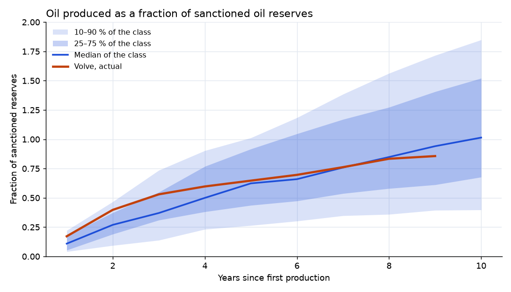

*Oil fields with sanctioned reserves of 3.3 to 53 million Sm3 o.e., Volve left out: 42 fields after one year, 32 after ten. Oil produced over sanctioned oil reserves. Orange: Volve, oil over its sanctioned 11.88 million Sm3.*

*Fraction of sanctioned oil reserves produced, oil fields of Volve's size.*

| Years | Fields | 10 % below | 25 % | Median | 75 % | 10 % above | Median, 90 % interval |
|---|---:|---:|---:|---:|---:|---:|---:|
| 1 | 42 | 0.04 | 0.05 | 0.11 | 0.18 | 0.22 | 0.10–0.13 |
| 2 | 42 | 0.09 | 0.19 | 0.27 | 0.37 | 0.47 | 0.23–0.29 |
| 3 | 41 | 0.14 | 0.31 | 0.37 | 0.55 | 0.74 | 0.34–0.49 |
| 4 | 39 | 0.23 | 0.38 | 0.50 | 0.77 | 0.90 | 0.46–0.60 |
| 5 | 38 | 0.26 | 0.44 | 0.62 | 0.92 | 1.01 | 0.54–0.74 |
| 6 | 37 | 0.30 | 0.47 | 0.66 | 1.05 | 1.18 | 0.61–0.94 |
| 7 | 37 | 0.35 | 0.54 | 0.76 | 1.17 | 1.38 | 0.64–0.98 |
| 8 | 35 | 0.36 | 0.58 | 0.85 | 1.27 | 1.56 | 0.64–1.16 |
| 9 | 34 | 0.39 | 0.61 | 0.94 | 1.41 | 1.72 | 0.70–1.18 |
| 10 | 32 | 0.40 | 0.68 | 1.01 | 1.52 | 1.85 | 0.73–1.35 |

The median field has produced 0.37 of its sanctioned oil after three years and 0.62 after five. After ten years the median field has produced 1.01 of what was sanctioned, and one in ten 1.85 or more — the later investments again. The 10–90 % range is a factor of 5.3 wide after three years and 3.8 after five.

### Would these ranges have held?

A range read off past fields is a forecast only if later fields fall in it as often as it says. To test this, the class was rebuilt for each field as it stood in the month that field's PDO was approved — only fields approved earlier, and only the horizons they had completed by then — and the field's later outcome was placed in that distribution. At least ten earlier fields were required.

After three years, 74 % of 62 fields fell inside the 10–90 % range of their class, 15 % below and 11 % above. After five years: 82 % inside, 12 % below, 6 % above (51 fields). The positions are spread evenly, as they should be (Kolmogorov–Smirnov test of uniformity: p = 0.94 and 0.45). For comparison, Nesvold and Bratvold found that operators' own low–high ranges held under 30 % of outcomes after two years and about 50 % after four to ten.

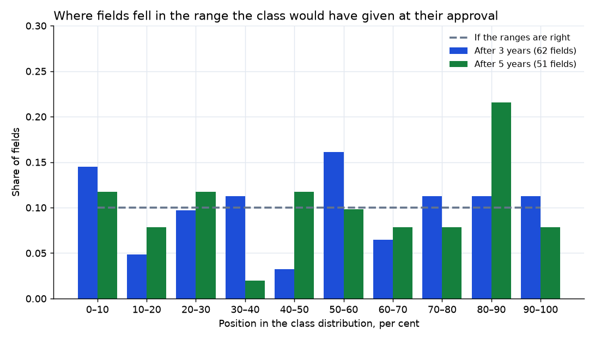

*Each field's outcome expressed as its position (0–100 %) among the fields known when its PDO was approved, in ten classes. A calibrated method puts a tenth of the fields in each class. All fields of the class, oil and gas over sanctioned oil and gas.*

## Volve in the record

### 1993: the discovery

Well 15/9-19 SR was drilled for two gas prospects. The first, given a 72 % chance, was dry. The second, given 32 % and 0.64 billion Sm3 of gas in place, held oil: 2.53 million Sm3 in place according to the result row, with 0.4 billion Sm3 of associated gas. That is 4.6 times the prognosed volume in oil equivalents, higher than 99 % of discoveries in the record. Volve began as one of the rare cases where the drill found more than was prognosed, and in another phase.

### 1993 to today: the volume in place

*Oil originally in place at Volve, million Sm3, as estimated at different times. The areas covered are not identical from one estimate to the next.*

| When | Source | Low | Central | High |
|---|---|---:|---:|---:|
| 1993, after the well | Result row of the prognosis file | 2.04 | 2.53 | 3.01 |
| December 1993 | Discovery evaluation report, Theta Vest (Table 10.1) | 7.22 | 10.33 | 12.83 |
| February 2005 | PDO, Volve closure (Table 3.4) | 20.9 | 27.5 | 35.2 |
| 2016 | Simulation model at end of production, all regions |  | 22.0 |  |
| Today | Sodir field table |  | 18.7 |  |

The field today is put at 7.3 times the oil equivalents recorded for its discovery well, against 1.8 times for the median field — more growth than 88 % of fields. All of that growth came before the PDO. Between the PDO and today the estimate of oil in place fell from 27.5 to 18.7 million Sm3, to below the PDO's low value of 20.9. The public record has no history of in-place estimates for other fields, so how common such a fall after sanction is cannot be said from this data. What the record does say is that the PDO promised a high recovery by today's knowledge: its sanctioned reserves are 0.61 of today's volume in place, where the median field's are 0.33 and 14 % of fields sanctioned a larger share.

### 2005: the production forecast

The PDO forecast 11.4 million Sm3 of oil (mean), with a low case of 9.0 and a high case of 15.3. The resource account for 2005 carries 11.88; the reference class fractions are multiplied by that figure, since it is the figure they were built on for the other fields. Three forecasts can then be set beside the outcome, all counted from first oil:

- the PDO's own low, mean and high cases (Table 4.5), re-counted from the planned first oil on 6 March 2007;
- the reference class forecast: low, median and high fractions of the class times sanctioned reserves — no knowledge of Volve beyond its size and that it is an oil field;
- the PDO mean after the calibration factors published by Nesvold and Bratvold (Table B.3) — an outside view built on a different record, the operators' forecasts for 71 fields.

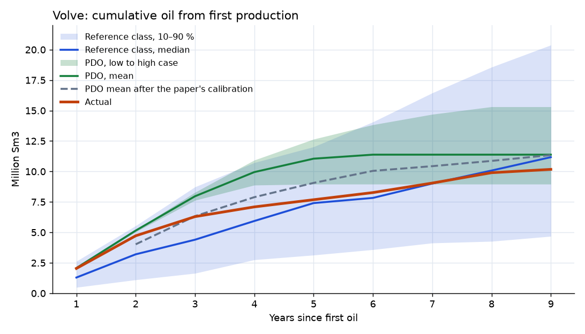

*Blue: 42 oil fields of Volve's size (the number falls to 34 by year 9). Green: PDO Table 4.5; the three cases are almost identical for the first two years. Grey: PDO mean times the paper's factor for each production year. Orange: Sodir monthly production, first oil February 2008.*

*Cumulative oil, million Sm3, by years since first oil.*

| Years | Actual | PDO low | PDO mean | PDO high | Actual / PDO mean | Class low | Class median | Class high | Actual, position in class | Calibrated PDO mean |
|---|---:|---:|---:|---:|---:|---:|---:|---:|---:|---:|
| 1 | 2.04 | 1.98 | 2.07 | 2.08 | 0.98 | 0.5 | 1.3 | 2.6 | 71 % |  |
| 2 | 4.72 | 5.04 | 5.15 | 5.19 | 0.92 | 1.1 | 3.2 | 5.5 | 79 % | 4.02 |
| 3 | 6.29 | 7.63 | 7.96 | 8.28 | 0.79 | 1.6 | 4.4 | 8.7 | 68 % | 6.33 |
| 4 | 7.09 | 8.88 | 9.95 | 10.93 | 0.71 | 2.7 | 5.9 | 10.7 | 64 % | 7.89 |
| 5 | 7.68 | 8.96 | 11.05 | 12.65 | 0.70 | 3.1 | 7.4 | 12.0 | 53 % | 9.06 |
| 6 | 8.27 | 8.96 | 11.38 | 13.83 | 0.73 | 3.6 | 7.8 | 14.1 | 51 % | 10.05 |
| 7 | 9.05 | 8.96 | 11.38 | 14.69 | 0.80 | 4.1 | 9.0 | 16.4 | 51 % | 10.44 |
| 8 | 9.90 | 8.96 | 11.38 | 15.31 | 0.87 | 4.3 | 10.1 | 18.6 | 49 % | 10.87 |
| 9 | 10.17 | 8.96 | 11.38 | 15.31 | 0.89 | 4.7 | 11.2 | 20.4 | 41 % | 11.35 |

The plan's range was almost nil at the start — 5.04 to 5.19 after two years — and the field fell out of it at once: production was below the low case in years 2 to 6. Against the mean it reached 0.79 after three years and 0.70 after five, close to the 0.8 the paper reports for the shelf. Production rose again in 2014 and 2015, after new investments, which took the field back above the low case, and it ended at 0.89 of the plan after more than twice the planned investment.

Against the reference class the same history is unremarkable. Volve sat between the 41 % and 79 % points of the class in every year — inside the 10–90 % range throughout: a field that started a little faster than most and then produced like the median. The calibrated PDO mean was within 1 % of the outcome after three years and too high after that.

In the end Volve recovered 0.83 of the oil and gas sanctioned. The 16 other fields that have shut down recovered 0.88 in the median, and 50 % of them a smaller share than Volve.

### Which forecast was better?

One field cannot rank forecasting methods; the back-test above is the evidence for the method. For Volve alone, a quantile score (the mean penalty over the low, middle and high values, lower is better; an approximation of the CRPS used in the paper) averaged over years 2 to 9 gives 0.69 for the PDO, 0.47 for the reference class and 0.48 for the calibrated PDO. The PDO scores best in the first two years, when the field followed it, and worst from the third, when its narrow range missed.

In value terms: oil of the first four years, discounted at 8 % a year to first oil, came to 6.26 million Sm3, which is 0.73 of the plan's mean and 1.23 of the reference class median.

### What could have been known in 2005

The class above uses fields that started after Volve was sanctioned. Restricted to what was on record in January 2005 — oil fields approved before then, each horizon only where completed — it has 22 fields at one year and 15 at five. Its forecast for Volve after five years is 6.8 million Sm3 with a 10–90 % range of 3.1 to 11.1, against 7.4 (3.1 to 12.0) from the full class. The outside view available at the time gave much the same answer as hindsight does.

*Forecast of Volve's cumulative oil after five years, million Sm3, from four definitions of the class. Actual: 7.68; PDO mean: 11.05.*

| Reference class | Fields at 5 years | Low | Median | High | Actual, position |
|---|---:|---:|---:|---:|---:|
| Oil fields of similar size | 38 | 3.1 | 7.4 | 12.0 | 53 % |
| All oil fields | 50 | 2.7 | 7.1 | 11.9 | 56 % |
| All fields | 67 | 2.3 | 7.2 | 12.5 | 55 % |
| Oil fields, as known in January 2005 | 15 | 3.1 | 6.8 | 11.1 | 73 % |

### Cost

The PDO put investments at 2 043 million NOK in nominal terms; Sodir records 4 689. A reference class for cost needs the PDO estimates of other fields, which are not in Sodir's tables. They are probably to be found in the yearly budget propositions to the Storting; this has not been checked, and nothing has been collected.

## What this gives a decision analysis

| Estimate | What the record supports |
|---|---|
| Probability of discovery | Use as stated. Check the recent drift: since 2010 about a third fewer discoveries than stated |
| Pre-drill volume in place | Median outcome 0.33 of the central value; 10–90 % range 0.04 to 1.5 times it. The shortfall is in rock volume |
| Volume in place at sanction | No public record of estimates at sanction. Volve's fell by 32 %, to below its low value |
| Reserves at sanction | Ultimate recovery 1.17 times sanctioned in the median, including later investments; 0.83 for fields that have shut down |
| Production in the first years | Fraction of sanctioned oil after 3 and 5 years: median 0.37 and 0.62; 10–90 % range 0.14–0.74 and 0.26–1.01. Condition on field size |

The tables behind these numbers are in `agents/rcf/out/data/`: one row per prospect, one per field, the production fractions, the quantiles of each class, and the Volve comparison.

## Limits

- The sanctioned reserves are the resource-account figures, not the PDO documents. For Volve the account has 11.88 million Sm3 of oil and the PDO 11.40, whose economic cut-off comes earlier. The paper reports near-perfect agreement between PDO forecasts and the forecasts reported to the authorities, but this study has checked it for one field.
- No operator forecast profiles are public. The study therefore cannot repeat the paper's calibration or compare the reference class with operators' forecasts for any field but Volve.
- The origin of the prognosis-and-result file and of `RCB_reserves.xlsx` is taken on trust from the expert study. In the latter the years 2020 and 2021 are exchanged; this is corrected in `rcfkit.data.resource_account`.
- The recorded result of an exploration well is itself an estimate, made soon after drilling. The comparison measures prognosis against that estimate, not against what was finally produced.
- Volume in place for fields is Sodir's current figure; there is no public history. The appraisal comparison mixes revision with additions to the field.
- The discoveries with a stated range are those with a single prognosis and the same phase before and after; discoveries in the wrong phase are counted in the volume comparison but not in the range test.
- The class for Volve has about forty fields, and the as-known-in-2005 class fifteen at five years. The intervals on the quantiles show what that supports.
- Fields are not independent — they share operators, technology and price cycles — so the bootstrap intervals are somewhat too narrow.

## How the study was made

- Code: the `rcfkit` package in `agents/rcf/src`. `rcfkit.data` reads the files, `rcfkit.exploration` and `rcfkit.fields` hold the analyses, `rcfkit.volve` the case, `rcfkit.stats` the statistics. `make rcf-volve` rebuilds everything.
- Volve's plan comes from the fact register (`data/facts/pud2005.csv`, PDO Table 4.5 and Table 3.4), its discovery estimate from `data/facts/disc1993.csv`.
- Checks: the statistics functions are tested on cases worked by hand; the expert study's numbers are reproduced before anything is changed ([review](expert-study-review.md)); the PDO's cumulative mean re-counted from first oil agrees with the integration of the PDO's rate curve used in the doc report (7.96 against 8.15 million Sm3 after 36 months, the difference being the even spread of each year's volume).
- Not done: cost; gas; a class weighted continuously by size as in the paper; the paper's density score (the metalog fit), for which the three-point quantile score stands in.

---

Generated 2026-11-20 by `python -m rcfkit.study build`.
