# Discovery evaluation report, well 15/9-19 SR, Theta Vest structure, PL 046 (Statoil, December 1993)

Source: Discovery_report.pdf


<!-- page 1 -->
<!-- type: cover -->

DISCOVERY EVALUATION [illegible]

WELL 15/9-19 SR

Theta Vest Structure - PL046A

SLEIPNER PETEK 1993

Esso, Hydro, elf, Total, Statoil

VOLUME 1

(Text, tables and figures)

Figure content: cover illustration without caption; black-and-white map of the Sleipner area showing outlined and hatched structures labelled THETA C, THETA VEST, THETA SØR, LOKE and SLEIPNER ØST, well symbols labelled 15/9-19SR, 15/9-17, 15/9-11, 15/9-13, 15/9-16, 15/9-9 and 15/9-15, the C-Templ. and D-Templ. symbols and SLEIPNER A; a horse-and-rider emblem at the upper left corner of the frame.

<!-- page 2 -->
<!-- type: cover -->

DISCOVERY EVALUATION REPORT

WELL 15/9-19 SR

Theta Vest Structure - PL046A

SLEIPNER PETEK 1993

Esso, Hydro, elf, Total, Statoil

VOLUME 1

(Text, tables and figures)

Figure content: cover illustration without caption; colour map of the Sleipner area showing outlined and hatched structures labelled THETA C, THETA VEST, THETA SØR, LOKE and SLEIPNER ØST, well symbols labelled 15/9-19SR, 15/9-17, 15/9-11, 15/9-13, 15/9-16, 15/9-9 and 15/9-15, the C-Templ. and D-Templ. symbols and SLEIPNER A; a horse-and-rider emblem at the upper left corner of the frame.

<!-- page 3 -->
<!-- type: cover -->

DISCOVERY EVALUATION REPORT

WELL 15/9-19 SR

Theta Vest Structure

PL 046

STATOIL 1993

| | Contributions by: |
|---|---|
| Project leader: | Malm, O.A. |
| Report compilation: | Blekastad, T. |
| Reservoir geology: | Blekastad, T. |
| Seismic interpretation: | Idsø, D. & Skole, B. |
| Structural core description: | Pallesen, S. & Ottesen, S. |
| Biostratigraphy: | Milner, P. |
| Core sedimentology | Allers, J.E. |
| Petrography: | Nadeau, P. |
| Petrophysics: | Logstein, J.I. |
| Drill stem testing: | Gjessing, K. |
| Geochemistry: | Patience, R. |
| Text contributions: | Malm, O.A. |

<!-- page 4 -->
<!-- type: text -->

### Title

DISCOVERY EVALUATION REPORT

WELL 15/9-19 SR

Theta Vest Structure

PL046

| Prepared by | Date | No. of pages | No. of enclosures |
|---|---|---|---|
| SLEIPNER PETEK | Dec. 1993 | 190 | 19 |

### Key words

PL 046, Sleipner, Exploration, Well 15/9-19 SR, Theta Vest structure, Oil, Discovery, Jurassic, Hugin Formation, ST8215R, Seismic interpretation, Structural geology, Tectonic development, Biostratigraphy, Sedimentology, Petrography, Geochemistry, Petrophysics, Drill stem testing, Resources.

### Abstract

Exploration well 15/9-19 SR, drilled to the Theta Vest structure in the Sleipner area, encountered oil in the Jurassic Hugin Formation. The drill stem test showed very good production capacities through time, with low water cut and low GOR. A comprehensive study of the structure and the discovery has been performed and is reported. This includes seismic and structural interpretations, biostratigraphy, sedimentology, petrography, geochemistry, petrophysics, test analysis and resource estimation. The resources are calculated to 10.3 million Sm3 oil in place and 4.55 million Sm3 oil recoverable.

| Recommended by | Date | Approved by | Date |
|---|---|---|---|
| Ove A. Malm | 16.12.93 | Sigve Haaland | 16.12.93 |
| [signature] | | [signature] | |
| G&G Supervisor | | Petr. Tech. Manager | |
| Sleipner Production | | Sleipner Production | |

<!-- page 5 -->
<!-- type: contents -->

### TABLE OF CONTENTS

### Volume 1

- 1 SUMMARY ..... 10
- 2 INTRODUCTION ..... 12
- 3 SEISMIC INTERPRETATION AND MAPPING ..... 16
  - 3.1 Seismic database ..... 16
  - 3.2 VSP ..... 16
  - 3.3 Seismic interpretation ..... 16
    - 3.3.1 Top Heimdal Formation ..... 17
    - 3.3.2 Top Shetland Group ..... 17
    - 3.3.3 Top Blodøks Formation ..... 17
    - 3.3.4 Base Cretaceous Unconformity ..... 17
    - 3.3.5 Top Mesozoic Sandstone ..... 18
    - 3.3.6 Other horizons ..... 18
  - 3.4 Depth conversion ..... 19
- 4 STRUCTURAL INTERPRETATION AND TECTONIC DEVELOPMENT ..... 33
  - 4.1 Structural core description ..... 33
  - 4.2 Estimate of tectonic thinning of the Hugin Fm. in the position of well 15/9-19 SR ..... 35
  - 4.3 Structural and tectonic development ..... 36
    - 4.3.1 Regional setting ..... 36
    - 4.3.2 The main fault zone ..... 36
    - 4.3.3 The Sleipner Terrace area ..... 37
    - 4.3.4 The Gamma High ..... 38
    - 4.3.5 Structural links between the Gamma High and the Sleipner Terrace ..... 38
  - 4.4 Tectonic history ..... 39
    - 4.4.1 Paleozoicum ..... 39
    - 4.4.2 Mesozoicum ..... 40
    - 4.4.3 Cenozoicum ..... 40
    - 4.4.4 Tectonic development of the Gamma High ..... 41
- 5 GEOLOGICAL INTERPRETATION ..... 58
  - 5.1 Introduction ..... 58
  - 5.2 Biostratigraphy ..... 58
    - 5.2.1 Chronostratigraphy ..... 59
    - 5.2.2 Palynological events ..... 59
    - 5.2.3 Palaeo-environmental comments ..... 59
    - 5.2.4 Comparison with 15/9-9, -11, -13, -15, -16 and -17 wells ..... 60
    - 5.2.5 Biostratigraphy of the 15/9-9, 11, 13, 15, 16 and 17 wells ..... 61
  - 5.3 Lithostratigraphy ..... 64
    - 5.3.1 The Nordland Group (84.0 - 1034.3 mMSL) ..... 66
    - 5.3.2 The Hordaland Group (1034.3 - 2206.8 mMSL) ..... 66

<!-- page 6 -->
<!-- type: contents -->

- 5.3.3 The Rogaland Group (2206.8 - 2527.6 mMSL) ..... 66
- 5.3.4 The Shetland Group (2527.6 - 2758.6 mMSL) ..... 67
- 5.3.5 The Cromer Knoll Group (2758.6 - 2854.4 mMSL) ..... 67
- 5.3.6 The Viking Group (2854.4 - 2864.0 mMSL) ..... 68
- 5.3.7 The Vestland Group (2864.0 - 2882.0 mMSL) ..... 68
- 5.3.8 The Triassic (2882.0 - 3110.3 mMSL) ..... 68
- 5.4 Core description and sedimentology ..... 69
  - 5.4.1 The Triassic section, the Skagerrak Formation ..... 69
  - 5.4.2 The Jurassic section, the Hugin Formation ..... 70
  - 5.4.3 Conclusions ..... 72
- 5.5 Mineralogy and petrology ..... 72
  - 5.5.1 The Heimdal Formation (Rogaland Gp., 3643.00-3645.50 m) ..... 72
  - 5.5.2 The Hugin Formation (Vestland Gp., 4328.85-4343.25 m) ..... 73
  - 5.5.3 The Skagerrak Formation (Hegre Gp., 4344.25-4354.00 m) ..... 74
- 5.6 Jurassic and Triassic sediment distribution on the Gamma High ..... 77
  - 5.6.1 Deposition of Jurassic and Triassic sediments ..... 77
  - 5.6.2 Jurassic and Triassic stratigraphy in the wells ..... 78
  - 5.6.3 Lithostratigraphic correlation ..... 82
  - 5.6.4 Facies relations, depositional environment and sediment distribution ..... 82
- 6 PETROPHYSICAL EVALUATION ..... 101
  - 6.1 Petrophysical analysis ..... 101
  - 6.2 Formations parameters ..... 101
  - 6.3 Formation temperature ..... 102
  - 6.4 Results ..... 102
- 7 DRILL STEM TESTING ..... 106
  - 7.1 DST #1 ..... 106
    - 7.1.1 Summary of analysis ..... 106
    - 7.1.2 Objectives ..... 107
    - 7.1.3 Test performance ..... 107
    - 7.1.4 Analysis ..... 108
- 8 GEOCHEMISTRY ..... 117
  - 8.1 Geochemical properties of gas from DST#1, well 15/9-19 SR ..... 117
  - 8.2 Geochemical properties of oil from DST#1, well 15/9-19 SR ..... 117
    - 8.2.1 Bulk composition ..... 117
    - 8.2.2 Molecular composition ..... 118
  - 8.3 Thermal maturity ..... 118
    - 8.3.1 Gas ..... 118
    - 8.3.2 Oil ..... 119
  - 8.4 Source classification ..... 119
    - 8.4.1 Gas ..... 119
    - 8.4.2 Oil ..... 119
  - 8.5 Comparison of Theta Vest with Sleipner Øst, Loke and Sleipner Vest ..... 120
    - 8.5.1 Sleipner Øst and Loke ..... 120

<!-- page 7 -->
<!-- type: contents -->

- 8.5.2 Sleipner Vest ..... 121
- 8.5.3 Comparison with Theta Vest ..... 121
- 9 DEFINITION OF DISCOVERIES, PROSPECTS AND LEADS AS A BASIS FOR RESOURCE ANALYSIS ..... 150
  - 9.1 Definition of structures ..... 150
    - 9.1.1 Faults and fault directions ..... 150
    - 9.1.2 Lineaments ..... 150
    - 9.1.3 Isochores ..... 151
    - 9.1.4 Depth maps ..... 151
    - 9.1.5 Structural areas ..... 152
  - 9.2 Evaluation of hydrocarbon source, migration and spill routes ..... 155
    - 9.2.1 Source rocks ..... 155
    - 9.2.2 Source areas ..... 156
    - 9.2.3 Migration paths ..... 157
    - 9.2.4 Spill routes ..... 158
    - 9.2.5 Pressure ..... 159
  - 9.3 Definition of prospects and leads ..... 160
- 10 RESOURCE AND PROBABILITY ESTIMATION ..... 168
  - 10.1 The Theta Vest discovery ..... 168
  - 10.2 The western and eastern segments of the Theta Vest structure ..... 171
  - 10.3 The Theta C prospect ..... 171
  - 10.4 The Theta Sør prospect ..... 173
- 11 FUTURE STUDIES AND EXPLORATION ..... 186
  - 11.1 Introduction ..... 186
  - 11.2 Evaluations based on the present data ..... 186
  - 11.3 Acquisition of new data ..... 187
    - 11.3.1 New seismic data ..... 187
    - 11.3.2 New well data ..... 187
  - 11.4 Evaluations based on new data ..... 187
- 12 REFERENCES ..... 188

<!-- page 8 -->
<!-- type: contents -->

### LIST OF FIGURES

- Figure 2.1 Location of well 15/9-19 SR. ..... 13
- Figure 2.2 The Sleipner Øst area. ..... 14
- Figure 2.3 Structural cross-section along the 15/9-19 SR well path. ..... 15
- Figure 3.1 Composite plot of VSP and random line along wellpath. ..... 21
- Figure 3.2 Synthetic seismogram (seismic tie to well). ..... 22
- Figure 3.3 V0 map, Top Heimdal Formation. ..... 23
- Figure 3.4 Structural depth map, Top Heimdal Formation. ..... 24
- Figure 3.5 Structural depth map, Base Cretaceous Unconformity. ..... 25
- Figure 3.6 Seismic crossline 491 through the 15/9-19 SR well. ..... 26
- Figure 3.7 Amplitude map, Base Cretaceous Unconformity. ..... 27
- Figure 3.8 Time map, Top Mesozoic Sandstone. ..... 28
- Figure 3.9 Structural depth map, Top Mesozoic Sandstone. ..... 29
- Figure 3.10 Result from add-linvel analysis down to Top Heimdal Formation. ..... 30
- Figure 3.11 Time/Depth and Velocity plot 15/9-19 SR. ..... 31
- Figure 3.12 Location map of the profiles and the seismic sections. ..... 32
- Figure 4.1 Fracture frequencies along 1 meter intervals of cores 2 and 3. ..... 43
- Figure 4.2 Core photograph from the Hugin Formation, at 4336.59-4336.80 m MD RKB. ..... 44
- Figure 4.3 Thin-section photograph 100X magnification from the Hugin Formation at 4336.84 m MD RKB. ..... 45
- Figure 4.4 Fault with clay smear and striations in the Triassic at 4345 m MD RKB. ..... 46
- Figure 4.5 Small faults in the Hugin Fm. at 4334 m MD RKB. ..... 47
- Figure 4.6 The present day structural framework map ..... 48
- Figure 4.7 Structural setting of the Sleipner Complex. ..... 49
- Figure 4.8 Simplified map of the main faults and lineaments in the Sleipner area. ..... 50
- Figure 4.9 Structural depth map, Top Rotliegendes. ..... 51
- Figure 4.10 Isochore, Top Rotliegendes - Base Cretaceous Unconformity. ..... 52
- Figure 4.11 Seismic inline 510 through Theta Vest and Sleipner Øst. ..... 53
- Figure 4.12 Seismic crossline 445 through well 15/9-17. ..... 54
- Figure 4.13 Structural cross section through well path 15/9-19 SR. ..... 55
- Figure 4.14 Seismic inline 703 in the Sleipner Øst area. ..... 56
- Figure 4.15 Seismic inline through wells 15/9-19 SR (Theta Vest) and 15/9-11 (Sleipner Øst). ..... 57
- Figure 5.1 Middle to late Jurassic chronostratigraphy in the Sleipner area. ..... 86
- Figure 5.2 Drilling prognosis versus drilling results. ..... 87
- Figure 5.3 Legend of core description. ..... 88
- Figure 5.4 Core description of the Hugin and the Skagerrak Formation, well 15/9-19 SR, scale 1:50. ..... 89
- Figure 5.5 Optical micrograph from the Heimdal Formation, well 15/9-19 SR, from 3644.50 m, plug no. 7. ..... 91
- Figure 5.6 Scanning Electron Micrographs, Heimdal Formation, well 15/9-19 SR, from 3644.50 m, plug No. 7. ..... 92

<!-- page 9 -->
<!-- type: contents -->

- Figure 5.7 Geologic controls on reservoir quality of the Hugin Formation, well 15/9-19 SR. ..... 93
- Figure 5.8 Optical micrograph from the Hugin Formation, well 15/9-19 SR, from 4330.25 m, plug no. 20. ..... 94
- Figure 5.9 Optical micrograph from the Hugin Formation, well 15/9-19 SR, from 4331.25 m, plug no. 24. ..... 95
- Figure 5.10 Optical micrograph from the Hugin Formation, well 15/9-19 SR, from 4333.25 m, plug no. 32. ..... 96
- Figure 5.11 Hydrocarbon columns of the Jurassic and Triassic reservoirs in the Sleipner Øst area. ..... 97
- Figure 5.12 Paleogeography of the Late Callovian regressive systems tract (max progradation). ..... 98
- Figure 5.13 Paleogeography of the Mid Oxfordian regressive systems tract (max. progradation). ..... 99
- Figure 5.14 Isochore map, Base Cretaceous Unconformity - Top Mesozoic Sandstone. ..... 100
- Figure 6.1 Log and core presentation of the Hugin and the Skagerrak Formations, well 15/9-19 SR. ..... 104
- Figure 6.2 CPI plott through the Hugin Formation, well 15/9-19 SR. ..... 105
- Figure 7.1 The performance of bottomhole pressure and temperature for the whole test period. ..... 113
- Figure 7.2 The Semi Log Analysis. ..... 114
- Figure 7.3 The pressure data with the Type Curve match. ..... 115
- Figure 7.4 The Semi Log Analysis matched with synthetic generated data. ..... 116
- Figure 8.1 Chemical composition of gas from DST#1, well 15/9-19 SR. ..... 134
- Figure 8.2 Isotopic composition of gas from DST#1, well 15/9-19 SR. ..... 135
- Figure 8.3 Carbon isotopic composition of oil and fractions from well 15/9-19 SR. ..... 136
- Figure 8.4 Gas chromatogram of the saturated hydrocarbon fraction from DST#1 oil, well 15/9-19 SR. ..... 137
- Figure 8.5 Gas chromatogram of the aromatic hydrocarbon fraction from DST#1 oil, well 15/9-19 SR. ..... 138
- Figure 8.6A Mass fragmentograms from GCMS analysis of saturated hydrocarbon fraction from DST#1 oil, well 15/9-19 SR - long plots. ..... 139
- Figure 8.6B Mass fragmentograms from GCMS analysis of saturated hydrocarbon fraction from DST#1 oil, well 15/9-19 SR - short plots. ..... 140
- Figure 8.6C Mass fragmentograms from GCMS analysis of saturated hydrocarbon fraction from DST#1 oil, well 15/9-19 SR - short plots. ..... 141
- Figure 8.6D Mass fragmentograms from GCMS analysis of saturated hydrocarbon fraction from DST#1 oil, well 15/9-19 SR - short plots. ..... 142
- Figure 8.6E Mass fragmentograms from GCMS analysis of saturated hydrocarbon fraction from DST#1 oil, well 15/9-19 SR - short plots. ..... 143
- Figure 8.7A Mass fragmentograms from GCMS analysis of aromatic hydrocarbon fraction from DST#1 oil, well 15/9-19 SR. ..... 144
- Figure 8.7B Mass fragmentograms from GCMS analysis of aromatic hydrocarbon fraction from DST#1 oil, well 15/9-19 SR. ..... 145
- Figure 8.7C Mass fragmentograms from GCMS analysis of aromatic hydrocarbon fraction from DST#1 oil, well 15/9-19 SR. ..... 146

<!-- page 10 -->
<!-- type: contents -->

- Figure 8.7D Mass fragmentograms from GCMS analysis of aromatic hydrocarbon fraction from DST#1 oil, well 15/9-19 SR. ..... 147
- Figure 8.8 Classification of fluid types on Sleipner Øst, Vest, Loke and Theta Vest according to source rock type and thermal maturity. ..... 148
- Figure 8.9 Plot of CO2 concentrations vs carbon isotope composition for all samples from Sleipner Øst, Vest, Loke and Theta Vest. ..... 149
- Figure 9.1 Isochore map, Top Shetland - Base Cretaceous Unconformity. ..... 162
- Figure 9.2 Isochore map, Top Shetland - Top Blodøks. ..... 163
- Figure 9.3 Isochore map, Top Blodøks - Base Cretaceous Unconformity. ..... 164
- Figure 9.4 Structural depth map of the Top Mesozoic Sandstone with the defined polygons. ..... 165
- Figure 9.5 Suggested migration paths and spill routes in the Sleipner area. ..... 166
- Figure 9.6 Fluid gradients of the Jurassic/Triassic reservoirs in the Sleipner Øst wells. ..... 167
- Figure 10.1 Prospect map, Theta Vest. ..... 180
- Figure 10.2 Frequency plot of plug and log derived porosity values from the Hugin Formation, well 15/9-19 SR. ..... 181
- Figure 10.3 Histogram plot of log derived water saturation values from the Hugin Formation, well 15/9-19 SR. ..... 182
- Figure 10.4 Segment map, Theta Vest. ..... 183
- Figure 10.5 Frequency plot of plug and log derived porosity values from the Hugin Formation in the Sleipner Vest wells. ..... 184
- Figure 10.6 Histogram plot of log derived water saturation values from the Hugin Formation in the Sleipner Vest wells. ..... 185

<!-- page 11 -->
<!-- type: contents -->

### LIST OF TABLES

- Table 5.1 15/9-19 SR, biostratigraphy, Statoil 1993. ..... 59
- Table 5.2 15/9-9, biostratigraphy, RRI (1981). ..... 61
- Table 5.3 15/9-11, biostratigraphy, RRI (1982a). ..... 62
- Table 5.4 15/9-13, biostratigraphy, RRI (1982b). ..... 63
- Table 5.5 15/9-15, biostratigraphy, RRI (1982c). ..... 63
- Table 5.6 15/9-16, biostratigraphy, RRI (1983a) ..... 64
- Table 5.7 15/9-17, biostratigraphy, RRI (1983b) and Statoil 1993 ..... 64
- Table 5.8 Table of lithostratigraphy, well 15/9-19 SR. ..... 65
- Table 5.9 Core record, well 15/9-19 SR. ..... 69
- Table 5.10 Whole rock x-ray diffraction analyses data in semiquantitative weight percent. ..... 75
- Table 5.11 Petrographic point count data (300 count) in volume percent. ..... 76
- Table 5.12 Thicknesses of the Draupne, Heather and Hugin Formations observed in the 15/9 exploration wells in the Sleipner Øst area. ..... 81
- Table 6.1 Arithmetic mean ..... 102
- Table 6.2 Mean of petrophysical results for the Hugin Fm. of 15/9-19 SR. ..... 103
- Table 7.1 Results from the testing phase and analysis. ..... 106
- Table 7.2 The rates, pressures and flow periods. ..... 108
- Table 7.3 Input parameters used for the analysis. ..... 108
- Table 7.4 Composition of reservoir fluid (from recombined separator samples). ..... 110
- Table 7.5 Results bottomhole samples. ..... 111
- Table 7.6 Results bottomhole samples. ..... 112
- Table 8.1 Available gas and oil samples from well 15/9-19 SR. ..... 123
- Table 8.2 Chemical and isotopic composition of gases from DST#1, well 15/9-19 SR¹. ..... 124
- Table 8.3 Bulk composition data for oil sample from well 15/9-19 SR. ..... 125
- Table 8.4 Isotopic composition data for oil sample and fractions from well 15/9-19 SR¹. ..... 125
- Table 8.5 Thompson's indices¹ from light hydrocarbons analysis of oil sample from well 15/9-19 SR. ..... 126
- Table 8.6 Data from GC analysis of whole oil and saturates fraction, well 15/9-19 SR. ..... 127
- Table 8.7 Data from GC analysis of aromatics fraction from oil, well 15/9-19 SR. ..... 127
- Table 8.8 Biomarker parameters from GCMS analysis of saturated hydrocarbon fraction of oil from well 15/9-19 SR. ..... 128
- Table 8.9 Biomarker parameters from GCMS analysis of aromatic hydrocarbon fraction of oil from well 15/9-19 SR. ..... 132
- Table 9.1 Pressure in adjacent wells. ..... 160
- Table 10.1 Estimation of resources for the Theta Vest prospect. ..... 175
- Table 10.2 Estimation of resources for the western segment of the Theta Vest structure. ..... 176
- Table 10.3 Estimation of resources for the eastern segment of the Theta Vest structure ..... 177

<!-- page 12 -->
<!-- type: contents -->

- Table 10.4 Estimation of resources for the Theta C prospect. ..... 178
- Table 10.5 Estimation of resources for the Theta Sør prospect. ..... 179

<!-- page 13 -->
<!-- type: contents -->

### Volume 2

### ENCLOSURES

1. V0 map, Top Heimdal Formation. Scale 1:25000.
2. Structural depth map, Top Heimdal Formation. Scale 1:25000.
3. Structural depth map, Base Cretaceous Unconformity. Scale 1:50000.
4. Time map, Top Mesozoic Sandstone. Scale 1:25000.
5. Structural depth map, Top Mesozoic Sandstone. Scale 1:25000.
6. Amplitude map, Top Mesozoic Sandstone. Scale 1:25000.
7. Dip map, Top Mesozoic Sandstone. Scale 1:25000.
8. Azimuth map, Top Mesozoic Sandstone. Scale 1:25000.
9. Amplitude map, Base Cretaceous Unconformity. Scale 1:25000.
10. Dip map, Base Cretaceous Unconformity. Scale 1:25000.
11. Azimuth map, Base Cretaceous Unconformity. Scale 1:25000.
12. Structural depth map, Top Rotliegende. Scale 1:25000.
13. Composite plott, well 15/9-19 SR. Scale 1:200.
14. Lithostratigraphic correlation. Scale 1:2000.
15. Lineament map. Scale 1:25000.
16. Isochore map, Top Shetland Gr. - Base Cretaceous Unconformity. Scale 1:25000.
17. Isochore map, Top Shetland Gr. - Top Blodøks Fm.. Scale 1:25000.
18. Isochore map, Top Blodøks Fm. - Base Cretaceous Unconformity. Scale 1:25000.
19. Isochore map, Base Cretaceous Unconformity - Top Mesozoic Sandstone. Scale 1:25000.

<!-- page 14 -->
<!-- type: text -->

## 1 SUMMARY

The hydrocarbon discovery of exploration well 15/9-19 SR has been evaluated. A comprehensive analysis has been performed including seismic and structural interpretation, biostratigraphy, sedimentology, petrography, petrophysics, DST-test analysis and geochemistry. Finally, a resource analysis of the discovery and associated prospects has been performed.

The exploration well 15/9-19 SR is located on the Theta Vest structure in the Sleipner Øst area. The well proved oil in Jurassic sandstones of the Hugin Formation. The 18 meter thick Hugin Formation was found to be completely filled with hydrocarbons to its base at 2882.0 m MSL. TD was reached in Triassic sediments at 3110.3 m MSL.

The primary objective of the well was to test the hydrocarbon potential in the Heimdal Formation of Paleocene age, which is the main reservoir for gas and condensate in the Sleipner Øst area. The formation was found deeper than prognosed and was water wet. The secondary objective of the well was to test the hydrocarbon potential of the Jurassic/Triassic.

Well planning on the Theta Vest structure was based on interpretation of reprocessed ST8215R 3D survey data from 1991. The Top Hugin Formation horizon has been mapped after the well was drilled. Because of limited resolution of the seismic data and a weak reflector, the horizon has been difficult to interpret consistently.

The Theta Vest structure and the oil trap is a dome-shaped structure. The structure has a well defined spill point to the east and is as a base case believed to be filled down to this point. However, several faults cutting the crest of the structure could be sealing the hydrocarbon accumulation off from spilling eastwards.

The core logging, covering the lower part of the Middle Jurassic Hugin Formation and the uppermost part of the Triassic Skagerrak Formation, shows a high frequence of fractures in the cores. This indicates penetration of a zone of intense and complex faulting. The unfaulted thickness of the Hugin Formation has been estimated. The application of a pure or simple shear model, gives an unfaulted thickness in the range of 24 to 27 meters.

The Hugin Formation in the 15/9-19 SR well is Callovian in age, probably of Late Callovian. The sandstones are interpreted to be deposited in a high energy marine environment, possibly a mouthbar setting.

The reservoir interval consists of highly variable fine to coarse grained, well to poorly sorted, subarkosic arenite sandstones with good to excellent reservoir properties. The underlying Skagerrak Formation is completely tight due to extensive kaolinite and dolomite cementation.

Within the Sleipner Øst area, the Jurassic and Triassic reservoir distribution is complicated

<!-- page 15 -->
<!-- type: text -->

due to syndepositional tectonics and later erosion. The Hugin Formation sandstones are only identified in three of the wells in the area. The scattered well data and poor seismic resolution of the Jurassic and Triassic levels, make the mapping of sedimentary facies and thickness distribution of the Hugin Formation very uncertain.

The Hugin Formation of the area consists of shallow marine shoreface, coastal plain/lagoonal, channel and possibly mouth bar deposits. It is suggested that a mouth bar system can have been developed in the Theta Vest area during the early stages of sea transgression onto the Gamma High area. The Theta Vest area may represent a site for increased sand thickness compared to what is observed elsewhere on the Gamma High.

The petrophysical analysis of the Hugin Formation in the 15/9-19 SR well, results in a mean net/gross of 0.924, a porosity of 22.6%, a permeability of 2913.2 mD and a water saturation of 11.0%.

One drill stem test has been carried out in the interval 2863.6 - 2880.5 m TVD MSL. The maximum rate recorded is 1358 Sm3/d. The permeabilities estimated from the build-up analyses are approximately 914 mD. The extrapolated reservoir pressure is calculated to 327.7 bar.

The oil and gas from Theta Vest have geochemical characteristics which are unlike those for any other fluids found elsewhere in the Sleipner area. The oil properties are consistent in indicating that this sample was generated from a non-clastic marine source rock or Jurassic shales (Draupne Fm.) of an unusual facies composition.

The Theta Vest area has been evaluated with respect to potentially prospects and leads. Resource estimates have been calculated for each prospect. The calculated resource estimates are Monte Carlo simulated results. The most probable resource estimate for the Hugin reservoir in the Theta Vest structure is 10.33x10^6 Sm3 oil in place and 1.65x10^9 Sm3 associated gas phase in place. A recovery factor of 45% gives 4.55x10^6 Sm3 recoverable oil and 0.72x10^9 Sm3 recoverable associated gas phase. The estimates are based on the assumption that the oil-water contact is governed by the spill point of the Theta Vest structure. If the faults cutting the structure are sealing, several of the fault segments north, west and south of the Theta Vest structure can be hydrocarbon bearing. This would increase the resource potential of the area by several orders of magnitude.

The evaluation of the Jurassic and Triassic reservoirs in the Sleipner Øst area will be continued on the present data. When new seismic and well data become available in 1994-96, the area and the Theta Vest structure will be reevaluated.

<!-- page 16 -->
<!-- type: text -->

## 2 INTRODUCTION

This report provides an evaluation of the 15/9-19 SR hydrocarbon discovery.

The exploration well 15/9-19 SR is situated on the Theta Vest structure, which is located between the Loke structure and the north-westerly extension of the Sleipner Øst structure. Figure 2.1 shows the location of well 15/9-19 SR together with other drilled exploration wells in the neighbouring area.

Block 15/9 was awarded in 1976, together with block 15/8, as Production License 046. The Theta Vest structure is located outside the area declared commercial (see Figure 2.2), with the following ownerships:

- Statoil (operator) 52.6%
- Esso 28.0%
- Norsk Hydro 9.4%
- Elf 9.0%
- Total 1.0%

The drilling of the 15/9-19 SR well was performed by the rig "Treasure Prospect" at a water depth of 84 m. The well was drilled through the Loke Template situated approximately 3 km east of the well target. The maximum deviation during drilling was 61.4 degrees from vertical.

The primary objective of the well was to test the hydrocarbon potential in the Heimdal Formation of Paleocene age, which is the main reservoir in the Sleipner Øst area. In case of discovery, the purpose was to complete the well as a producer and take it into production with the subsea well 15/9-C2H on the Loke structure. However, the Heimdal Formation was found deeper than prognosed and did not contain hydrocarbons.

The secondary objective of the well was to test the hydrocarbon potential in sandstones of Jurassic/Triassic age. Oil was encountered in sandstones of the Middle Jurassic Hugin Formation. A structural cross-section along the well path given in Figure 2.3, illustrates the geology of the Theta Vest structure.

The well was spudded on 18th Sept. 1992 and temporarily abandoned on 24th Sept. 1992. A re-entry was done on 18th Nov. 1992. The well was drilled to a total depth of 3110.3 m below sea level and was terminated in sediments of Triassic age. The testing and completion started 26nd March 1993. The well showed very good production properties. It was plugged and abandoned on 29th April 1993.

In the following chapters, an evaluation of the Theta Vest discovery and neighbouring areas based on seismic interpretation, structural geology, biostratigraphy, sedimentology, mineralogy, petrophysics, DST-test analysis and geochemistry is presented. This leads to an anlysis and conclusion on the probable resources of the discovery. Planned future studies and exploration in the Sleipner Øst area are also reviewed.

<!-- page 17 -->
<!-- type: figure -->

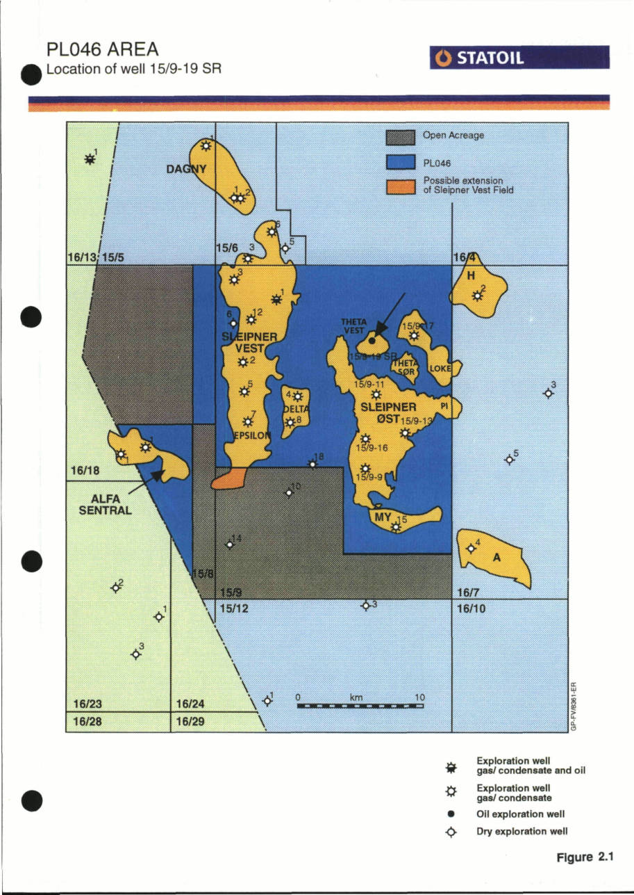

Figure content: colour location map of the PL046 area with block boundaries and block numbers; outlined structures labelled DAGNY, SLEIPNER VEST, EPSILON, DELTA, ALFA SENTRAL, THETA VEST, THETA SØR, LOKE, SLEIPNER ØST, PI, MY, H and A; numbered well symbols, with an arrow pointing to well 15/9-19 SR on THETA VEST; area legend (Open Acreage, PL046, Possible extension of Sleipner Vest Field); well-symbol legend (Exploration well gas/condensate and oil, Exploration well gas/condensate, Oil exploration well, Dry exploration well); scale bar 0–10 km.

<!-- page 18 -->
<!-- type: figure -->

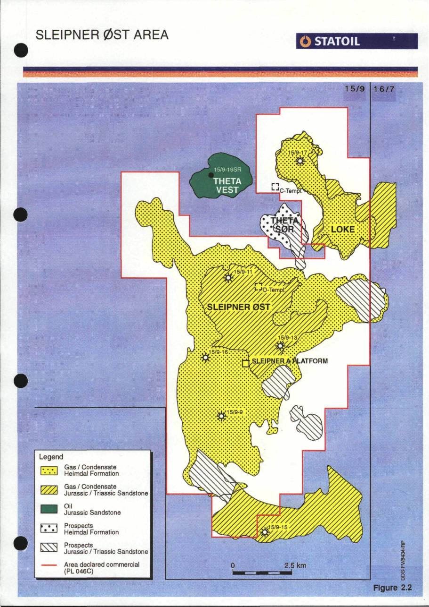

Figure content: colour map of the Sleipner Øst area with the boundary between blocks 15/9 and 16/7; outlined, patterned areas labelled THETA VEST (with well 15/9-19SR), THETA SØR, LOKE and SLEIPNER ØST; well symbols labelled 15/9-17, 15/9-11, 15/9-13, 15/9-16, 15/9-9 and 15/9-15; C-Templ., D-Templ. and SLEIPNER A PLATFORM symbols; legend (Gas / Condensate Heimdal Formation; Gas / Condensate Jurassic / Triassic Sandstone; Oil Jurassic Sandstone; Prospects Heimdal Formation; Prospects Jurassic / Triassic Sandstone; Area declared commercial (PL 046C), drawn as a red outline); scale bar 0–2.5 km.

<!-- page 19 -->
<!-- type: figure -->

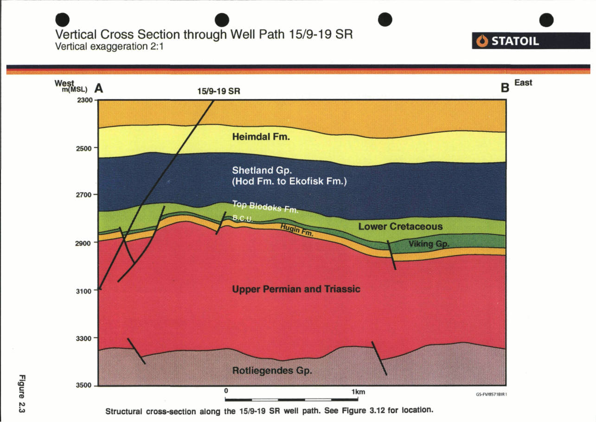

Figure content: colour geological cross-section on a landscape page, headed "Vertical Cross Section through Well Path 15/9-19 SR, Vertical exaggeration 2:1"; from A (West) to B (East); vertical axis depth in m(MSL) from 2300 to 3500; horizontal scale bar 0–1 km; deviated well path of 15/9-19 SR; layers labelled Heimdal Fm., Shetland Gp. (Hod Fm. to Ekofisk Fm.), Top Blodøks Fm., B.C.U., Lower Cretaceous, Viking Gp., Hugin Fm., Upper Permian and Triassic, Rotliegendes Gp.; faults drawn as black lines.

<!-- page 20 -->
<!-- type: text -->

## 3 SEISMIC INTERPRETATION AND MAPPING

A complete documentation of the operators seismic interpretation on the Gamma High is beyond the scope of this report. Only the most relevant data for interpretation of the Theta Vest area is included. Some of the presented maps are preliminary.

### 3.1 Seismic database.

The ST8215R 3D survey was shot in 1982 and reprocessed in 1991. Well planning on the Theta Vest structure was based on interpretation of these data. The quality of the data is varying. The lower Tertiary section, including Top Heimdal Fm. is of poor quality in this area, whereas the Cretaceous section is better. The section below the Base Cretaceous Unconformity is of poor quality. The deep section suffers from some overmigration.

The seismic data are processed with zero phase conversion using check-shot calibrated well logs. Log-calibration analyses, using "Integrate" modelling, have confirmed that the data are fairly close to zero phase.

### 3.2 VSP

A vertical incidence VSP was shot in the well after TD was reached and casing set. The VSP covers the depth range 4580 to 846 m (MD RKB), of which the interval 4580 - 1480 m (MD RKB) had a level spacing of 20 m MD. The VSP data has contributed to correction of the velocities, well ties as well as the seismic mapping of major horizons on the Theta Vest structure.

Figure 3.1 shows a composite plot of VSP spliced with a random line along the wellbore. The Base Cretaceous Unconformity is notably better defined on this VSP section than on the 3D seismic data, especially in the crestal area. The Top Mesozoic Sandstone however, fails to be properly resolved, as the rest of the deep section. The Heimdal Formation is resolved with more internal reflectors than on the 3D data. From visual inspection on Figure 3.1, a negative shift of 5 to 10 ms seems to be necessary for the VSP to match the seismic data. However, when checking the log times on several horizons and comparing them with the 3D seismic data, a general shift is not required (Figure 3.2).

### 3.3 Seismic interpretation

Tie between the major horizons and the stratigraphy in the well is shown on Figure 3.2. Top Heimdal Formation and Base Cretaceous Unconformity were adjusted, based on the

<!-- page 21 -->
<!-- type: text -->

well results and the VSP data. The Top Mesozoic Sandstone was interpreted after the well was drilled.

#### 3.3.1 Top Heimdal Formation

The Top Heimdal Formation reflector, representing top of the Heimdal sandstone, is interpreted regionally in the Sleipner Øst area. It is generally picked in a minimum reflection (white trough), since there is a marked increase in acoustic impedance from the overlying shales to the well consolidated sandstone reservoir.

The Heimdal Formation was the primary target for this well. This reservoir came 50 m TVD deep according to prognosis and was water wet. The VSP data indicated that the Heimdal Formation reflector was picked approximaly 15 ms too high initially. The other reason for the depth-discrepancy is relatively high velocities in the overlying sediments compared to adjacent wells. Therefore the velocity map was adjusted accordingly (Figure 3.3 and Enclosure 1). The corrected Top Heimdal Fm. depth map is shown on Figure 3.4 and Enclosure 2.

The quality of the Top Heimdal horizon is varying. On the Theta Vest structure this horizon is generally weak and hard to define. In the 15/9-19 SR well, the Top Heimdal Formation tie is on the onset of a black peak accordingly to VSP, but is interpreted on the seismic data 1/4 cycle higher, in the white trough.

#### 3.3.2 Top Shetland Group

This is generally the best defined reflector in the Sleipner Øst area, representing the top of the Cretaceous. It is picked in a strong white trough, as there is a marked increase of acoustic impedance from Tertiary sandstones and shales to Cretaceous chalk.

#### 3.3.3 Top Blodøks Formation

The Blodøks Formation is a marly formation near the base of the Shetland Group. In most wells, the top of this formation ties to the onset of a black peak.

#### 3.3.4 Base Cretaceous Unconformity

The Base Cretaceous Unconformity represents a fall in acoustic impedance on top of the Jurassic Draupne Formation in the Viking Group. The horizon is therefore picked on the maximum of a generally strong black peak. The horizon is of importance as it reveals the

<!-- page 22 -->
<!-- type: text -->

Jurassic structuring, both regarding fault block delineation and dips. The Base Cretaceous Unconformity map is given in Enclosure 3 and Figure 3.5.

In the 15/9-19 SR well, the seismic tie should be on two-way time 2.547 sec. according to the velocity log, which is on the maximum of a black peak according to the synthetic seismogram. Originally the B.C.U. was picked at 2.512 sec, one cycle higher. The new interpretation placed the Jurassic section in a down-faulted position (see Figure 3.6). The new seismic tie will not affect the Jurassic/Triassic interpretation in areas outside the down-faulted block.

The B.C.U. reflector is seen to have less amplitude levels near the crest of the structures (see Enclosure 9 and Figure 3.7). A probable reason for this is thinning of the Draupne Formation, probably also thinning of the Heather Formation.

#### 3.3.5 Top Mesozoic Sandstone

The first occurence of sandstone below the Viking Group is denoted Top Mesozoic Sandstone regardless of stratigraphic position. In well 15/9-19 SR it equals the top Hugin Formation.

As the Top Mesozoic Sandstone reflector is the top of a sandstone with generally higher acoustic impedance than the overlying shales, this should be picked at a minimum white trough. Due to the fact that the Viking Group in most Sleipner Øst wells is relatively thin, beyond the resolution of the seismic data, the horizon is hard to tie and interpret consistently. To this should be added that there is a great variation in sand quality and sand thickness throughout the Sleipner Øst area. The interpretation is consistent with and tied to the "Top Hugin Fm." interpreted on Sleipner Vest (Statoil, 1993c).

In the 15/9-19 SR well the Viking Group is only 9.5 m thick. The top of the Hugin Formation is picked 7 ms below the BCU reflector. Top Mesozoic Sandstone time- and depth maps are shown on Enclosures 4 and 5 and also given in Figure 3.8 and 3.9.

#### 3.3.6 Other horizons

In the deepest parts of the seismic dataset, the following two horizons were picked (deeper than TD in 15/9-19 SR):

- Top Smith Bank Formation (interpreted on selected lines).
- Top Rotliegendes Gp.

<!-- page 23 -->
<!-- type: text -->

In the shallow section, the following events are picked:

- Top Pliocene.
- Top Utsira Formation.
- Near Top Oligocen.
- Base Utsira Formation.
- Top Balder Formation.
- Top Lista Formation.

Internally in the Shetland Gp., Top Hod Fm. is interpreted. Based on the tie from the VSP, also the Grid Formation was picked. This appears to have an "eye" - shape, consistent with the sedimentological interpretation of this being a channel deposit. The areal extension of the Grid sands have not yet been mapped. Figure 3.6 illustrates the seismic picks in the Theta Vest area. Time and depth data for the various horizons are listed in Table 5.8.

### 3.4 Depth conversion

Shallow horizons (above the Top Heimdal reflector) were depth converted using interval velocities derived from wells in the area. The Top Heimdal Formation was depth converted using the linear formula:

Vz = V0 + kZ

in which

- Vz = veolocity at depth z
- V0 = initial velocity
- k = compaction factor
- Z = depth (subsea).

The ADLINVEL program estimates the linear velocity function which minimizes the depth difference between the observed and the estimated time/depth data. Based on analyses from 11 wells in the 15/9 block (including 15/9-19 SR), the minimum point for depth residuals occured at k= 0.346, whereas the minimum for standard deviation of V0 occured at k= 0.71 (see Figure 3.10). A similar analysis using the 5 vertical wells on the Gamma High only (15/9-9, -11, -13, -15, -16 and -17), resulted in minimum for depth residuals at k= 0.456. Bearing in mind that the well 15/9-19 SR is highly deviated, less weight is given to that well than to the vertical wells on the Gamma High. Also a larger k-value gives less standard deviation on the V0 values. Therefore k= 0.456 is chosen for the Theta Vest area as for the rest of the Gamma High.

The time/depth relationship as well as velocities from 15/9-19 SR are shown in Figure 3.11. The abnormally high average velocities at Theta Vest, are probably contributed by the Grid sands which are much poorer developed in other wells on the Gamma High. The distribution of the Grid sands is likely to be restricted.

<!-- page 24 -->
<!-- type: text -->

Horizons below Top Heimdal Formation were depth converted using interval velocity grids based on vertical velocities in the wells. Velocity grids were made for the following intervals:

- Top Heimdal Fm. - Top Shetland Gp.
- Top Shetland Gp. - Top Blodøks Fm.
- Top Shetland Gp. - Base Cretaceous Unconformity
- Base Cret. Unc. - Top Rotliegendes Gp.

The composite map of the Base Cretaceous Unconformity shown on Figure 3.5, was depth converted using Linvel function to Top Shetland Group (k=0.728) and velocity grid for the interval Top Shetland - Base Cretaceous Unconformity.

The maps were adjusted in the wells using "AGR" (in IRAP). These residual corrections have been minor. The grid size is 100 x 100 m.

<!-- page 25 -->
<!-- type: figure -->

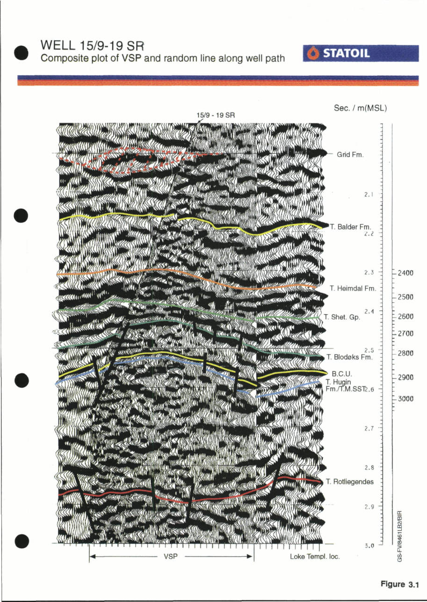

Figure content: seismic section (wiggle traces) with the VSP spliced into a random line along the well path of 15/9-19 SR; right-hand axes two-way time in seconds (2.1 to 3.0) and depth in m(MSL) (2400 to 3000); coloured interpreted horizons labelled Grid Fm. (dashed outline), T. Balder Fm., T. Heimdal Fm., T. Shet. Gp., T. Blodøks Fm., B.C.U., T. Hugin Fm./T.M.SST and T. Rotliegendes; faults drawn as black lines; the extent of the VSP and "Loke Templ. loc." marked along the base.

<!-- page 26 -->
<!-- type: figure -->

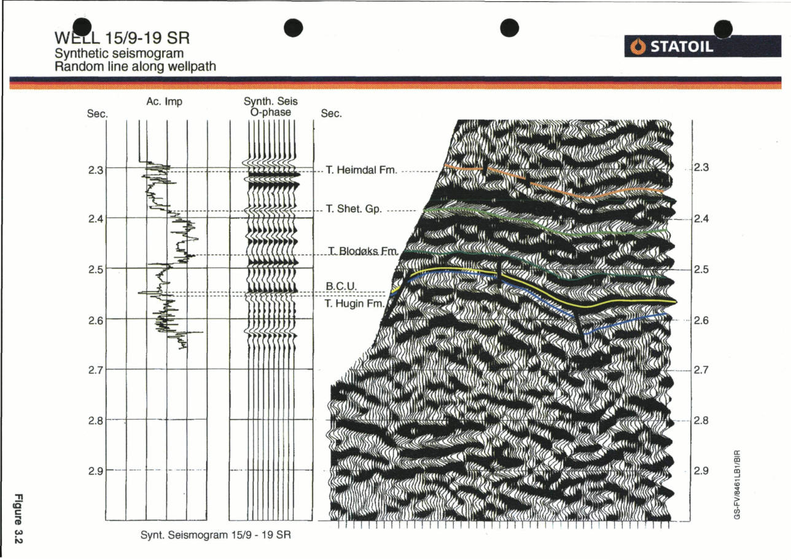

Figure content: seismic well tie on a landscape page; left panels, labelled "Synt. Seismogram 15/9 - 19 SR", show an acoustic impedance log (Ac. Imp) and a zero-phase synthetic seismogram (Synth. Seis 0-phase) against two-way time in seconds (2.3 to 2.9); right panel shows the seismic random line along the well path (wiggle traces) with the same time axis (2.3 to 2.9) and coloured interpreted horizons; dashed tie lines labelled T. Heimdal Fm., T. Shet. Gp., T. Blodøks Fm., B.C.U. and T. Hugin Fm.; faults drawn as black lines.

<!-- page 27 -->
<!-- type: figure -->

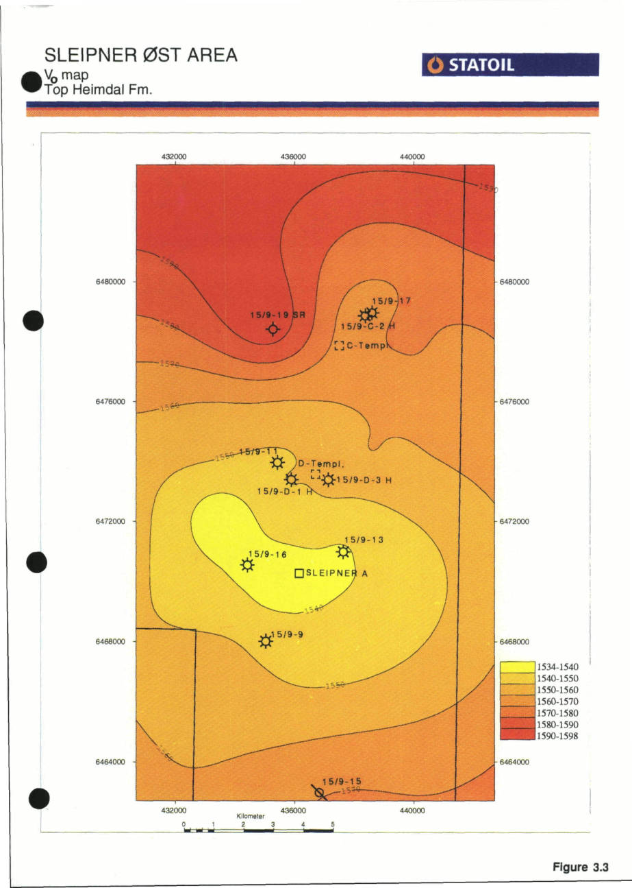

Figure content: colour-filled contour map of V0 at Top Heimdal Fm.; easting axis 432000 to 440000 and northing axis 6464000 to 6480000; labelled contour lines; colour legend in seven classes from 1534-1540 to 1590-1598 (no unit printed); well symbols labelled 15/9-19 SR, 15/9-17, 15/9-C-2 H, 15/9-11, 15/9-D-1 H, 15/9-D-3 H, 15/9-13, 15/9-16, 15/9-9 and 15/9-15; C-Templ., D-Templ. and SLEIPNER A symbols; block boundary lines; scale bar 0–5 Kilometer.

<!-- page 28 -->
<!-- type: figure -->

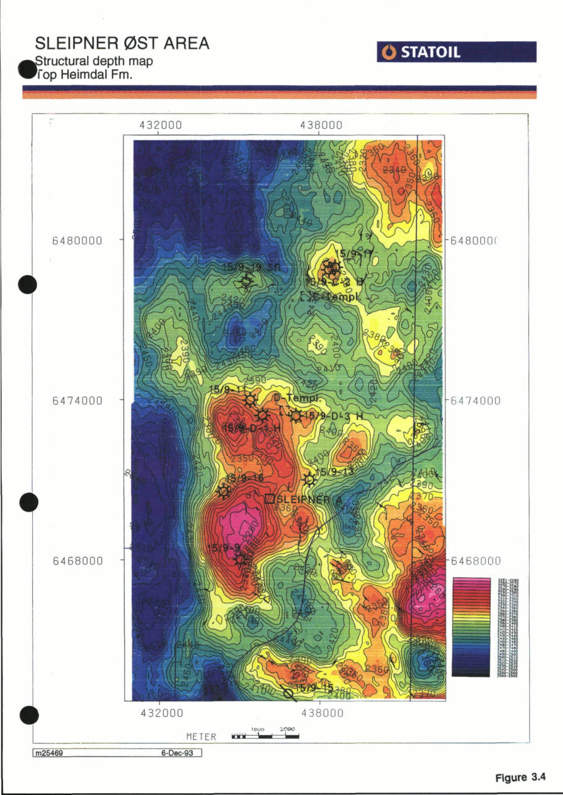

Figure content: colour-filled structural depth contour map of Top Heimdal Fm.; easting axis 432000 to 438000 and northing axis 6468000 to 6480000; densely labelled depth contours; colour legend with many depth classes in print too small to read; well symbols labelled 15/9-19 SR, 15/9-17, 15/9-C-2 H, 15/9-11, 15/9-D-1 H, 15/9-D-3 H, 15/9-13, 15/9-16, 15/9-9 and 15/9-15; C-Templ., D-Templ. and SLEIPNER A symbols; block boundary and fault lines; scale bar in METER (1000, 2000); plot reference m25469, 6-Dec-93.

<!-- page 29 -->
<!-- type: figure -->

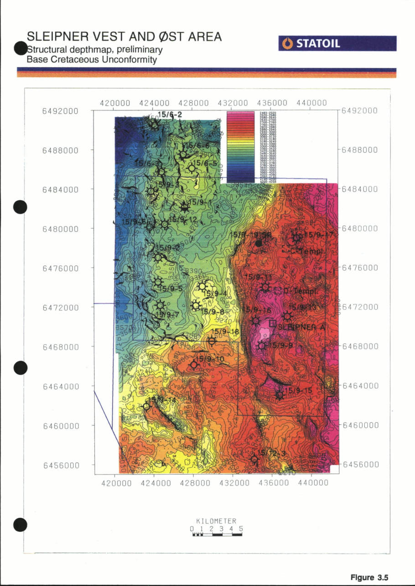

Figure content: colour-filled contour map of depth to the Base Cretaceous Unconformity; x-axis easting 420000–440000, y-axis northing 6456000–6492000; colour scale of depth intervals; fault traces; licence/area outlines; well symbols with names (15/6 and 15/9 wells, including 15/9-19 SR, and 15/12-3), C-Templ., D-Templ. and SLEIPNER A; scale bar in kilometres (0–5).

<!-- page 30 -->
<!-- type: figure -->

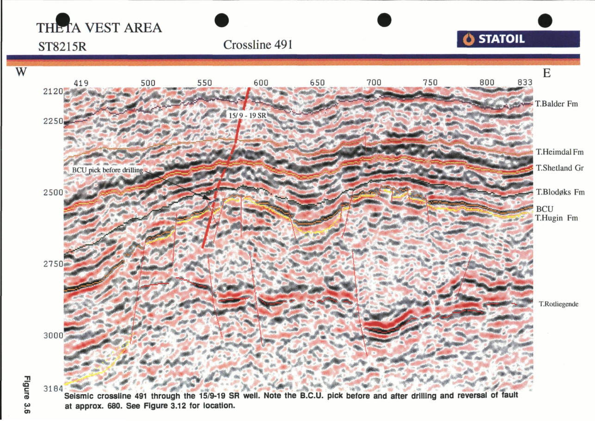

Figure content: interpreted seismic section (colour display), headed "THETA VEST AREA, ST8215R, Crossline 491"; oriented W (left) to E (right); horizontal axis inline numbers 419–833; vertical axis two-way time 2120–3184; interpreted horizons labelled T.Balder Fm, T.Heimdal Fm, T.Shetland Gr, T.Blodøks Fm, BCU, T.Hugin Fm and T.Rotliegende; faults drawn as red lines; path of well 15/9-19 SR drawn as a thick red line; arrow labelled "BCU pick before drilling".

<!-- page 31 -->
<!-- type: figure -->

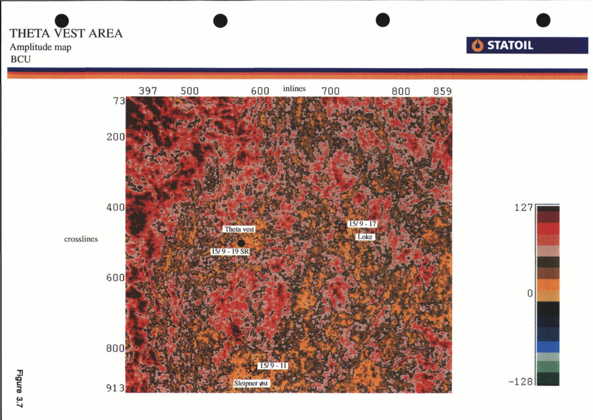

Figure content: colour seismic amplitude map of the BCU; x-axis inlines 397–859, y-axis crosslines 73–913; colour scale from 127 to -128; labels Theta vest with well 15/9-19 SR, Loke with well 15/9-17, and Sleipner øst with well 15/9-11.

<!-- page 32 -->
<!-- type: figure -->

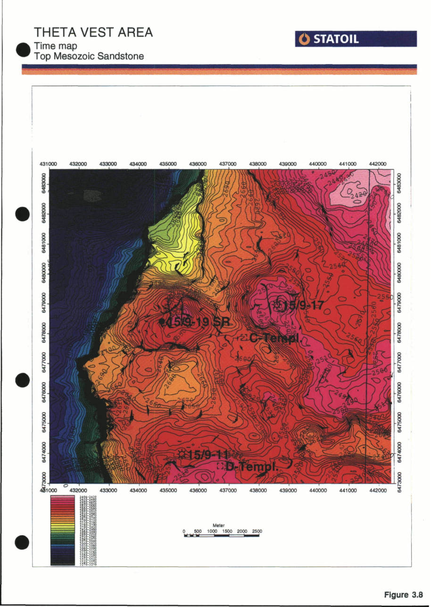

Figure content: colour-filled contour map of two-way time to Top Mesozoic Sandstone; x-axis easting 431000–442000, y-axis northing 6473000–6483000; colour scale of time intervals; fault traces; wells 15/9-19 SR, 15/9-17 and 15/9-11; C-Templ. and D-Templ.; scale bar in metres (0–2500).

<!-- page 33 -->
<!-- type: figure -->

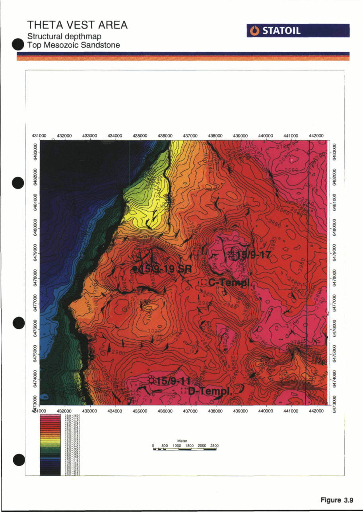

Figure content: colour-filled contour map of depth to Top Mesozoic Sandstone; x-axis easting 431000–442000, y-axis northing 6473000–6483000; colour scale of depth intervals; fault traces; wells 15/9-19 SR, 15/9-17 and 15/9-11; C-Templ. and D-Templ.; scale bar in metres (0–2500).

<!-- page 34 -->
<!-- type: figure -->

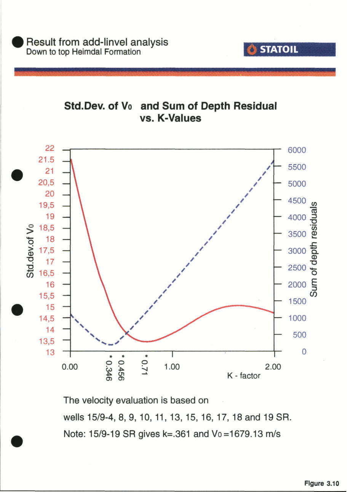

Figure content: line chart titled "Std.Dev. of Vo and Sum of Depth Residual vs. K-Values"; x-axis K - factor 0.00–2.00, with marks at 0.346, 0.456 and 0.71; left axis Std.dev.of Vo 13–22 (solid red curve), right axis Sum of depth residuals 0–6000 (dashed blue curve).

The velocity evaluation is based on wells 15/9-4, 8, 9, 10, 11, 13, 15, 16, 17, 18 and 19 SR.

Note: 15/9-19 SR gives k=.361 and Vo =1679.13 m/s

<!-- page 35 -->
<!-- type: figure -->

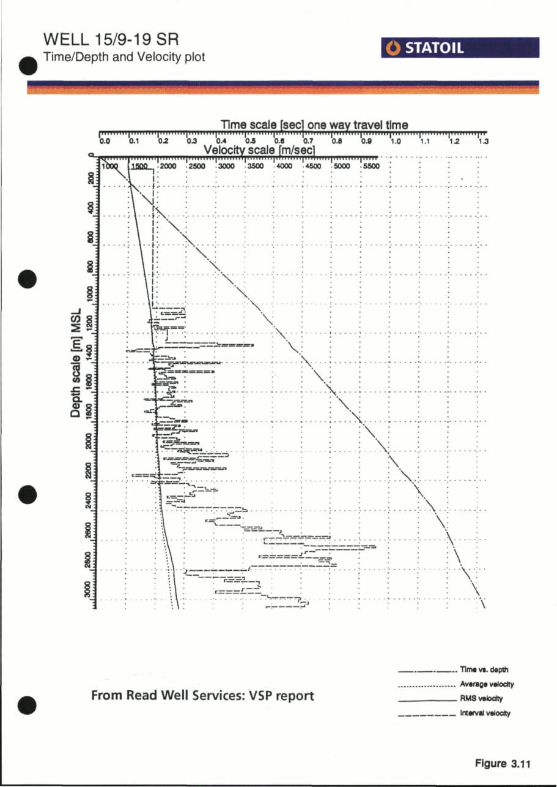

Figure content: plot against depth; vertical axis Depth scale [m] MSL 0–3000; upper horizontal axes Time scale [sec] one way travel time 0.0–1.3 and Velocity scale [m/sec] 1000–5500; curves Time vs. depth, Average velocity, RMS velocity and Interval velocity.

From Read Well Services: VSP report

<!-- page 36 -->
<!-- type: figure -->

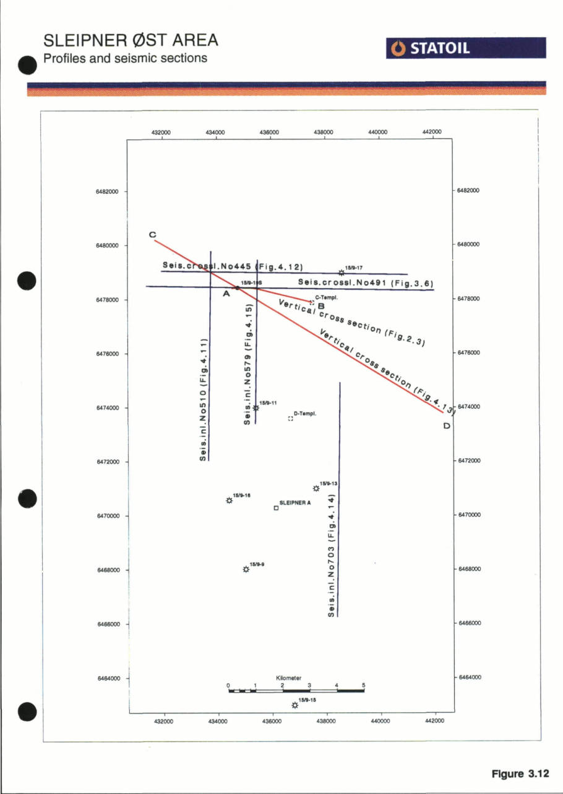

Figure content: location map; x-axis easting 432000–442000, y-axis northing 6464000–6482000; lines showing seismic crosslines No 445 (Fig. 4.12) and No 491 (Fig. 3.6), seismic inlines No 510 (Fig. 4.11), No 579 (Fig. 4.15) and No 703 (Fig. 4.14), and vertical cross sections A–B (Fig. 2.3) and C–D (Fig. 4.13); wells 15/9-9, 15/9-11, 15/9-13, 15/9-15, 15/9-16, 15/9-17 and 15/9-19S; C-Templ., D-Templ. and SLEIPNER A; scale bar in kilometres (0–5).

<!-- page 37 -->
<!-- type: text -->

## 4 STRUCTURAL INTERPRETATION AND TECTONIC DEVELOPMENT

### 4.1 Structural core description

Structural core logging was carried out for cores no. 2 and 3, covering the lower part of the Middle Jurassic Hugin Formation, and the uppermost part of the Triassic Skagerrak Formation.

A core logging scheme for describing and mapping structures at a scale 1:5 was used, including drawings. 15 thin-sections were studied.

The study showed that the rocks contain a high number of natural fractures. Frequency distribution is shown in Figure 4.1.

The fractures are mostly small faults or deformation bands with displacements from a few mm to a few cm (Figure 4.2), and the fracture infill is highly variable in colour.

When studied in thin section, it is observed that most deformation bands have grain crushing/grain size reduction (Figure 4.3). Porosity reduction is often one order of magnitude. Preferred orientation of quartz grain long axes is frequent, and some preferred growth of clay minerals seems possibly to have taken place in many of the deformation bands.

According to researchers at Stanford University, deformation bands may be classified according to the change in porosity (unchanged, compaction, dilatation) and after presence of grain crushing (Antonelli et al., 1993). All these types were found in the core, but the grain crushing/porosity reduction was the most common.

A deformation band with grain crushing and porosity reduction may be viewed as a result of strain hardening, whereas larger faults with localized slip surfaces represent strain softening products. Mechanically, these are different processes.

A few larger faults were recognized by clay smear and striations. It seems that they form zones of weakness where the core easily parts under bending stress.

A partial orientation of the core was made possible by the well deviation (about 40 degrees towards the west). In the west, there is a west-dipping, N-S striking large master fault, and faults were termed synthetic and antithetic relative to this.

All clear cross-cutting relationships in the two cores were analyzed, and it was found that "synthetic before antithetic" was of similar frequency as "antithetic before synthetic".

From this, it may be concluded that the faults observed were formed in a zone of intense and complex deformation. Antithetic and synthetic faults probably formed at roughly the

<!-- page 38 -->
<!-- type: text -->

same time.

General dip of the bedding relative to a plane perpendicular to the core axis was measured in an attempt to record possible fault drag zones (dipmeter was not run due to technical problems). This method contains some uncertainties due to core orientation and observational difficulties due to massive rock etc. The oil stain and often massive character of the Hugin Formation made observations of general bedding dip difficult, especially in the Jurassic. Rotation of bedding was pronounced in two zones:

- (i) 4345-4348 m MD RKB (Triassic). This coincides with major (m-size?) faults with clay smear and striations at 4345 (Figure 4.4) and 4347 m MD RKB. Fracture frequency is high in the upper part, and low in the lower part of the interval.
- (ii) 4355-4362 m MD RKB (Triassic). No major fault has been recorded in this interval. Fracture frequency is low in the upper part (Figure 4.1), and medium in the lower part of the interval. Rotation may have been caused by slumping.

Since grain crushing require some minimum value of the mean stress, it may be concluded that some overburden (Upper Jurassic shales) were present at the time of faulting.

It is assumed that the Upper Jurassic tectonic phase is responsible for most of the fractures. Where displacements can be seen, they dominantly indicate normal faulting. In addition, syn-sedimentary faulting can be seen in the Triassic, especially in the lower part of core no. 3. These are characterized by small associated folding and a combination of normal and reverse faulting. A few post-consolidation reverse faults may be of Cretaceous age.

The Jurassic is oil-filled troughout, but still contains a large number of deformation bands with a possible sealing potential. Sometimes these bands are light and in some cases very thick (up to 10 mm), indicating a "seal". Other bands are dark. See Figure 4.5 and 4.2.

Both light and dark bands show grain crushing and significant porosity reduction under the microscope. A possible explanation is that tight light bands do seal, but the sealing property has a limited lateral extent, and that a significant oil coloumn has broken the seal of the more narrow, dark bands. This may possibly be due to differences in capillary displacement pressure.

Altogether some 400 induced fractures were present in the two cores. They were easily recognized by not containing clay smear/striations or a deformation band of mm-thickness. They fall into two groups, one perpendicular to the core axis with "clean" joint surface (probably caused by bending), and one with joint "swarms" mainly parallel to the core axis and sometimes covered by drilling mud (possibly caused by torsion).

The structural core description is presented in detail in a separate report (Statoil, 1993f).

<!-- page 39 -->
<!-- type: text -->

### 4.2 Estimate of tectonic thinning of the Hugin Fm. in the position of well 15/9-19 SR

Single-well hydrocarbon discoveries with poor seismic resolution give a drilled reservoir thickness that may not be representative for the reservoir within closure. A high degree of faulting by faults of varying size (most of them small) may have thinned the reservoir anomaleously at and near the well trace.

A rough estimate of a representative reservoir thickness may be obtained using a pure-shear or simple-shear analysis based on data from structural core logging. All natural fractures found in the core were assumed to be shear fractures, and a mean displacement is applied to all fractures from (a limited number of) measurable displacements in the core. An initial fault dip of 60 degrees was assumed.

The core part of 52 meter contained 829 fractures (assumed to be faults), with mean displacement of 31 mm based on 42 measurements. The ratio of antithetic faulting (roughly east-dipping) realtive to synthetic faulting was found to be 2:1.

The following procedure was used to estimate tectonic thinning:

1. Structural core logging was carried out (see separate report; Statoil, 1993f). Displacements and numbers of fractures per meter were noted, and drawing of fractures were made.
2. The number of faults encountered in a well is dependent on deviation direction relative to fault plane orientations. The number of fractures (intensity) encountered was corrected for well deviation, recalculated from a 40 degree deviation to zero deviation, assuming horizontal bedding. Both pure-shear and simple-shear models for recalculation were used.
3. For a pure-shear model, tectonic thinning equals sum of throws on faults.
4. For a simple-shear model, a rotated fault block model (rotation is relative to disturbed bedding surface), including the shear angle, is expressing the thinning. The shear angle was found using a numerical procedure.

The results for the Hugin Fm., well 15/9-19 SR (18 m vertical thickness in well position) is as follows:

- unfaulted thickness using pure-shear model is 27.0 m
- unfaulted thickness using simple-shear model is 24.7 m
- interpolated pure-shear/simple-shear model using observed ratio between antithetic and synthetic fractures gives an unfaulted thickness of 25.5 m.

<!-- page 40 -->
<!-- type: text -->

Instead of reducing fault intensity to zero to obtain representative thickness, it may be reduced to a suitable background level, using comparable wells. The calculation of tectonic thinning of reservoir is described in a separate report (Statoil, 1993e).

The method is of limited accuracy due to a limited data set, and lack of control on displacements larger than core dimensions.

### 4.3 Structural and tectonic development

#### 4.3.1 Regional setting

The Sleipner area is located in the south-eastern part of the Viking Graben. The area is situated close to the intersection point between some of the major structural elements of the North Sea. Major structural elements of the Sleipner region are given in Figure 4.6 and Figure 4.7.

At this intersection, the N(NE)-S(SW) striking Viking Graben intersects with the NW-SE striking Central Graben and also the NW-SE striking Norwegian-Danish basin. These strike directions (N-S, NE-SW and NW-SE) are also the dominant strike directions for faults and lineaments in the Sleipner area and have played an important role in the structuring and shaping of the area.

The seismic attribute maps (Enclosure 6 - 11) reveal the lineaments in the Theta Vest - Loke area. The Triassic/Jurassic faults in the Sleipner area are plotted on the Top Mesozoic Sandstone depth map (Enclosure 5) and on the seismic interpretation of the Sleipner Vest Field by Statoil (1993c). A simplified map showing the main faults and lineaments in the Sleipner area is shown in Figure 4.8. Based on this map, some of the main structural features of the Sleipner area are reviewed.

#### 4.3.2 The main fault zone

The Sleipner area is divided into two major structural subareas, the Sleipner Terrace and the Gamma High, by a major fault zone of approximately 1000 m throw in the northern part of the 15/9-block (on Top Rotliegendes level). The fault zone is reaching a maximum 1500 m throw west of the 15/9-11 well and is down to approx. 1000 m west of well no. 15/9-9.

The Sleipner Terrace is located to the west of the main fault zone on the downthrown side. To the west the Sleipner Terrace is bounded by the Viking Graben. The Sleipner Vest Field is located on this terrace.

<!-- page 41 -->
<!-- type: text -->

The Gamma High is located on the eastern upthrown side of the main fault. The Gamma High constitutes the southern extension of the Utsira High. The Sleipner Øst, Loke and Theta Vest are located on the Gamma High.

The main fault zone follows two main directions (see Figure 4.8). In the south, between the Sleipner Øst Field and the southern part of the Sleipner Vest Field, the main fault strike dominantly N-S with a weak deviation towards a NW-SE direction. This direction is steady over a distance of more than 10 kilometer along the Sleipner Øst Field. An extension of the main fault can be followed for more than 10 kilometer south of the field out of the mapped area, as a distinct depression on the Base Cretaceuos map (see Figure 3.5). At the extreme north-western part of the Sleipner Øst Field, right south-west of the Theta Vest structure, the main fault direction changes sharply to a NE-SW direction. This direction can be followed for more than 10 kilometers towards north-east out of the mapped area.

#### 4.3.3 The Sleipner Terrace area

The Sleipner Vest Field is located in the west part of the Sleipner Terrace. Between the Sleipner Vest Field and the main fault to the east, there is a downfaulted basinal area.

The Sleipner Vest Field consists of several major fault blocks. The shape and orientation of these fault blocks is governed by the three main fault and lineament directions N-S, NE-SW and NW-SE (see Figure 4.8). The overall general shape of the Sleipner Vest Field is an anticline.

The southern fault blocks have an overall N-S orientation, while the fault blocks central on the field have an overall NE-SW orientation. This change in orientation coincides with the change in the orientation of the main fault zone from N-S in the south to NE-SW in the north. It is found that the deepest and most well defined basin area between Sleipner Vest and the main fault zone is located in this northern area, and that this basin also have an NE-SW orientation.

The main fault blocks of the Sleipner Vest Field are separated from each other by well defined NW-SE orientated faults and lineaments. This simplified picture is complicated by the fact that faults with the three main directions (N-S, NE-SW and NW-SE) actually are present over the whole field area, but to different degrees. Many of the faults around and within the main fault blocks are composite faults where all the three main directions are playing a part.

As a simplification it can be said that N-S and NW-SE directions dominate in the southern part of the Sleipner Vest Field, NE-SW directions dominate in the central part and N-S NW-SE directions dominate in the northern part. In addition to these three main directions, also faults with E-W directions are found in the central and northern area of the field. This adds to the complicated structural picture of the Sleipner Vest Field.

<!-- page 42 -->
<!-- type: text -->

#### 4.3.4 The Gamma High

There is an apparent difference in the complexity of faulting between the Sleipner Terrace and the Gamma High area. On the Gamma High, including Sleipner Øst, Loke and Theta Vest, the number of mapped faults are few compared to what is observed on the Sleipner Terrace. Also the extension and continuity of the faults are significantly different. The faults on the Gamma High are generally scattered with a limited continuity. This is at least valid in the Post Triassic section.

This difference implicates that the Gamma High is less influenced by faulting activity than the Sleipner Terrace. This can be explained by the fact that it has a more distant position to the Viking Graben area and the tectonics related to its formation.

The observed difference between the two areas can also partly be explained by different influence from the Cretaceous and the Tertiary compressional phases: The Gamma High area and its structures are strongly influenced by doming during these phases. This may have resulted in reverse movements on faults, and thereby masked many of them from seismic resolution and mapping. On the Top Rotliegendes level however, the faults are large in extension and throw (see Enclosure 12 and Figure 4.9).

#### 4.3.5 Structural links between the Gamma High and the Sleipner Terrace

Despite the structural difference between the Gamma High area and the Sleipner Terrace, the two areas do have a common history. The fault and lineament directions on the Gamma High are similar to those on the Sleipner Terrace with the dominating directions N-S, NE-SW and NW-SE. Especially the NW-SE directed faults and lineaments connect the two areas. Although only scattered faults with this direction is observed on the Gamma High, it is found from the seismic attribute maps (Enclosure 6-11) that several distinct and continous lineaments with this direction cut across the Gamma High. The westward extension of these lineaments line up directly with many of the major NW-SE faults mapped over the Sleipner Vest Field and obviously are connected to these. Those lineaments also have significant influence on the shaping of the structures on the Gamma High. Many of the highs and lows on the Gamma High thus have an elongate shape orientated NW-SE.

On the Sleipner Vest Field many of the NW-SE faults and lineaments are expected to be sealing due to changes in fluid contacts across them.

On the Gamma High the main NW-SE lineament cutting across the Sleipner Øst Field, also must be sealing. This may explain the waterbearing Jurrasic/Triassic reservoirs to the south (wells 15/9-9 and 15/9-16) and hydrocarbon bearing Hugin Formation to the north (wells 15/9-11 and 15/9-13).

<!-- page 43 -->
<!-- type: text -->

### 4.4 Tectonic history

The current interpretation seems to confirm the importance of regional lineaments as described in the litterature for this area (Pegrum 1984, Pegrum & Ljones 1984). The NW-SE direction could be an extension of the Tornquist Zone. The main bounding faults to the west and northwest of the Gamma High have directions that conform to the Viking Graben and to the Central Graben. The Tornquist Zone belongs to a set of northwesterly tectonic zones extending into the Fennoscandian - East European Precambrian basement platform. This can be traced from onshore Poland through Southern Sweden, Denmark, the Fjerritslev Fault, the Farsund Basin, the Stavanger Platform and the Sele High. Movements along this zone have occured during several periods and are interpreted to be the response of major plate-tectonic adjustments.

An other fundamental lineament is the Highland Boundary Fault-Ling Graben Alignment. This extends in northeastern direction from the Highlands past southeastern part of the Utsira High, into the Ling Graben (Gage and Doré, 1987), see Figure 4.6.

#### 4.4.1 Paleozoicum

During the Caledonian and Variscan orogenic cycles, the general stress along the Tornquist Zone was compressional with right-lateral movements between the Fennoscandian-East European platform and the rest of Europe. In the Late Devonian, sedimentary basins with a north-northeast trend were formed in the central North Sea areas as an effect of wrench faulting. These basins were subject to widespread deposition of Old Red Sandstone and later also by Early Carboniferous sedimentation. During late Carboniferous, the Variscan compression gave an east-west dominating direction, especially in the southern North Sea. During Permian time, the North Sea area was subject to east-west extension with development of Oslo Graben, Bamle Through and Horn Graben. The Tornquist zone generally acted as a northeastern limit of the Zechstein Salt basin.

In Permian time, the Gamma High in block 15/9, was probably a basin-margin area, based on results in wells 15/9-9 and 15/9-16. These wells proved 20 m and 56 m respectively of anhydritic Zechstein Gp. overlying the Rotliegendes Gp. shaley sandstone and breccia. In contrast, well 15/12-3 to the south had a Zechstein Gp. of 1154 m. Differences in the development of the Rotliegendes also indicates a more basin-margin environment in the Gamma High area. (Pegrum & Ljones 1984). In the Sleipner Terrace area, halokinetic movements probably have been of importance for the formation of the Sleipner Vest structuring, but it is uncertain how thick this salt has been.

<!-- page 44 -->
<!-- type: text -->

#### 4.4.2 Mesozoicum

In the northwestern Europe the Triassic was dominated by regional extension and rifting. During the early rifting phase the dominant lineament directions were north and northeast. The Viking Graben, Central Graben, the Egersund Basin and Moray Firth Basin were formed. The Gamma High, although being an extension of the Utsira High, still received sediments. The present thickness of Triassic sediments is in the order of 300-600m. The isochore map of Top Rotliegendes - Base Cretaceous Unconformity is given in Figure 4.10. Relatively thin Triassic sections in the wells 15/9-11, 15/9-13 and 15/9-16 suggest that parts of the Gamma High had relief during Triassic, resulting in non-deposition and/or erosion at this time (Pegrum & Ljones, 1984).

The Mesozoic extension lead to a reversal of the movements along the Tornquist Zone, from right-lateral/compressional to left-lateral/extensional. There was a regional uplift during Early - Mid Jurassic in the central North Sea with erosion of high areas, also on the Gamma High. Earlier deposited sediments on the Gamma High were largely removed by erosion. There are abundant sandy deposits on the Sleipner Terrace of Bathonian - Callovian age and much thinner development on the Gamma High (of Callovian Hugin Formation).

The Mesozoic extension culminated in Late Jurassic time. The western margin of the Gamma High consists of major normal faults with periodic movements associated with the development of the Viking Graben and Central Graben. There has apparently been a "footwall uplift" yielding a general dip down to the east and with most extensive erosion along the fault margin. During Late Jurassic the vertical movement of the western- and northwestern margin was 400-600m. On the Gamma High there are differences in amplitude between highs and lows for the BCU reflector. This is interpreted to be an effect of local thinning of the Viking Group on these high areas and consequently the structures were in development at least during Upper Jurassic time. This is also supported by observations of structures in the cores (see Chapter 4.1). During the Lower Cretaceous time, the area has been subject to compression with the result that faults were steepened and partly overturned. See Figure 4.11. This has also been observed during the latest seismic interpretation on Sleipner Vest (Statoil 1993c). During Upper Cretaceous there was subsidence and deposition of the marls and chalk of the Shetland Gp.

#### 4.4.3 Cenozoicum

Laramide tectonism and associated drop in sea level caused large paleogeographic changes in the North Sea Area (Ziegler, 1981). The Shetland Platform was subjected to uplift and erosion, giving rise to eastward directed output of clastic sedimentation. This eventually also reached the Sleipner area, providing Heimdal Formation reservoir sands. Some flexuring and faulting of the Top Shetland Gp indicates that faults bounding The Gamma High could have had a minor reactivation in the Paleocene.

<!-- page 45 -->
<!-- type: text -->

The last tectonic event of importance for the Gamma area occured in the Mid Tertiary in connection with Alpine folding. This event resulted in a regional compression and probably also reactivation of the Tornquist lineament, causing doming and creating the hydrocarbon trap in the Paleocene. A possible late phase of the Mid-Tertiary compressional event can be observed in the north-easterly extremes of the 15/9 block, causing local uplift.

#### 4.4.4 Tectonic development of the Gamma High

Based on the known stressfields, the observed lineaments and the stratigraphy encountered in the wells in the Sleipner area, the Gamma High is considered to consist of rotated fault blocks with a complex genetic history.

From the seismic sections on Figure 4.11 and 4.12, it can be seen that there have been reversed movements of some deep faults. The major faults on the T. Rotliegendes level (Enclosure 12, Figure 4.9) can in some cases be traced up to the Base Cretaceous level, but then often with reversed displacement. In some cases, the Jurassic - Lower Cretaceous is flexured over the deep seated block boundaries, and often this section thickens in local graben areas. The Top Rotliegendes, however, will locally be uplifted in some of these low areas, thus forming a pattern of repeated local inversions. See the vertical cross-section through Theta Vest and Theta Sør in Figure 4.13. This pattern can not be explained as result of a single dominating stressfield.

Two models will be briefly discussed here:

### 1. Halokinetic model

The structures on the Gamma High have some resemblance to "turtleback structures", being the result of differential loading, salt doming and subsequent salt-with-drawel: the clastic Post-Permian sedimentation would first be concentrated in local basins separated by salt doming. Upon salt drainage from the area, the former clastic depocenters would become local high areas and supply sediments for deposition in the former salt-dome regions.

This model fails to explain the frequent reversals of major faults penetrating the Rotliegendes. Also this model requires initial salt deposition up to a thickness at which the salt becomes mobile, which is uncertain at the Gamma High (see Chapter 4.3.1), but it can not be excluded that this could have been a mechanism in eastern part of the 15/9 area.

### 2. Shear fault model

Shear faulting will juxtapose fault blocks with different sediment thickness. From the known tectonic history, especially with respect to the shear movements along the Tornquist Zone, shearing could have has some impact on the tectonic development of the Sleipner area. Restoration of the fault blocks is not possible with this model either, and the extension of the Tornquist Zone (at least the magnitude of shear movements) is uncertain. Several

<!-- page 46 -->
<!-- type: text -->

observed features, at least in the Post - Rotliegende section are consistent with the known movements along that lineament. First of all, the above mentioned thickening and flexuration of the Jurassic and Lower Cretaceous sediments, is in agreement with the known extensional stress-field along the Tornquist Zone during that period. Furthermore the abundant NW-SE lineaments cut across to the Sleipner Terrace as well and seems to seperate distinctive fault compartments (see Chapter 4.2.6). The net movements along the lineaments seems to be left-lateral, observed for example on the Sleipner Terrace as cutting local Jurassic basin axes.

Paleocene horizons, like the Top Heimdal Formation seems to have an "dome"-axis running south of well 15/9-11 in the NW-SE direction. Faulting and folding along this axis confirm Post-Paleocene compressional phase. Very locally there are indications of thrusting (on T.Shetland Gp.), along the same lineament. See Figure 3.4, 4.8 and 4.14.

Both Jurassic extension and Early Cretaceous and Tertiary compression appear to have been of importance for the development of the Theta Vest structure, as illustrated on the seismic section in Figure 4.15.

### Conclusion

The "Shear fault model" seems to agree better with the observed data than a purely halokinetic model. The latter model seems unsufficient in order to explain typical observations in the area. On the other hand, salt could have secondary importance locally, especially in eastern parts of the Gamma High. In areas surrounding the Gamma High, salt movements are thought to have accompanied movements of major faults and deposition of Triassic clastic sediments (Pegrum and Ljones, 1984).

It is probable that the two NW-SE trending lineaments, bounding Theta Vest, have had major influence on the development of that structure. The fault blocks seem to be irrestorable in cross-section view (Figure 4.13), but shearing along the lineaments could explain this.

<!-- page 47 -->
<!-- type: figure -->


Figure content: horizontal bar chart under the page title "WELL 15/9-19 SR, Fracture frequency"; chart title "Measured 1 meter intervals"; horizontal axis Fracture frequency, fractures per meter, 0–50; vertical axis Depth m MD RKB, 4328–4382; black and grey bars; note "Extrapolated in the case of missing core".

<!-- page 48 -->
<!-- type: figure -->

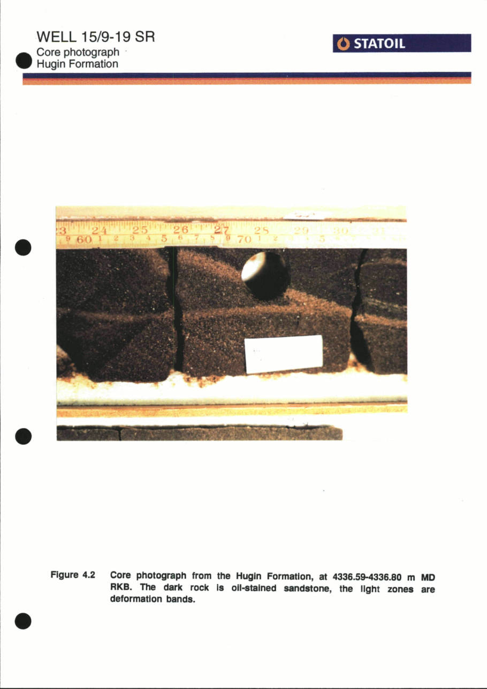

Figure content: colour photograph under the page title "WELL 15/9-19 SR, Core photograph, Hugin Formation"; slabbed core in a core box with a measuring tape along the top, a plug hole and a blank label.

<!-- page 49 -->
<!-- type: figure -->

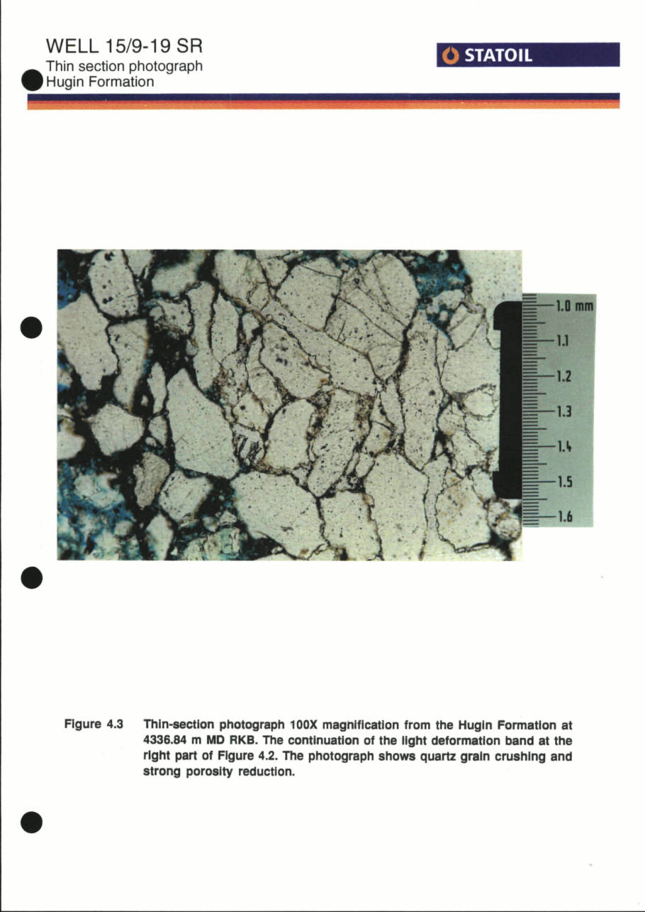

Figure content: colour photomicrograph under the page title "WELL 15/9-19 SR, Thin section photograph, Hugin Formation"; grains with fractures and dark and blue areas between them; scale graticule in mm at the right edge.

<!-- page 50 -->
<!-- type: figure -->

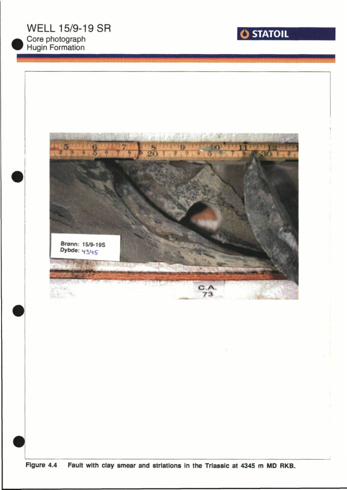

Figure content: colour photograph under the page title "WELL 15/9-19 SR, Core photograph, Hugin Formation"; core pieces in a core box with a measuring tape along the top, a plug hole, a label giving well and depth, and a tag "C.A. 73".

<!-- page 51 -->
<!-- type: figure -->

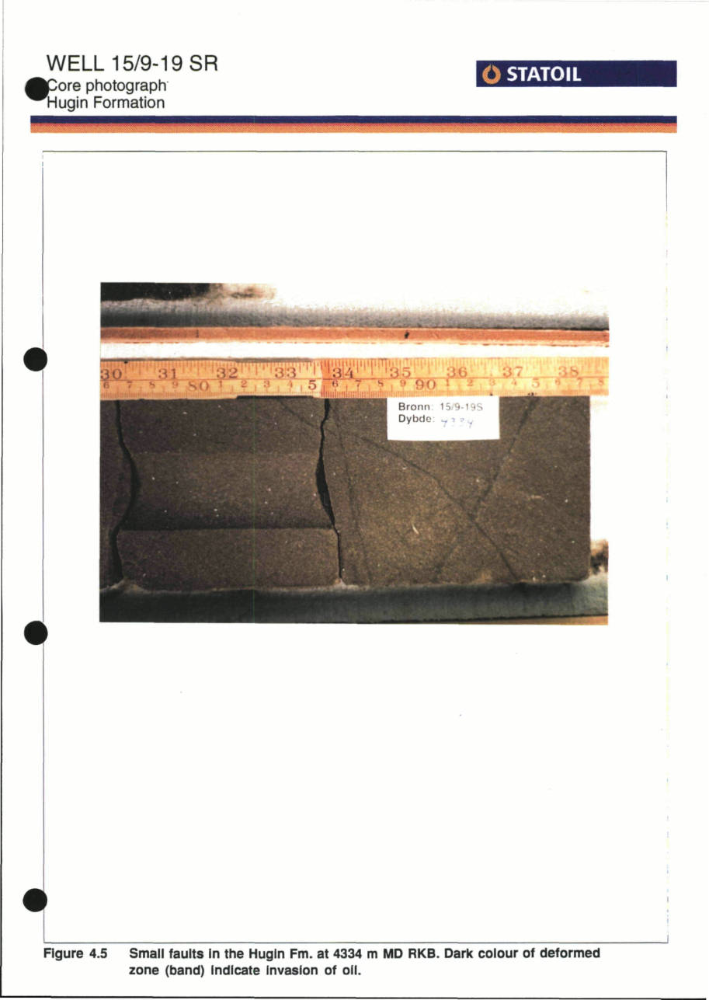

Figure content: colour photograph under the page title "WELL 15/9-19 SR, Core photograph, Hugin Formation"; slabbed core in a core box with a measuring tape along the top, thin dark bands crossing the core, and a label giving well and depth.

<!-- page 52 -->
<!-- type: figure -->

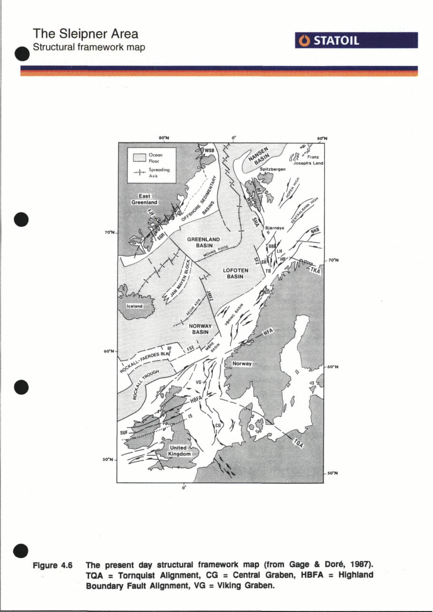

Figure content: black-and-white regional map under the page title "The Sleipner Area, Structural framework map"; North Atlantic and north-west Europe from 50°N to 80°N; land areas hatched (East Greenland, Iceland, Spitzbergen, Norway, United Kingdom); legend for ocean floor and spreading axis; named basins, ridges, fault zones and alignments marked by names and abbreviations.

<!-- page 53 -->
<!-- type: figure -->

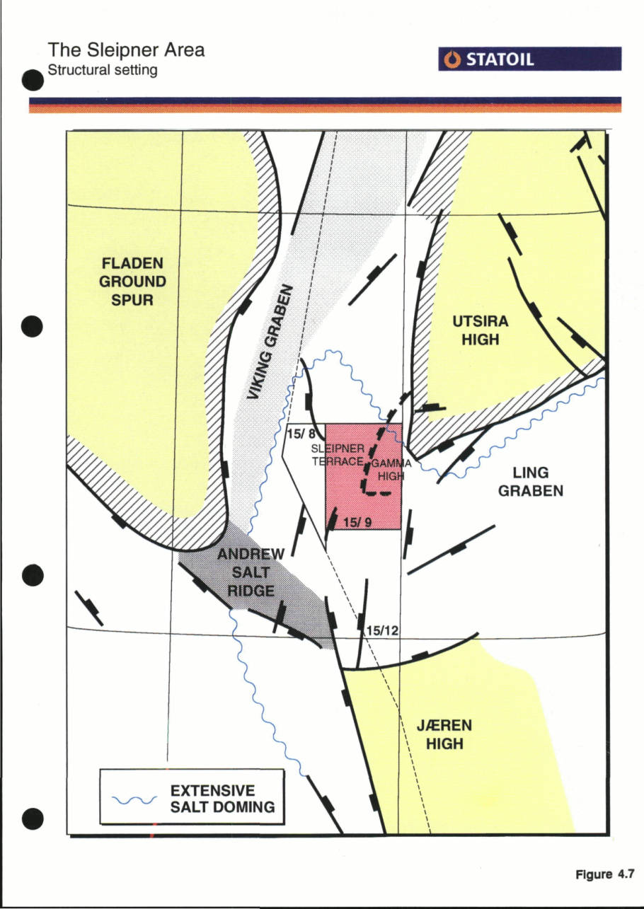

Figure content: colour sketch map of structural elements; highs shaded yellow (Fladen Ground Spur, Utsira High, Jæren High), Viking Graben, Ling Graben, Andrew Salt Ridge; blocks 15/8, 15/9 and 15/12, with Sleipner Terrace and Gamma High marked in block 15/9; fault lines with throw marks; wavy line with legend "EXTENSIVE SALT DOMING".

<!-- page 54 -->
<!-- type: figure -->

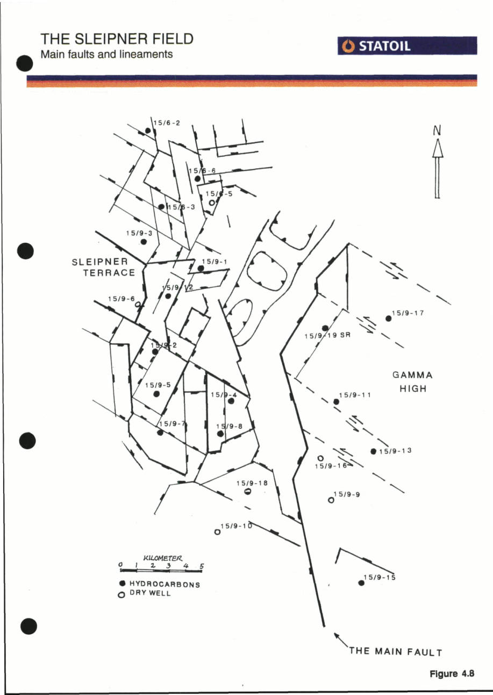

Figure content: black-and-white line map of faults (solid lines with throw marks) and lineaments (dashed lines with shear arrows); areas labelled SLEIPNER TERRACE and GAMMA HIGH; arrow pointing to "THE MAIN FAULT"; wells of blocks 15/6 and 15/9 (including 15/9-19 SR) with legend filled circle = hydrocarbons, open circle = dry well; north arrow; scale bar in kilometres (0–5).

<!-- page 55 -->
<!-- type: figure -->

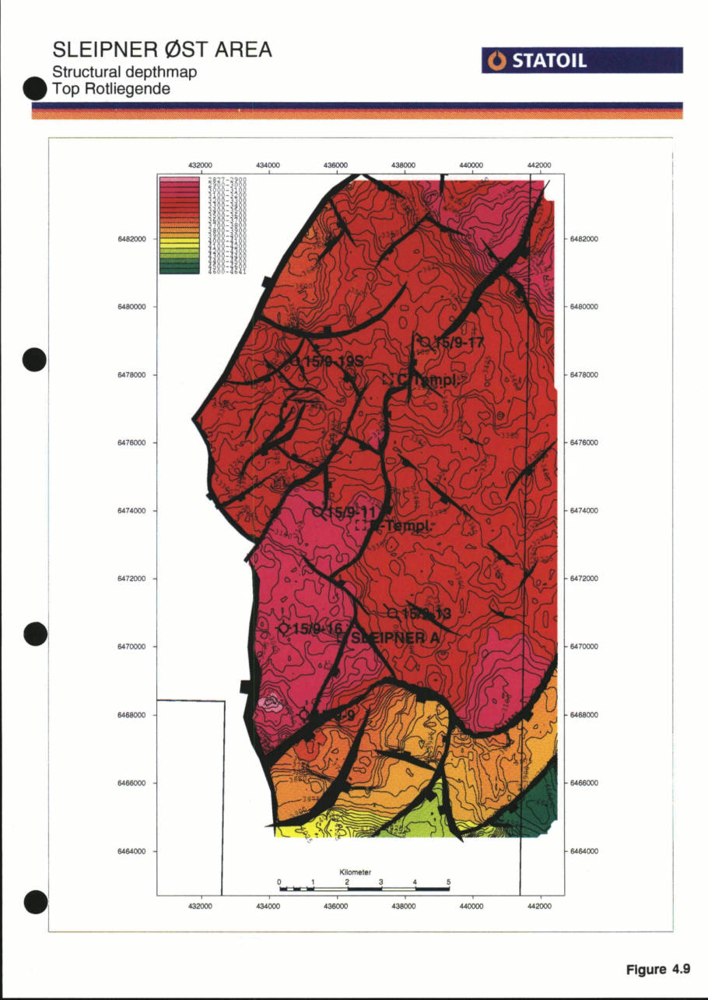

Figure content: colour-filled contour map of depth to Top Rotliegende; x-axis easting 432000–442000, y-axis northing 6464000–6482000; colour scale of depth intervals; fault traces as thick black lines; wells 15/9-9, 15/9-11, 15/9-13, 15/9-16, 15/9-17 and 15/9-19S; C-Templ., D-Templ. and SLEIPNER A; scale bar in kilometres (0–5).

<!-- page 56 -->
<!-- type: figure -->

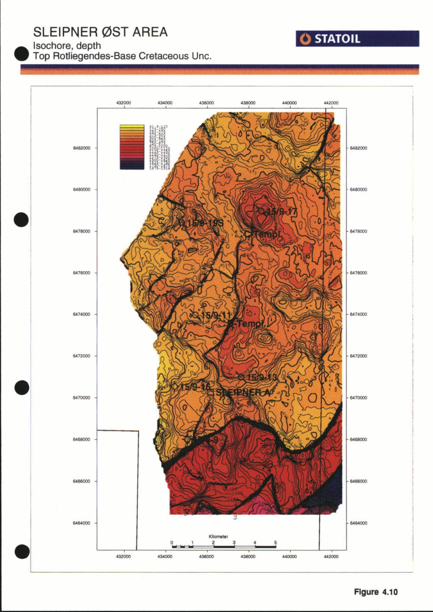

Figure content: colour-filled contour map of thickness between Top Rotliegendes and the Base Cretaceous Unconformity; x-axis easting 432000–442000, y-axis northing 6464000–6482000; colour scale of thickness intervals; fault traces as thick black lines; wells 15/9-9, 15/9-11, 15/9-13, 15/9-16, 15/9-17 and 15/9-19S; C-Templ., D-Templ. and SLEIPNER A; scale bar in kilometres (0–5).

<!-- page 57 -->
<!-- type: figure -->

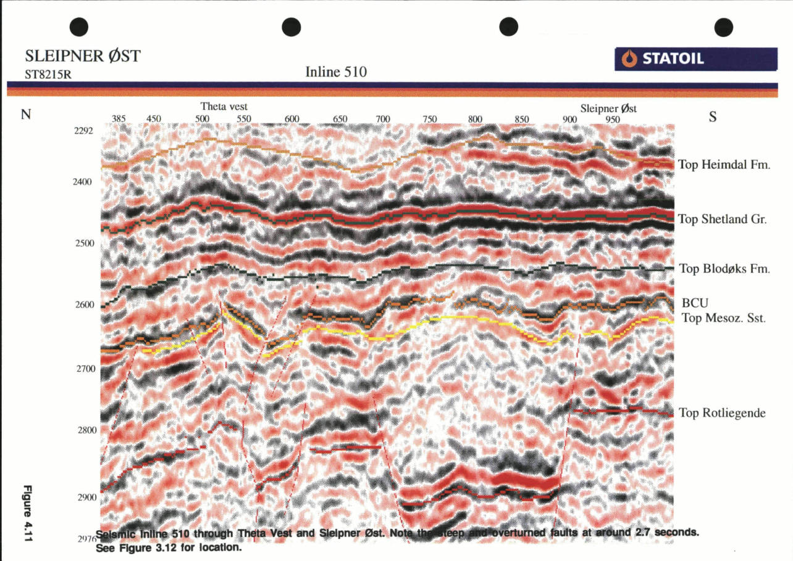

Figure content: interpreted seismic section (colour display), headed "SLEIPNER ØST, ST8215R, Inline 510"; oriented N (left) to S (right); horizontal axis crossline numbers 385–950 with "Theta vest" and "Sleipner Øst" marked above the section; vertical axis two-way time 2292–2976 (ms); interpreted horizons labelled Top Heimdal Fm., Top Shetland Gr., Top Blodøks Fm., BCU, Top Mesoz. Sst. and Top Rotliegende; faults drawn as red dashed lines.

<!-- page 58 -->
<!-- type: figure -->

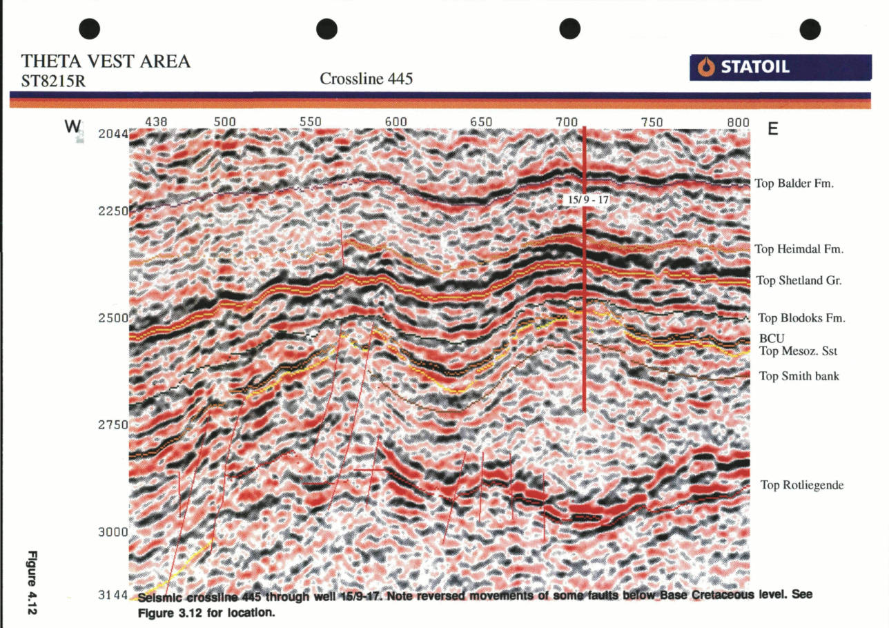

Figure content: interpreted seismic section (colour display), headed "THETA VEST AREA, ST8215R, Crossline 445"; oriented W (left) to E (right); horizontal axis inline numbers 438–800; vertical axis two-way time 2044–3144 (ms); well 15/9-17 drawn as a vertical red line; interpreted horizons labelled Top Balder Fm., Top Heimdal Fm., Top Shetland Gr., Top Blodoks Fm., BCU, Top Mesoz. Sst, Top Smith bank and Top Rotliegende; faults drawn as red lines.

<!-- page 59 -->
<!-- type: figure -->

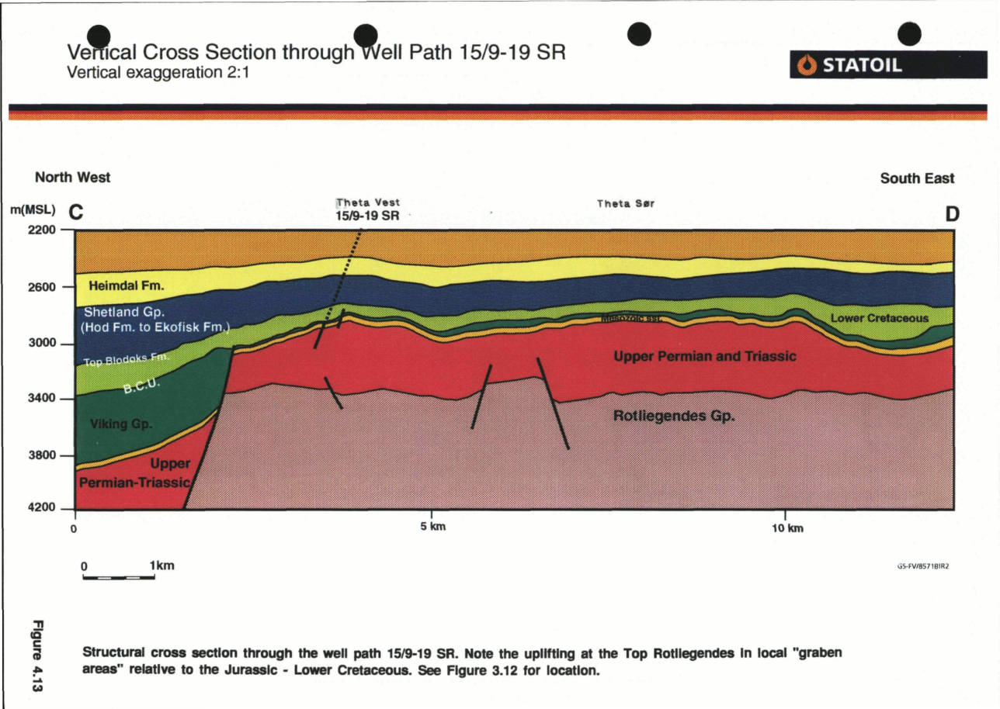

Figure content: coloured geological cross section, headed "Vertical Cross Section through Well Path 15/9-19 SR, Vertical exaggeration 2:1"; from C (North West, left) to D (South East, right); vertical axis depth in m(MSL), 2200–4200; horizontal axis distance 0–10 km, with a 0–1 km scale bar; well path 15/9-19 SR drawn as a dotted line at Theta Vest, with Theta Sør marked further south-east; units labelled Heimdal Fm., Shetland Gp. (Hod Fm. to Ekofisk Fm.), Top Blodøks Fm., B.C.U., Lower Cretaceous, Viking Gp., Mesozoic sst., Upper Permian and Triassic (Upper Permian-Triassic) and Rotliegendes Gp.; faults drawn as black lines; drawing reference GS-FV/8571BIR2.

<!-- page 60 -->
<!-- type: figure -->

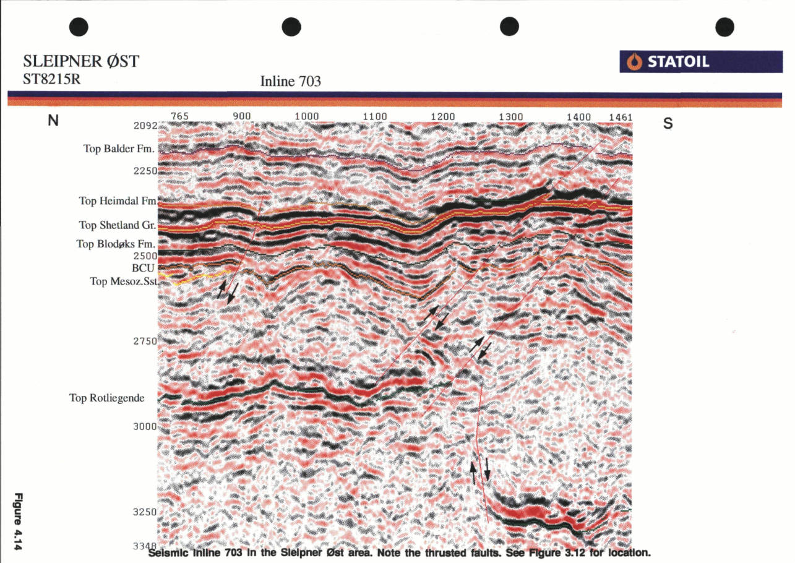

Figure content: interpreted seismic section (colour display), headed "SLEIPNER ØST, ST8215R, Inline 703"; oriented N (left) to S (right); horizontal axis crossline numbers 765–1461; vertical axis two-way time 2092–3348 (ms); interpreted horizons labelled Top Balder Fm., Top Heimdal Fm., Top Shetland Gr., Top Blodøks Fm., BCU, Top Mesoz.Sst. and Top Rotliegende; faults drawn as red lines with pairs of black arrows showing the sense of movement.

<!-- page 61 -->
<!-- type: figure -->

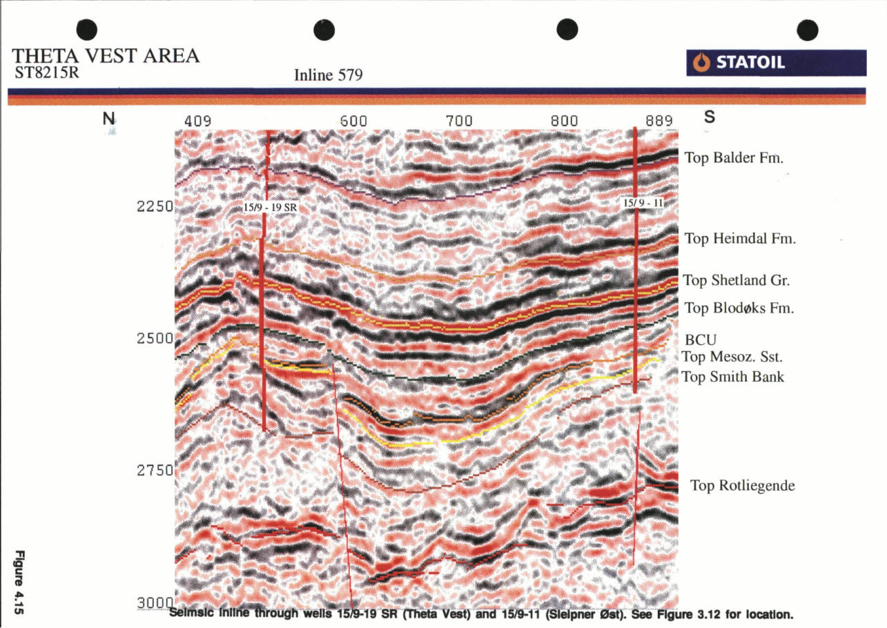

Figure content: interpreted seismic section (colour display), headed "THETA VEST AREA, ST8215R, Inline 579"; oriented N (left) to S (right); horizontal axis crossline numbers 409–889; vertical axis two-way time 2250–3000 (ms); wells 15/9 - 19 SR and 15/9 - 11 drawn as vertical red lines; interpreted horizons labelled Top Balder Fm., Top Heimdal Fm., Top Shetland Gr., Top Blodøks Fm., BCU, Top Mesoz. Sst., Top Smith Bank and Top Rotliegende; faults drawn as red lines.

<!-- page 62 -->
<!-- type: text -->

## 5 GEOLOGICAL INTERPRETATION

### 5.1 Introduction

The core cut through the Hugin and the Skagerrak Formations, has been analysed and described in detail with respect to palynology, sedimentology and structural geology. In addition, the mineralogy and petrography of these sandstones, and their reservoir quality have been analysed. These data, together with the wireline logs and correlation to neighbouring wells, have been applied in the description of the sedimentary environment in the Sleipner Øst area.

### 5.2 Biostratigraphy

Selective palynological analyses have been undertaken on core samples from the interval 4332.80 - 4380.96 m. In addition, selective new analyses have been undertaken on 15/9-17 and integrated with existing data over the interval 2717.58 - 2739.55 m. Furthermore, existing datasets for the basal Heather - Hugin Formations in 15/9-9, 15/9-11, 15/9-13, 15/9-15 and 15/9-16 have been reviewed.

The results from 15/9-19 SR are discussed in relation to these other sections. Figure 5.1 schematically illustrates the chronostratigraphy of these wells in relation to the Jurassic stratigraphy of wells in the Sleipner Vest area, as reported in Statoil (1993d).

Depths referred to are drilled depths (RKB) unless stated otherwise. Core depths are therefore uncorrected. Depths quoted to integers indicate ditch cuttings samples, depths quoted to one decimal place indicate sidewall cores, and to two places indicate core depths.

<!-- page 63 -->
<!-- type: mixed -->

#### 5.2.1 Chronostratigraphy

*Table 5.1 – 15/9-19 SR, biostratigraphy, Statoil 1993.*

| Depth (M) | Lithostratigraphic tops | Age |
|---|---|---|
| 4316.5 (log) | Hugin Formation | |
| 4332.80-4339.22 | | Late? Callovian |
| 4340.65-4343.63 | | Callovian |
| 4340.0 (log) | Skagerrak Formation | |
| 4380.96 | | indeterminate |

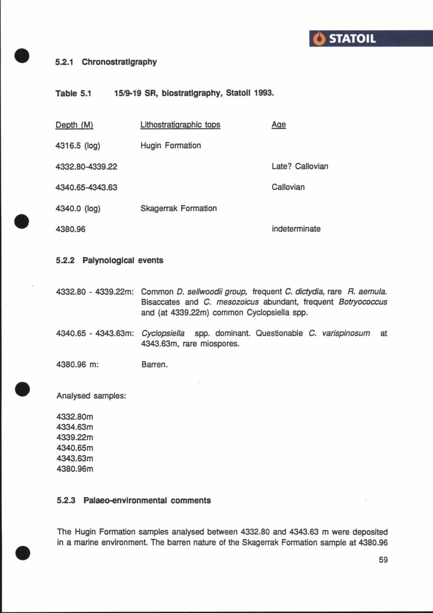

#### 5.2.2 Palynological events

4332.80 - 4339.22m: Common D. sellwoodii group, frequent C. dictydia, rare R. aemula. Bisaccates and C. mesozoicus abundant, frequent Botryococcus and (at 4339.22m) common Cyclopsiella spp.

4340.65 - 4343.63m: Cyclopsiella spp. dominant. Questionable C. varispinosum at 4343.63m, rare miospores.

4380.96 m: Barren.

Analysed samples:

- 4332.80m
- 4334.63m
- 4339.22m
- 4340.65m
- 4343.63m
- 4380.96m

#### 5.2.3 Palaeo-environmental comments

The Hugin Formation samples analysed between 4332.80 and 4343.63 m were deposited in a marine environment. The barren nature of the Skagerrak Formation sample at 4380.96

<!-- page 64 -->
<!-- type: text -->

m precludes positive interpretation although such samples are suggestive of non-marine, high energy fluvio-deltaic or terrestrial, oxidised environments.

Within the Hugin Formation, the marine acritarch Cyclopsiella spp. dominates assemblages at 4343.63 and 4340.65 m and is common at 4339.22 m. The abundance of this form suggests the possibility of stressed (shallow, high energy?) marine conditions at these levels. Dinoflagellate cysts are rare in the afore-mentioned samples but increase in numbers and diversity in the overlying interval 4334.63 - 4332.80 m. This suggests a slightly less "stressed", more "normal" marine environment although the dominance of a few species still indicates a relatively stressed (shallow?) marine environment.

Miospores are extremely rare in the Hugin Formation indicating either minimal sediment input from a vegetated terrestrial source or destruction/winnowing in a high energy environment. The consistent presence of the alga Botryococcus spp. indicates minor input/runoff from a freshwater source.

#### 5.2.4 Comparison with 15/9-9, -11, -13, -15, -16 and -17 wells

The Hugin Formation in 15/9-19 SR is Callovian in age and probably Late Callovian. A more precise dating is hindered by the sandy and thereby relatively "clean" nature of the facies which restricts the recovery of age diagnostic palynomorphs.

The age of this sandstone therefore probably correlates with the 15/9-11 Hugin Formation between the top of the formation at 2795.0 (log) and 2809.5 m where Middle Callovian sediments are identified.

The section is also time equivalent to the 15/9-13 Hugin Formation between 2763.0 (log) and 2770.88 m. The lower part of the Hugin Formation in 15/9-13 cannot be precisely dated due to the presence of facies unfavourable for recovery of age -diagnostic palynomorphs.

In 15/9-9, a time equivalent package is developed in the shale facies of the Heather Formation between the top of the formation at 2627.0 (log) and 2633.0 m where Middle Callovian sediments are identified.

Time equivalent sections are not developed in either the 15/9-15 or 16 wells. In 15/9-15 an Early Oxfordian aged Heather Formation directly overlies presumed Triassic Skagerrak Formation sediments. In 15/9-16, presumed Triassic Smith Bank Formation sediments are overlain by Early Cenomanian aged Chalk Group sediments.

Four core samples were prepared and analysed from 15/9-17 over the interval 2717.50 - 2739.45m. In addition, existing slides from the overlapping interval 2716.20 - 2755.33m were re-analysed. This cored sandstone interval proved to be barren of in situ palynomorphs and the age is therefore indeterminate.

<!-- page 65 -->
<!-- type: table -->

#### 5.2.5 Biostratigraphy of the 15/9-9, 11, 13, 15, 16 and 17 wells

*Table 5.2 – 15/9-9, biostratigraphy, RRI (1981).*

| Depth (M) | Lithostratigraphic tops | Age |
|---|---|---|
| 2625.0 (log) | Draupne Formation | |
| 2626.0 | | "Middle" Kimmeridgian |
| | ---Hiatus--- | |
| 2627.0 (log) | Heather Formation | |
| 2628.0-2630.5 | | Late Callovian |
| 2633.0-2637.0 | | Middle Callovian |
| | ---Hiatus--- | |
| 2642.0 (log) | Skagerrak Formation | |
| 2668.75-2749.45 | | indeterminate |

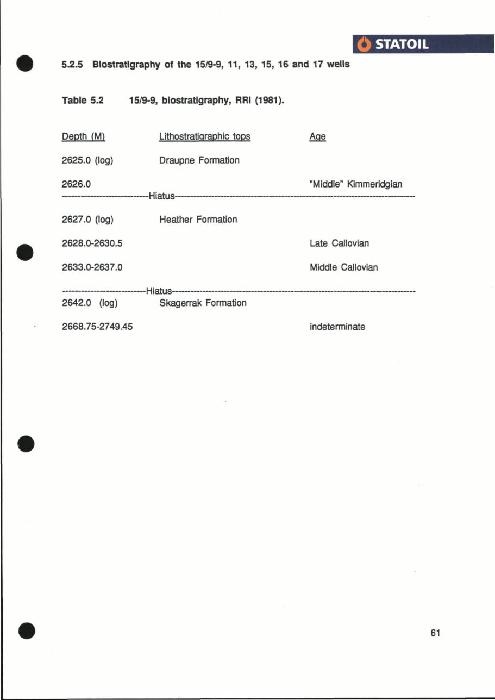

<!-- page 66 -->
<!-- type: table -->

*Table 5.3 – 15/9-11, biostratigraphy, RRI (1982a).*

| Depth (M) | Lithostratigraphic tops | Age |
|---|---|---|
| 2752.0 (log) | Draupne Formation | |
| 2754 | | Kimmeridgian |
| 2760 | | E. Kimmeridgian |
| 2765.0 | | L. Oxfordian |
| 2770 | | M. Oxfordian |
| 2776.0 (log) | Heather Formation | |
| 2782.0 | | M. Oxfordian |
| 2795.0 (log) | Hugin Formation | |
| 2809.5 | | M. Callovian |
| | ---Hiatus--- | |
| 2830.0 (log) | Smith Bank Formation | |

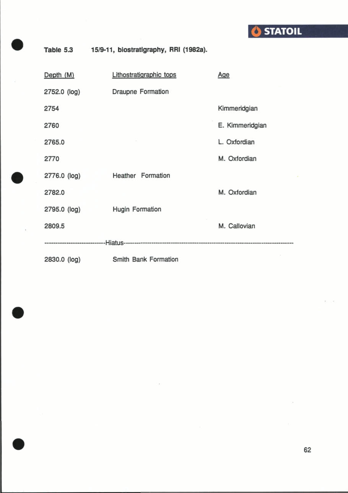

<!-- page 67 -->
<!-- type: table -->

*Table 5.4 – 15/9-13, biostratigraphy, RRI (1982b).*

| Depth (M) | Lithostratigraphic tops | Age |
|---|---|---|
| 2762.0 (log) | Heather Formation | |
| 2762.9 | | Early Oxfordian |
| 2763.5 (log) | Hugin Formation | |
| 2768.45 | | ?Callovian |
| 2769.10-2770.88 | | Late Callovian |
| 2771.1-2789.9 | | ?Callovian |
| | ---Hiatus--- | |
| 2791.0 (log) | Smith Bank Formation | |

*Table 5.5 – 15/9-15, biostratigraphy, RRI (1982c).*

| Depth (M) | Lithostratigraphic tops | Age |
|---|---|---|
| 2756.0 (log) | Heather Formation | |
| 2768.0-2793.0 | | Kim.-Middle Oxfordian |
| 2805.33-2809.71 | | Middle Oxfordian |
| 2817.35 | | Early Oxfordian |
| | ---Hiatus--- | |
| 2821.0 (log) | Skagerrak Formation | |

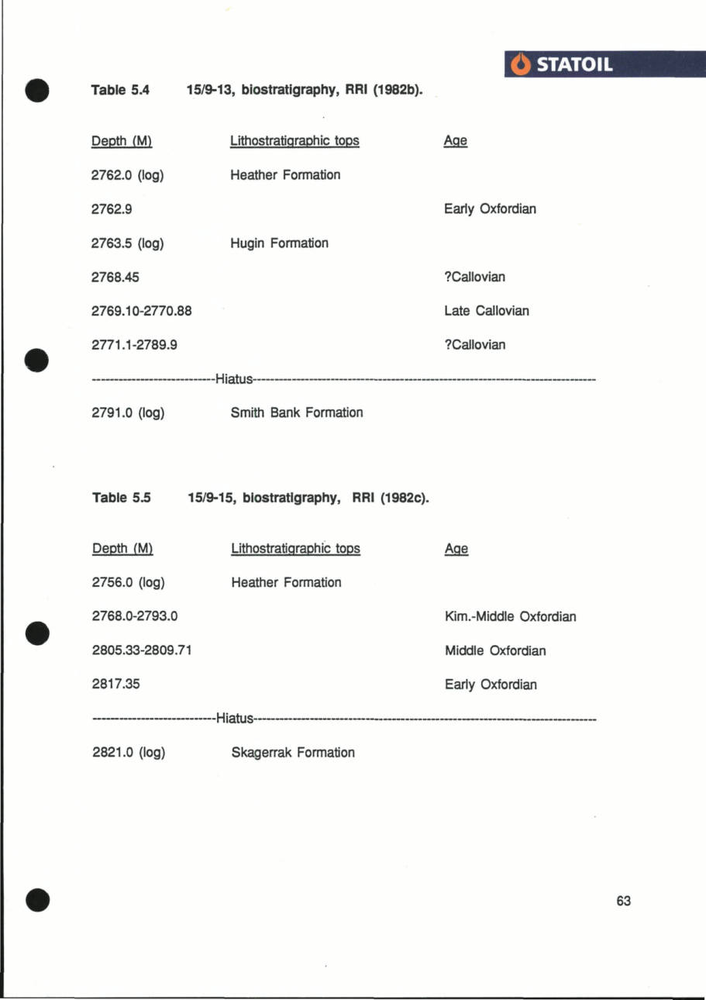

<!-- page 68 -->
<!-- type: mixed -->

*Table 5.6 – 15/9-16, biostratigraphy, RRI (1983a).*

| Depth (M) | Lithostratigraphic tops | Age |
|---|---|---|
| 2643.0 (log) | Chalk Group, Plenus Marl Fm | |
| 2690.2 | | Early Cenomanian |
| | ---Hiatus--- | |
| 2705.0 (log) | Smith Bank Formation | |
| 2707.5 | | indeterminate |

*Table 5.7 – 15/9-17, biostratigraphy, RRI (1983b) and Statoil 1993.*

| Depth (M) | Lithostratigraphic tops | Age |
|---|---|---|
| 2715.0 | ? Hugin/Skaggerrak Formation | |
| 2716.20-2755.33 | | indeterminate |
| 2847.0 | Smith Bank Formation | |

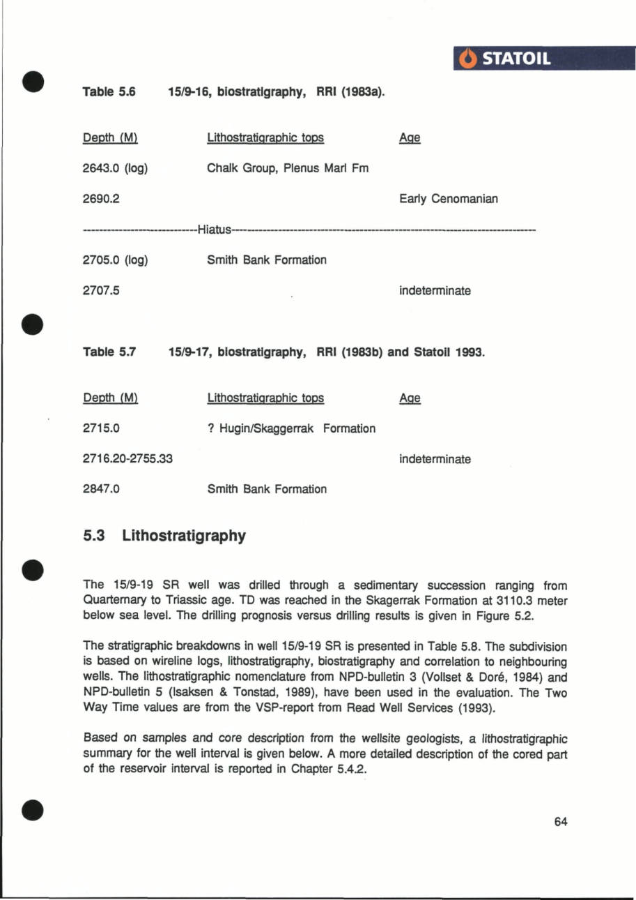

### 5.3 Lithostratigraphy

The 15/9-19 SR well was drilled through a sedimentary succession ranging from Quarternary to Triassic age. TD was reached in the Skagerrak Formation at 3110.3 meter below sea level. The drilling prognosis versus drilling results is given in Figure 5.2.

The stratigraphic breakdowns in well 15/9-19 SR is presented in Table 5.8. The subdivision is based on wireline logs, lithostratigraphy, biostratigraphy and correlation to neighbouring wells. The lithostratigraphic nomenclature from NPD-bulletin 3 (Vollset & Doré, 1984) and NPD-bulletin 5 (Isaksen & Tonstad, 1989), have been used in the evaluation. The Two Way Time values are from the VSP-report from Read Well Services (1993).

Based on samples and core description from the wellsite geologists, a lithostratigraphic summary for the well interval is given below. A more detailed description of the cored part of the reservoir interval is reported in Chapter 5.4.2.

<!-- page 69 -->
<!-- type: table -->

*Table 5.8 – Table of lithostratigraphy, well 15/9-19 SR.*

| Lithostratigraphic tops. | Depth MD (m RKB) | Depth TVD (m MSL) | Thickness (m) | TWT (sec.) |
|---|---|---|---|---|
| NORDLAND GROUP | 106.0 | 84.0 | 950.3 | 0.113 |
| Utsira Fm | 847.8 | 817.5 | 216.8 | 0.880 |
| HORDALAND GROUP | 1107.5 | 1034.3 | | 1.10 |
| Skade Fm | 1313.0 | 1156.3 | 73.9 | 1.220 |
| Grid Fm | 3008.0 | 2040.2 | 129.4 | 2.020 |
| ROGALAND GROUP | 3301.6 | 2206.8 | | 2.140 |
| Balder Fm | 3301.6 | 2206.8 | 61.2 | 2.152 |
| Sele Fm | 3402.5 | 2268.0 | 50.0 | |
| Lista Fm | 3483.0 | 2318.0 | 87.0 | 2.230 |
| Heimdal Fm | 3622.5 | 2405.0 | 122.6 | 2.309 |
| SHETLAND GROUP | 3827.0 | 2527.6 | | |
| Ekofisk Fm | 3827.0 | 2527.6 | 14.9 | 2.384 |
| Tor Fm | 3850.0 | 2542.5 | 127.2 | |
| Hod Fm | 4046.5 | 2669.6 | 70.8 | |
| Blodøks Fm | 4150.0 | 2740.4 | 12.5 | 2.479 |
| Hidra Fm | 4167.5 | 2752.9 | 5.7 | |
| CROMER KNOLL GROUP | 4175.5 | 2758.6 | | |
| Rødby Fm | 4175.5 | 2758.6 | 8.7 | |
| Sola Fm | 4187.5 | 2767.3 | 9.8 | |
| Aasgard Fm | 4201.0 | 2777.2 | 77.3 | |
| VIKING GROUP | 4304.0 | 2854.4 | | |
| Draupne Fm | 4304.0 | 2854.4 | 4.2 | 2.547 |
| Heather Fm | 4309.5 | 2858.6 | 5.4 | |
| VESTLAND GROUP | 4316.5 | 2864.0 | | |
| Hugin Fm | 4316.5 | 2864.0 | 18.0 | 2.554 |
| TRIASSIC GROUP | 4340.0 | 2882.0 | | |
| Skagerrak Fm | 4340.0 | 2882.0 | 228.2 | 2.565 |
| TD | 4641.0 | 3110.3 | | |

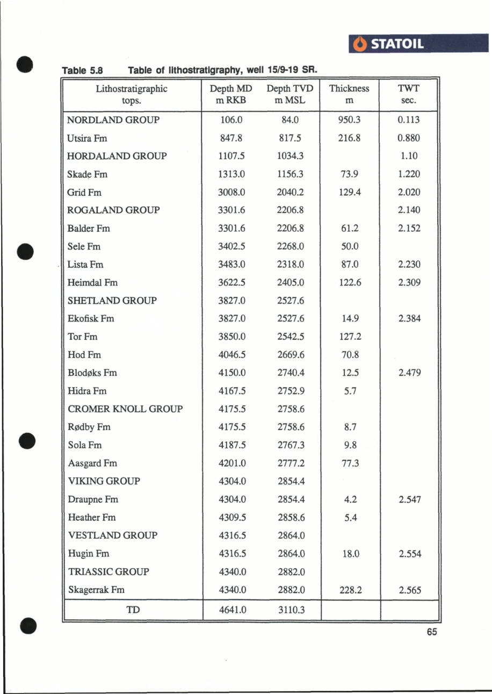

<!-- page 70 -->
<!-- type: text -->

#### 5.3.1 The Nordland Group (84.0 - 1034.3 mMSL)

The group comprises of silty claystones with some minor sand stringers, down to the top of the Utsira Formation. The claystone is dark greenish grey, soft, soluble, sticky, micromicaceous to micaceous, moderate to very calcareous, sandy and silty, locally grading to siltstone. The siltstone is olive grey, soft, sandy, very argillaceous, micromicaceous and slightly to moderate calcareous. The sand consists of clear, translucent quartz grains. The grains are medium, occasionally coarse, subangular to subrounded and loose. Traces of lithic fragments are recorded in the section.

The Utsira Formation (817.5 - 1034.3 mMSL) consists of mainly sand with some claystone stringers. The sand is composed of transparent to translucent, occasionally opaque quartz. The grains are fine to medium, subangular to subrounded, poor to moderate sorted and loosely packed, occasionally with white calcareous matrix. The claystone is medium grey, soft, sticky, slightly to very silty, locally micromicaceous and slightly calcareous. Shell fragments, forams and glauconite are very common in the formation.

#### 5.3.2 The Hordaland Group (1034.3 - 2206.8 mMSL)

The upper part consists of mainly claystone with some limestone stringers. The claystone is olive grey, occasionally dark greenish grey, soft to firm, locally subfissile, silty and non to slightly calcareous. Traces of glauconite are dispersed in the claystone. The limestone is white, soft, micritic, occasionally light grey, hard and cryptocrystalline.

Two sand sequences are encountered, the first being the Skade Formation (1156.3 - 1230.3 mMSL). The second one is the Grid Formation (2040.2 - 2169.6 mMSL), which itself is made up of an upper and lower sand. These sands are predominantly medium, with minor fine and coarse fractions and well sorted. Below the Grid Formation the lower Hordaland Group consists of pale green/blue grey to grey and grey brown claystones. Frequent hard limestone and dolomitic stringers are encountered.

#### 5.3.3 The Rogaland Group (2206.8 - 2527.6 mMSL)

The Balder Formation (2206.8 - 2268.0 mMSL) is composed dominantly of light to dark grey to green grey and occasionally red brown claystone with casual limestone stringers and tuffaceous horizons.

The Sele Formation (2268.0 - 2318.0 mMSL) consists of dark grey to brown grey claystone with thin limestone and dolomitic stringers. Occasional tuffs are observed in the upper part of Sele.

The claystone of the Lista Formation (2318.0 - 2405.0 mMSL) are medium to dark initially,

<!-- page 71 -->
<!-- type: text -->

becoming pale to medium olive/green grey and pale to medium grey. Frequent dolomitic limestone and limestone stringers are encountered, generally becoming increasingly calcareous and less dolomitic with depth.

The Heimdal Formation (2405.0 - 2527.6 mMSL) consists of a massiv sandstone with claystone beds and minor calcareous sandstones. The sandstone is predominantly found as loose clear quartz, with occasional red stained grains and rare lithic fragments. The grain size is predominantly very fine to medium, and occasionally coarse. In the core the sandstone is seen to be mainly cemented with silica and clay matrix. Although some elongate grains are observed, the grains are general subangular to subrounded and mainly subspherical. Furthermore, they are very poorly sorted. The claystone beds are predominantly greenish grey and rarely micropyritic.

#### 5.3.4 The Shetland Group (2527.6 - 2758.6 mMSL)

The Ekofisk Formation (2527.6 - 2542.5 mMSL) is recognised as an off white to occasionally light grey limestone, with minor greenish grey claystone. The limestone is mainly microcrystalline to cryptocrystalline and moderately argillaceous in part.

The Tor Formation (2542.5 - 2669.6 mMSL) consists of a predominantly white limestone, hard and brittle with chalky texture in places. It is dominantly micritic, but also microcrystalline and cryptocrystalline in places. No chert is observed. Rare thin laminations of light grey claystone are observed within the limestone.

No obvious lithological change can be seen into the Hod Formation (2669.6 - 2740.4 mMSL). The Formation has been picked by a decrease in resistivity and a minor gamma peak. With depth the limestone locally becomes argillaceous and grades into a marl. Towards the base, glauconite is common.

The Blodøks Formation (2740.4 - 2752.9 mMSL) consists of marl which is medium to dark grey, hard, blocky and with brown to black argillaceous lamination. The marl is locally grading to calcareous claystone towards the base of the formation.

The Hidra Formation (2752.9 - 2758.6 mMSL) is as described for the Blodøks Formation.

#### 5.3.5 The Cromer Knoll Group (2758.6 - 2854.4 mMSL)

The Rødby Formation (2758.6 - 2767.3 mMSL) consists of marl/claystone as described for the Blodøks Formation.

The Sola Formation (2767.3 - 2777.2 mMSL) consists of marl/claystone as described above.

<!-- page 72 -->
<!-- type: text -->

The Åsgard Formation (2777.2 - 2854.4 mMSL) is mainly composed of interbedded limestone and marl with some minor layers of claystone and siltstone. The limestone is mainly white to light grey. It is moderate hard, brittle, slightly to moderate argillaceous, locally silty to very silty, occasionally glauconitic and sometimes slightly micaceous. The marl is medium to dark grey, hard and blocky with brownish black argillaceous laminations. In part the marl is grading to very calcareous claystone. The claystone is light to dark grey, locally greenish grey to bluish grey, firm, subblocky to fissile, non to very calcareous, carbonaceous, micaceous and slightly to locally very silty. The siltstone is light to dark grey, locally light to medium greyish green to greenish grey, moderate hard, slightly to moderate calcareous, micaceous, arenaceous in part, occasionally very argillaceous and in part grading to silty calystone.

#### 5.3.6 The Viking Group (2854.4 - 2864.0 mMSL)

The group consists of the Draupne (2854.4 - 2858.6 mMSL) and Heather (2858.6 - 2864.0 mMSL) Formations. There is no obvious lithological change between the Formations. The Heather Formation is picked on a decrease in gamma peak and increase in the velocity log. The Draupne and Heather Formations consists of very dark brownish grey claystone, which is firm to very firm, slightly to occasionally moderate dolomitic, carbonaceous, very micaceous and with traces of pyrite. At the base, the claystones become moderate to very silty and locally arenaceous .

#### 5.3.7 The Vestland Group (2864.0 - 2882.0 mMSL)

The group is represented by a minor part of the Hugin Formation. The formation consists of olive grey sandstone which is locally dusky yellow brown stained. The grains are fine to medium, occasionally coarse and rarely very coarse. They are moderate to well sorted, locally poor sorted, subangular to subrounded and subspherical. The sandstone is friable, moderate cemented with silica, occasionally calcite, micromicaceous and with moderate to good visible porosity.

#### 5.3.8 The Triassic (2882.0 - 3110.3 mMSL)

The Triassic interval is represented by a part of the Skagerrak Formation. It consists mainly of sandstone with some silty interbedded sections. The sandstone is white to off-white, locally very light grey, bluish grey or yellow grey. The grains consists of clear, translucent quartz.They are predominantly very fine, occasionally fine, sometimes coarse to very coarse subelongated to spherical, predominantly subangular to subrounded, but sections with angular and rounded grains occur. Commonly the grains are associated with matrix consisting of rock flour or silt, together with some calcitic and dolomitic cement. The sandstone is argillaceous and occasionally containing copper coloured mica. The siltstone

<!-- page 73 -->
<!-- type: mixed -->

is white to very light to medium greenish grey to light bluish grey, locally red brown, friable to moderate hard, slightly calcareous and dolomitic, argillaceous, arenaceous in part and micromicaceous.

### 5.4 Core description and sedimentology

Three cores were cut through the well 15/9-19 SR. The coring record is shown in Table 5.9. Only core no. 2 has been described in detail. It was the only one which was cut in the reservoir section. The description and interpretation of the core is complicated due to extensive oil staining in the Jurassic section and due to abundant fractures and faults throughout the entire cored section.

The borehole has a deviation of ~ 40° in the cored interval.

All depths given are original core depths.

*Table 5.9 – Core record, well 15/9-19 SR.*

| CORE NO. | CORE TOP DEPTH (m) | CORE BOT. DEPTH (m) | LOG TOP DEPTH (m MD RKB) | LOG BOT DEPTH (m MD RKB) | UNIT |
|---|---|---|---|---|---|
| 1 | 3643.000 | 3647.500 | | | HEIMDAL |
| 2 | 4328.850 | 4354.200 | 4325.85 | 4351.20 | HUGIN/SKAGERRAK |
| 3 | 4355.000 | 4383.000 | 4352.00 | 4380.00 | SKAGERRAK |

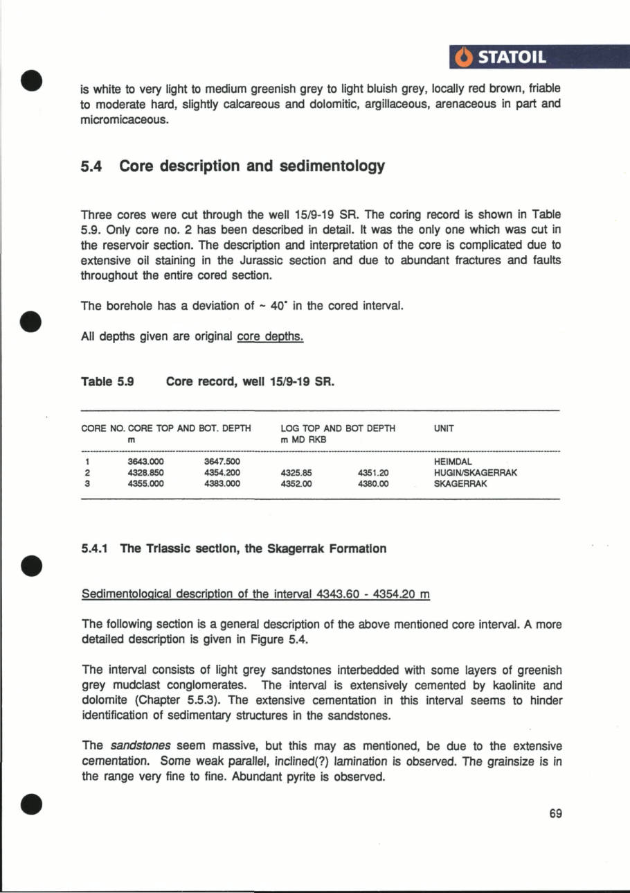

#### 5.4.1 The Triassic section, the Skagerrak Formation

### Sedimentological description of the interval 4343.60 - 4354.20 m

The following section is a general description of the above mentioned core interval. A more detailed description is given in Figure 5.4.

The interval consists of light grey sandstones interbedded with some layers of greenish grey mudclast conglomerates. The interval is extensively cemented by kaolinite and dolomite (Chapter 5.5.3). The extensive cementation in this interval seems to hinder identification of sedimentary structures in the sandstones.

The sandstones seem massive, but this may as mentioned, be due to the extensive cementation. Some weak parallel, inclined(?) lamination is observed. The grainsize is in the range very fine to fine. Abundant pyrite is observed.

<!-- page 74 -->
<!-- type: text -->

The conglomerates consist of greenish grey, angular to subangular mudclasts of 0.5 - 4 cm size. The matrix consists of light grey, very fine to fine sandstone. The mudclasts show a horizontal parallel lamination. The base of the conglomerates are characteristically scoured.

The conglomerates constitute the lower part of fining upward (FU) sequences, whereas the sandstones constitute the upper part. The FU-sequences varies from 0.5 - 2 m in thickness; the conglomerates constitute maximum 10-15 cm of this.

In addition to abundant fractures, the interval seems to contain a fault zone; in the interval of about 4348 - 4350 m. This is seen as bed boundaries nearly parallel to the borehole; this is particularly clear for the greenish grey mudclast conglomerate in this interval.

### Interpretation

No characteristic bioturbation has been identified in the interval, indicating a non-marine environment. The overall stacked fining upward sequences with scouring mudclast conglomerates at the base suggest channel deposits of fluvial origin. The lack of overbank deposits, may indicate a low sinousity braided stream.

#### 5.4.2 The Jurassic section, the Hugin Formation

### Sedimentological description of the interval 4328.00 - 4343.60 m

The following section is a general description of the above mentioned core interval. A more detailed description is given in Figure 5.4.

The interval consists mainly of clean sandstones. These sandstones are brownish due to oil staining, the coarser grained sandstones more oil stained than the finer. As previously mentioned the extensive oil staining and abundant fracturing, complicate the identification of sedimentary structures in this interval.

The sandstones of this interval are divided into four facies, based on grainsize and sedimentary structures:

Facies A - Fine grained sandstone with parallel laminated mudstreaks. Slumped/distorted strata is observed. Moderately - strong bioturbation is observed in this facies. Some horizontal burrows, ~ 1 cm; possible Palaeophycus burrows. This facies is less than 30 cm thick, and constitutes a very minor part of the cored interval.

Facies B - Fine to medium grained sandstone. Fairly homogenous, massive in appearence, some rare coarse floating quartz grains. Some concave non-parallel lamination; possible cross bedding. Weakly bioturbated; scattered Ophiomorpha burrows, < 1 cm, are observed. This facies is 1 - 1.5 m in thickness, and constitutes a major part

<!-- page 75 -->
<!-- type: text -->

of the cored interval.

Facies C - Medium to coarse grained sandstone. Some 2 - 3 mm quartz grains. Appears as stacked small, 10 - 20 cm, fining upward units, with scouring base. Possible cross bedding. Some rare burrows are observed.

Facies D - This facies may seem similar to facies C, exept for the fact that the entire interval comprises a more uniformly medium to coarse grained sandstone. Some minor fining upward trends are observed in the only interval that contains this facies; 4328.80 - 4330.85 m. The fining upward trends are 50 - 75 cm thick, with no distinct scouring bases. Abundant concave non-parallel coaly streaks are observed. This is the only part of the cored interval that contains such coaly streaks. Possible trough cross bedding is observed. The observed thickness of this facies is about 1.5 m.

Facies A, B and C are vertically stacked in what seems to be an overall fining upward sequence, with facies C as the coarsest and lowermost facies in the FU-sequence. However, the observed stacking pattern may not be the correct stratigraphical stacking pattern, due to the extensive fracturing/faulting seen in the core. Facies D comprises the uppermost part of the cored interval.

In addition to abundant fractures, the interval seems to contain two fault zones; in the interval of about 4336 - 4338 m and in the interval of about 4339.5 - 4341 m. These fault zones are seen as extensive fractured intervals, with very sharp, "abnormal" grain size changes.

### Interpretation

It is difficult to be conclusive regarding the environmental setting of these sandstones of the Hugin Formation.

Bioturbation and the identified trace fossils give a marine setting, the low diversity and abundance of trace fossils though indicating a stressed environment. The overall fining upward sequences of facies, with scouring bases, indicate a channelized setting; where facies C is interpreted to be the base of the channel deposits. The uppermost facies D, with increased carbonaceous material, may indicate a shift towards a more extensive eroding channel.

Biostratigraphical analyse (Chapter 4.2) has identified fresh water algae in the interval 4332.80-4339.22, indicating run-off from a fresh-water source.

A combination of shoreface deposits and more fluvial(?) channels are proposed as depositional environment for these sandstones of the Hugin Formation; this may be a part of a mouth bar setting.

<!-- page 76 -->
<!-- type: mixed -->

#### 5.4.3 Conclusions

Enclosure 13 shows a comparison of the core description and a suite of wireline logs.

The sediments of the Triassic Skagerrak Formation is interpreted to be channel deposits of fluvial origin.

The sediments of the Jurassic Hugin Formation is interpreted to be deposited in a possible mouth bar setting, although it is difficult to be conclusive regarding depositional environment.

### 5.5 Mineralogy and petrology

Whole rock x-ray diffraction (XRD), petrographic point count, and Scanning Electron Microscopy (SEM) analysis data from cored intervals of the 15/9-19 SR well have been performed by Statoils Geological Laboratory, in order to characterize the mineralogy and petrography of these sandstone units and evaluate the controls on reservoir quality. The following summary has been specially prepared for this Theta Vest discovery well report.

The data presented here are from the following cored intervals:

| Formation | Interval (mD MSL) | Samples |
|---|---|---|
| Heimdal | 3643.00 - 3645.50 | 6 |
| Hugin | 4328.85 - 4343.25 | 16 |
| Skagerrak | 4344.25 - 4354.00 | 11 |

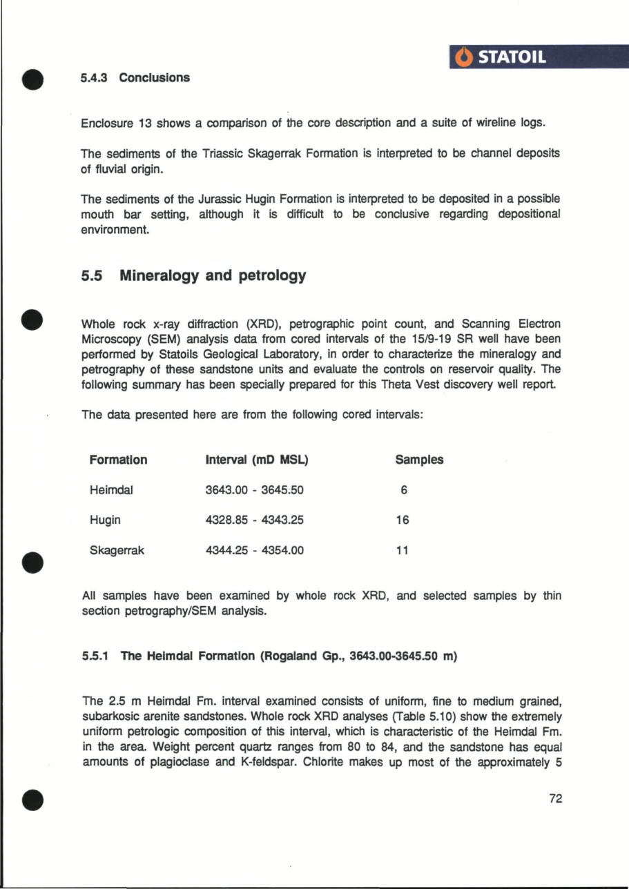

All samples have been examined by whole rock XRD, and selected samples by thin section petrography/SEM analysis.

#### 5.5.1 The Heimdal Formation (Rogaland Gp., 3643.00-3645.50 m)

The 2.5 m Heimdal Fm. interval examined consists of uniform, fine to medium grained, subarkosic arenite sandstones. Whole rock XRD analyses (Table 5.10) show the extremely uniform petrologic composition of this interval, which is characteristic of the Heimdal Fm. in the area. Weight percent quartz ranges from 80 to 84, and the sandstone has equal amounts of plagioclase and K-feldspar. Chlorite makes up most of the approximately 5

<!-- page 77 -->
<!-- type: text -->

weight percent clay minerals, along with minor amounts of illite. Petrographic analysis data (Table 5.11) is consistent with the XRD petrologic results, and indicate about 2 - 4 volume percent quartz cement. The petrographic data also show anomalous low intergranular macroporosity values of 5 - 11 volume percent. On average, this accounts for only about 34 % of the total Helium porosity measured by conventional core analysis (average He porosity = 26 %). Substantial amounts of microporous dispersed clay and clay matrix (Figure 5.5) are mainly responsible for this large discrepancy, and also probably for the anonymously low measured core permeabilities (12 - 40 mD).

Because this petrologic feature may represent a more extreme development related to resistivity transition zone problem of the Sleipner Øst Field, it was investigated further. Special clay mineral XRD analyses were performed on samples from 3644.50 and 3645.00 m in order to better characterize the dispersed clay and clay matrix observed by petrographic analysis. The less than 2 micron and less than 0.5 micron clay fractions were examined. The results show that all four separates consist predominantly of iron-rich chlorite, with minor amounts of illite/smectite (5 - 10 % expandable layers). The results confirmed petrographic observations that the dispersed clay is mainly derived from detrital clay matrix, clasts, and pellets. SEM observations (for example: 3644.50 m) indicate that diagenetic recrystallization or alteration of the clay has also occurred (Figure 5.6). These results will be integrated into the Sleipner Øst petrologic investigation of the resistivity transition zone.

#### 5.5.2 The Hugin Formation (Vestland Gp., 4328.85-4343.25 m)

The 15 m Hugin interval examined consists of highly variable, fine to coarse grained, well to poorly sorted, subarkosic arenite sandstones with good to excellent reservoir properties. Whole rock XRD analyses (Table 5.10) show 55 - 94 weight percent quartz, with K-feldspar and no detectable plagioclase, except in the deepest sample (4343.25 m), which may represent reworked material from the underlying Skagerrak Formation. Clay minerals consist mostly of variable amounts of kaolinite (3 - 28 weight %), and lesser amounts of illite. Petrographic analysis data (Table 5.11) show the variable grain size and sorting of these lithologies, and also indicate that diagenetic quartz cement ranges from 2 to 11 volume percent, and generally increases with depth. The intergranular macroporosity varies from 25 - 8 volume percent, and on average accounts for 79 % of the Helium porosity measured by conventional core analysis. The remainder is mostly accounted for by secondary pores in dissolved feldspars, and microporosity in clay minerals. Because of the variable grain size and clay content, which are the main controls on permeability (Figures 5.7A & B), porosity and permeability are poorly correlated (Figure 5.7C). Variation in grain size, sorting, and reservoir quality is readily evident from the examination of three examples using photomicrographs from full diameter, blue epoxy impregnated thin sections (4330.25, 4331.25 and 4333.25 m, Figures 5.8, 5.9 and 5.10 respectively). More than over two orders of magnitude difference in permeability (15300 vs. 115 mD) is exhibited by samples only 1 meter apart (4330.25 and 4331.25 m) with only 0.5 difference in porosity (25.2 vs. 24.7 %). The difference is primarily due to grain size and clay content.

<!-- page 78 -->
<!-- type: text -->

#### 5.5.3 The Skagerrak Formation (Hegre Gp., 4344.25-4354.00 m)

The Skagerrak interval examined consists of fine to very fine grained subarkosic arenites sandstones, siltstones, and shales with poor reservoir quality. Only whole rock XRD data (Table 5.10) was acquired over this interval due to low economic interest of these lithologies (permeabilities generally less than 1 md). Quartz contents of the Skagerrak samples range from 36 - 50 weight percent, with approximately equal amounts of plagioclase and K-feldspar. Carbonate is predominantly dolomite, with up to 11 weight percent. Kaolinite makes up most of the clay mineral content, with 29 - 44 weight percent, and lesser amounts of mica-illite. The fine grain size and high clay content of the Skagerrak are mainly responsible for the poor reservoir quality of this formation.

<!-- page 79 -->
<!-- type: table -->

*Table 5.10 – Whole rock x-ray diffraction analyses data in semiquantitative weight percent. From the Heimdal (3643.00 - 3645.50 m), Hugin (4328.85 - 4343.25 m), and Skagerrak (4344.25 - 4354.00 m) Formations, well 15/9-19 SR.*

Whole Rock XRD Analysis Data in Semi-Quantitative Weight %

| He Por. | Klh | Plug No. | DEPTH | Quartz | K-Feldspar | Plagioclase | Calcite | Dolomite | Siderite | Pyrite | Kaolinite | Mica-Illite | Chl.-Ber. | Smectite | TOTAL |
|---|---|---|---|---|---|---|---|---|---|---|---|---|---|---|---|
| | | * * * | Heimdal Formation * * * | | | | | | | | | | | | |
| 27.3 | 21.8 | 1 | 3643.00 | 84.2 | 6.2 | 6.1 | 0.0 | 0.3 | 0.0 | 0.0 | 0.0 | 0.0 | 3.3 | 0.0 | 100.0 |
| 22.9 | 40.0 | 3 | 3643.50 | 80.0 | 6.3 | 7.0 | 0.0 | 0.3 | 0.0 | 0.0 | 0.0 | 1.5 | 4.9 | 0.0 | 100.0 |
| 27.3 | 68.4 | 5 | 3644.00 | 84.0 | 5.7 | 5.9 | 0.0 | 0.3 | 0.0 | 0.0 | 0.0 | 0.9 | 3.2 | 0.0 | 100.0 |
| 26.6 | 27.5 | 7 | 3644.50 | 82.5 | 6.1 | 6.1 | 0.0 | 0.3 | 0.0 | 0.0 | 0.0 | 1.5 | 3.5 | 0.0 | 100.0 |
| 26.4 | 54.1 | 9 | 3645.00 | 82.7 | 5.9 | 5.8 | 0.0 | 0.3 | 0.0 | 0.0 | 0.0 | 1.0 | 4.3 | 0.0 | 100.0 |
| 25.6 | 11.6 | 11 | 3645.50 | 82.7 | 6.2 | 6.1 | 0.0 | 0.3 | 0.0 | 0.0 | 0.0 | 0.7 | 4.0 | 0.0 | 100.0 |
| | | * * * | Hugin Formation * * * | | | | | | | | | | | | |
| 24.5 | 5350.0 | 14 | 4328.85 | 88.8 | 4.5 | 0.0 | 0.0 | 0.3 | 0.0 | 1.0 | 4.6 | 0.8 | 0.0 | 0.0 | 100.0 |
| 25.5 | 11600.0 | 16 | 4329.25 | 93.9 | 2.2 | 0.0 | 0.0 | 0.2 | 0.0 | 0.8 | 2.9 | 0.0 | 0.0 | 0.0 | 100.0 |
| 25.2 | 15300.0 | 20 | 4330.25 | 92.9 | 2.8 | 0.0 | 0.0 | 0.2 | 0.0 | 0.7 | 3.4 | 0.0 | 0.0 | 0.0 | 100.0 |
| 24.7 | 115.0 | 24 | 4331.25 | 59.0 | 8.6 | 0.0 | 0.4 | 2.0 | 0.2 | 0.6 | 23.5 | 5.6 | 0.0 | 0.0 | 100.0 |
| 21.8 | 111.0 | 28 | 4332.25 | 67.5 | 5.6 | 0.0 | 0.3 | 5.4 | 0.1 | 0.5 | 19.3 | 1.3 | 0.0 | 0.0 | 100.0 |
| 22.7 | 312.0 | 32 | 4333.25 | 84.2 | 5.5 | 0.0 | 0.2 | 0.5 | 0.0 | 0.6 | 9.0 | 0.0 | 0.0 | 0.0 | 100.0 |
| 26.1 | 298.0 | 34 | 4334.25 | 72.7 | 7.0 | 0.0 | 0.3 | 1.6 | 0.0 | 0.8 | 16.0 | 1.5 | 0.0 | 0.0 | 100.0 |
| 23.1 | 82.6 | 38 | 4335.35 | 65.5 | 8.2 | 0.0 | 0.3 | 2.3 | 0.0 | 0.7 | 20.8 | 2.1 | 0.0 | 0.0 | 100.0 |
| 21.5 | 3820.0 | 42 | 4336.25 | 89.1 | 5.0 | 0.0 | 0.2 | 0.9 | 0.0 | 0.0 | 4.7 | 0.0 | 0.0 | 0.0 | 100.0 |
| 18.9 | 2630.0 | 46 | 4337.25 | 86.7 | 5.8 | 0.0 | 0.2 | 1.1 | 0.0 | 0.2 | 6.0 | 0.0 | 0.0 | 0.0 | 100.0 |
| 20.5 | 591.0 | 50 | 4338.25 | 82.2 | 8.5 | 0.0 | 0.3 | 1.4 | 0.0 | 0.7 | 6.9 | 0.0 | 0.0 | 0.0 | 100.0 |
| 27.4 | 98.0 | 53 | 4339.25 | 59.7 | 6.7 | 0.0 | 0.0 | 0.4 | 0.0 | 0.3 | 28.0 | 4.9 | 0.0 | 0.0 | 100.0 |
| 28.0 | 514.0 | 57 | 4340.25 | 67.4 | 5.5 | 0.0 | 0.3 | 0.4 | 0.0 | 0.0 | 24.0 | 2.5 | 0.0 | 0.0 | 100.0 |
| 24.8 | 208.0 | 61 | 4341.25 | 68.3 | 5.5 | 0.0 | 0.2 | 0.4 | 0.0 | 0.6 | 22.6 | 2.3 | 0.0 | 0.0 | 100.0 |
| 14.7 | 9.5 | 65 | 4342.25 | 57.0 | 5.8 | 0.0 | 0.0 | 13.5 | 0.0 | 0.0 | 20.9 | 2.8 | 0.0 | 0.0 | 100.0 |
| 9.9 | 16.4 | 69 | 4343.25 | 54.6 | 5.5 | 3.2 | 0.3 | 16.1 | 0.0 | 0.7 | 16.3 | 3.3 | 0.0 | 0.0 | 100.0 |
| | | * * * | Skagerrak Formation * * * | | | | | | | | | | | | |
| 17.9 | 1.3 | 73 | 4344.25 | 37.5 | 4.7 | 4.0 | 0.0 | 0.8 | 0.0 | 3.1 | 45.9 | 3.4 | 0.6 | 0.0 | 100.0 |
| 15.0 | - | 76 | 4345.25 | 43.6 | 6.9 | 6.0 | 0.0 | 3.6 | 0.6 | 0.0 | 27.9 | 8.8 | 0.0 | 2.6 | 100.0 |
| 14.4 | 0.3 | 80 | 4346.25 | 42.6 | 4.9 | 4.0 | 0.0 | 8.4 | 0.0 | 0.0 | 33.8 | 4.5 | 0.0 | 1.9 | 100.0 |
| 16.7 | 0.6 | 84 | 4347.25 | 39.5 | 5.9 | 4.7 | 0.0 | 1.2 | 0.3 | 0.9 | 44.0 | 3.5 | 0.0 | 0.0 | 100.0 |
| 13.4 | - | 88 | 4348.25 | 36.0 | 6.6 | 5.3 | 0.0 | 2.7 | 0.3 | 2.1 | 42.4 | 4.5 | 0.0 | 0.0 | 100.0 |
| 11.3 | - | 92 | 4349.25 | 41.1 | 6.9 | 5.8 | 0.0 | 8.7 | 1.1 | 1.3 | 31.8 | 3.5 | 0.0 | 0.0 | 100.0 |
| 12.8 | 0.2 | 96 | 4350.25 | 41.6 | 6.0 | 5.3 | 0.0 | 10.9 | 0.7 | 0.7 | 29.0 | 5.7 | 0.0 | 0.0 | 100.0 |
| 14.2 | - | 99 | 4351.00 | 46.1 | 5.7 | 4.5 | 0.0 | 3.9 | 0.7 | 0.6 | 32.5 | 6.0 | 0.0 | 0.0 | 100.0 |
| 11.4 | 0.1 | 104 | 4352.25 | 44.7 | 5.5 | 6.7 | 0.0 | 8.2 | 1.4 | 0.0 | 29.4 | 3.5 | 0.0 | 0.7 | 100.0 |
| 15.1 | - | 108 | 4353.25 | 43.1 | 6.0 | 5.8 | 0.0 | 0.6 | 0.3 | 0.3 | 34.4 | 9.4 | 0.0 | 0.0 | 100.0 |
| 17.2 | - | 111 | 4354.00 | 49.5 | 6.5 | 7.6 | 0.0 | 0.8 | 0.5 | 0.4 | 32.9 | 1.9 | 0.0 | 0.0 | 100.0 |

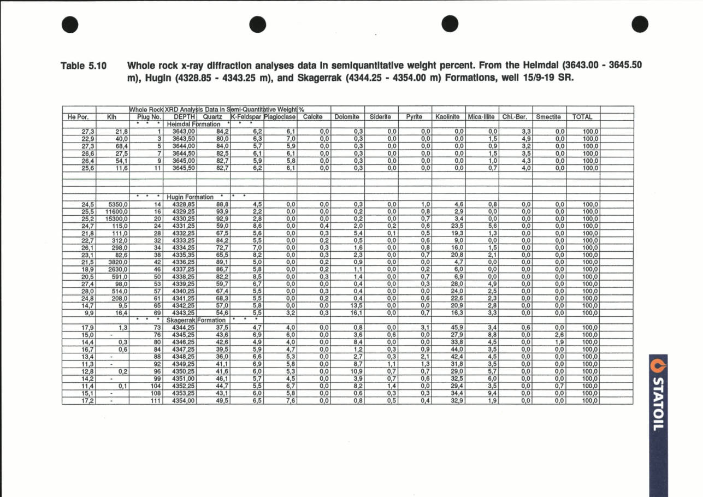

<!-- page 80 -->
<!-- type: table -->

*Table 5.11 – Petrographic point count data (300 count) in volume percent. From the Heimdal (3643.00 - 3645.50 m) and Hugin (4328.85 - 4342.25 m) Formations, well 15/9-19 SR.*

Petrographic Analysis Volume Percent Data (300 count)

| Grain Size | Sorting | Plug No. | DEPTH | Øim | 2Ø | Quartz | K-Feldspar | Plagioclase | Mica | RX | Pellets | HM | FG Other | Qtz Cmt | Feld Cmt | Kaolinite | Disp. Cl | Clay Matrix | Carbonate | Py-Opq | Org |
|---|---|---|---|---|---|---|---|---|---|---|---|---|---|---|---|---|---|---|---|---|---|
| | | * * * | Heimdal Formation * * * | | | | | | | | | | | | | | | | | | |
| 0.25 | 1.6 | 1 | 3643.00 | 5.0 | 0.7 | 57.7 | 5.0 | 1.7 | 1.0 | 1.0 | 0.7 | 0.3 | 0.0 | 2.3 | 0.0 | 0.0 | 18.3 | 4.3 | 1.0 | 1.0 | 0.0 |
| 0.25 | 1.6 | 5 | 3643.50 | 11.3 | 1.0 | 53.3 | 7.7 | 1.0 | 0.7 | 2.0 | 1.0 | 0.0 | 0.0 | 4.0 | 0.0 | 0.0 | 16.0 | 0.7 | 0.7 | 0.7 | 0.0 |
| 0.25 | 1.6 | 5 | 3644.00 | * * * Poor Thin Section Quality - Point Count Data Not Acquired * * * | | | | | | | | | | | | | | | | | |
| 0.25 | 1.6 | 9 | 3644.50 | 7.0 | 1.3 | 59.7 | 3.3 | 1.0 | 0.7 | 3.0 | 0.7 | 0.7 | 0.0 | 1.7 | 0.0 | 0.0 | 19.3 | 1.3 | 0.0 | 0.3 | 0.0 |
| 0.25 | 1.6 | 12 | 3645.00 | 10.0 | 0.0 | 59.7 | 2.3 | 1.0 | 0.7 | 1.7 | 2.0 | 0.0 | 0.0 | 2.3 | 0.0 | 0.0 | 10.7 | 8.3 | 0.3 | 1.0 | 0.0 |
| 0.25 | 1.6 | 14 | 3645.00 | 11.3 | 2.0 | 54.3 | 6.3 | 1.0 | 1.7 | 1.7 | 1.3 | 0.0 | 0.0 | 2.0 | 0.0 | 0.0 | 12.7 | 4.3 | 0.0 | 1.3 | 0.0 |
| | | * * * | Hugin Formation * * * | | | | Total Feldspar | | | | | | | | | | Grn. Cl. | | | | |
| 0.30 | 1.3 | 14 | 4328.85 | 22.3 | 2.0 | 63.7 | 3.0 | - | 0 | 0 | 0 | 0 | 0 | 3.3 | 0 | 1 | 0 | 0 | 1 | 2.7 | 1 |
| 0.35 | 1.3 | 16 | 4329.25 | 25.0 | 0.7 | 65.7 | 2.3 | - | 0.3 | 0 | 0 | 0 | 0 | 3 | 0 | 1 | 0 | 0.3 | 0.3 | 1 | 0.3 |
| 0.40 | 1.3 | 20 | 4330.25 | 24.3 | 1.3 | 64.3 | 2.7 | - | 0 | 0 | 0 | 0 | 0 | 2.3 | 0 | 1.3 | 0 | 1.7 | 0 | 1.3 | 0.7 |
| 0.13 | 1.4 | 24 | 4331.25 | 17.3 | 2.0 | 54.0 | 2.0 | - | 4.7 | 0 | 0 | 0 | 0 | 5.7 | 0 | 5.3 | 0 | 4 | 2.7 | 1.7 | 0.7 |
| 0.10 | 1.6 | 28 | 4332.25 | 19.7 | 0.7 | 51.7 | 2.0 | - | 1.7 | 0 | 0 | 0.3 | 0 | 4.7 | 0 | 4.3 | 0 | 3 | 9.7 | 1.3 | 1 |
| 0.40 | 3.0 | 32 | 4333.25 | 12.3 | 1.7 | 68.3 | 5.0 | - | 1.3 | 0 | 0 | 0 | 0 | 3.7 | 0 | 2.3 | 0 | 2.3 | 0.3 | 2 | 0.7 |
| 0.15 | 1.5 | 34 | 4334.25 | 17.7 | 0.7 | 54.0 | 5.7 | - | 1.3 | 0 | 0 | 0 | 0 | 7.7 | 0 | 3 | 0 | 3 | 2.7 | 3 | 1.3 |
| 0.10 | 1.6 | 38 | 4335.35 | 16.3 | 1.7 | 51.0 | 8.0 | - | 1.3 | 0 | 0 | 0.3 | 0 | 5.3 | 0 | 5 | 0 | 4.3 | 2.3 | 3.3 | 1 |
| 0.50 | 2.0 | 42 | 4336.25 | 15.0 | 0.3 | 68.7 | 5.7 | - | 0 | 0.3 | 0 | 0 | 0 | 4 | 0 | 0.3 | 0 | 2.3 | 0.3 | 1.3 | 1.7 |
| 0.40 | 2.0 | 46 | 4337.25 | 18.0 | 1.3 | 60.0 | 5.3 | - | 1 | 0 | 0 | 0 | 0 | 5 | 0 | 3.7 | 0 | 3 | 1 | 1.3 | 0.3 |
| 0.40 | 2.0 | 50 | 4338.25 | 15.0 | 0.3 | 59.7 | 5.3 | - | 0.7 | 0 | 0 | 0.3 | 0 | 6.3 | 0 | 3.7 | 0 | 5 | 1.3 | 1.7 | 0.7 |
| 0.15 | 1.4 | 53 | 4339.25 | 16.7 | 1.0 | 52.3 | 3.7 | - | 3.3 | 0.3 | 0 | 0.7 | 0 | 6.7 | 0 | 9 | 0 | 3.3 | 0 | 2 | 1 |
| 0.15 | 1.5 | 57 | 4340.25 | 19.0 | 0.3 | 55.0 | 2.3 | - | 1.3 | 0.3 | 0 | 0.3 | 0 | 10.7 | 0 | 5.7 | 0 | 2.3 | 0.3 | 2 | 0.3 |
| 0.15 | 1.4 | 61 | 4341.25 | 19.7 | 1.0 | 55.0 | 4.3 | - | 0.3 | 0 | 0 | 0 | 0 | 9 | 0 | 5.7 | 0 | 1.3 | 1.7 | 1.3 | 0.7 |
| 0.15 | 1.3 | 65 | 4342.25 | 7.7 | 0.0 | 53.0 | 3.0 | - | 0.7 | 0 | 0 | 0 | 0 | 8 | 0 | 6.3 | 0 | 5 | 14.3 | 2 | 0 |
| 0.15 | - | 69 | 4343.25 | - | - | - | - | - | - | - | - | - | - | - | - | - | - | - | - | - | - |
| | | * * * | Skagerrak Formation * * * | | | | | | | | | | | | | | | | | | |
| 0.05 | - | 73 | 4344.25 | - | - | - | - | - | - | - | - | - | - | - | - | - | - | - | - | - | - |
| 0.10 | - | 76 | 4345.25 | - | - | - | - | - | - | - | - | - | - | - | - | - | - | - | - | - | - |
| 0.05 | - | 80 | 4346.25 | - | - | - | - | - | - | - | - | - | - | - | - | - | - | - | - | - | - |
| 0.10 | - | 84 | 4347.25 | - | - | - | - | - | - | - | - | - | - | - | - | - | - | - | - | - | - |
| 0.10 | - | 88 | 4348.25 | - | - | - | - | - | - | - | - | - | - | - | - | - | - | - | - | - | - |
| 0.10 | - | 92 | 4349.25 | - | - | - | - | - | - | - | - | - | - | - | - | - | - | - | - | - | - |
| 0.05 | - | 96 | 4350.25 | - | - | - | - | - | - | - | - | - | - | - | - | - | - | - | - | - | - |
| 0.05 | - | 99 | 4351.00 | - | - | - | - | - | - | - | - | - | - | - | - | - | - | - | - | - | - |
| 0.10 | - | 104 | 4352.25 | - | - | - | - | - | - | - | - | - | - | - | - | - | - | - | - | - | - |
| - | - | 108 | 4353.25 | - | - | - | - | - | - | - | - | - | - | - | - | - | - | - | - | - | - |
| 0.10 | - | 111 | 4354.00 | - | - | - | - | - | - | - | - | - | - | - | - | - | - | - | - | - | - |

Legend :

- Øim = intergranular macroporosity
- 2Ø = secondary porosity
- RX = rock fragments
- HM = heavy minerals
- FG Other = other framework grains
- Qtz Cmt = quartz cement
- Feld Cmt = Feldspar cement
- Disp Cl = highly microporous dispersed clay
- Clay Matrix = intergranular clay
- Py - Opq = Pyrite and other opaque minerals
- Org = organic matrix

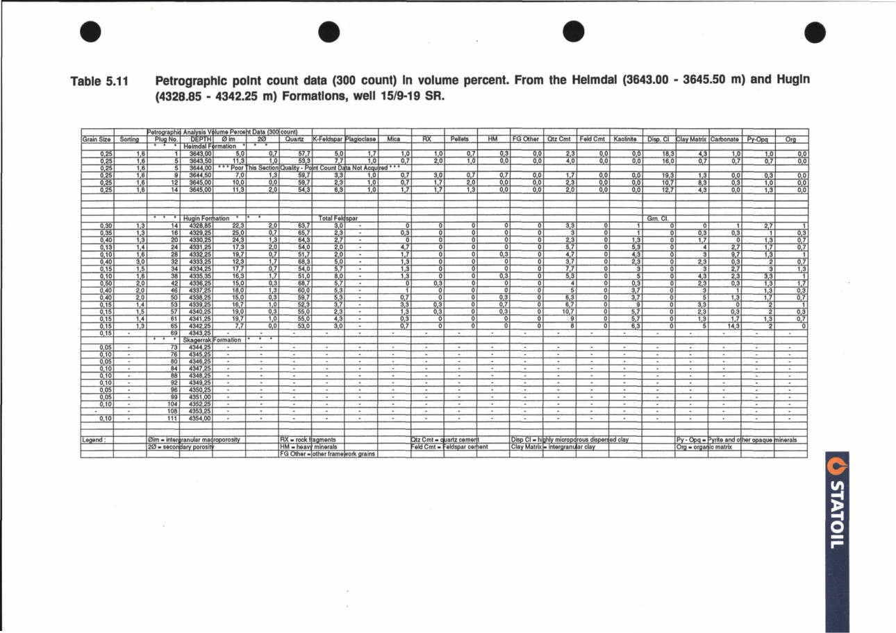

<!-- page 81 -->
<!-- type: text -->

### 5.6 Jurassic and Triassic sediment distribution on the Gamma High

The relation between the reservoirs of Jurassic and Triassic age found in the Sleipner Øst area are very complex. They are either found in the Jurassic Hugin Fm. sandstones (well 15/9-19 SR, 15/9-13, 15/9-11), or in Triassic Skagerrak Fm. sandstones (well 15/9-9) or as a combination of sandstones of Jurassic/Triassic age (well 15/9-17). However, the age of these latter sandstones are in some cases disputable (e.g. well 15/9-17, 15/9-15, 15/9-9).

Except from the 15/9-19 SR well, which proved oil, the Jurassic and Triassic reservoirs are filled with gas and condensate. The well 15/9-9 is found waterbearing whereas no reservoir is present in the 15/9-16 well at this level. The fluid contacts are different in each well. An overview of the contacts, probable hydrocarbon columns and reservoirs in each well is given in Figure 5.11.

A short summary of the geological evolution on the Gamma High and the Jurassic and Triassic stratigraphy in the wells, is given below. Where nothing else is indicated, the geological evolution is taken from Statoil (1984). The facies relations, paleo environment and sediment distribution of the Hugin Formation in the Gamma High area, is also discussed.

#### 5.6.1 Deposition of Jurassic and Triassic sediments

During Triassic time, the Gamma High was subaerially exposed and continental deposits characterize this period. Argillaceous sediments assigned to the Smith Bank Formation constitutes most of the Triassic intervals encountered in the wells. These sediments were probably deposited in a lacustrine or muddy floodplain environment. Rejuvenation of source areas during the Triassic resulted in an influx of arenaceous detritus which characterizes the Skagerrak Formation. The Skagerrak Formation is generally thinner than the Smith Bank Fm. and in some places absent. The formation is believed to represent continental deposits of braided stream/floodplain origin.

Rising sea level during the Early Jurassic, led to marine conditions and sedimentation throughout the South Viking Graben and the Sleipner Terrace. There is however no direct biostratigraphic evidence of Early Jurassic sediments in the Gamma High area. Some of the sandstone reservoirs on the Gamma High, which lack age diagnostic fossils and show marine sedimentary structures, may be of Early - Middle Jurassic age.

Jurassic sediments are thin on the Gamma structure compared to the Sleipner Terrace to the west. The Jurassic, in the Sleipner Øst wells, is represented by sediments of Middle to Upper Jurassic age (Hugin, Heather and Draupne Formations). In the Sleipner Vest Field, thick Middle Jurassic Bathonian - Bajocian Sleipner Fm. and Callovian Hugin Fm.

<!-- page 82 -->
<!-- type: text -->

sandstones are developed. Middle Jurassic sediments, older than the Hugin Fm., may have been deposited on the Gamma High. The sediments may then have been subsequently eroded, contributing as a clastic source area to the Callovian (Hugin Fm.) sands deposited on the Sleipner Terrace to the west (Cockings et al., 1992).

Corresponding to three major phases of sediment accumulation, the Hugin Formation previously was divided into three main units, A, B and C (Statoil, 1983a). In a study concerning the reservoir geology of the Sleipner Vest Field, a new reservoir zonation based on a sequence stratigraphic framework has been established (Statoil, 1993a). In this study, an overall backstepping depositional pattern is observed in the Sleipner Vest area, with the oldest sandstones (Early Callovian) deposited in the north, block 15/6, and the youngest sandstones (Late Callovian) deposited in block 15/9 (see Figure 5.1). The overall backstepping pattern is caused by a stepwise transgression of the Sleipner Vest area, though interupted by regressive events. This is seen as a result of the retreating phase of the Brent delta megasequence southwards. A flooding event in Early-Middle Callovian time is believed to represent the initiation of the overall backstepping.

The majority of the Hugin Formation sandstones in the Sleipner Vest area were deposited during Middle to Late Callovian time (Statoil, 1993a). The western margin of the Gamma High restricted deposition during Early and Middle Callovian (Statoil, 1983a). The majority of the Hugin Formation sandstones on the Gamma High were deposited during Late Callovian.

The present-day distribution of the Hugin Fm. sandstones are highly variable over the Gamma High structure. The thickness vary from 36 m (e.g. well 15/9-11) to no Hugin Fm. sands at all (e.g. well 15/9-16). This can be explained by non-deposition or later erosion.

In Early to Mid-Oxfordian, the Hugin Fm. sandstones were overlain by open-marine shales of the Heather and Draupne Formations. At the end of the Oxfordian, the relative rise of sea-level was sufficiently high to have eliminated any sand deposition in the Sleipner area.

#### 5.6.2 Jurassic and Triassic stratigraphy in the wells

The observed and interpreted thicknesses of the Draupne, Heather and Hugin Formations in the seven exploration wells on the Gamma High, are listed in Table 5.12.

In the 15/9-16 well the Jurassic section is entirely absent. The Cretaceous Shetland Group directly overlies the Triassic Smith Bank Formation. No reservoir is encountered in the Smith Bank Formation.

In well 15/9-9 the Jurassic sequence is represented by a 17 m thick Viking Group (Draupne and Heather shales). The underlying sandstones proved to be barren of fossils and have by RRI (1981) been ascribed to the Triassic Skagerrak Formation. They assume a terrestrial setting of the whole section. On the other hand, based on facies changes and borehole log responses, the cored interval has by Statoil (1982) been subdivided in two

<!-- page 83 -->
<!-- type: text -->

informal subunits; an upper unit (2648 - 2703 m core depth) of marine clastic beach facies and a lower unit (2703 - 2755 m core depth) of coastal alluvial plain facies. The possibility that at least the upper part is Jurassic in age, either a Hugin Fm. equivalent or a marine Early to Middle Jurassic sandstone, can therefore not be ignored. The well proved to be waterbearing, but the cores show abundant staining of residual hydrocarbons.

In the 15/9-17 well, gas and condensate are found in Jurassic and Triassic sandstones with gas down to the Triassic Smith Bank Formation. These sandstones are capped by a 3 m thick Jurassic shale sequence. Based on the core descriptions, Statoil (1983c) has divided the reservoir sandstones in an Upper Mesozoic sandstone unit (2741 - 2741) m RKB and a Lower Triassic Skagerrak Fm. unit (2741 - 2847) m RKB. The uppermost 2 m of the Mesozoic section is interpreted as a possible Hugin Fm. equivalent. Due to the lack of age diagnostic taxa, the age of the Mesozoic sandstone unit are indeterminate. Three alternative interpretations are considered possible. The section is:

- a) attributed to the Hugin or Sleipner Formation. There is no positive palynological evidence of these formations, although this could be due to the occurence of unfavourable paleo-environmental conditions.
- b) a marine Early to Middle Jurassic. There is no positive biostratigraphic evidence for this.
- c) Triassic. The main argument against this alternative, is that a continental environment was widespread in Triassic.

The thickness of the Viking Group in well 15/9-19 SR, is only 9.6 m. The underlying Hugin Fm. reservoir, which is 18 m thick, is heavily faulted. The Hugin Formation is interpreted to represent a possible mouth-bar setting (see Chapter 5.4.2). The oil is accumulated down to the Triassic Skagerrak Fm. interval, which is completely tight due to extensive dolomite and kaolinite cementation.

The Jurassic sequence in well 15/9-13 is made up of 23.5 m of Upper Jurassic shales deposited over 26.5 m of the Hugin Formation. The Hugin Fm. sands are filled with gas and condensate down to the Triassic Smith Bank Formation. The upper part of the Hugin Formation is interpreted to be a progradational lower to upper shoreface sandstone, whereas the lower part is interpreted to be lagoonal/tidal flat deposits.

Well 15/9-11 drilled a somewhat thicker Upper Jurassic shale section, totally 42.5 m. The underlying gas and condensate bearing Jurassic Hugin Fm. sandstone is 35.5 m thick. The depositional environment is interpreted to be progradational lower to upper shoreface sandstone. This is based on log interpretations, as the Hugin Formation was not cored.

In well 15/9-15 as much as 70 m shales of the Jurassic Viking Group directly overlies sandstones which constitutes a 99 m gas bearing interval. As in the 15/9-9, Statoil (1983b) has subdivided the cored interval in an upper suggested foreshore/shoreface sand unit (2821 - 2860.5 m RKB) and a lower alluvial sand unit (2860.5 - 2948 m RKB). No age

<!-- page 84 -->
<!-- type: text -->

evidence has been obtained from the upper interval. It has so far proven to be barren of palynomorphs. Three alternative interpretations of their age seem possible:

- a) Callovian Hugin Formation. The main argument against this alternative is that the lithology is atypical of the Hugin Formation. The main argument for a Callovian age is the marine influence.
- b) marine Early to Middle Jurassic Formation. The gradual transition from terrestrial conditions into marine, which are seen in the cores, may reflect transgressions in the Early to Middle Jurassic.
- c) Triassic. The cores are indicative of marine environment, whereas the environment was continental in Triassic.

<!-- page 85 -->
<!-- type: table -->

*Table 5.12 – Thicknesses of the Draupne, Heather and Hugin Formations observed in the 15/9 exploration wells in the Sleipner Øst area.*

| | 15/9 EXPLORATION WELLS | | | | | | |
|---|---|---|---|---|---|---|---|
| FORMATION | -9 | -11 | -13 | -15 | -16 | -17 | -19 SR\* |
| Draupne | 2.0 m | 23.5 m | 21.0 m | 55.0 m | - | 3.0 m | 4.2 m |
| Heather | 15.0 m | 19.0 m | 2.5 m | 15.0 m | - | - | 5.4 m |
| Hugin | ? | 35.5 m | 26.5 m | ? | - | ? | 18.1 m |

\* faults in the Hugin Fm..

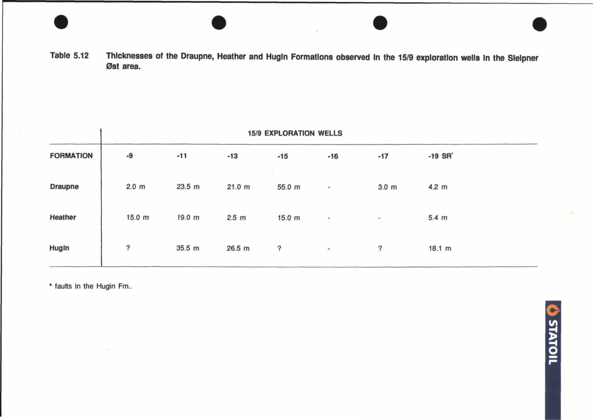

<!-- page 86 -->
<!-- type: text -->

#### 5.6.3 Lithostratigraphic correlation

A suggested lithostratigraphic correlation through the wells 15/9-17, 15/9-19 SR, 15/9-11, 15/9-13, 15/9-16, 15/9-9 and 15/9-15 is shown in Enclosure 14. The reservoir section in well 15/9-19 SR has not a straight forward correlation with the wells on the Loke, the Sleipner Øst and the My structures. The correlation is uncertain due to:

- the questionable dating of the reservoir section in the 15/9-17 and 15/9-15 wells and the cored section in the 15/9-9 well
- the very large distances between the wells (ca. 2 - 16 km), which makes the correlation very difficult
- the different depositional environments of the sandstones
- sparse data.

#### 5.6.4 Facies relations, depositional environment and sediment distribution

It has not been possible to determine the age of the sandstones in the wells 15/9-9, -15 and -17. They could probably represent deposits of Early - Middle Jurassic age. In the Sleipner Øst area, the Hugin Formation is therefore with certainty only identified in the 15/9-11, -13 and -19 SR wells. Only these wells can be used in the sedimentological analysis of the Hugin Formation.

The 15/9-11 well has also limited value for such analysis, because the Hugin Formation was not cored in this well. Only two wells have been cored in the Hugin Formation (15/9-19 SR and 15/9-13). In one of them (15/9-19 SR), the Hugin Formation is heavily faulted. The well data information of the Hugin Formation is thereby very limited and scattered.

In addition, the present seismic data is generally of poor quality and resolution in the Jurassic and Triassic sections. It has not been possible to pick the base of the Top Mesozoic Sandstone reflector from the seismic. The thickness distribution of the Hugin Formation sandstones has therefore not been possible to picture. The seismic interpretation so far, has only been completed in the Theta Vest - Loke area and does not cover the area south of the wells 15/9-11 and -13.

The limited data available exclude a detailed analysis and mapping of thickness and facies distributions of the Hugin Formation in the Sleipner Øst area at present. A more generalized description and analysis is however attempted.

### Depositional environment and facies relations.

Sedimentological and biostratigraphical analyses of the cored sections in the 15/9-13 and

<!-- page 87 -->
<!-- type: text -->

15/9-19 SR wells have been performed.

The biostratigraphic data from the 15/9-13 well, conclude that the upper part of the Hugin Formation is marine, while the lower part lack diagnostic fossils (see paragraph 5.2.4). The sedimentological analysis interprets the upper part as marine shoreface and the lower part as lagoonal. Both the biostratigraphic and sedimentologic data interpret increasing marine influence upwards through the formation.

The biostratigraphic data from the 15/9-19 SR well, conclude that the cored section is marine with some minor input/runoff from a fresh water source indicated by the presence of alga (see paragraph 5.2.3). The lower part of the cored interval contains marine fossils indicative of a shallow marine, high energy "stressed" environment. The upper part of the core interval contains marine fossils, which indicate more normal and less "stressed" environment. This indicates a general increase in marine influence upwards through the cored interval.

The sedimentological analysis of the cored interval in the 15/9-19 SR well, interprets the formation as a combination of shoreface deposits with channels. These channels could represent fluvial channels in a mouthbar setting (see paragraph 5.4.2).

Based on logs and biostratigraphy, the Hugin Formation in the 15/9-11 well is interpreted to be marine. Coarsening upwards sequences seen on the GR and SP logs are interpreted to represent prograding systems in a shoreface environment (Statoil, 1982).

In the neighbouring block to 15/9, the 16/7 block, the Hugin Formation is identified in two wells. It is the 16/7-2 well, situated northeast of the Loke structure, and the 16/7-3 well, situated east of the 15/9-11 well. The formation has been described by Esso (1987) as a progradational unit developing from shoreface to beach to coastal plain to channelized sandstone capped by a marine shoreface sandstone.

The shallow marine sandstones in the 16/7 block are of Late Callovian to Early Oxfordian age (Esso, 1987). Since the Hugin Formation of the Gamma High area mainly were deposited in the Middle to Late Callovian time, the age of the sandstones in the 16/7 block supports the backstepping model for the Hugin Formation deposition suggested by Statoil (1993a).

In summary, the facies described above for the cored wells, in the 15/9 and 16/7 blocks, suggest a coastal depositional system including shallow marine shoreface deposits, coastal plain/lagoonal deposits and channel deposits.

The coastal plain/lagoonal deposits are observed in the wells located to the south east (15/9-13 and 16/7-3). This suggests an onshore to offshore direction towards the northwest in the 15/9 and 16/7 block.

The description of deposits in the 16/7 wells indicates one main progradation of the depositional system, terminated by a transgressive retreat in the uppermost part. The maximum progradation of the coastline will be located somewhere between the 15/9-13 and

<!-- page 88 -->
<!-- type: text -->

the 15/9-19 SR well.

Schematic paleogeographic maps of the Late Callovian and Mid Oxfordian, are shown in Figure 5.12 and 5.13. The maps show the main areas of erosion/non deposition and shallow marine upper shoreface sand deposition in blocks 15/9, 16/7, 15/12 and 16/10.

### Sand distribution and thickness variation.

The interpretation of channel deposits in the 16/7 wells and also in the 15/9-19 SR well, implies the possible presence of a fluvial system in the area.

A mouth bar setting has been suggested for the 15/9-19 SR well. This implies the possible formation and preservation of mouthbar deposits connected to the fluvial channel system. The 15/9-19 SR well is located close to the main fault zone boundary between the Gamma High and the Sleipner Terrace. It is known that there is a significant increase in the thickness of the Hugin Formation across this fault zone in the Sleipner Terrace area (Statoil 1993a). The fault zone could have represented a fault escarpement established before depositon started, but it could also have been active during deposition. This zone area therefore would represent a likely position for the developement of possible mouth bar accumulations. In this area, accomodation space may have been generated through depositon time, with the possibility of much thicker accumulations of the Hugin Formation than what is typically observed in the wells situated on the main Gamma High area.

The Theta Vest area is located at the north-west end of several of the NW-SE lineaments and connected structural depressions located between the Sleipner Øst structure and the Loke structure. Possible fluvial channel systems may have been guided towards the Theta Vest area along such depressions. The fluvial system may have been sourced from the elevated Sleipner Øst structure to the south.

It is therefore suggested an increasing thickness of the Hugin Formation in the areas close to the Theta Vest structure. This would include the fault-blocks mapped north, west and south of the Theta Vest structure and also the down-faulted side of the main fault zone.

The isochore map of the Viking Group reveals distinct increases in its thickness within these fault blocks. The thickness changes and variations are obviously linked to the fault blocks. This is illustrated in the isochore map of the BCU - Top Mesoz. Sandstone in Figure 5.14.

Very thick shales (100-150 m) are found in the fault block right north of the Theta Vest structure. East of this, is another fairly well defined fault block with thicknesses in the range of 40-60 m. On the structural highs in the area (e.q. on the Theta Vest and Loke), the thickness is only in the range of 10-20 m.

Although erosion of the Jurassic shales most certainly have occured over much of the area, the present thickness distribution probably also relates to the primary thickness distribution. As synsedimentary faulting can be assumed during the deposition of the Hugin Formation, it is also likely that there is some relations between the thickness distribution of the

<!-- page 89 -->
<!-- type: text -->

Jurassic shales and the primary thickness distribution of the Hugin Formation. The thicknesses of the Hugin Fm. sandstones can be expected to be larger in depressions and down thrown areas, compared to what is observed on the highs.

The presence of an active fluvial system in the Loke and Theta Vest area, with an associated developement of mouth-bar deposition in the Theta Vest area, must be linked to the early stages of transgression of the sea onto the Gamma High.

<!-- page 90 -->
<!-- type: figure -->

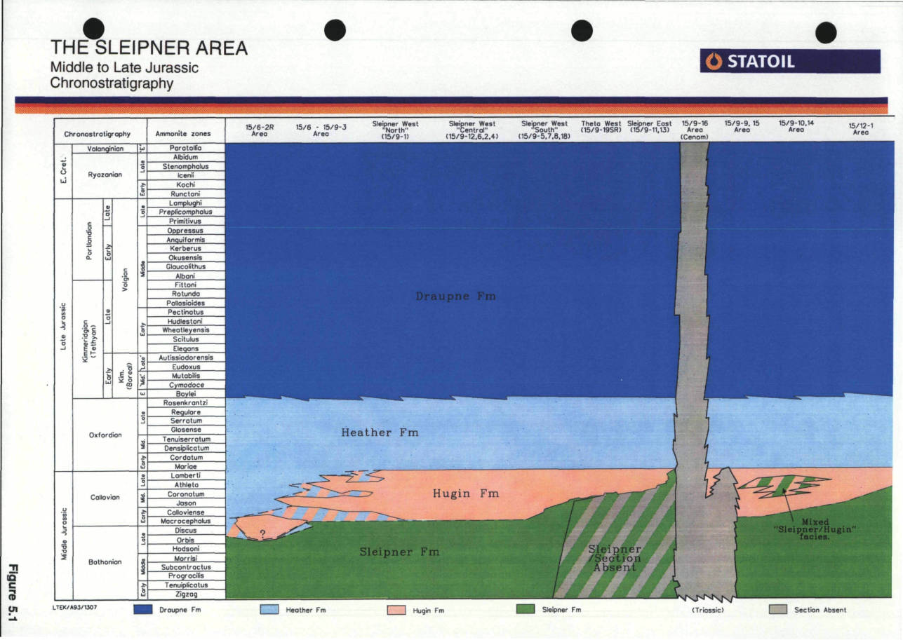

Figure content: chronostratigraphic chart; left columns give chronostratigraphy (Middle Jurassic Bathonian to Early Cretaceous Valanginian) and ammonite zones; across the top are areas and wells from 15/6-2R Area through Sleipner West "North", "Central" and "South", Theta West (15/9-19SR), Sleipner East (15/9-11,13), 15/9-16 Area, 15/9-9, 15 Area, 15/9-10,14 Area to 15/12-1 Area; coloured fields show Draupne Fm, Heather Fm, Hugin Fm, Sleipner Fm, mixed "Sleipner/Hugin" facies and Section Absent, with a colour legend below.

<!-- page 91 -->
<!-- type: figure -->

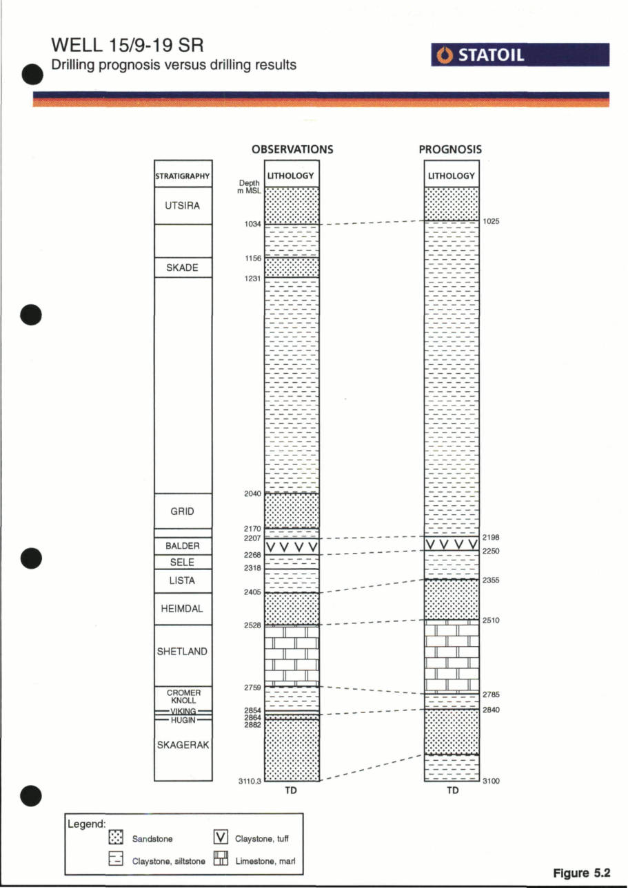

Figure content: three vertical columns side by side; a stratigraphy column (Utsira, Skade, Grid, Balder, Sele, Lista, Heimdal, Shetland, Cromer Knoll, Viking, Hugin, Skagerak), an observed lithology column with formation-top depths in m MSL down to TD, and a prognosed lithology column with prognosed depths down to TD; dashed lines tie observed tops to prognosed tops; legend of lithology patterns (sandstone; claystone, siltstone; claystone, tuff; limestone, marl).

<!-- page 92 -->
<!-- type: figure -->

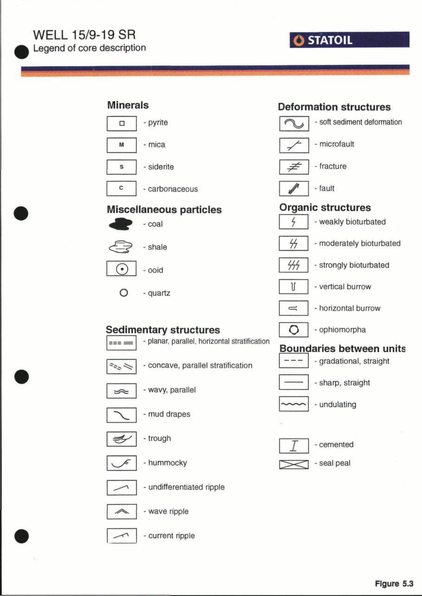

Figure content: legend of the symbols used in the core description sheets, grouped as minerals, miscellaneous particles, sedimentary structures, deformation structures, organic structures and boundaries between units, plus symbols for cemented intervals and seal peal.

<!-- page 93 -->
<!-- type: figure -->

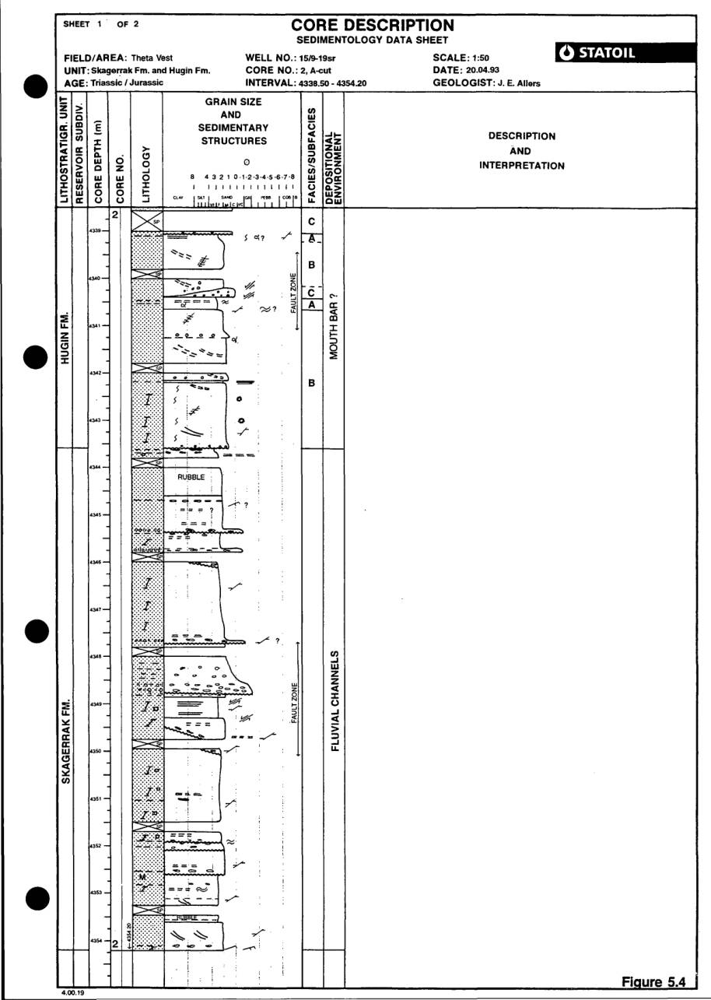

Figure content: core description log, sheet 1 of 2; header block with field/area (Theta Vest), unit (Skagerrak Fm. and Hugin Fm.), age, well no., core no., interval, scale, date and geologist; columns for lithostratigraphic unit, reservoir subdivision, core depth (m), core no., lithology, grain size and sedimentary structures, facies/subfacies, depositional environment, and description and interpretation (empty); the log shows the Hugin Fm. over the Skagerrak Fm. with fault zones, rubble intervals, facies letters and the environment labels "MOUTH BAR ?" and "FLUVIAL CHANNELS".

<!-- page 94 -->
<!-- type: figure -->

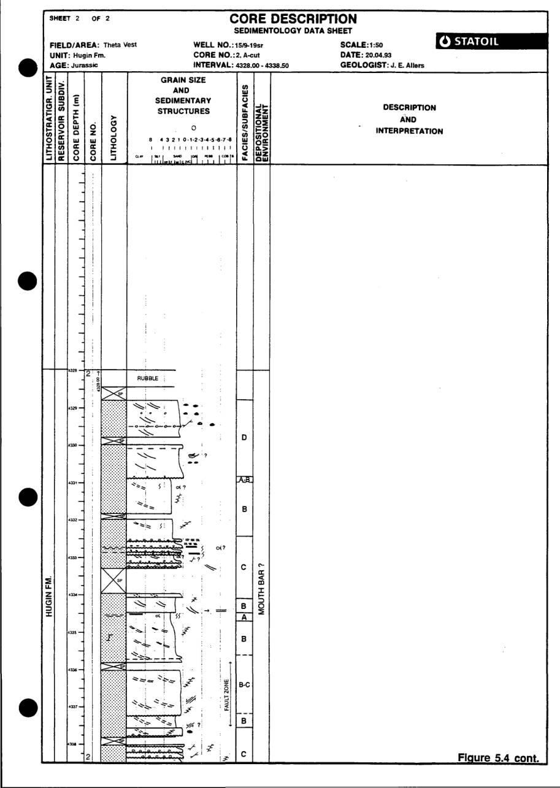

Figure content: core description log, sheet 2 of 2; header block with field/area (Theta Vest), unit (Hugin Fm.), age, well no., core no., interval, scale, date and geologist; columns for lithostratigraphic unit, reservoir subdivision, core depth (m), core no., lithology, grain size and sedimentary structures, facies/subfacies, depositional environment, and description and interpretation (empty); the log shows the Hugin Fm. with a rubble interval, a fault zone, facies letters and the environment label "MOUTH BAR ?".

<!-- page 95 -->
<!-- type: figure -->


Figure content: two colour photomicrographs of a thin section under the page title "WELL 15/9-19 SR, Optical micrograph, Heimdal Formation"; upper image in plane polarized light with arrows marking features, lower image of the same view in cross polarized light; each has a reference grid of letters A–H down the left side and numbers 1–11 along the bottom.

<!-- page 96 -->
<!-- type: figure -->


Figure content: two black-and-white scanning electron micrographs under the page title "WELL 15/9-19 SR, Scanning Electron Micrograph, Heimdal Formation"; upper image at lower magnification, lower image at higher magnification, each with an instrument data strip and scale bar along its lower edge and a reference grid of letters A–H down the left side and numbers 1–11 along the bottom.

<!-- page 97 -->
<!-- type: figure -->

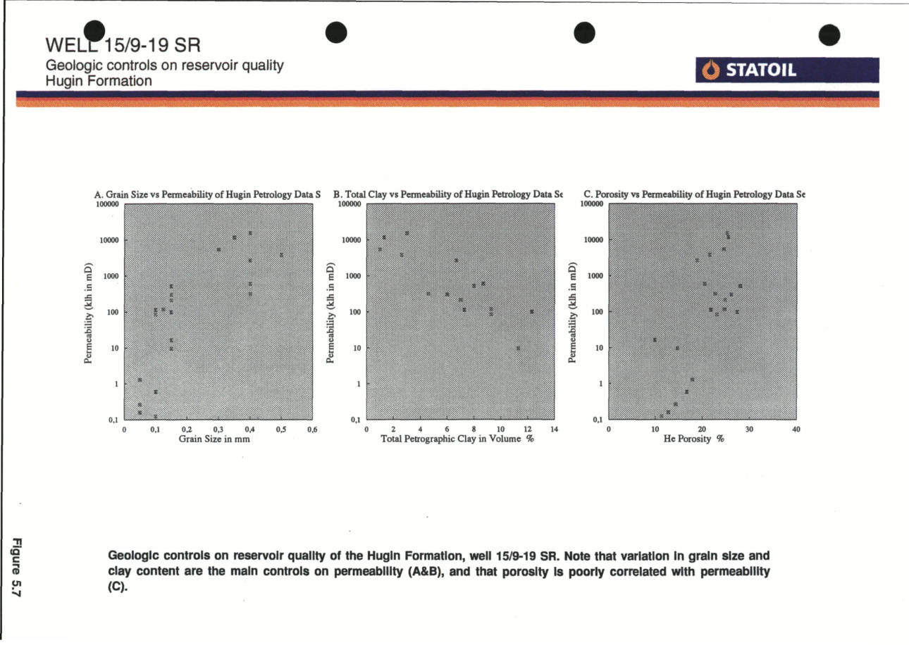

Figure content: three scatter plots side by side under the page title "WELL 15/9-19 SR, Geologic controls on reservoir quality, Hugin Formation", each with a logarithmic y-axis Permeability (klh in mD) from 0.1 to 100000; A. Grain Size vs Permeability of Hugin Petrology Data Set, x-axis Grain Size in mm, 0–0.6; B. Total Clay vs Permeability of Hugin Petrology Data Set, x-axis Total Petrographic Clay in Volume %, 0–14; C. Porosity vs Permeability of Hugin Petrology Data Set, x-axis He Porosity %, 0–40. The plot titles are cut off at the right edge of each panel.

<!-- page 98 -->
<!-- type: figure -->


Figure content: colour photograph of a full-diameter circular thin section impregnated with blue epoxy, under the page title "WELL 15/9-19 SR, Optical micrograph, Hugin Formation"; a ruler lies along the lower edge of the photograph; reference grid of letters A–H (printed twice) down the left side and numbers 1–11 along the bottom.

<!-- page 99 -->
<!-- type: figure -->


Figure content: colour photograph of a full-diameter circular thin section impregnated with blue epoxy, under the page title "WELL 15/9-19 SR, Optical micrograph, Hugin Formation"; a ruler lies along the lower edge of the photograph; reference grid of letters A–H (printed twice) down the left side and numbers 1–11 along the bottom.

<!-- page 100 -->
<!-- type: figure -->


Figure content: colour photograph of a full-diameter circular thin section impregnated with blue epoxy, under the page title "WELL 15/9-19 SR, Optical micrograph, Hugin Formation"; a ruler lies along the lower edge of the photograph; reference grid of letters A–H (printed twice) down the left side and numbers 1–11 along the bottom.

<!-- page 101 -->
<!-- type: figure -->

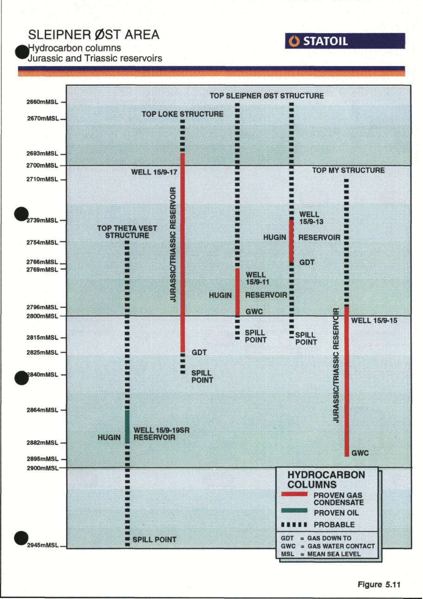

Figure content: schematic diagram of hydrocarbon columns against a vertical depth scale in m MSL; one vertical bar for each of the Theta Vest structure (well 15/9-19SR, Hugin reservoir), the Loke structure (well 15/9-17, Jurassic/Triassic reservoir), the Sleipner Øst structure (wells 15/9-11 and 15/9-13, Hugin reservoir) and the My structure (well 15/9-15, Jurassic/Triassic reservoir), running from top of structure to spill point, with GDT and GWC levels marked; legend distinguishes proven gas condensate, proven oil and probable columns, and explains GDT = gas down to, GWC = gas water contact, MSL = mean sea level.

<!-- page 102 -->
<!-- type: figure -->

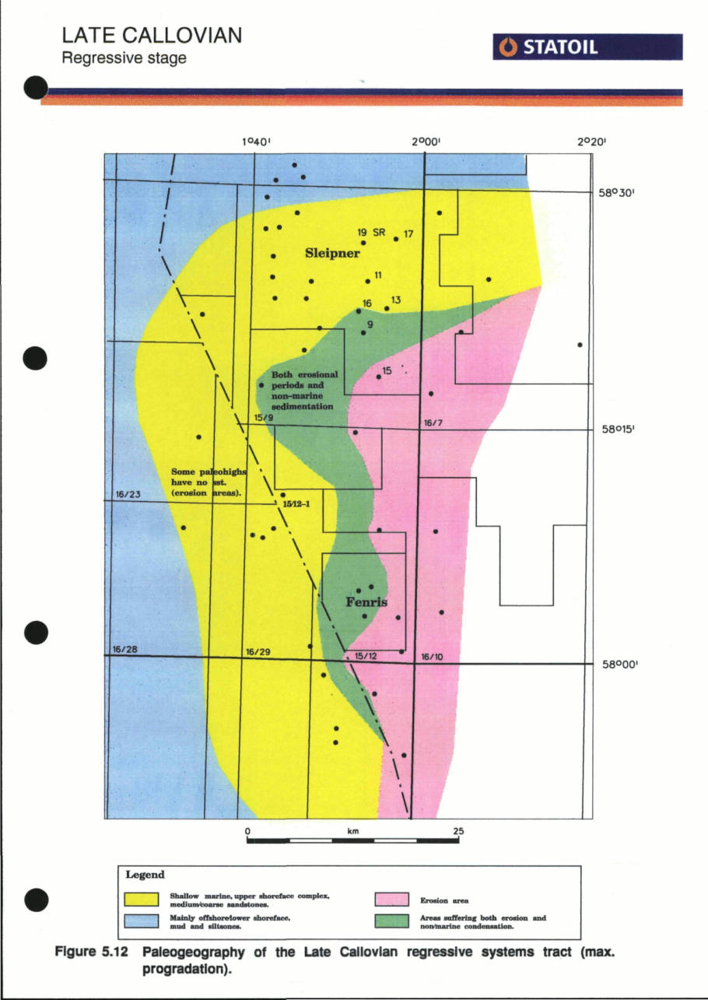

Figure content: colour paleogeographic map under the page title "LATE CALLOVIAN, Regressive stage"; latitude and longitude graticule, licence block outlines and numbers (15/9, 15/12, 16/7, 16/10, 16/23, 16/28, 16/29), well locations as dots with some wells numbered, the names Sleipner and Fenris, a dash-dot line across the map, two text annotations on the map, and a scale bar 0–25 km; legend with four colours: shallow marine, upper shoreface complex, medium/coarse sandstones; mainly offshore/lower shoreface, mud and siltstones; erosion area; areas suffering both erosion and non/marine condensation.

<!-- page 103 -->
<!-- type: figure -->

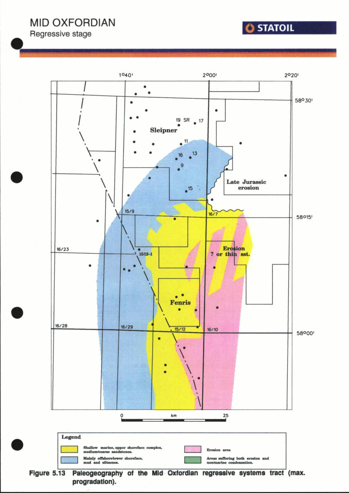

Figure content: colour paleogeographic map under the page title "MID OXFORDIAN, Regressive stage"; latitude and longitude graticule, licence block outlines and numbers (15/9, 15/12, 16/7, 16/10, 16/23, 16/28, 16/29), well locations as dots with some wells numbered, the names Sleipner and Fenris, a dash-dot line across the map, the annotations "Late Jurassic erosion" and "Erosion ? or thin sst.", and a scale bar 0–25 km; legend with four colours: shallow marine, upper shoreface complex, medium/coarse sandstones; mainly offshore/lower shoreface, mud and siltstones; erosion area; areas suffering both erosion and non/marine condensation.

<!-- page 104 -->
<!-- type: figure -->

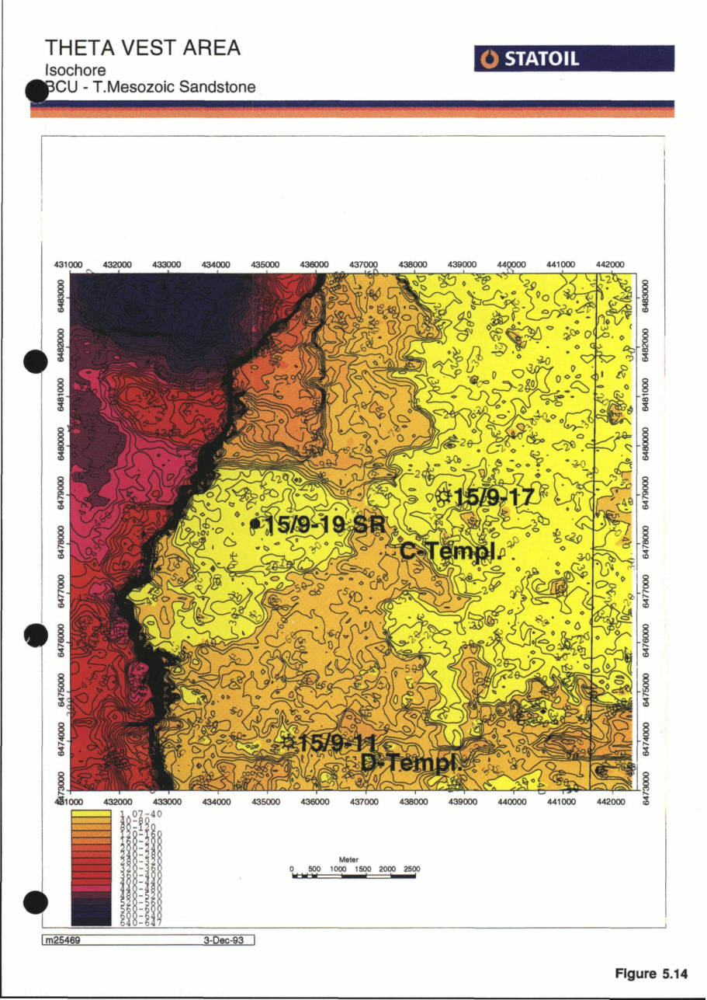

Figure content: colour-filled contour (isochore) map with UTM easting and northing coordinates along the frame; contour lines with thickness labels, heavy fault traces, well symbols labelled 15/9-19 SR, 15/9-17 and 15/9-11, and the labels C-Templ. and D-Templ.; colour scale of thickness classes below the map, scale bar in metres (0–2500), map reference m25469 and date 3-Dec-93.

<!-- page 105 -->
<!-- type: text -->

## 6 PETROPHYSICAL EVALUATION

### 6.1 Petrophysical analysis

Well 15/9-19 SR has been logged with both MWD and on wireline (WL). Only the WL logs are used in the petrophysical analysis. A log and core presentation of the Hugin and Skagerrak Formations, are given in Figure 6.1.

The following wireline logs were run over the reservoir section (run 3A):

```
DIFL/BHC AC/GR        3567.5 - 4602.2 m MD RKB
ZDL/CN/GR             3567.5 - 4602.2 m MD RKB
```

"Petrofree"-mud was used when drilling the well. With this mud and a 8 1/2" hole the induction log needs no borehole corrections. The formation resistivity (Rt) is thus set equal to the deep induction log.

Porosity compaction from lab porosity (φ<sub>atm</sub>) to reservoir porosity (φ<sub>res</sub>) is done with the same multiplication factor that is used for this formation on Sleipner Øst.

φ<sub>res</sub> = 0.965 \* φ<sub>atm</sub>

Porosity is calculated from logged bulk density (RHOB) by using the correlation between core measured porosity, corrected for compaction, (φ<sub>res</sub>) and the logged bulk density. The correlation only uses plug data in net sand intervals and gives:

PHIF = 1.506 - 0.568 \* RHOB

Water saturation is calculated from Archies' equation

Rt = a \* Rw / (φ<sup>m</sup> \* Sw<sup>n</sup>)

where a, m and n are derived from SCAL on plugs from the Hugin Fm. in the wells 15/9-13 and 15/9-17.

### 6.2 Formations parameters

Special core analysis (SCAL) have been performed on plugs from the Hugin Fm. of the wells 15/9-11, 15/9-13 and 15/9-17. Conventional plugs were taken from the Hugin Fm. of 15/9-19 SR as well as in the three above mentioned wells.

<!-- page 106 -->
<!-- type: mixed -->

The parameters in Archies' equation are estimated from the SCAL on plugs from the Hugin Fm. of 15/9-17 and 15/9-13. These data define the following values for the parameters:

a=1, m=1.75 og n=1.7.

Formation water resistivity (Rw) is not measured on any water samples from the Hugin Fm. in any of the wells on Sleipner Øst, and must therefore be estimated from other sources. It is reasonable to first assume that the salinity in the Hugin Fm. is equal to the salinity in the Heimdal Fm. As the water saturation calculated with this salinity is reasonable, this resistivity is used. That is:

Rw=0.0435 Ωm at 93°C at 2435 m TVD RKB

and when corrected to the proper reservoir temperature, assuming a temperature gradient of 3 °C/100 mTVD:

Rw=0.041 Ωm at 105°C in the Hugin Fm.

### 6.3 Formation temperature

Maximum logged temperature was 110°C at 4586 m MD RKB ( 3067 m TVD MSL) in well 15/9-19 SR.

### 6.4 Results

Mean of core measured values in net sand are given in Table 6.1 below. The measured values are reported in Coreteam (1993a).

*Table 6.1 – Arithmetic mean.*

| Measurement | # plugs | mean |
|---|---|---|
| grdens | 47 | 2.648 g/cc |
| por | 47 | 0.233 v/v |
| klh | 45 | 2762.3 mD |


<!-- page 107 -->
<!-- type: mixed -->

Petrophysical mean results in net sand are given in Table 6.2 below, and the calculated curves are plotted in Figure 6.2.

*Table 6.2 – Mean of petrophysical results for the Hugin Fm. of 15/9-19 SR.*

| Zone | Interval | Thickness | Phif | Sw | N/G | KLH |
|---|---|---|---|---|---|---|
| Hugin | 2863.98-2882.04 m TVD | 18.059 m TVT | 0.226 | 0.110 | 0.924 | 2913.2 mD |
| | 4316.50 - 4340.00 m MD | 23.5 m MD | | | | |


<!-- page 108 -->
<!-- type: figure -->


Figure content: composite well log plot against depth in metres TVD/MSL; stratigraphy columns on the left (Kritt, Jura, Trias; Viking, Vestland, Hegre; Draupne, Heather, Hugin, Skagerrak); log tracks for GR, for RHOB with NPHI (dashed), for ILD and for DT, each with its scale printed at the top of the track; a core column on the right showing the cored intervals as black bars.

<!-- page 109 -->
<!-- type: figure -->


Figure content: computer-processed interpretation (CPI) log plot against depth in metres TVD; tracks from left to right for GR with CALI, for RHOB with NPHI and SAND, for PHIF with core porosity POR-OB (points), for SW, and for K with core permeability KLH (points), each with its scale printed at the top of the track; a shaded bar beside the depth column marks an interval.

<!-- page 110 -->
<!-- type: mixed -->

## 7 DRILL STEM TESTING

### 7.1 DST #1

#### 7.1.1 Summary of analysis

The analysis have been done basically by using Horner analysis for the pressure build-up periods. A preliminary check of the pressure response away from the near wellbore area has also been done by matching the data to constant pressure type curves.

The DST #1 has a pressure response away from the wellbore which indicates pressure barriers. There are signs of a pressure barrier approximately 65 m from the well. In addition, there are boundary effects approximately 120-260 m from the well. These can be identified as a combination of pressure barriers and an increase in flow capacity away from the well.

The test results indicate an oil-bearing formation with very good production capacities. Table 7.1 gives a summary of the results from the testing phase and the analysis.

*Table 7.1 – Results from the testing phase and analysis.*

| DST #1 | |
|---|---|
| Formation | Hugin |
| Interval | 4316.0 - 4338.0 m MD RKB |
| | 2863.6 - 2880.5 m TVD MSL |
| Fluid type | Oil |
| Oil density | 0.883 |
| GOR | 97-130 Sm3/Sm3 |
| Max. rate | 1358 Sm3/d |
| Flow capacity, kh | 20066 mDm |
| Test permeability | 914 mD |
| P\* | 327.7 bar |
| Pwf | 318.6 bar |
| Reservoir temp. | 106.2 °C |
| PI | 144 Sm3/d/bar |
| Skin | 1.7 |


The pressures are measured at 2863.9 m TVD MSL.

<!-- page 111 -->
<!-- type: text -->

#### 7.1.2 Objectives

The objectives for the production test were:

- quantify amounts of sour gas in the wellstream at surface and downhole
- obtain initial formation pressure
- collect data for evaluation of reservoir properties and productivity
- obtain formation fluid samples and separator fluid samples
- investigate boundary effects.

#### 7.1.3 Test performance

The rate history includes the initial clean-up, followed by the test and the main flow. The well was perforated in underbalance (>80 bar), using diesel as a cushion, with open choke. The rate was increased in steps up to a maximum of 1358 Sm3/d, two test separators were used.

After the initial build up, the well was opened to a rate of 75 Sm3/d for PVT sampling. After the sampling, the well was opened for the main flow period with 1290 Sm3/d. The well was then shut in for the main build up. See Figure 7.1 for overview of the complete test. Table 7.2 shows the rates, pressures and flow periods.

<!-- page 112 -->
<!-- type: mixed -->

*Table 7.2 – The rates, pressures and flow periods.*

| Flow period | Choke ( mm) | WHP (kPa) | Qo (Sm3/d) | Qg (Sm3/d) | GOR (Sm3/Sm3) |
|---|---|---|---|---|---|
| First clean up flow | 12.70 | 11740 | 679 | 66500 | 98 |
| Second clean up flow | 15.88 | 11256 | 914 | 88600 | 97 |
| Third clean up flow | 2x15.88 | 90260 | 1358 | 134000 | 99 |
| Clean up build up | | | | | |
| Wire line operation/ BHS operation | | | | | |
| Sampling flow | 4.76 | 12220 | 75 | 11700 | 156 |
| First main flow | 12.70 | 11860 | 660 | 65300 | 99 |
| Second main flow | 2x 15.88 | 9020 | 1290 | 168000 | 130 |
| Main build up | | | | | |
| Well killed | | | | | |

The pressure data from all four down-hole pressure gauges are in agreement, and the quality of the data is acceptable.

#### 7.1.4 Analysis

Analysis have been done on the pressure build-up data obtained by one of the four Halliburton HMR memory gauges at 2719.0 m TVD MSL, HRS-10809.

*Table 7.3 – Input parameters used for the analysis.*

| | | |
|---|---|---|
| Ø | 22.1 | (%) |
| μ | 0.904 | (mPas) |
| C<sub>t</sub> | 3.38\*10E-6 | (1/kPa) |
| Bo | 1.4374 | (Rm3/Sm3) |
| rw | 0.1080 | (m) |
| h | 22.0 | (m) |
| T | 106.2 | (°C) |


The pressure response indicates several boundary effects. Barriers are identified

<!-- page 113 -->
<!-- type: text -->

approximately 60 m and 250 m from the well. In addition an increase in flow capacity is observed approximately 125 m from the well. See Figure 7.2 and 7.3.

An analytic model based on a set of pressure boundaries has been used to produce synthetic pressure data to fit the measured data. Parallel no flow barrier 60 and 255 m from the well, together with a perpendicular constant pressure boundary 125 m from the well, give a good match between synthetic and measured data. See Figure 7.4.

The permeability is calculated using data from the main pressure build-up period. The test analysis give a permeability of approximately 900 mD. The average core permeability varies between 310 mD and 2.9 D, for various methods. Based on core observations and log data, the permeability distribution is expected to be non homogeneous, hence the test permeability is believed to correspond with the core and log data.

The productivity index (PI) is calculated to 145 Sm3/d/bar.

Total skin from the test analysis is approximately -0.2, the completion skin is 0. By taking the well deviation (in the perforated interval) of 50.2 degrees into account, a damage skin of 1.7 can be calculated.

Perforation with high underbalance is supposed to stimulate the near wellbore effects. However, experience from the Statfjord Field shows that high rates give positive skin as a result of pressure loss through the drill stem between the perforated interval and pressure gauges.

A skin of 1.7 is the equivalent of a pressure loss of 1.8 bar. This is within the expectations of a hydraulic frictionloss between the perforated interval and the pressure gauges (197 m MD), given a heavy and high viscous oil, with a flowrate of 1,310 Sm3/d.

The extrapolated reservoir pressure is calculated to 327.7 bar.

Max. temperature during the cleanup flow was measured to 106.2 °C.

The following fluid properties were measured during the main flow period (choke 15.88 mm):

```
Oil  S.G.    0.882
Gas  S.G.    0.730
H2S          3.5 ppm
CO2          9.5 %
```

Table 7.4 shows the fluid composition from the recombination of separator samples. Tables 7.5 and 7.6 show the composition and results from the two analysed bottom hole samples. The results of PVT and compositional analysis of two bottom hole samples and one set of separator samples from well 15/9-19 SR are reported in Statoil (1993b).

<!-- page 114 -->
<!-- type: table -->

*Table 7.4 – Composition of reservoir fluid (from recombined separator samples).*

| | Separator liquid (MOL%) | Separator gas (MOL%) | Recombined fluid (MOL%) |
|---|---|---|---|
| Bottle no. | TS-55-08 | A-14629 | |
| Nitrogen | 0.06 | 0.99 | 0.47 |
| Carbondioxide | 2.78 | 7.55 | 4.87 |
| Methane | 15.45 | 77.79 | 42.82 |
| Ethane | 5.05 | 7.54 | 6.14 |
| Propane | 6.50 | 3.94 | 5.38 |
| i-Butane | 0.99 | 0.34 | 0.70 |
| n-Butane | 4.02 | 1.03 | 2.71 |
| i-Pentane | 1.52 | 0.21 | 0.95 |
| n-Pentane | 2.54 | 0.28 | 1.55 |
| Hexanes | 3.62 | 0.18 | 2.11 |
| Heptanes | 5.76 | 0.12 | 3.28 |
| Octanes | 5.64 | 0.03 | 3.18 |
| Nonanes | 4.14 | 0.00 | 2.32 |
| Decanes plus | 41.93 | 0.00 | 23.52 |
| Sum | 100.00 | 100.00 | 100.00 |

GOR = 88.5 Sm3/m3


<!-- page 115 -->
<!-- type: table -->

*Table 7.5 – Results bottomhole samples.*

| Bottle no. | TS-29-06 Stabilized oil (MOL %) | TS-29-06 Evolved gas (MOL%) | TS-29-06 Recombined fluid (MOL %) | TS-61-04 Stabilized oil (MOL %) | TS-61-04 Evolved gas (MOL %) | TS-61-04 Recombined fluid (MOL %) |
|---|---|---|---|---|---|---|
| Nitrogen | 0.00 | 0.71 | 0.46 | 0.00 | 0.71 | 0.46 |
| Carbondioxide | 0.00 | 7.65 | 4.95 | 0.00 | 7.66 | 4.94 |
| Methane | 0.25 | 67.10 | 43.50 | 0.23 | 67.27 | 43.43 |
| Ethane | 0.26 | 9.34 | 6.14 | 0.25 | 9.26 | 6.06 |
| Propane | 0.96 | 7.60 | 5.26 | 0.97 | 7.63 | 5.26 |
| i-Butane | 0.29 | 0.91 | 0.69 | 0.30 | 0.90 | 0.69 |
| n-Butane | 1.61 | 3.21 | 2.65 | 1.68 | 3.20 | 2.66 |
| i-Pentane | 1.11 | 0.82 | 0.92 | 1.15 | 0.80 | 0.92 |
| n-Pentane | 2.18 | 1.15 | 1.51 | 2.23 | 1.11 | 1.51 |
| Hexanes | 4.46 | 0.81 | 2.10 | 4.47 | 0.77 | 2.08 |
| Heptanes | 8.36 | 0.52 | 3.29 | 8.26 | 0.53 | 3.28 |
| Octanes | 8.92 | 0.14 | 3.24 | 8.74 | 0.14 | 3.20 |
| Nonanes | 6.75 | 0.02 | 2.39 | 6.64 | 0.02 | 2.37 |
| Decanes plus | 64.86 | 0.00 | 22.90 | 65.08 | 0.00 | 23.15 |
| Sum | 100.00 | 100.00 | 100.00 | 100.00 | 100.00 | 100.00 |


<!-- page 116 -->
<!-- type: table -->

*Table 7.6 – Results bottomhole samples.*

| Bottle no. | TS-29-06 | TS-61-04 |
|---|---|---|
| Gas oil ratio (Sm3/Sm3) | 159.1 | 157.0 |
| Flash formation volume factor of bubble point liquid (m3/Sm3) | 1.505 | 1.500 |
| Density at bubble point (g/cm3) | 0.701 | 0.702 |
| Density of stabilized oil (g/cm3) | 0.883 | 0.883 |
| Gas gravity (air=1) | 0.885 | 0.882 |
| Density of C10+ (g/cm3) | 0.916 | 0.915 |
| Bubble point (bar) | 273.8 | 273.2 |


<!-- page 117 -->
<!-- type: figure -->


Figure content: two time-series plots side by side under the heading "WELL 15/9-19 SR, Test performance", drawn with time running down the page; left plot bottomhole temperature in °C (scale 100–110), right plot bottomhole pressure in kPa (scale 30000–32000); time axis in hours with date marks from 93/04/18 to 93/04/23; one curve in each plot; recorder HRS-10809 and test date noted on the plots.

<!-- page 118 -->
<!-- type: figure -->


Figure content: semi-log (Horner) plot under the heading "WELL 15/9-19 SR, Multiple-rate Horner analysis"; x-axis multiple-rate Horner time (superposition time function), from -4 to 0; y-axis wellbore pressure in kPa, from 31200 to 31700; one measured pressure curve and one fitted straight line; three arrows mark points on the curve and one arrow on the x-axis marks 1 HR; a text box headed "BY LEAST SQUARES" gives the fitted values of m, kh, r_inv and s; recorder HRS-10809 and test date noted at the frame.

<!-- page 119 -->
<!-- type: figure -->


Figure content: log-log diagnostic plot under the heading "WELL 15/9-19 SR, Multiple-rate Buildup analysis"; x-axis multiple-rate equivalent drawdown time in hours, logarithmic from 10^-3 to 10^2; y-axis differences and derivatives of pressures, logarithmic from 10^1 to 10^4; two series of measured points (triangles for pressure difference, circles for derivative), each with a type-curve line; a text box gives the match values of m, kh, k, h, kV/kH, CD and s; recorder HRS-10809 and test date noted at the frame.

<!-- page 120 -->
<!-- type: figure -->


Figure content: semi-log (Horner) plot under the heading "WELL 15/9-19 SR, Multiple-rate Horner analysis"; x-axis multiple-rate Horner time (superposition time function), from -4 to 0; y-axis wellbore pressure in kPa, from 31200 to 31700; one solid curve and one dotted curve (measured and synthetic data) that nearly coincide; a text line in the plot names the boundary model (two parallel no-flow boundaries and one perpendicular constant-pressure boundary); a text box gives the values of m, kh, k, h, kV/kH, CD and s; recorder HRS-10809 and test date noted at the frame.

<!-- page 121 -->
<!-- type: text -->

## 8 GEOCHEMISTRY

Organic geochemical analyses and interpretations have been carried out on gas (main flow and bottom hole) and oil (bottom hole) samples from DST#1, well 15/9-19 SR. Gas analysis were done by IFE. Oil analyses were performed by Statoil's Geochemistry Dept., with the exception of sulphur content (Production Laboratories, Statoil) and isotopic analyses (IFE).

Data for well 15/9-19 SR have been compared with results from recent studies of gas, condensate and oil samples from Sleipner Øst/Loke and Sleipner Vest.

General information on DST#1, together with gas:oil ratios (GOR), H2S concentrations and API gravity of the oil from rigsite reports, are given in Table 8.1.

### 8.1 Geochemical properties of gas from DST#1, well 15/9-19 SR

The chemical and isotopic composition of the gas is given in Table 8.2 and is shown graphically in Figs. 8.1 and 8.2. The chemical composition of the gas is comparatively normal in that it falls within the range generally found in the North Sea province, albeit with relatively high carbon dioxide (CO2) concentration.

However, the isotopic composition is very unusual compared to the normal trend of steadily increasing ("heavier") carbon isotope values with increasing carbon number. The gas from well 15/9-19 SR shows a "zigzag" pattern of increasing and decreasing, but always unusually light, isotope values on going from methane to ethane, propane and the butanes (Fig. 8.2).

### 8.2 Geochemical properties of oil from DST#1, well 15/9-19 SR

#### 8.2.1 Bulk composition

In the context of the North Sea, the oil from DST#1 has a low API gravity (ca. 30° according to rig reports, Table 8.1) and a very high sulphur content (1.7%, Table 8.3). These properties are reflected in a high C15+ fraction (79%, Table 8.3) and very low saturated hydrocarbon content (30%, Table 8.3). The aromatic hydrocarbon content is exceptionally high (57%, Table 8.3), whilst asphaltenes are somewhat elevated (3%).

The carbon isotopic composition (δ13C) of the oil (-27.8‰, Table 8.4) is slightly heavier than is usually observed in the North Sea, and individual fractions surprisingly show almost no variation (Fig. 8.3).

<!-- page 122 -->
<!-- type: text -->

#### 8.2.2 Molecular composition

Thompson's indices are given in Table 8.5 and show that the light hydrocarbons are depleted in branched and cyclic alkanes relative to n-alkanes and aromatics (e.g. high W, H, S).

Pr/Ph ratio is very low from GC analysis of both the whole oil and saturated hydrocarbon fraction (0.64 and 0.65 respectively, Table 8.6). The chromatogram from analysis of the latter fraction (Fig. 8.4) reveals also relatively large amounts of acyclic isoprenoid alkanes and long chain n-alkanes compared to most North Sea oils. These features are reflected in a high Ph/nC18 and low nC17/(nC17+nC27) ratio (Table 8.6).

The GC trace of the aromatic hydrocarbon fraction (Fig. 8.5) contains abundant phenanthrenes which resulted in calculation of relatively low F1, F2 and MPI1 parameters in Table 8.7.

The mass fragmentograms from GCMS analysis of the saturated hydrocarbons (Fig. 8.6) and parameters derived therefrom (Table 8.8) are unusual in several respects. Most notable are the high relative abundances of bisnorhopane (C28αβ/H = 0.58) and C35αβ hopanes (35/34H = 1.03) in m/z 191. Other noteworthy features are the low diasterane/regular sterane ratio in m/z 217 (dia/reg = 0.72), low hopane/sterane ratio (H/S = 3.12) and high C30 sterane abundance (C30/st = 0.10).

The GCMS analysis of the aromatics fraction resulted in an inability to identify the monoaromatic steroids in m/z 253 (Fig. 8.7) due to the presence of other components, and hence failure to measure parameters Arom1 and Arom2 (Table 8.9). The triaromatic steroids were recognisable however and Crack1 and Crack2 are reported in Table 8.9. The values for both are moderate to low.

### 8.3 Thermal maturity

#### 8.3.1 Gas

The gas has a normal hydrocarbon composition with a gas "wetness" (0.14 for bottom hole sample, Table 8.2) which suggests a relatively mature sample. However, the "zigzag" isotopic compositions of the hydrocarbons (see section 8.1 and Fig. 8.2) are extremely unusual and are not interpretable using currently accepted isotopic models of gas generation. Hence, no reliable estimate of the thermal maturity of the gas can be made.

<!-- page 123 -->
<!-- type: text -->

#### 8.3.2 Oil

Both the 20S and 22S biomarker parameters (0.54 and 0.60 respectively) have reached "equilibrium" values, which generally occurs at or around the onset of petroleum generation. There are other bulk and molecular properties which suggest that the oil was generated relatively early in the oil generation window (OGW). API gravity is low (ca. 30°), saturated hydrocarbon content is very low (30%), acyclic isoprenoids are high relative to n-alkanes (Ph/nC18 ca. 1), there are relatively abundant long chain n-alkanes, the ββ parameter (0.56) has not reached its maximum ("equilibrium") value of ca. 0.7.

However, the source parameters (section 8.4, below) suggest an unconventional source rock (in a North Sea context) for the oil, which - if true - may also have affected some of the maturity parameters. Hence, it is probably safest to conclude that generation of the oil occurred over the early (lower temperature) to main phase of the OGW.

### 8.4 Source classification

#### 8.4.1 Gas

The hydrocarbon composition of this gas resembles, in particular, gas from Sleipner Vest (see section 8.5). However, the "zigzag" trend shown by the carbon isotopes, illustrated in Fig. 8.2 and discussed in section 8.1, is beyond the scope of current models and makes it impossible to classify the source of the gas.

The amount of carbon dioxide in the gas is relatively high (7.6% in the bottom hole sample, Table 8.2) and has a carbon isotope value of -8.0‰. These factors together suggest that the source was mostly thermal degradation of inorganic carbonate (James, 1985).

#### 8.4.2 Oil

The oil properties, both bulk and molecular, are remarkably consistent in indicating that this sample was generated from a non-clastic marine source rock - i.e. not the Kimmeridge Clay Formation (KCF) or equivalent (Draupne Formation here) in its normal form. Key features which support this interpretation are:

- i) bulk properties such as the API gravity and high sulphur content (30° and 1.7% respectively)
- ii) biomarker parameters including low Pr/Ph ratio (0.65), high bisnorhopane (C28αβ/H 0.58), low diasteranes (dia/reg 0.72), abundant extended hopanes

<!-- page 124 -->
<!-- type: text -->

(35/34H 1.03).

All of the above are characteristic of oils from carbonate/siliceous source rocks and are unusual for a North Sea oil. Other parameters, such as C30/st, confirm that the source rock was deposited in a marine environment.

Thus the oil was most likely generated from a non-clastic (i.e. carbonate or siliceous) marine source rock. This could have been either an Upper Jurassic KCF equivalent with an unusual facies, or a completely different and as yet undiscovered source.

### 8.5 Comparison of Theta Vest with Sleipner Øst, Loke and Sleipner Vest

Sleipner Øst, Loke and Sleipner Vest have been the subjects of recent geochemical reports (Statoil, 1993g; Statoil, 1993h). The following is a summary of the main conclusions for these areas.

#### 8.5.1 Sleipner Øst and Loke

The hydrocarbon gases have very similar chemical and isotopic compositions throughout the Heimdal and Hugin Formations, both in Sleipner Øst and Loke. Only the amount of CO2 shows any trend amongst the gas components, being in lower abundance in the Heimdal Formation than the Hugin. Low amounts of CO2 tend also to be slightly isotopically lighter.

The gas was probably generated from either coals or marine sediments with significant land plant input, at thermal maturities corresponding to the end of the oil window. The hydrocarbon gases in Sleipner Øst are wetter and isotopically lighter than in Sleipner Vest, indicating that they were generated at a somewhat lower maturity.

The very low amounts of CO2 in the Heimdal Formation were probably co-sourced with the hydrocarbons; where concentrations are slightly higher in the Hugin Formation, this is a reflection of a separate input from thermal breakdown of carbonates.

The condensates in the Heimdal Formation comprise a homogeneous data set, with no lateral (across the field) or vertical (intra-well) trends in geochemical composition visible.

In contrast, the condensates from the Hugin Formation on Sleipner Øst form a separate group with different geochemical properties to those from the Hugin Formation in Loke and well 15/9-15. The latter are more similar in geochemical properties to those from the Heimdal Formation.

<!-- page 125 -->
<!-- type: text -->

The condensate in the Heimdal (all wells) and in the Hugin in well 15/9-15 and Loke may well have been co-sourced with the gas - or possibly have come from the same source rock type (dominated by terrestrial organic matter - OM) but at slightly lower thermal maturity. In contrast, the condensate in the Hugin on Sleipner Øst came originally from a conventional oil-prone marine source rock, and corresponds to a fluid generated at top of the oil window or onset of oil to gas cracking. The condensate was probably dissolved in the gas phase by the later-generated gas from a terrestrial source.

#### 8.5.2 Sleipner Vest

On Sleipner Vest the bulk of the gas has been derived from a different source than the oil/condensates. Source variations have also been recognized amongst the oil/condensates.

The gases have a very uniform hydrocarbon composition, characteristic of condensate-associated material generated at a maturity level of approx. 1-1.5% Ro. The coals of the Hugin and Sleipner Fm. are the most likely source rocks for this gas, but at greater burial depths than those present in the Sleipner Vest field.

CO2 content in the gases increases when going from the southern part of the field both in northern and eastern direction. This trend coincides with a larger-scale regional variation in both content and isotopic ratio of CO2, which is thought to be related to the input of an isotopically heavy, CO2-rich gas from the Viking Graben into this area.

The composition of the condensates from Sleipner Vest is very uniform, with the exception of well 15/9-1 (both oil and condensate). This indicates that the latter well is located in an isolated field segment which has received a stronger influx of material derived from marine OM (Draupne Formation?).

All the other condensates have been generated from source rocks containing both terrestrial and marine OM. This could be a more terrestrial facies of the Draupne Formation (compared to 15/9-1) or it could reflect mixing of petroleum generated from the Draupne with that from a terrestrially dominated source (Hugin/Sleipner coals?).

#### 8.5.3 Comparison with Theta Vest

Figure 8.8 contains a comprehensive classification of fluids (gases, condensates and oils) discovered to date in the greater Sleipner area. The fluid types are classified according to field/structure, formation, thermal maturity and source rock type. Note that it applies only to the hydrocarbon components of the gases - carbon dioxide is dealt with separately below. The figure shows that four different source rock types/combinations and four maturity levels have been identified to date (excluding the unclassifiable gas from Theta Vest). The following general points can be made:

<!-- page 126 -->
<!-- type: text -->

- throughout the area, the thermal maturity level apparently increases, as might be expected, in the order oils < condensates < gases;
- no attempt has been made to discriminate between thermal and phase effects. Thus the former may in fact be due to the latter (e.g. condensate in 15/9-1 may be a phase and not a thermal process) and hence the thermal maturity categories are deliberately broad and overlap;
- the oil from Theta Vest is unique in coming from a non-clastic marine source rock and has many properties which are very unusual for the North Sea province;
- the Draupne Formation (KCF≡) is the source of a) the oil in 15/9-1, Sleipner Vest; b) the condensates in 15/9-1 and in wells from the Hugin Formation on Sleipner Øst;
- coals, or a marine source rock dominated by terrigenous OM, are the proposed source of i) the condensates and the gas in the Heimdal Formation on both Sleipner Øst and Loke, as well as ii) the gas in the Hugin Formation on both Sleipner Øst and Loke and iii) the gas in the Hugin Formation on Sleipner Vest;
- a mixed terrigenous/marine OM source was most likely for the condensate in the Hugin Formation on Sleipner Vest (i.e. either a mixture of fluids from a coal and Draupne Fm. source or a single source rock with a mixed organic input).

Thus in summary it can be seen that there are wide variations in source rock type of the oils, condensates and gases across the Sleipner area. The oil and gas from Theta Vest have properties which are unlike those for any other fluid found elsewhere in the area.

The origin of carbon dioxide in the area is, in one sense, simpler in that there are only two proposed sources: either low amounts generated from OM in the source rock or high amounts from an inorganic carbonate source. These two origins can be distinguished on the basis of the carbon isotope values, as illustrated by Fig. 8.9 which shows %CO2 in the gas versus δ13C for CO2 for all samples from the area. It was reported previously that the CO2 in Sleipner Vest is more abundant and comes predominantly from breakdown of inorganic carbonate; in contrast the low amounts in Sleipner Øst and Loke originate mostly from OM degradation. However, the CO2 from Theta Vest resembles that from Sleipner Vest in terms of abundance and isotopic composition, and as such is in contrast to other samples from the Sleipner Øst area.

<!-- page 127 -->
<!-- type: table -->

*Table 8.1 – Available gas and oil samples from well 15/9-19 SR.*

| Formation | Sample type | Geochem. sample no. | Perforated interval¹ (mRKB) | Gas/oil ratio² (SM3/SM3) | API gravity² | H2S² (ppm) |
|---|---|---|---|---|---|---|
| Hugin | DST#1 | S6891 | 4316-4338 | 98-141 | 30.0-31.1 | 1-6 |

1 Uncorrected depths

2 Values taken from rigsite reports


<!-- page 128 -->
<!-- type: table -->

*Table 8.2 – Chemical and isotopic composition of gases from DST#1, well 15/9-19 SR¹.*

a) Chemical composition

| Sample type | Sample no. | C1 % | C2 % | C3 % | iC4 % | nC4 % | iC5 % | nC5 % | CO2 % | ΣC1-C5 % | Wetness² |
|---|---|---|---|---|---|---|---|---|---|---|---|
| Main flow | 11993 | 75.8 | 8.3 | 4.9 | 0.42 | 1.5 | 0.29 | 0.39 | 8.4 | 91.6 | 0.17 |
| Bottom hole | 11994 | 79.5 | 7.0 | 4.0 | 0.35 | 1.0 | 0.21 | 0.28 | 7.6 | 92.4 | 0.14 |

b) Isotopic composition

| Sample type | Sample no. | C1 δ13C ‰PDB | C1 δD ‰SMOW | C2 δ13C ‰PDB | C3 δ13C ‰PDB | iC4 δ13C ‰PDB | nC4 δ13C ‰PDB | CO2 δ13C ‰PDB | CO2 δ18O ‰PDB |
|---|---|---|---|---|---|---|---|---|---|
| Main flow | 11993 | -40.0 | -209 | -30.0 | -33.2 | -30.9 | -35.6 | -8.4 | -11.4 |
| Bottom hole | 11994 | -40.5 | -212 | -30.3 | -33.0 | -30.6 | -35.1 | -8.0 | -11.1 |

1 Data from IFE

2 Wetness = ΣC2-C5/ΣC1-C5


<!-- page 129 -->
<!-- type: table -->

*Table 8.3 – Bulk composition data for oil sample from well 15/9-19 SR.*

| Sample type | Sample no. | C15+ % | Saturates % | Aromatics % | Polars % | Asphaltenes % | Sulphur¹ % |
|---|---|---|---|---|---|---|---|
| Bottom hole | S6891 | 79 | 30 | 57 | 10 | 3 | 1.7 |

1 Sulphur content from PROLAB

*Table 8.4 – Isotopic composition data for oil sample and fractions from well 15/9-19 SR¹.*

| Sample type | Sample no. | δ13C (‰) Oil | δ13C (‰) Saturates | δ13C (‰) Aromatics | δ13C (‰) Polars | δ13C (‰) Asphaltenes |
|---|---|---|---|---|---|---|
| Bottom hole | 12009 | -27.8 | -27.9 | -27.6 | -27.6 | -27.5 |

1 Data from IFE


<!-- page 130 -->
<!-- type: table -->

*Table 8.5 – Thompson's indices¹ from light hydrocarbons analysis of oil sample from well 15/9-19 SR.*

| Sample type | Sample no. | A | B | X | W | C | I | F | H | U | R | S |
|---|---|---|---|---|---|---|---|---|---|---|---|---|
| Bottom hole | S6891 | 0.55 | 0.86 | 0.41 | 13.7 | 1.8 | 1.5 | 1.5 | 30.8 | 0.7 | 2.8 | 289 |

1 From Thompson, 1983 inter alia

Aromaticity

- A = benzene/nC6
- B = toluene/nC7
- X = m+p-xylenes/nC8
- W = 10*benzene/cC6

Paraffinicity

- C = (nC6+nC7)/(cC6+mcC6)
- I = (2mC6+3mC6)/(1cis3dmcC5+1t3dmcC5+1t2dmcC5)
- F = nC7/mcC6
- H = (100*nC7)/(cC6+2mC6+2,3dmcC5+3mC6+1cis3dmcC5+1t3dmcC5+1t2dmcC5+nC7+mcC6)

Naphthene branching

- U = cC6/mcC5

Paraffin branching

- R = nC7/2mC6
- S = nC6/2,2dmC4

Codes: n = normal; c = cyclo; C6 = hexane (etc); m = methyl; dm = dimethyl; t = trans


<!-- page 131 -->
<!-- type: table -->

*Table 8.6 – Data from GC analysis of whole oil and saturates fraction, well 15/9-19 SR.*

| Sample type¹ | Pr/nC17 (A) | Ph/nC18 (B) | A/B | Pr/Ph | nC17/(nC17+nC27) |
|---|---|---|---|---|---|
| Whole oil | 0.48 | 0.99 | 0.48 | 0.64 | 0.80 |
| Saturates | 0.55 | 1.1 | 0.52 | 0.65 | 0.82 |

1 Bottom hole sample (S6891)

Pr pristane; Ph phytane; nC17 n-heptadecane; nC18 n-octadecane; nC27 n-heptacosane

*Table 8.7 – Data from GC analysis of aromatics fraction from oil, well 15/9-19 SR.*

| Sample no.¹ | F1 | F2 | MPI1 |
|---|---|---|---|
| S6891 | 0.43 | 0.12 | 0.66 |

1 Bottom hole sample

```
          3/2 (2-MP + 3-MP)
MPI1 = -----------------------
          P + 1-MP + 9-MP

               3-MP + 2-MP
F1   = -------------------------------
          3-MP + 2-MP + 9-MP + 1-MP

                  2-MP
F2   = -------------------------------
          3-MP + 2-MP + 9-MP + 1-MP
```

P = phenanthrene; M = methyl


<!-- page 132 -->
<!-- type: table -->

*Table 8.8 – Biomarker parameters from GCMS analysis of saturated hydrocarbon fraction of oil from well 15/9-19 SR.*

| Sample type | Sample no. | Biomarker parameter | | | | | | | |
|---|---|---|---|---|---|---|---|---|---|
| | | 20S | ββ | 22S | Ts/Tm | TtX | 30D/H | ppmH | ppmS |
| Bottom hole | S6891 | 0.54 | 0.56 | 0.60 | 0.56 | 0.15 | 0.02 | 2179 | 698 |
| | | %C27 | %C28 | %C29 | C30/st | Dia/reg | C28αβ/H | H/S | |
| | | 36 | 28 | 35 | 0.10 | 0.72 | 0.58 | 3.12 | |
| | | 3R/H | 4R/H | 35/34H | Dem/H | O/H | G/H | 30αβ | 29/30H |
| | | 0.06 | 0.05 | 1.03 | 0.00 | 0.00 | 0.03 | 0.93 | 0.43 |


<!-- page 133 -->
<!-- type: table -->

*Derivation of biomarker ratios*

| Ratio | Derivation | m/z |
|---|---|---|
| Triterpanes | | |
| 22S | 32αβS/(32αβS+32αβR) | 191 |
| Ts/Tm | 27Ts/27Tm | 191 |
| TtX | 30D/29βα | 191 |
| 30D/H | 30D/30αβ | 191 |
| 29/30H | 29αβ/30αβ | 191 |
| 30αβ | 30αβ/(30αβ+30βα) | 191 |
| C28αβ/H | 28αβ/30αβ | 191 |
| 3R/H | (23/3)/30αβ | 191 |
| 4R/H | (24/4)/30αβ | 191 |
| 35/34H | (35αβR+35αβS)/(34αβR+34αβS) | 191 |
| Dem/H | 25nor30αβ/30αβ | 191 |
| O/H | 30O/30αβ | 191 |
| G/H | 30G/30αβ | 191 |
| ppmH* | Σ ppm 27Ts+27Tm+29αβ+29βα+30αβ+30βα+31αβS+31αβR+32αβS+32αβR+33αβS+33αβR +34αβS+34αβR+35αβS+35αβR | 191 |
| Steranes | | |
| 20S | 29ααS/(29ααR+29ααS) | 217 |
| ββ | (29ββR+29ββS)/(29ββR+29ββS+29ααR+29ααS) | 217 |
| %C27 | 100*(27ββR+27ββS)/(27ββR+27ββS+28ββR+28ββS+29ββR+29ββS) | 218 |
| %C28 | 100*(28ββR+28ββS)/(27ββR+27ββS+28ββR+28ββS+29ββR+29ββS) | 218 |
| %C29 | 100*(29ββR+29ββS)/(27ββR+27ββS+28ββR+28ββS+29ββR+29ββS) | 218 |
| C30/st | 100*(30ββR+30ββS)/(27ββR+27ββS+28ββR+28ββS+29ββR+29ββS) | 218 |
| Dia/reg | (27dβR+27dβS)/(27ααR+27ααS) | 217 |
| ppmS* | Σ ppm 27ββR+27ββS+28ββR+28ββS+29ββR+29ββS | 218 |
| H/S | ppmH/ppmS | |

\* ppm calculated from comparison with m/z 219 intensity for D2-cholestane


<!-- page 134 -->
<!-- type: table -->

*Biomarker codes used in derivation of ratios*

| Compound name | Old code | NEW CODE |
|---|---|---|
| Triterpanes | | |
| C23H42 tricyclic terpane | P | 23/3 |
| C24H44 tricyclic terpane | Q | 24/3 |
| C25H46[?] tricyclic terpane¹ | R | 25/3 |
| C24H42 tetracyclic terpane | S | 24/4 |
| C26H48[?] tricyclic terpane² | T | 26/3 |
| 18α(H)-22,29,30-trisnorneohopane | 27A | 27Ts |
| 17α(H)-22,29,30-trisnorhopane | 27B | 27Tm |
| 17α(H), 21β(H)-25,28,30-trisnorhopane | | 25nor28αβ |
| 17α(H), 21β(H)-28,30-bisnorhopane | 28A | 28αβ |
| 17α(H), 21β(H)-25-norhopane | | 25nor30αβ |
| 17α(H), 21β(H)-30-norhopane | C29A | 29αβ |
| 18α(H)-30-norneohopane | | 29Ts |
| 15α-methyl-17α(H)-27-norhopane (TtX) | X | 30D |
| 17β(H), 21α(H)-30-norhopane (normoretane) | C29B | 29βα |
| 18α(H)-oleanane | | 30O |
| 17α(H), 21β(H)-hopane | C30A | 30αβ |
| 17β(H), 21α(H)-hopane (moretane) | C30B | 30βα |
| Gammacerane | | 30G |
| 17α(H), 21β(H), 22(S)-homohopane | C31S | 31αβS |
| 17α(H), 21β(H), 22(R)-homohopane | C31R | 31αβR |
| 17α(H), 21β(H), 22(S)-bishomohopane | C32S | 32αβS |
| 17α(H), 21β(H), 22(R)-bishomohopane | C32R | 32αβR |
| 17α(H), 21β(H), 22(S)-trishomohopane | C33S | 33αβS |
| 17α(H), 21β(H), 22(R)-trishomohopane | C33R | 33αβR |
| 17α(H), 21β(H), 22(S)-tetrakishomohopane | C34S | 34αβS |
| 17α(H), 21β(H), 22(R)-tetrakishomohopane | C34R | 34αβR |
| 17α(H), 21β(H), 22(S)-pentakishomohopane | C35S | 35αβS |
| 17α(H), 21β(H), 22(R)-pentakishomohopane | C35R | 35αβR |
| Steranes | | |
| 13β(H), 17α(H), 20(S)-cholestane (diasterane) | 27a | 27dβS |
| 13β(H), 17α(H), 20(R)-cholestane (diasterane) | 27b | 27dβR |
| 13α(H), 17β(H), 20(R)-cholestane (diasterane) | 27c | 27dαR |
| 13α(H), 17β(H), 20(S)-cholestane (diasterane) | 27d | 27dαS |
| 5α(H), 14α(H), 17α(H), 20(S)-cholestane | 27e | 27ααS |
| 5α(H), 14β(H), 17β(H), 20(R)-cholestane | 27f | 27ββR |


<!-- page 135 -->
<!-- type: table -->

| Compound name | Old code | NEW CODE |
|---|---|---|
| 5α(H), 14β(H), 17β(H), 20(S)-cholestane | 27g | 27ββS |
| 5α(H), 14α(H), 17α(H), 20(R)-cholestane | 27h | 27ααR |
| 24-methyl-13β(H), 17α(H), 20(S)-cholestane (diasterane) | 28a | 28dβS |
| 24-methyl-13β(H), 17α(H), 20(R)-cholestane (diasterane) | 28b | 28dβR |
| 24-methyl-13α(H), 17β(H), 20(R)-cholestane (diasterane) | 28c | 28dαR |
| 24-methyl-13α(H), 17β(H), 20(S)-cholestane (diasterane) | 28d | 28dαS |
| 24-methyl-5α(H), 14α(H), 17α(H), 20(S)-cholestane | 28e | 28ααS |
| 24-methyl-5α(H), 14β(H), 17β(H), 20(R)-cholestane | 28f | 28ββR |
| 24-methyl-5α(H), 14β(H), 17β(H), 20(S)-cholestane | 28g | 28ββS |
| 24-methyl-5α(H), 14α(H), 17α(H), 20(R)-cholestane | 28h | 28ααR |
| 24-ethyl-13β(H), 17α(H), 20(S)-cholestane (diasterane) | 29a | 29dβS |
| 24-ethyl-13β(H), 17α(H), 20(R)-cholestane (diasterane) | 29b | 29dβR |
| 24-ethyl-13α(H), 17β(H), 20(R)-cholestane (diasterane) | 29c | 29dαR |
| 24-ethyl-13α(H), 17β(H), 20(S)-cholestane (diasterane) | 29d | 29dαS |
| 24-ethyl-5α(H), 14α(H), 17α(H), 20(S)-cholestane | 29e | 29ααS |
| 24-ethyl-5α(H), 14β(H), 17β(H), 20(R)-cholestane | 29f | 29ββR |
| 24-ethyl-5α(H), 14β(H), 17β(H), 20(S)-cholestane | 29g | 29ββS |
| 24-ethyl-5α(H), 14α(H), 17α(H), 20(R)-cholestane | 29h | 29ααR |
| 24-propyl-5α(H), 14α(H), 17α(H), 20(S)-cholestane | 30e | 30ααS |
| 24-propyl-5α(H), 14β(H), 17β(H), 20(R)-cholestane | 30f | 30ββR |
| 24-propyl-5α(H), 14β(H), 17β(H), 20(S)-cholestane | 30g | 30ββS |
| 24-propyl-5α(H), 14α(H), 17α(H), 20(R)-cholestane | 30h | 30ααR |
| 4-methyl-14α(H), 17α(H)-cholestanes | | M28αα |
| 4,24-dimethyl-14α(H), 17α(H)-cholestanes | | M29αα |
| 4-methyl-24-ethyl-14α(H), 17α(H)-cholestanes | | M30αα |
| 4,23,24-trimethyl-14α(H), 17α(H)-cholestanes (dinosteranes) | | M30D |


<!-- page 136 -->
<!-- type: table -->

*Table 8.9 – Biomarker parameters from GCMS analysis of aromatic hydrocarbon fraction of oil from well 15/9-19 SR.*

| Sample type | Sample no. | Arom1 | Arom2 | Crack1 | Crack2 |
|---|---|---|---|---|---|
| Bottom hole | S6891 | n.d.¹ | n.d.¹ | 0.49 | 0.28 |

n.d. not determined

1 Identification of monoaromatic steranes not possible due to presence of other peaks

Derivation of aromatic steroid ratios

Arom 1 = g1/((g1+H1b+I1) - (H1b*f1/g1))

Arom 2 = (a1+b1+c1+d1+e1+f1+g1) / (a1+b1+c1+d1+e1+f1+g1+A1+B1+C1+D1+E1+F1+G1+H1+I1)

Crack 1 = a1/(a1+g1)

Crack 2 = (a1+b1)/(a1+b1+c1+d1+e1+f1+g1)

N.B. H1b refers to second eluting (split) peak of doublet corresponding to H1 in standard figure

Codes for aromatic steroids

*ABC-RING TRIAROMATIC STEROID HYDROCARBONS (m/z 231)*

| Peak | Substituents R1 | Substituents R2 | Abbreviation of Compound |
|---|---|---|---|
| a1 | CH3 | H | C20TA |
| b1 | CH3 | CH3 | C21TA |
| c1 | S(CH3) | C6H13 | SC26TA |
| d1 | R(CH3) | C6H13 | RC26TA |
| | S(CH3) | C7H15 | SC27TA |
| e1 | S(CH3) | C8H17 | SC28TA |
| f1 | R(CH3) | C7H15 | RC27TA |
| g1 | R(CH3) | C8H17 | RC28TA |


<!-- page 137 -->
<!-- type: table -->

*C-RING MONOAROMATIC STEROID HYDROCARBONS (m/z 253)*

| Peak | Substituents R1 | Substituents R2 | Substituents R3 | Substituents R4 | Abbreviation of Compound |
|---|---|---|---|---|---|
| A1 | | | | | C21M |
| B1 | | | | | C22MA |
| C1 | β(H) | CH3 | S(CH3) | H | βSC27MA |
| | β(CH3) | H | S(CH3) | H | βSC27DMA |
| D1 | β(CH3) | H | R(CH3) | H | βRC27DMA |
| | β(H) | CH3 | R(CH3) | H | βRC27MA |
| | α(H) | CH3 | S(CH3) | H | αSC27MA |
| E1 | β(H) | CH3 | S(CH3) | CH3 | βSC28MA |
| | α(CH3) | H | R(CH3) | H | αRC27DMA |
| | β(CH3) | H | S(CH3) | CH3 | βSC28DMA |
| F1 | α(CH3) | H | S(CH3) | CH3 | αSC27DMA |
| G1 | α(H) | CH3 | R(CH3) | H | αRC27MA |
| | α(H) | CH3 | S(CH3) | CH3 | αSC28MA |
| | β(H) | CH3 | R(CH3) | CH3 | βRC28MA |
| | β(CH3) | H | R(CH3) | CH3 | βRC28DMA |
| | β(H) | CH3 | S(CH3) | C2H5 | βSC29MA |
| | βCH3 | H | S(CH3) | C2H5 | βSC29DMA |
| H1 | α(H) | CH3 | S(CH3) | C2H5 | αSC29MA |
| | α(H) | CH3 | R(CH3) | CH3 | αRC28MA |
| | β(H) | CH3 | R(CH3) | C2H5 | βRC29MA |
| | βCH3 | H | R(CH3) | C2H5 | βRC29DMA |
| I1 | α(H) | CH3 | R(CH3) | C2H5 | αRC29MA |

N.B. Not all possible αDMA isomers are marked (rarely present in geological samples)


<!-- page 138 -->
<!-- type: figure -->


Figure content: pie chart under the heading "WELL 15/9-19 SR, Chemical composition of gas"; slices for the gas components C1, C2, C3, iC4, nC4, iC5, nC5 and CO2, identified by fill pattern in a legend below the chart; the four largest slices carry percentage labels.

<!-- page 139 -->
<!-- type: figure -->


Figure content: line chart under the heading "WELL 15/9-19 SR, Isotopic composition of gas"; x-axis gas component (C1, C2, C3, iC4, nC4); y-axis d13C per mil, from -45 to -25; one series of five points joined by a line.

<!-- page 140 -->
<!-- type: figure -->


Figure content: line chart under the heading "WELL 15/9-19 SR, Carbon isotopic composition of oil and fractions"; x-axis oil/fraction (Oil, Sats, Aromatics, Polars, Asphaltenes); y-axis d13C per mil, from -35 to -25; one series of five points joined by a line.

<!-- page 141 -->
<!-- type: figure -->


Figure content: gas chromatogram (line trace with peaks), landscape page; title block "WELL 15/9-19 SR, Gas chromatogram"; plot header "15/9-19RS DST1 SAT, Amount : 1.000"; x-axis Time (minutes), 5.0 to 45.0; y-axis Intensity (mV), labelled 100 to 200; peak labels C17 to C32, PRI and PHY, and two further peak labels left of C17 that are overprinted by the plot header.

<!-- page 142 -->
<!-- type: figure -->


Figure content: gas chromatogram (line trace with peaks), landscape page; title block "WELL 15/9-19 SR, Gas chromatogram"; plot header "15/9-19RS DST1 ARO, Amount : 1.000"; x-axis Time (minutes), 5.0 to 45.0; y-axis Intensity (mV), 100 to 150; peak labels fenantren, 3mf, 2mf, 9mf and 1mf.

<!-- page 143 -->
<!-- type: figure -->


Figure content: two mass fragmentograms (line traces with peaks), one above the other; title block "WELL 15/9-19 SR, Mass fragmentograms"; each panel headed "VG LAB-BASE, The TRIO-1 GC-MS Data System, Sample: BIOMARKER, SATURATED FRACTION, Instrument: Trio-1, SAT02"; y-axis %FS, 0 to 100; x-axis Min. Upper panel: header numbers 27299840, 191, #1; x-axis labelled 15.0 to 50.0; handwritten peak labels Ts, Tm, 28αβ and 30αβ. Lower panel: header numbers 7449600, 217, #1; x-axis labelled 15.0 to 40.0; handwritten peak labels 27ββ, 28ββ and 29ββ.

<!-- page 144 -->
<!-- type: figure -->


Figure content: two mass fragmentograms (line traces with peaks), one above the other; title block "WELL 15/9-19 SR, Mass fragmentograms"; each panel headed "VG LAB-BASE, The TRIO-1 GC-MS Data System, Sample: BIOMARKER, SATURATED FRACTION, Instrument: Trio-1, SAT02"; y-axis %FS, 0 to 100; x-axis Min, labelled 30.0 to 50.0 in both panels. Upper panel: header numbers 5939200, 177, #1. Lower panel: header numbers 27299840, 191, #1.

<!-- page 145 -->
<!-- type: figure -->


Figure content: two mass fragmentograms (line traces with peaks), one above the other; title block "WELL 15/9-19 SR, Mass fragmentograms"; each panel headed "VG LAB-BASE, The TRIO-1 GC-MS Data System, Sample: BIOMARKER, SATURATED FRACTION, Instrument: Trio-1, SAT02"; y-axis %FS, 0 to 100; x-axis Min. Upper panel: header numbers 5447680, 205, #1; x-axis labelled 30.0 to 50.0. Lower panel: header numbers 7449600, 217, #1; x-axis labelled 22.0 to 44.0.

<!-- page 146 -->
<!-- type: figure -->


Figure content: two mass fragmentograms (line traces with peaks), one above the other; title block "WELL 15/9-19 SR, Mass fragmentograms"; each panel headed "VG LAB-BASE, The TRIO-1 GC-MS Data System, Sample: BIOMARKER, SATURATED FRACTION, Instrument: Trio-1, SAT02"; y-axis %FS, 0 to 100; x-axis Min, labelled 22.0 to 44.0 in both panels. Upper panel: header numbers 8282112, 218, #1; handwritten peak labels 27ββ, 28ββ, 29ββ and 30ββ. Lower panel: header numbers 3735552, 219, #1.

<!-- page 147 -->
<!-- type: figure -->


Figure content: two mass fragmentograms (line traces with peaks), one above the other; title block "WELL 15/9-19 SR, Mass fragmentograms"; each panel headed "VG LAB-BASE, The TRIO-1 GC-MS Data System, Sample: BIOMARKER, SATURATED FRACTION, Instrument: Trio-1, SAT02"; y-axis %FS, 0 to 100; x-axis Min, labelled 22.0 to 44.0 in both panels. Upper panel: header numbers 17227776, 231, #1. Lower panel: header numbers 1699072, 259, #1.

<!-- page 148 -->
<!-- type: figure -->


Figure content: two mass fragmentograms (line traces with peaks), one above the other; title block "WELL 15/9-19 SR, Mass fragmentograms"; each panel headed "VG LAB-BASE, The TRIO-1 GC-MS Data System, Sample: BIOMARKER, AROMATIC FRACTION, Instrument: Trio-1, S6891AR"; y-axis %FS, 0 to 100; x-axis Min, labelled 4.50 to 8.50 in both panels. Upper panel: header numbers 4214784, 142, #1. Lower panel: header numbers 29286400, 156, #1.

<!-- page 149 -->
<!-- type: figure -->


Figure content: two mass fragmentograms (line traces with peaks), one above the other; title block "WELL 15/9-19 SR, Mass fragmentograms"; each panel headed "VG LAB-BASE, The TRIO-1 GC-MS Data System, Sample: BIOMARKER, AROMATIC FRACTION, Instrument: Trio-1, S6891AR"; y-axis %FS, 0 to 100; x-axis Min, labelled 12.0 to 24.0 in both panels. Upper panel: header numbers 134070272, 178, #1; handwritten peak label "P (overloaded)". Lower panel: header numbers 97648640, 192, #1; handwritten peak labels 3MP, 2MP, 9MP and 1MP.

<!-- page 150 -->
<!-- type: figure -->


Figure content: two mass fragmentograms (line traces with peaks), one above the other; title block "WELL 15/9-19 SR, Mass fragmentograms"; each panel headed "VG LAB-BASE, The TRIO-1 GC-MS Data System, Sample: BIOMARKER, AROMATIC FRACTION, Instrument: Trio-1, S6891AR"; y-axis %FS, 0 to 100; x-axis Min. Upper panel: header numbers 94142464, 198, #1; x-axis labelled 10.0 to 50.0. Lower panel: header numbers 7781376, 231, #1; x-axis labelled 25.0 to 65.0.

<!-- page 151 -->
<!-- type: figure -->


Figure content: one mass fragmentogram (line trace with peaks) in a page frame; title block "WELL 15/9-19 SR, Mass fragmentograms"; panel headed "VG LAB-BASE, The TRIO-1 GC-MS Data System, Sample: BIOMARKER, AROMATIC FRACTION, Instrument: Trio-1, S6891AR"; header numbers 476736, 253, #1; y-axis %FS, 0 to 100; x-axis Min, labelled 25.0 to 65.0.

<!-- page 152 -->
<!-- type: figure -->


Figure content: tree diagram of boxes joined by lines, landscape page; title block "THE SLEIPNER FIELD, Classification of fluid types"; top box "Fluid classification"; second level five source rock (SR) boxes (marine non-clastic, marine clastic ("KCF"), mixed, coal-type, unclassifiable); third level eight maturity boxes (low/med, medium, med/high, high, unclassifiable); bottom level eleven boxes each naming a fluid (oil, condensate or gas), a formation (Hugin Fm or Heimdal Fm; two boxes read "15/9-1 Hugin") and a structure (Theta West, Sleipner W, Sleipner E, Loke, Sleipner E/Loke).

<!-- page 153 -->
<!-- type: figure -->


Figure content: scatter plot, landscape page; title block "THE SLEIPNER FIELD, CO2 concentrations vs carbon isotope composition"; x-axis CO2 (mol%), 0 to 20; y-axis d13C (per mil), -14 to -2; three point series in the legend: Sl. W (squares), Sl. E & Loke (diamonds), Theta W (star).

<!-- page 154 -->
<!-- type: text -->

## 9 DEFINITION OF DISCOVERIES, PROSPECTS AND LEADS AS A BASIS FOR RESOURCE ANALYSIS

Before a resource analysis can be performed, considered discoveries, prospects and leads in the area must be defined and delineated.

The definition and delineation of prospects and leads in the Theta Vest area, will be based on an analysis of structures, source rocks, source areas, migration paths, spill routes and relations/lack of relations between discovered hydrocarbon accumulations with respect to pressures and chemistry.

### 9.1 Definition of structures

A structural description and analysis of the Sleipner area, is given under Chapter 4.3 in this report. It has been found that a more detailed description and understanding of the Theta Vest - Loke area itself can be obtained by combining information from mapped faults, lineaments observed on seismic attribute maps, isochores and depth maps.

In the following, some of the main observations that can be made concerning the structures of the area, are summarized.

#### 9.1.1 Faults and fault directions

The mapped faults in the area are marked on the depth map of the Top Mesozoic Sandstone given in Enclosure 5 and Figure 3.9. The faults orientations in this area are similar to the directions observed for many other areas in block 15/9. Three main directions dominate: NE-SW, NW-SE and N-S. Many faults are combinations of these directions. The main fault, bounding the Theta Vest - Loke area to the west, has a dominant NE-SW direction. It actually represents a combination of NE-SW and N-S directions.

In the Theta Vest - Loke area and north and south to this area, numerous faults are shown. Some of these can be followed over distances of more than a kilometer, others only over distances of 200-500 meters. This gives an overall impression of many scattered faults with limited continuity. However, some of the faults line up indicating the possible presence of more continous faults that can not be mapped on the present seimic data.

#### 9.1.2 Lineaments

Seismic attribute maps (amplitude, azimuth and dip maps) over the seismically mapped horizons (Base Cretaceous and Top Mesozoic Sandstone) have been used together with timeslices, to extract information on lineaments in the area. The seismic attribute maps are given in Enclosure 6 - 11. The lineament information from these maps are shown on a separate map in Enclosure 15.

The map shows abundant lineaments disecting the area. Again three directions dominate: NW-SE (strong and abundant over the whole area), NE-SW (strong and abundant, especially in the western part) and N-S (seems to be limited to an area north of a strong NW-SE lineament cutting the area south of the Loke structure and north of the Theta Vest

<!-- page 155 -->
<!-- type: text -->

structure). The lineaments are parallel to and coincides with the mapped faults, but they also extends and continues over areas where no faults are directly mapped from the seismic.

#### 9.1.3 Isochores

Several isochores have been generated as difference maps from the seismically mapped horizons:

- a) Top Shetland Gr. - Base Cretaceous Unconformity (Figure 9.1 and Enclosure 16)
- b) Top Shetland Gr. - Top Blodøks Formation (Figure 9.2 and Enclosure 17)
- c) Top Blodøks Formation - Base Cretaceous Unconformity (Figure 9.3 and Enclosure 18)
- d) Base Cretaceous - Top Mesozoic Sandstone (Figure 5.14 and Enclosure 19)

These maps reveal information concerning thickness distributions, which are important for the understanding of the structuring of the area.

Map d) reveals that the area can be divided into several distinct subareas with respect to the thickness of the Jurassic shales (the Viking Group). North of the Theta Vest structure, an area with very thick shales, in the range of 100-150 m, is situated. This area is bounded to the east by a well defined N-S fault. East of this fault there is a well defined area with thicknesses of 40-60 m. This area again, is bounded to the east by more scattered faults. East of this area and in the Loke area, the thickness is in the range 10-20 meters. Similar thickness of 10-20 m is observed over the Theta Vest structure and south of the structure.

This abrupt and distinct variations in the thickness of the Upper Jurassic shales, are indicative of distinct fault blocks and segments with different deposition/erosion of the shales.

The isochore maps of the Cretaceous horizons (a) and c)), show thickness distributions that do not coincide/match with that of the Jurassic shales. The thicknesses vary more across the NE-SW and the NW-SE directions. A pronounced fault block orientated NE-SW is defined west of the Theta Vest structure, partly cutting the western part of this structure. North of the Theta Vest structure and west of the Loke structure, a more NW-SE orientated basin/fault block with large thicknesses of the Cretaceous is situated. This is partly oblique to the underlying fault blocks observed on the Top Mesozoic Sandstone map.

#### 9.1.4 Depth maps

The depth maps for the Base Cretaceous and the Top Mesozoic Sandstone (Figure 3.5 and 3.9), displays numerous highs and lows over the Theta Vest - Loke area. These have shapes and boundaries that coincide with the dominant directions of faults and lineaments. The NW-SE direction is especially prominent on these maps, but also N-S and NE-SW directions take part in the shaping of highs and lows.

This strongly indicates that faults and lineaments are underlying the shaping of the

<!-- page 156 -->
<!-- type: text -->

structures, although these are mapped with distinct displacements only over parts of the area with the present seimic data.

#### 9.1.5 Structural areas

By combining the information and analysis given above, it is possibly to disect the mapped area into several subareas each representing distinct structural areas.

Eight (8) major areas, denoted "polygons", have been defined. The polygons are plotted on the structural depth map of the Top Mesozoic Sandstone in Figure 9.4. Each polygon has been labeled with letters from A to I. The polygons and their structures are described, and the possible closure of the structures evaluated.

### Polygon A

This area represents a structural low on the depth map and a fairly well defined down faulted block. It contains a distinct and very thick package (100-150 m) of Upper Jurassic shale. The block is bounded to the west by the NE-SW striking main fault and to the east by a well defined N-S trending fault with a throw of about 100 m. This throw is significantly larger than the expected thickness of the Hugin Formation reservoir sand in the area (30-40 m). This, together with the thick Jurassic shale on the downthrown side of the fault, suggests a high probability for this fault to be sealing.

The area is limited to the south(-west) by a strong NW-SE striking lineament. Minor faults parallel to this lineament are also mapped. Across this lineament, both the structural depth map and the isochores have relatively dense contouring indicating rapid changes across the lineament. This changes could represent faulting and/or erosion. However, it is impossible to conclude wether sealing is present or not in this area.

### Polygon B

This area also represents a structural low on the Top Mesozoic Sandstone depth map. The isochore map of the Upper Jurassic shale in the area is distinctly thinner than in Polygon A and distinctly thicker than what is observed north, east and south of the polygon (see paragraph 9.1.3).

The area is bounded to the west by the well defined N-S striking fault. The polygon is bounded to the NW by the main fault, to the NE by a strong NW-SE lineament, which in part is represented by a well defined fault.

The eastern boundary is poorly defined with few and scattered faults. This boundary is partly defined by mapped lineaments and the change in the isochore thickness of the Upper Jurassic shale.

The combined information from the Upper Jurassic shale isochore and the faults present, indicates in general a throw of about 20-30 m for mapped and unmapped faults along the north and east boundary of the polygon. With an expected sand thickness of the Hugin Formation of 20-40 meters, this throw will be on the limit for sealing.

The south(-west) boundary of the polygon is defined by a strong NW-SE lineament. Some scattered faults are mapped in this area parallel to the lineament. For the south(-west) boundary, the same reasoning as used for polygon A described above, is applied.

<!-- page 157 -->
<!-- type: text -->

### Polygon C (Theta C)

This structure is located right west of the Theta Vest on the downthrown side of the main fault. On the downthrown side of the fault, the contours on the Top Mesozoic Sandstone depth map dip gradually down towards the west and the basin between the Gamma High and Sleipner Vest.

Towards NE and SW, the contours close against the main fault. These two points of contour closure against the main fault, both coincide with points where two of the major and most well defined NW-SE lineaments of the area are observed to intersect the main fault. Also distinct changes of the direction of the main fault are observed at those points.

It is believed that significant movements along these two lineaments have played an important role in the structural shaping of the whole area. The polygon can therefore be sealed off against the two lineaments. This gives the possibility of much larger hydrocarbon columns than expected from the closing contour alone.

### Polygon D (Theta Vest)

The Theta Vest structure is located east of the main fault. The structure has an overall dome shaped appearence and appearantly a well defined spill point to the east.

A closer examination of the maps, shows that the structure and its surroundings have a very complicated structural appearance. The structure is surrounded by many faults and lineaments that follow the three main directions observed in the Sleipner area; NE-SW, NW-SE and N-S.

On the structure itself, several faults with these directions are mapped to intersect each other in a complicated and irregular pattern. Several of the faults have throws in the order of tens of meters, sufficient to cut out the reservoir across the faults. Especially, the crest and the northern part of the structure is cut into several segments that can be isolated from each other. In contrast, the depth map does not show any fault or combination of faults that can be followed across the whole structure. Appearently, there is structural continuity east-west over the southern flank of the structure between the 15/9-19SR well and towards the spill point to the east.

Keeping strictly to the depth map, one can consider that the 15/9-19 SR well has proved hydrocarbons for the whole structure more or less. However, the possibility that one or several of the faults can have an unmapped extension southwards across the structure can not be disregarded, leaving open some probability of fault sealing across the structure.

To take care of this uncertainty, the structure has been divided into one western and one eastern segment by following some of the most dominant faults and fault directions on the structure (Figure 10.4). The western segment contains the 15/9-19 SR well and is considered to be proven. The eastern segment is considered not proved, but with a high probability of hydrocarbons to be present.

### Polygon E

On the structural depth map, this area is seen as "low" situated south-west of the Theta Vest structure. The area is bounded to the west and the south by the main fault. To the east the area is bounded by a small horst like structure. A couple of faults are mapped along this boundary. The contours on the depth map are closely spaced suggesting a fault controlled boundary. To the north, this area is bounded by the Theta Vest structure. This northern boundary is seen as an elongate E-W "depression" that is aligned with faults along the southern boundary of the Theta Vest dome structure. It is probable that the

<!-- page 158 -->
<!-- type: text -->

"depression" is an expression of similar faults/or a fault zone.

On the isochore maps the area is very distinct with large thicknesses for the Upper Jurassic shales. All data indicate that this area represent a downfaulted block. The maps further indicate that the area represents the southern part of a larger fault block extending north-east wards along the main fault, cutting also the western part of the Theta Vest structure. The probability that this fault block is sealed towards the west, south and east is considered very high.

### Polygon F

This represents a small well defined NE-SW orientated horst block. It is bounded to the west and the east by well defined "lows" on the depth structure map.

On the isochore maps, there is a strong contrast in thickness between this "high" and the "lows" to the east and west, supporting that this represents a horst. To the north and the Theta Vest structure, the horst is bounded by a distinct fault with throw down to the south. The throw of this fault is approximately 50 m.

Both to the north and the south, the contours of the horst narrows into possible spill points lying approximately 40 m below the highest point of the horst. At the southern spillpoint, a small fault striking NW-SE and beeing parallel to a very strong NW-SE lineament (Enclosure 5) further to the south, is mapped.

### Polygon G (Theta Sør)

The Theta Sør structure is surrounded by the Theta Vest structure to the north-west, the Loke structure to the north-east and the Sleipner Øst structure to the south. On the structural depth map, the structure apparently has spill points from the Theta Vest, the Loke and the Sleipner Øst structures. No major faults seem to cut the structure on the present map.

However, well defined strong lineaments striking NW-SE are seen on both sides of the structure. The structure itself has an overall NW-SE orientation and a horstlike appearence on the structural depth maps. Scattered faults with NW-SE strike are also mapped on and around the structure. Also several scattered faults with NE-SW strike are mapped on and around the structure. The contour terminating the structure towards south-east, strike in the same direction.

This indicates that faulting has been important in the shaping of the structure. Thus, the present map which shows the structure is in communication through spill points with the Theta Vest, the Loke and the Sleipner Øst structures, most probably gives an oversimplified picture of the relations between these structures.

### Polygon H and I (Loke)

The Loke structure can be divided into several structural subareas. The north - western part of the structure (polygon H) has a dome-shaped appearance. Around this dome is mapped several faults with NW-SE, NE-SW and N-S strikes. Several faults with these directions are also mapped on the structure. This dome-like structure goes over into a more sadel shaped area to the south-east. This area again represents a bridge over to the south-eastern part of the structure. The shape of the south-eastern part of the structure is orientated more NE-SW and faults with this direction is mapped in this area.

The Loke structure is a complicated and composite structure. A reevalution of the Loke structure and discovery, including a new resource analysis, will be performed in the near

<!-- page 159 -->
<!-- type: text -->

future and be reported separately.

### 9.2 Evaluation of hydrocarbon source, migration and spill routes

#### 9.2.1 Source rocks

Extensive new geochemical analyses of all available hydrocarbon samples from the Sleipner area has been undertaken during 1993 (Statoil, 1993g & 1993h). The analyses show that at least three different source rocks are involved in the generation of hydrocarbons to the Sleipner area (Chapter 8 and Figure 8.8 in this report):

Type 1 Coal type source rock or shale with terrestrial organic matter (Sleipner and Hugin Formations)

- a) source for the gas in the Hugin Formation on the Sleipner Vest structure
- b) source for the gas and the condensate in the Heimdal Formation on the Sleipner Øst and the Loke structures
- c) source for the condensate in the Jurassic/Triassic reservoir on the Loke structure.
- d) source for the gas in the Hugin Formation on the Sleipner Øst and Loke structures.

Type 2 Shale type source rock (Draupne Fm.)

- a) source for the oil in the Sleipner Vest structure (15/9-1)
- b) source for the condensate/oil in the Hugin Formation on the Sleipner Øst structure.

Type 3 Mixed type source rock (terrestrial/marine-mixture of source from type 1 and 2)

- a) source for the condensate in the Hugin Formation on the Sleipner Vest structure

Type 4 Non-clastic marine source rock (carbonates?/unknown Draupne facies?)

- a) source for the oil in the Theta Vest structure.

This source rock type is unusual in the North Sea. In addition, the gas in Theta Vest can not be typed due to its unusual isotopic composition.

This information about source rock type can be regrouped by reservoir and structure:

THETA VEST - HUGIN FORMATION

OIL: Type 4

GAS: unclassified

<!-- page 160 -->
<!-- type: text -->

LOKE - TRIASSIC AND JURASSIC

CONDENSATE: Type 1

GAS: Type 1

SLEIPNER ØST - HUGIN FORMATION

CONDENSATE/OIL: Type 2

GAS: Type 1

This information reveals that:

- the compositions of the hydrocarbons in the Theta Vest structure are not related to the compositions of the hydrocarbons in either the Loke or the Sleipner Øst structure
- the gases in the Loke and the Sleipner Øst structures have a common source rock
- the condensates of the Loke and the Sleipner Øst structures are not related and have different source rocks.

From this it can be concluded that compositions of the liquid hydrocarbons in the reservoirs of Theta Vest, the Loke and the Sleipner Øst structures are in general not related, and do not have common source rocks. These hydrocarbons have not been mixed during migration. It means that they probably have followed separate migration paths and are not related through spill from one structure to another.

Only the gases of the Loke and the Sleipner Øst structures are related and can have followed the same migration paths and have a connection through spill.

#### 9.2.2 Source areas

Two main source areas are identified:

I) The South Viking Graben area west of the Sleipner Vest Field

Source rock 1 (Sleipner/Hugin Formation coals/shales) is early - mid mature for condensate formation and late mature for gas formation.

Source rock 2 (Draupne Fm. shales) is early - mid mature for oil generation and late mature for condensate formation.

II) Local basin(s) between the Sleipner Vest Field and the Gamma High

The Base Cretaceous structural depth map over the Sleipner area (Enclosure 3/Figure 3.5) shows the presence of a well defined basin area between the northern part of the Sleipner Vest Field and the Theta Vest - Loke area of

<!-- page 161 -->
<!-- type: text -->

the Gamma High. The basin area extends towards north-east out of the map area. Probably, it is connected with the Viking Graben area north of the Sleipner Vest and Dagny Field.

This basin area terminates towards south-west against a prominent NW-SE lineament that can be followed across the central part of the Sleipner Øst structure and further north-west north of the Delta and Beta structures of the Sleipner Vest Field (see Figure 4.8).

The deepest part of this basin area, approximately 3550 meters (base Cretaceos level), is situated right next to the Theta Vest-Loke area.

In this basin area source rock 1 (Sleipner/Hugin Formation coals/shales) is early - mid mature for condensate formation. Source rock 2 (Draupne shales), is early - mid mature for oil formation.

This source area is the most probable source area for the Theta Vest oil. Long range migration from more distant source areas (like the Viking Graben) would lead to mixing with hydrocarbons from other sources and therefore can be excluded. This source area is also less mature than source area I, and thus a more likely source area for the Theta Vest oil, which has a low maturity. The source rock of the Theta Vest oil (carbonates or an unusual facies of the Draupne Fm.) is early-mid mature.

III) Local basin south of the Sleipner Øst Field and the My structure

This is a fairly shallow sub-basin and it is questionable if it is mature for hydrocarbon formation.

#### 9.2.3 Migration paths

Migration from two of the identified source areas (I and II) and into the Sleipner Øst - Loke - Theta Vest area, requires migration across the main fault zone between the Sleipner Terrace and the Gamma High. In general, the throw at base Cretaceous level is in the range of 200-300 meters across this main fault. This is sufficient to exclude sand to sand contact of the Hugin Fm. across the fault over large areas.

In the area west and north of the Theta Vest - Loke area, where the strike of the main fault turns from N-S to NE-SW, a more gentle slope between the Gamma High and the Sleipner Terrace excist (see Enclosure 3/Figure 3.5). In this area, the main fault also has the smallest throw: down to 70 meters on the base Cretaceous level. This area is one of the most likely area for migration from the Sleipner Terrace to the Gamma High area. At the base of this slope area, is the source area basin II. Up side of the slope, the Theta Vest and the Loke area is situated.

A second possible migration route from the Sleipner Terrace to the Gamma High, is found at the extreme southern area of the Sleipner Øst Field itself. Here the base Cretaceous depth map shows a fairly gradual transition from the Sleipner Vest Field area and to the southern area of the Sleipner Øst Field.

<!-- page 162 -->
<!-- type: text -->

In summary, there exist two probable areas for migration from the Sleipner Terrace and into the Gamma High:

- i) an area located north of the Sleipner Øst structure, where the Theta Vest and Loke structures receive hydrocarbons from the early - mid mature local sub basin situated between the Sleipner Vest and Gamma High
- ii) an area at the southern end of the Sleipner Øst Field

However, it can not be excluded that the main fault zone itself represents a possible migration path. This means that the migration would not have to be limited to the two areas described.

#### 9.2.4 Spill routes

The present depth structure map of the Top Mesosoic Sandstone, has well defined spill points between the positive structures (highs) in the Sleipner Øst - Loke - Theta Vest area. The following spill points have been identified:

- a spill point between Theta Vest and Theta Sør at 2945 mss
- a spill point between Loke and Theta Sør at 2840 mss
- a spill point between Theta Sør and Sleipner Øst at 2815 mss.

None of the wells drilled on the Theta Vest, the Loke and the Sleipner Øst structures, have proved hydrocarbons below the spill points of each structure. It is therefore possible that a fill-spill relation exists between the structures.

Based on the relative depths of the identified spill points, the following spill routes are possible between the structures:

- i) spill from Theta Vest to Theta Sør to Sleipner Øst
- ii) spill from Loke to Theta Sør to Sleipner Øst
- iii) spill from Sleipner Øst to Theta Sør.

From this it can be concluded that:

- a) hydrocarbons can not have spilled into Theta Vest from the other structures (Theta Sør, Loke or Sleipner Øst).

This implies that:

- b) Theta Vest must have been sourced/charged by oil by direct migration through the northern migration area
- c) the oil that migrated into Theta Vest can have migrated further into Theta Sør and Sleipner Øst, but not into Loke.

As gas would replace oil, and oil cannot replace gas in a structure, it can be concluded:

<!-- page 163 -->
<!-- type: text -->

- d) migration of gas has not taken place through the Theta Vest structure.

Further that:

- e) migration into Loke can not come from the south by spill from Sleipner Øst and Theta Sør. This means that the gas and condesate in Loke came through the northern migration area.

This implies that:

- f) both oil, condensate and gas have migrated through the northern migration area.

Since condensate and gas has not migrated into Theta Vest, this implies:

- g) there exist separate cooridors for migration in the northern migration area; a corridor for oil charging Theta Vest and a corridor for condensate and gas charging Loke.

This deduction, that there might exist separate corridors for oil and gas migration in the northern area, can seem speculative.

From a closer examination of the Base Cretaceous and Top Mesozoic Sandstone maps, it is found that the basinal area on the downfaulted side of the main fault is divided into several sub basins by horsts structures (see Enclosure 3 and 5/Figure 3.5, 3.9 and 4.8). One of these horst structures bridges the northern part of the Sleipner Vest Field with the Loke - Theta Vest area. The horst structure and this downfaulted area lie directly north of a very strong lineament that strikes NW-SE. The Theta Vest lie directly south of this lineament (see also Enclosure 15).

The oil may have been generated in the sub-basins south of the horst structure and the lineament. It may have migrated along the crest of the Theta C structure and into the Theta Vest structure.

The gas may have been generated in sub-basins north of the horst or in the Viking Graben. It may have migrated southwards into the horst area and then westwards into the Sleipner Vest structure and eastwards into the Loke area.

The migration paths and spill routes that are suggested above are the ones thought most probable at present. However, other solutions to migration and spill into the Theta Vest - Loke - Sleipner Øst area, most probably exist.

Figure 9.5 illustrates the suggested source areas, migration paths and spill routes. This map is based on combined information from the B.C.U. and Top Mesozoic structural depth maps.

#### 9.2.5 Pressure

The reservoir pressure in the Theta Vest Hugin Formation has been compared to the pressures in equivalent formations in the adjacent wells 15/9-11 (Sleipner Øst) and 15/9-17 (Loke). The relevant data and assumptions are shown in the Table 9.1 below. The fluid gradients are plottet in Figure 9.6. All depths are in m TVD MSL.

<!-- page 164 -->
<!-- type: mixed -->

*Table 9.1 – Pressure in adjacent wells.*

| | 15/9-19 SR | 15/9-11 | 15/9-17 |
|---|---|---|---|
| RFT pressure (kPa) | n.a. | 29937 (2784.0 m) | 29627 (2717.7 m) |
| DST pressure (kPa) | 32770 (2863.9 m) | 29950 (2783.7 m) | 29710 (2718.1 m) |
| Estimated pressure at 2945 m | 33320 | 31450 | 31230 |
| Applied gradients (kPa/m), gas | | 3.0 | 3.0 |
| Applied gradients (kPa/m), oil | 6.8 | | |
| Applied gradients (kPa/m), water | | 10.0 | 10.0 |
| Assumptions | Oilfilled to spill point | GWC=2800 m (proven) | GDT=2825 m |


The measured pressures are converted to a depth of 2945 m MSL. This corresponds approximately to the spill point of the Theta Vest structure. As can be seen from the table, there is a pressure difference of approximately 2000 kPa between well 15/9-19 SR and the other two wells.

The pressure data exclude a direct continuity and contact between the hydrocarbon accumulation in the Theta Vest structure and those in the Sleipner Øst and the Loke structures at present. The analysis also shows that the pressures of the Loke and the Sleipner Øst structures are nearly similar.

This implies that:

- the Theta Vest structure can not be in communication with the Loke or the Sleipner Øst structures
- communication can exist between the Loke and the Sleipner Øst structures and probably through the Theta Sør structure.

### 9.3 Definition of prospects and leads

The structural analysis has shown that most of the structures are bounded by faults and lineaments. Some of the faults have been described to have a potential for sealing due to significant throw across these faults. However, none of the structures are completely surrounded by such faults. At one or several sides the limit/boundary of the structures have been defined by lineaments that are not accompanied by a (significant) vertical throw across the lineament. This gives a lack of closure for most downfaulted structures.

<!-- page 165 -->
<!-- type: text -->

Appearently there are open structural contact through spill points/lack of closure between all highs and lows in the mapped area. If this picture was a true representation of the area, a simple fill-spill relation between all structures, pressure communication between the structures and hydrocarbons with geneticly related compositions should be expected. However, the pressure data and lack of genetic relationship between the compositions of the hydrocarbon discoveries indicates that there are no communications between the Theta Vest structure and respectively the Loke and Sleipner Øst discoveries at present.

Where and what are the barrieres between the discoveries and other structural highs and lows in the area? The analysis of lineaments from the seismic attribute maps have revealed several and many major lineaments crossing the area between the highs and lows. Across many of these lineaments, significant changes in the thicknesses on the seismically derived isochores have been observed. In summary, there are many lineaments that can represent candidates for the sealing between structures. However, it is impossible from the present data to conclude which of these lineaments actually are sealing.

At present, the simplest approach in the definition of prospects, is that none of the lineaments are sealing. Thus, only highs with an elevation above the spill points of the discoveries are considered to have hydrocarbon potential and can be defined as prospects. This will include only the Theta Vest, the Loke and the Theta Sør structures. The prospects defined, are as a maximum filled to their spill points.

Lows or downthrown faultblocks are at best considered as possible leads with one exception: the downfaulted Theta C structure which has a defined closure against the main fault. This structure is defined as a prospect.

It is believed that this simple approach gives the minimum hydrocarbon potential for the area. The presence of sealing faults may define fluid contacts deeper than the mapped spill points. Structural highs, or part of them, can be filled below their closing contours. Downfaulted blocks can aslo be sealed. Such a situation will significantly increase the hydrocarbon potential of the area.

It is believed that sealing faults are active in the area as it is in the Sleipner Vest area, and as indicated from the pressure and geochemical data. However, due to limited hard data from the seimic mapping, only the simple approach outlined above is applied in the present resource evaluation of the area.

<!-- page 166 -->
<!-- type: figure -->


Figure content: colour-filled contour map with contour labels; x-axis coordinates 431000 to 442000, y-axis coordinates 6473000 to 6483000; well and template labels 15/9-19 SR, 15/9-17, 15/9-11, C-Templ. and D-Templ.; scale bar in Meter, 0 to 2500; colour legend of thickness classes from 130-160 to 720-727, the class labels in between overprinting each other.

<!-- page 167 -->
<!-- type: figure -->


Figure content: colour-filled contour map with contour labels; x-axis coordinates 431000 to 442000, y-axis coordinates 6473000 to 6483000; well and template labels 15/9-19 SR, 15/9-17, 15/9-11, C-Templ. and D-Templ.; scale bar in Meter, 0 to 2500; colour legend of ten thickness classes from 102-120 to 440-478.

<!-- page 168 -->
<!-- type: figure -->


Figure content: colour-filled contour map with contour labels; x-axis coordinates 431000 to 442000, y-axis coordinates 6473000 to 6483000; well and template labels 15/9-19 SR, 15/9-17, 15/9-11, C-Templ. and D-Templ.; scale bar in Meter, 0 to 2500; colour legend of thickness classes from 0-0 to 320-325, the class labels in between overprinting each other.

<!-- page 169 -->
<!-- type: figure -->


Figure content: colour-filled structural depth contour map titled "Structural depth map – Top Mesozoic sandstone and defined polygons"; UTM easting and northing ticks on the frame; depth contours with labels, fault traces, well locations, and straight polygon boundaries with the polygons labelled A, B, C, D, E, F, G, H and I; scale bar in metres.

<!-- page 170 -->
<!-- type: figure -->


Figure content: colour map of the Sleipner area showing accumulations (gas and condensate, oil), source areas I, II and III, well locations with well names, contour lines and dashed lineaments; coloured arrows mark migration paths and spill routes for gas, condensate and oil; legend distinguishes arrows by fluid and by source rock type (Type 1: Sleipner/Hugin coal/shale source rock; Type 2: Draupne shale source rock; Type 4: unknown source rock); scale bar in kilometres.

<!-- page 171 -->
<!-- type: figure -->


Figure content: pressure–depth plot (page printed in landscape); x-axis pressure (bar); y-axis depth (m TVD MSL), increasing downwards; pressure gradient lines for wells 15/9-17, 15/9-11 and 15/9-19 SR, with GWC and GDT marked; a dashed horizontal line labelled as the possible Theta Vest spill point; inset box listing fluid gradients (bar/m) for gas, oil and water.

<!-- page 172 -->
<!-- type: text -->

## 10 RESOURCE AND PROBABILITY ESTIMATION

The defined prospects (Chapter 9) have been evaluated through a resource and probability-estimation.

The resource parameters are the parameters that are used in the calculations of the in place and recoverable resources. Evaluation of the parameters is accomplished by recording a minimum, most likely and a maximum value for each parameter.

The minimum value is equivalent to the lowest expected value in a discovery of economical interest.

The most likely value is the value expected to be found, based on the evaluation.

The maximum value is equivalent to the highest value that can be expected.

The different resource parameters are tied to different probability attributes. The attributes involved are: hydrocarbon source and migration, closure and potential reservoir facies. For each of these attributes one has to assign a value between 0 (not present) and 1.0 (present). The discovery probability is found by multiplying the estimated probability attributes.

The estimated parameters have been Monte-Carlo simulated to give possible distributions of the resource estimates. The hydrocarbon contacts and the reservoir thicknesses have been used in the software package IRAP to calculate the rock volumes. The basis for the calulation of the reservoir rock volume has been the depth converted Top Mesozoic time map.

The resource estimations for the Theta Vest structure includes a:

- resource estimation without any segmentation of the structure (Chap. 10.1)
- resource estimation where the structure is divided into two segments (Chap.10.2)

The resource estimations for the Theta C and the Theta Sør prospect are given in Chapter 10.3 and 10.4.

The input and results of the resource simulations for each prospect, are given in Table 10.1 to 10.5.

### 10.1 The Theta Vest discovery

### Reservoir thickness

The reservoir thickness of the Hugin Formation in the 15/9-19 SR well is 18 m TVT. The well is located high on the structure. The reservoir probably thickens downflanks due to less erosion/more deposition. In addition, several normal faults close to the well have been mapped from the seismic, and 829 fractures (assumed to be faults) are observed in the Jurassic and Triassic cores. In Chapter 4.2 an analysis of the tectonic thinning of the Hugin Formation has been performed. The restored (primary) thickness of the formation has been calculated to 24.7 - 27 m TVT. This indicates that the 18 m thickness is the minimum.

<!-- page 173 -->
<!-- type: text -->

The largest thickness of the Hugin Formation sandstone found in the Sleipner Øst area is about 36 m (15/9-11). For simplicity, it will be assumed that this is the maximum reservoir thickness on the Theta Vest structure.

The most likely reservoir thickness is defined to be the arithmetic average of the minimum and maximum values. This value, which is 27 m, is in the agreement with the estimated unfaulted thickness of the Hugin Formation in Chapter 4.2.

### Hydrocarbon column

The 15/9-19 SR well drilled through a reservoir that was completely filled with oil. The top and the base of the reservoir was found at respectively 2864 m MSL and 2882 m MSL. This gives a proven oil column of 18 meters in the well.

The base of the oil column in the well is found at the boundary of the Hugin and the Skagerrak Formation. The boundary between the Hugin Formation and the underlying Skagerrak Formation is well defined and sharp (primary sedimentary contact) in the cores. The Hugin Formation shows dark brown oil staining, while the Skagerrak Formation has a light grey colour with no signs of oil staining, except for a weak staining in its uppermost 5 cm. This is confirmed by a distinct difference in fluorescence observed on the UV-light core photos. This lack of oil in the Skagerrak Formation is also confirmed by the resistivity log, which shows a distinct drop from high resistivity values in the Hugin Formation into low values in the Skagerrak Formation (see Figure 6.1).

The observations can be interpreted in two ways:

- i) the 15/9-19 SR has hit a horizontal OWC that by incidence is located right at the boundary between the Hugin and the Skagerrak Formations
- ii) the Skagerrak Formation is tight and has so low permeability and porosity that oil could not penetrate into the formation.

The first interpretation (i) is unlikely, while the second interpretation (ii) is strongly supported by core observations, core-plug measurements, mineralogy and the logs (see paragraphs 5.4.1, 5.5.3 and Figure 6.2).

It can be concluded that the Skagerrak Formation is too tight to have been charged by oil, and that this formation forms an effective seal/barrier for oil migration below the Hugin Formation. This implies that the surface boundary between these two formations form the lower limit of oil over the structure.

It is also unlikely that a water or gas contact is present very close to the well. During the DST-test, the well produced only minor amounts of water. No changes in the water content or in the GOR of the fluid were observed. However, interpretation of the pressure data indicates pressure barriers approximately 65 and 250 m away from the well (see Chapter 7). At the same time, an increase in flow capacity is observed in the data. This has been modelled as a constant pressure boundary at a distance of approximately 125 m from the well. It is therefore a possibility of a gas cap above the oil. On the other hand, the presence of a gas cap seems unlikely due to the fact that the oil itself is undersaturated with respect to gas (bubble point pressure = 273 bar, reservoir pressure = 327.7 bar). Consequently, the well is probably in communication with a larger reservoir volume.

Based on the well data, it has not been possible to determine any fluid contact(s) for the Theta Vest discovery.

<!-- page 174 -->
<!-- type: text -->

The base of the reservoir at 2882 m MSL could be the most shallow contact. Since the top of the structure is found at 2754 m MSL and a gas cap is probably not present, this gives a minimum oil column of 128 m.

Because the structure is situated near a possible oil kitchen, the supply of hydrocarbons is thought not to be a problem. As a base case, it is a sound approximation to believe that the dome structure is filled to spill point at 2945 m MSL, and that the spill point level equals the oil-water contact. The result is then an oil column of 191 m.

Based on possible uncertainties in mapping of the spillpoint, five meters have been added to the defined spillpoint. Thus, a maximum oil column of 196 m is estimated with a hydrocarbon contact at 2950 m MSL.

The prospect map, with minimum and most likely hydrocarbon columns colour coded, is presented in Figure 10.1.

### Rock volume

From the IRAP volume calculations, the minimum, most likely and maximum rock volume is respectively 36105368 m3, 91203736 m3 and 121919760 m3.

### Petrophysical variables

The distribution of the petrophysical parameters is based on the assumption that the facies of the Hugin Formation sand does not change over the structure.

The distribution of the log and plug derived porosity and log derived water saturation values, through the Hugin Formation in the 15/9-19 SR well, has been used to estimate their possible minimum and maximum values for the Hugin Fm. over the structure. The distribution of the porosity values is represented in the frequency plot in Figure 10.2. To make it easier to visualize the distribution of values, a density plot along each axis is specified. The standard histogram plot in Figure 10.3 represents the distribution of the water saturation values. The most likely values are derived from the mean of the petrophysical results for the Hugin Formation in well 15/9-19 SR (see Table 6.2).

The reservoir sand in the 15/9-19 SR well is very clean. The calculated net/gross is reduced due to carbonate cementation at the base of the reservoir. In places where the cementation does not occur, the net/gross value may be as high as 0.99. With a thicker interval of cementation than recorded in the well, a minimum net/gross value is assumed to be 0.9.

### Reservoir technological parameters

From the PVT analyses the formation volume factor (Bo) is 1.50 and 1.505 (see Table 7.6). The distribution in the shrinkage factor is estimated to be: 1/(Bo ± 0.05). The most likely is 1/1.50.

The recovery factor is estimated to be 0.45. The factor is purely based on the test results, which indicate very good production capacities. However, a lot of faults are mapped on top of the structure. As mentioned earlier, one or several of these faults can have an unmapped extension across the structure. Several of the faults also have throws which are sufficient to cut out reservoir communication across the faults. These factors could give a lower recovery factor.

<!-- page 175 -->
<!-- type: text -->

Based on the test results, the minimum recovery factor is expected to be 0.35 and the maximum value 0.50.

The recorded gas-oil ratios from the PVT analyses are reported in Statoil (1993b) and Chapter 7. The total gas-oil ratios were 157 Sm3/Sm3 (single flash), 159.1 Sm3/Sm3 (single flash) and 169.0 Sm3/Sm3 (diff. vaporization). From these data a minimum value is estimated to be 150, a most likely to be 158 and a maximum value to be 169.

### Probability estimation

The Hugin reservoir is present, the structure has a closure and oil is accumulated. A probability for recovery is therefore estimated to be 1.0.

### 10.2 The western and eastern segments of the Theta Vest structure

### Hydrocarbon volume - and reservoir technological parameters

Apart from the hydrocarbon columns, the resource parameters are estimated to be the same as in the case of the Theta Vest prospect (Chapter 10.1). The hydrocarbon column estimates are different in the western segment. The highest structural point of this segment is 2790 m MSL and consequently deeper than for the eastern segment (2754 m MSL). The different columns are illustrated on the segment map in Figure 10.4.

The IRAP calculated minimum, most likely and maximum rock volume is 18698840 m3, 50158036 m3 and 67045048 m3 for the western segment and 17401588 m3, 41047200 m3 and 54873172 m3 for the eastern segment.

### Probability estimation

Oil is proven in the 15/9-19 SR well in the western segment. This segment is therefore defined as a proven segment. The probability of discovery is estimated to be 1.0.

The risk that no hydrocarbons have migrated from the western segment to the eastern due to sealing faults, is estimated to be 0.1. This gives an estimated probability of discovery of 0.9 for the eastern segment.

### 10.3 The Theta C prospect

### Reservoir thickness

This prospect is defined on the hanging wall west of the main fault. The throw/slip across the fault is in the approximate order of 100 - 400 m in the prospect. Due to less erosion and more sediment accumulation, the thickness of the Hugin Formation sand may be larger than in the Sleipner Øst and the Theta Vest area.

The prospect is situated near the boundary of the seismic interpretation of the Sleipner Øst seismic survey. This boundary nearly overlaps the seismic interpretation of the Sleipner

<!-- page 176 -->
<!-- type: text -->

Vest Field. The interpretation is reported in Statoil (1993c). From the Hugin Fm. isochore map of the Sleipner Vest seismic survey interpretation, it seems that this prospect is situated near a transition zone between thick and thin Hugin Fm. isochore. The Hugin Formation sandstones thins northwards. The Hugin Fm. isochore in this area, which is a graben area, varies between 50 - 250 m.

Since the prospect is located at the eastern margin of this graben, a maximum thickness of the reservoir is not probably more than 200 m. Near the main fault in the northern area, the sandstone thickness may be as thin as 50 m. The most probable thickness is estimated to be 100 m.

### Hydrocarbon column

From the structural depth map of the Top Mesozoic Sandstone, the highest point on the prospect is picked at 3530 m MSL. The minimum hydrocarbon contact expected, is estimated to be at the closing contour of the Top Mesozoic Sandstone, which is the 3650 m contour. A minimum hydrocarbon column is thereby estimated to be 120 m.

In the northern end of the prospect, the prospect is closing against the main fault at 3700 m MSL. The closing contour is 3650 in the southern part. However, a broader fault zone may excist. Based on this assumption, the most likely contact is estimated at this depth. This gives a most likely hydrocarbon column of 170 m.

The 3800 m contour is the last of all contours that are closing against the main fault in the northern end of the prospect. But, the contour is not closing against the main fault in the southern part. It is obvious from the seismic attribute maps that a well defined NW-SE lineament is extending across the NE-SW main fault in the southern part of the prospect (see the lineament map in Enclosure 15). As an upside possibility, this lineament could be sealing as a fault which could close at 3800 m MSL. A maximum column of 270 m is therefore expected.

### Rock volume

The IRAP calculated minimum, most likely and maximum rock volumes are 78662712 m3, 197590912 m3 and 590406016 m3.

### Petrophysical variables

The Hugin Formation sandstone in the Sleipner Vest wells lies at the same depth as this prospect. Due to the fact that the prospect is situated on the same side of the main fault as the Sleipner Vest wells, it is reasonable to believe the sandstone facies is more like the Sleipner Vest Hugin facies than the Sleipner Øst Hugin facies. The well data from the Sleipner Vest wells have therefore formed the basis for the estimation of the petrophysical parameter distribution in this prospect.

The average net/gross in the Hugin Formation sand was calculated for all the Sleipner Vest wells. The values vary from 0.058 - 0.913. The maximum value is estimated to be 0.9, the minimum value to be 0.5 and the most likely value to be 0.6.

A frequency plot of log - and plug derived porosity values, through the Hugin Formation in the Sleipner Vest wells, was generated. The average log derived water saturation values from the Hugin Formation were calculated for each Sleipner Vest well. The values vary between 0.08 - 0.22. A histogram has been plotted of all the water saturation values inside

<!-- page 177 -->
<!-- type: text -->

this range of values. The frequency and histogram plots are given in Figure 10.5 and 10.6. Based on those plots, the probable distribution of the values have been estimated.

### Reservoir technological parameters

The top of the Hugin Formation in this prospect (3530 m MSL) is approximately 800 m deeper than the top of the Hugin Formation in the 15/9-19 SR well. The formation volume factor (Bo) is estimated to be somewhat higher in this prospect than in the Theta Vest well, due to a larger depth. The factor is estimated to be 1.6. The most likely shrinkage factor is 1/Bo and the minimum and maximum shrinkage factors: 1/(Bo ± 0.05).

As a consequence of a larger depth and therefore a higher pressure, the GOR ought to be higher in this prospect than in the 15/9-19 SR well. An increasing GOR in the order of 40-50 is expected.

The recovery factor is reduced due to the assumption of poorer reservoir quality and more faults in this prospect than in the Theta Vest prospect. The most likely recovery factor is estimated to be 0.40. A variation of ±0.05 is expected.

### Probability estimation

The main risk factor in this prospect is the sealing potential of the main fault. This is a downfaulted prospect, and the possibility that the fault may not be sealing is high. The fault throw is approximately 100-400 m, and the Triassic sandstones in the foot wall may juxtapose the Jurassic Hugin Formation in the hanging wall. A sandstone to sandstone contact at the fault, may have led to a migration through the sands across the fault. However, if the juxtaposed sandstone is the tight Skagerrak Formation sandstone observed in the 15/9-19 SR well, the prospect may be closed. The probability that this trap is sucessfull is estimated to be 0.25.

It is assumed that this prospect has a reservoir, the Hugin Formation. The porosity of the Hugin Fm. sandstones may be a problem in this prospect. Slumps, brecciation, secondary cementation etc., caused by faulting, will reduce the porosity. The porosity is therefore risked to be 0.7. Because of the uncertainties in the reservoir properties of the prospect, the recovery may be a problem. Recovery is given a risk factor of 0.7. The reservoir probability is thus 0.49.

The prospect is situated near the oil kitchen, so the supply of hydrocarbons are not believed to be a problem. The probability of source is of this reason estimated to be 1.0. The probability of disovery is consequently 0.12.

### 10.4 The Theta Sør prospect

### Reservoir thickness

The top of the Theta Sør structure (2760 m MSL) is at nearly the same depth level as the top of the Theta Vest structure (2754 m MSL). It is therefore reasonable to estimate the same reservoir thickness distribution for this structure as for the Theta Vest structure.

<!-- page 178 -->
<!-- type: text -->

### Hydrocarbon column

In the south, the structure has a well defined spill point, at 2815 m MSL, to the Sleipner Øst Field. The most likely hydrocarbon contact has been estimated to be this spill point depth. An uncertainty of ±5 m for the spill point depth is estimated. This defines the minimum and maximum contact. A contact at 2815 ± 5 m MSL and a top of the structure at 2760 m MSL, gives a hydrocarbon column of 55 ± 5 m.

### Rock volume

The IRAP calculated minimum, most likely and maximum rock volumes are 15439756 m3, 24015756 m3 and 32693052 m3.

### Petrophysical variables

The Theta Sør prospect is located east of the Theta Vest structure and north of the 15/9-11 well. The average petrophysical values of the Hugin resevoir in the 15/9-11 and 15/9-19 SR wells, are approximately the same. The estimated parameters from the Theta Vest prospect, have therefore been used for this prospect. The petrophysical evaluation of the 15/9-11 well is reported in Statoil (1982).

### Reservoir technological data

It is assumed that gas/condensate is accumulated in the Theta Sør structure, since spill points exist to both the Loke and the Sleipner Øst gas/condensate reservoirs. Due to a lack of data, the data from the Hugin reservoir in the Sleipner Øst structure (15/9-11 and 15/9-13) is estimated to be the most likely representative data for this prospect. For the gas recovery factor, an uncertainty of ±0.05 is expected. The distribution of the GOR is estimated to be ±200.

### Probability estimation

The structure is a dome structure. The probability of closure is estimated to be 1.0. It is assumed that this prospect has the Hugin Formation as reservoir. The risk is whether or not gas/condensate is accumulated. Since the structure is situated at the possible spill route between the Loke and the Sleipner Øst structure, gas/condensate is assumed to be accumulated. Based on the evaluation of migration and spill routes in Chapter 9.2.3 and 9.2.4, this possibility seems to be most likely. The probability of source is therefore estimated to be 0.8. Consequently, the probability of discovery is 0.8.

<!-- page 179 -->
<!-- type: table -->

*Table 10.1 Estimation of resources for the Theta Vest prospect.*

| | |
|---|---|
| Prosp. name | THETA VEST |
| Prosp. numb. | 12853 |
| Reservoir code | Hugin |
| Play name | Middle Jurassic |
| Litho Name | Hugin Fm |
| Chrono Name | Mesozoic |
| Class oil mph | |
| Class gas aph | |
| HC-type | OIL |
| Blocks | |
| Licenses | |
| Water depth | -84 |
| Res. depth | -2754 |
| Spillpoint depth | -2945 |
| Sim. date | 06OCT93 |
| Report date | 06OCT93 |
| Archive ref. | Sleipner Øst |

| PARAMETERS | Distrib. Type | Minimum | Most likely | Maximum |
|---|---|---|---|---|
| Reservoir thickness (m) | B | 18.00 | 27.00 | 36.00 |
| Area (km2) | | | | |
| HC column (m) | B | 128.00 | 191.00 | 196.00 |
| Geometrical factor | | | | |
| Degree of fill | | | | |
| Rock volume (*10^9 km3) | B | 0.04 | 0.09 | 0.12 |
| Net-gross ratio | B | 0.90 | 0.92 | 0.99 |
| Porosity | B | 0.19 | 0.23 | 0.26 |
| Oil saturation | B | 0.80 | 0.89 | 0.95 |
| Shrinkage factor | B | 0.64 | 0.67 | 0.69 |
| Gas-oil ratio | B | 150.00 | 158.00 | 169.00 |
| Oil recovery factor | B | 0.35 | 0.45 | 0.50 |
| Ass. gas recovery factor | B | 0.35 | 0.45 | 0.50 |

| PROBABILITIES | |
|---|---|
| Probability of reservoir | 1.00 |
| Probability of trap | 1.00 |
| Probability of source | 1.00 |
| Probability of discovery | 1.00 |
| Probability of discovery of actual HC-type | 1.00 |

| RESOURCES | P(90) | Mean | P(10) |
|---|---|---|---|
| Hydrocarbon pore volume (10^6 Sm3) | 10.78 | 15.49 | 19.15 |
| Resources in place, mph. (10^6 Sm3) | 7.22 | 10.33 | 12.83 |
| Resources in place, aph. (10^9 Sm3) | 1.17 | 1.65 | 2.04 |
| Recoverable resources, mph. (10^6 Sm3) | 3.18 | 4.55 | 5.68 |
| Recoverable resources, aph. (10^9 Sm3) | 0.50 | 0.72 | 0.90 |


<!-- page 180 -->
<!-- type: table -->

*Table 10.2 Estimation of resources for the western segment of the Theta Vest structure.*

| | |
|---|---|
| Prosp. name | THETA VEST |
| Prosp. numb. | 12853 |
| Res. code | Hugin |
| Segment code | west |
| Play name | Middle Jurassic |
| Litho Name | Hugin Fm |
| Chrono Name | Mesozoic |
| Class oil mph | D4 |
| Class gas aph | D4 |
| HC-type | OIL |
| Blocks | |
| Licenses | |
| Water depth | -84 |
| Seg. depth | -2790 |
| Spillpoint depth | -2945 |
| Sim. date | 06OCT93 |
| Report date | 06OCT93 |
| Archive ref. | Sleipner Øst |

| PARAMETERS | Distrib. Type | Minimum | Most likely | Maximum |
|---|---|---|---|---|
| Segment thickness (m) | B | 18.00 | 27.00 | 36.00 |
| Area (km2) | | | | |
| HC column (m) | B | 92.00 | 155.00 | 160.00 |
| Geometrical factor | | | | |
| Degree of fill | | | | |
| Rock volume (*10^9 km3) | B | 0.02 | 0.05 | 0.07 |
| Net-gross ratio | B | 0.90 | 0.92 | 0.99 |
| Porosity | B | 0.19 | 0.23 | 0.26 |
| Oil saturation | B | 0.80 | 0.89 | 0.95 |
| Shrinkage factor | B | 0.64 | 0.67 | 0.69 |
| Gas-oil ratio | B | 150.00 | 158.00 | 169.00 |
| Oil recovery factor | B | 0.35 | 0.45 | 0.50 |
| Ass. gas recovery factor | B | 0.35 | 0.45 | 0.50 |

| PROBABILITIES | |
|---|---|
| Probability of reservoir | 1.00 |
| Probability of trap | 1.00 |
| Probability of source | 1.00 |
| Probability of discovery | 1.00 |
| Probability of discovery of actual HC-type | 1.00 |

| RESOURCES | P(90) | Mean | P(10) |
|---|---|---|---|
| Hydrocarbon pore volume (10^6 m3) | 6.24 | 8.83 | 11.20 |
| Resources in place, mph. (10^6 Sm3) | 4.17 | 5.90 | 7.50 |
| Resources in place, aph. (10^9 Sm3) | 0.66 | 0.94 | 1.19 |
| Recoverable resources, mph. (10^6 Sm3) | 1.81 | 2.60 | 3.35 |
| Recoverable resources, aph. (10^9 Sm3) | 0.29 | 0.41 | 0.53 |


<!-- page 181 -->
<!-- type: table -->

*Table 10.3 Estimation of resources for the eastern segment of the Theta Vest structure.*

| | |
|---|---|
| Prosp. name | THETA VEST |
| Prosp. numb. | 12853 |
| Res. code | Hugin |
| Segment code | east |
| Play name | Middle Jurassic |
| Litho Name | Hugin Fm |
| Chrono Name | Mesozoic |
| Class oil mph | U3 |
| Class gas aph | U3 |
| HC-type | OIL |
| Blocks | |
| Licenses | |
| Water depth | -84 |
| Seg. depth | -2754 |
| Spillpoint depth | -2945 |
| Sim. date | 06OCT93 |
| Report date | 06OCT93 |
| Archive ref. | Sleipner Øst |

| PARAMETERS | Distrib. Type | Minimum | Most likely | Maximum |
|---|---|---|---|---|
| Segment thickness (m) | B | 18.00 | 27.00 | 36.00 |
| Area (km2) | | | | |
| HC column (m) | B | 128.00 | 191.00 | 196.00 |
| Geometrical factor | | | | |
| Degree of fill | | | | |
| Rock volume (*10^9 km3) | B | 0.02 | 0.04 | 0.05 |
| Net-gross ratio | B | 0.90 | 0.92 | 0.99 |
| Porosity | B | 0.19 | 0.23 | 0.26 |
| Oil saturation | B | 0.80 | 0.89 | 0.95 |
| Shrinkage factor | B | 0.64 | 0.67 | 0.69 |
| Gas-oil ratio | B | 150.00 | 158.00 | 169.00 |
| Oil recovery factor | B | 0.35 | 0.45 | 0.50 |
| Ass. gas recovery factor | B | 0.35 | 0.45 | 0.50 |

| PROBABILITIES | |
|---|---|
| Probability of reservoir | 1.00 |
| Probability of trap | 1.00 |
| Probability of source | 0.90 |
| Probability of discovery | 0.90 |
| Probability of discovery of actual HC-type | 1.00 |

| RESOURCES | P(90) | Mean | P(10) |
|---|---|---|---|
| Hydrocarbon pore volume (10^6 m3) | 5.42 | 7.35 | 9.21 |
| Resources in place, mph. (10^6 Sm3) | 3.62 | 4.91 | 6.15 |
| Resources in place, aph. (10^9 Sm3) | 0.57 | 0.78 | 0.98 |
| Recoverable resources, mph. (10^6 Sm3) | 1.57 | 2.17 | 2.76 |
| Recoverable resources, aph. (10^9 Sm3) | 0.25 | 0.34 | 0.44 |


<!-- page 182 -->
<!-- type: table -->

*Table 10.4 Estimation of resources for the Theta C prospect.*

PROSA REPORT

| RESERVOIR IDENTIFICATION | |
|---|---|
| Prosp. name | THETA C |
| Prosp. numb. | 12888 |
| Prosp. version | 1 |
| Reservoir code | Hugin |
| Play name | NS/SV/J2sst/J3 |
| Litho Name | Hugin Fm |
| Chrono Name | Mesozoic |
| Archive ref. | Sleipner Øst |
| Class oil mph | U3 |
| Class gas aph | U3 |
| HC-type | OIL |
| Blocks | NO 15/9 |
| Licenses | NO PL046 |

| General data | |
|---|---|
| Water depth | |
| Reservoir depth | -3530 |
| Spillpoint depth | |
| Manual resources | No |
| Registration date | 08OCT93 |
| Simulation date | 12OCT93 |
| Report date | 08DEC93 |

| PARAMETERS | Distrib. Type | Minimum | Most likely | Maximum |
|---|---|---|---|---|
| Reservoir thickness (m) | B | 50.00 | 100.00 | 200.00 |
| Area (km2) | | | | |
| Depth to HC/W contact (m) | B | -3650.00 | -3700.00 | -3800.00 |
| Geometrical factor | | | | |
| Degree of fill | | | | |
| Rock volume (*10^9 m3) | B | 0.08 | 0.20 | 0.59 |
| Net-gross ratio | B | 0.50 | 0.60 | 0.90 |
| Porosity | B | 0.15 | 0.19 | 0.23 |
| Oil saturation | B | 0.78 | 0.87 | 0.92 |
| Shrinkage factor | B | 0.60 | 0.63 | 0.65 |
| Gas-oil ratio | B | 190.00 | 200.00 | 210.00 |
| Oil recovery factor | B | 0.35 | 0.40 | 0.45 |
| Ass. gas recovery factor | B | 0.35 | 0.40 | 0.45 |

| PROBABILITIES | |
|---|---|
| Probability of reservoir | 0.49 |
| Probability of trap | 0.25 |
| Probability of source | 1.00 |
| Probability of discovery | 0.12 |
| Probability of actual HC-type given discovery | 1.00 |

| RESOURCES | P(90) | Mean | P(10) |
|---|---|---|---|
| Hydrocarbon pore volume (10^6 Sm3) | 13.16 | 25.86 | 41.10 |
| Resources in place, mph. (10^6 Sm3) | 8.28 | 16.24 | 25.86 |
| Resources in place, aph. (10^9 Sm3) | 1.65 | 3.25 | 5.15 |
| Recoverable resources, mph. (10^6 Sm3) | 3.30 | 6.51 | 10.39 |
| Recoverable resources, aph. (10^9 Sm3) | 0.66 | 1.30 | 2.08 |


<!-- page 183 -->
<!-- type: table -->

*Table 10.5 Estimation of resources for the Theta Sør prospect.*

PROSA REPORT

| RESERVOIR IDENTIFICATION | |
|---|---|
| Prosp. name | THETA SØR |
| Prosp. numb. | 12876 |
| Prosp. version | 1 |
| Reservoir code | Hugin |
| Play name | NS/SV/J2sst/J3 |
| Litho Name | Hugin Fm |
| Chrono Name | Mesozoic |
| Archive ref. | Sleipner Øst |
| Class gas mph. | U3 |
| Class oil aph | U3 |
| HC-type | GAS |
| Blocks | NO 15/9 |
| Licenses | NO PL046 |

| General data | |
|---|---|
| Water depth | |
| Reservoir depth | -2760 |
| Spillpoint depth | -2815 |
| Manual resources | No |
| Registration date | 05OCT93 |
| Simulation date | 12OCT93 |
| Report date | 08DEC93 |

| PARAMETERS | Distrib. Type | Minimum | Most likely | Maximum |
|---|---|---|---|---|
| Reservoir thickness (m) | B | 18.00 | 27.00 | 36.00 |
| Area (km2) | | | | |
| Depth to HC/W contact (m) | B | -2810.00 | -2815.00 | -2820.00 |
| Geometrical factor | | | | |
| Degree of fill | | | | |
| Rock volume (*10^9 m3) | B | 0.02 | 0.02 | 0.03 |
| Net-gross ratio | B | 0.90 | 0.92 | 0.99 |
| Porosity | B | 0.19 | 0.23 | 0.26 |
| Gas saturation | B | 0.80 | 0.89 | 0.95 |
| Expansion factor | B | 225.00 | 242.00 | 270.00 |
| Gas-oil ratio | B | 1100.00 | 1383.00 | 1500.00 |
| Gas recovery factor | B | 0.24 | 0.29 | 0.34 |
| Ass. oil recovery factor | B | 0.09 | 0.11 | 0.13 |

| PROBABILITIES | |
|---|---|
| Probability of reservoir | 1.00 |
| Probability of trap | 1.00 |
| Probability of source | 0.80 |
| Probability of discovery | 0.80 |
| Probability of actual HC-type given discovery | 1.00 |

| RESOURCES | P(90) | Mean | P(10) |
|---|---|---|---|
| Hydrocarbon pore volume (10^6 Sm3) | 3.57 | 4.48 | 5.42 |
| Resources in place, mph. (10^9 Sm3) | 0.87 | 1.09 | 1.33 |
| Resources in place, aph. (10^6 Sm3) | 0.64 | 0.81 | 0.99 |
| Recoverable resources, mph. (10^9 Sm3) | 0.25 | 0.32 | 0.39 |
| Recoverable resources, aph. (10^6 Sm3) | 0.07 | 0.09 | 0.11 |


<!-- page 184 -->
<!-- type: figure -->


Figure content: structural contour map of the Theta Vest structure with fault polygons in black and the location of well 15/9-19 SR; two green shadings mark the area inside the minimum hydrocarbon column and the area inside the most likely hydrocarbon column; legend box gives the depth of the top of the structure and the minimum and most likely columns with their contact depths.

<!-- page 185 -->
<!-- type: figure -->


Figure content: frequency cross-plot titled "Well 15/9-19 SR – Frequency plot"; x-axis PHIF, y-axis POR; the number of points in each cell is printed as a digit in the plot area; hatched histograms (density plots) of the point counts along the top (PHIF) and along the right-hand side (POR).

<!-- page 186 -->
<!-- type: figure -->


Figure content: histogram titled "Well 15/9-19 SR – Histogram plot"; x-axis SW, y-axis number of points; hatched bars; the number of points, mean value and standard deviation are printed below the x-axis.

<!-- page 187 -->
<!-- type: figure -->


Figure content: structural contour map of the Theta Vest structure with fault polygons in black and the location of well 15/9-19 SR; a dashed line divides the structure into a western segment and an eastern segment, both labelled; two green shadings mark the area inside the minimum hydrocarbon column and the area inside the most likely hydrocarbon column; two legend boxes, one for each segment, give the depth of the top of the segment and the minimum and most likely columns with their contact depths.

<!-- page 188 -->
<!-- type: figure -->


Figure content: frequency cross-plot titled "Sleipner Vest wells – Frequency plot"; x-axis PHIF, y-axis POR; the number of points in each cell is printed as a coloured digit or letter in the plot area; hatched histograms (density plots) of the point counts along the top (PHIF) and along the right-hand side (POR).

<!-- page 189 -->
<!-- type: figure -->


Figure content: histogram titled "Sleipner Vest wells – Histogram plot"; x-axis SW, y-axis number of points; hatched bars; the number of points, mean value and standard deviation are printed below the x-axis.

<!-- page 190 -->
<!-- type: text -->

## 11 FUTURE STUDIES AND EXPLORATION

### 11.1 Introduction

This report represents a first step in a comprehensive reevaluation that should be performed on the Jurassic/Triassic discoveries and the exploration potential of the Jurassic/Triassic in the Sleipner Øst area.

The reevaluation of the Jurassic/Triassic will have the following aims:

- a) further appraisal of the Theta Vest discovery
- b) preparation for drilling and production of gas and condensate from the Jurassic discovery in Sleipner Øst
- c) updating of reservoir description and resource estimations for the Loke and My discoveries
- c) evaluation of the exploration/resource potential in general of the Jurassic/Triassic in the Sleipner Øst area.

This reevaluation should take place in two major stages:

- 1) evaluations based on the present data including further interpretations of the reprocessed seismic data from 1992
- 2) evaluations after the new 3D seismic data has been acquired over the Sleipner Øst area in 1994, and after new data is available from production, appraisal and exploration wells to be drilled in the period 1995-97.

In the following is given a short review of new studies that should be performed and the new data that will be acquired.

### 11.2 Evaluations based on the present data

After this report is finished the reevaluation of the Triassic and Jurassic in general in the Sleipner Øst area will be continued on the present data.

This will mainly consist of a complete seismic remapping of the area based on the reprocessed seismic data from 1991.

This data have poor quality on the Jurassic and Triassic level and will not allow a very detailed mapping and understanding of the structures and reservoir distribution. However, the best will be done to extract as much information as possible out of the available data.

This mapping probably will have to form the basis for the location of the first production wells to be drilled to the Jurassic reservoir on the Sleipner Øst in 1995.

The interpretation of the reprocessed seismic data is not expected to give a proper appraisal and exploration of the Jurassic and Triassic in general, but it could give some better understanding of structures and tectonics in the area.

Concerning further geological evaluations of the present well data this will be continued in connection with the remapping of the Jurassic and Triassic in the Sleipner Øst Field. A petrophysical reevaluation of all available wells will take place in the near future.

<!-- page 191 -->
<!-- type: text -->

### 11.3 Acquisition of new data

In the coming years new seismic data and new well data will become available for a reevaluation of the Jurassic and Triassic in the Sleipner Øst area.

#### 11.3.1 New seismic data

It has been decided that new 3D seismic data shall be acquired over the Sleipner Øst area during 1994. The survey shall cover the PL046 licence area of block 15/9 not covered by the Sleipner Vest 3D survey that is acquired during 1993. Acquisition will take place during autumn 1994, and the data will probably not be available for interpretation before the second half of 1995.

#### 11.3.2 New well data

The drilling of a total of four production wells to the Jurassic gas and condensate reservoir on Sleipner Øst is scheduled to start early in 1995.

Drilling in the period 1995-1997 of two appraisal/exploration wells in the area of the Theta Vest discovery has been included in the long term work program and budget issued in 1993.

### 11.4 Evaluations based on new data

The new seismic data and well data that will become available from 1995 will be evaluated continously.

Significant improvements in the quality of the seismic data compared to the old data available at present, are expected. This will improve the mapping of the Jurassic and Triassic reservoirs and their resources in the Sleipner Øst area, form a sound basis for further exploration and appraisal in the area and eventually lead to a comprehensive evaluation of the resources in the area.

<!-- page 192 -->
<!-- type: text -->

## 12 REFERENCES

Antonelli M.A., Aydin A. & Pollard D., 1993
Microstructure of deformation bands in porous sandstones at Arches National Park. Submitted to Journal of Structural Geology.

Cockings J.H., Kessler II G.L., Mazza T.A. & Riley L.A., 1992
Bathonian to mid-Oxfordian sequence stratigraphy of the South Viking Graben, North Sea. In: Hardman, R.F.P. (ed.) Exploration Britain: Geological insights for the next decade. Geol. Soc. Spec. Publ. No. 67, 10-65.

Coreteam, 1993a
Final report, Conventional core analysis, well 15/9-19S, core 1-3.

Coreteam, 1993b
Core photographs, white and UV-lights, Statoil well 15/9-19S, core no. 1-3.

Esso, 1987
Ledje K.H.I. & Nordberg M.O.
Exploration summary report, PL072, block 16/7.

Gage M.S & Doré A.G., 1987
Crustal alignments and sedimentary domains in the evolution of the North Sea, North-East Atlantic Margin and Barents Shelf. In: Brooks, J. & Glennie, K. (eds.) Petroleum Geology of North West Europe, Graham & Trotman, 1131-1148.

Isaksen D. & Tonstad K., (eds.), 1989
A revised Creataceous and Tertiary lithostratigraphic nomenclature for the Norwegian North Sea, NPD-Bull. No. 5.

James A.T., 1985
Origin of the Sleipner gases, offshore Norway: a summary of the geochemical interpretations and analyses, Exxon Production Research Co. EPR.117EX.85.

Pegrum R.M., 1984
The extension of the Tornquist Zone in the Norwegian North Sea. Norsk Geologisk Tidsskrift, Vol. 64.

Pegrum R.M. & Ljones T.E., 1984
15/9 Gamma Gas Field Offshore Norway, New Trap Type for North Sea Basin with Regional Structural Implications. Am. Assoc. Petrol. Geol. Bull. Vol. 68 No.7, 874 - 902.

Read Well Services, 1993
Normal Incidence VSP, 15/9-19 SR.

Robertson Research International Ltd (RRI), 1981
Church J.W., Fenton J.P.G., Titterton R. & Underwood J.
Statoil 15/9-9 Norwegian North Sea Well: Biostratigraphy of the Interval 170-3044m TD.

Robertson Research International Ltd (RRI), 1982a
Statoil 15/9-11 Norwegian North Sea Well: Biostratigraphy of the Interval 2000-2946m TD.

Robertson Research International Ltd (RRI), 1982b
Statoil 15/9-13 Norwegian North Sea Well: Biostratigraphy of the Interval 2095-3280m TD.

<!-- page 193 -->
<!-- type: text -->

Robertson Research International Ltd (RRI), 1982c
Statoil 15/9-15 Norwegian North Sea Well: Biostratigraphy of the Interval 180-3200m TD.

Robertson Research International Ltd (RRI), 1983a
Statoil 15/9-16 Norwegian North Sea Well: Biostratigraphy of the Interval 2000-3120m TD.

Robertson Research International Ltd (RRI), 1983b
Statoil 15/9-17 Norwegian North Sea Well: Biostratigraphy of the Interval 180-3120m TD.

Statoil, 1982
Pegrum R.M., Ljones T.E. & Skagen J.I.
An Evaluation of the 15/9-9 and 15/9-11 Hydrocarbon Discoveries.

Statoil, 1983a
A Depositional Model for the Hugin Formation of the Sleipner Area.

Statoil, 1983b
Eide S.
An Evaluation of the 15/9-15 Hydrocarbon Discovery.

Statoil, 1983c
Kristensen J.
An Evaluation of the 15/9-17 Hydrocarbon Discovery.

Statoil, 1984
Eide S.I, Eriksen K.O., Grini K.A., Horpestad K., Høiland O., Kristensen J., Pegrum R.M., Veiberg D., Evensen S., Jaarvik L.J., Ranaweera K.A., Irwin H. & Øygard K.
Evaluation report, PL046, blocks 15/8 - 15/9.

Statoil, 1993a
Allers J.E., Seim K. & MacDonald A
The Sleipner Vest Field 1993 Updated Reservoir Model.

Statoil 1993b
Grande, J.M., Isom, T., Sømme, B.F. & Tau, L.Aa.
PVT analysis Well 15/9-19 SR DST1. Bottom hole and separator samples.

Statoil, 1993c
Halvorsen K. & Ottesen S.
3D seismic interpretation of the Sleipner Vest Field. Survey ST8010/8115R. Block 15/9 and 15/6. Pl 046 and PL 029. Volume 1 & 2.

Statoil, 1993d
Milner P. & Kjekshus E. K.
Biostratigraphy of the Heather, Hugin and Sleipner Formations, Sleipner West Area, South Viking Graben.

Statoil 1993e
Pallesen S.
Estimate of representatives reservoir thickness of the Hugin Formation in the Theta Vest structure, Sleipner Øst, based on core data and strain analysis.

Statoil 1993f
Pallesen, S. & Ottesen, S.
Structural Core Description - Well 15/9-19 SR Theta Vest Sleipner Øst.

<!-- page 194 -->
<!-- type: text -->

Statoil, 1993g
Patience R.L., Eikelmann K.S. & Berge E.
Variations in petroleum composition in the Heimdal and Hugin Formations on Sleipner Øst and Loke.

Statoil, 1993h
van Graas G., Eikelmann K.S. & Berge E., 1993
Variations in hydrocarbon composition in Sleipner Vest field and their implications for reservoir compartmentalisation.

Vollset J. & Doré A. G. (eds.), 1984
A revised Triassic and Jurassic lithostratigraphic nomenclature for the Norwegian North Sea, NPD-Bull. No. 3.

Ziegler P.A., 1978
North-western Europe: Tectonics and basin development. In A. J. van Loon (ed.): Geol. Mijnbouw, 57, 589-626.

Ziegler P.A., 1981
Evolution of Sedimentary Basins in North-West Europe. In Petroleum Geology of the Continental Shelf of North-West Europe, 3 -39. Institute of Petroleum, London 1981.
