# Plan for development and operation of Volve (PDO), February 2005

Source: Volve_PUD_cmt.pdf

<!-- page 1 -->
<!-- type: cover -->

# Plan for development and operation of Volve

Production licence 046

February 2005

Figure content: cover illustration; map of the Norwegian coast with fields, pipelines and landing points and the Volve location marked next to Sleipner; drawing of a jack-up platform connected by a seabed line to a storage vessel.

Graphics 40054_08

Total

Hydro

ExxonMobil

Statoil

<!-- page 2 -->
<!-- type: contents -->

### CONTENTS

- Introduction and summary — 6
- 1 6
  - 1.1 Location and ownership — 6
    - 1.1.1 Location — 6
    - 1.1.2 Licence matters — 6
  - 1.2 Exploration history — 7
  - 1.3 Geological evaluation — 7
  - 1.4 Reservoir engineering and recovery aspects — 7
  - 1.5 Production technology — 8
  - 1.6 Drilling and well technology — 8
  - 1.7 Development solution — 8
  - 1.8 Operation and maintenance — 9
  - 1.9 Health, safety and environment — 9
  - 1.10 Organisation and execution — 9
  - 1.11 Decommissioning plan — 9
  - 1.12 Economic analyses and evaluations — 9
  - 1.13 Area evaluation — 10
- 2 Exploration history — 11
- 3 Geological evaluation — 13
  - 3.1 Summary — 13
  - 3.2 Seismic database and mapping — 13
    - 3.2.1 Depositional environment, sedimentology and stratigraphy — 15
  - 3.3 Tectonic and stratigraphic development — 15
  - 3.4 Geochemistry and migration history — 16
  - 3.5 Petrophysical evaluation — 17
  - 3.6 Geological model — 18
  - 3.7 Uncertainty calculation — 19
- 4 Reservoir engineering and recovery aspects — 21
  - 4.1 Introduction — 21
  - 4.2 Well testing — 21
  - 4.3 Fluid data — 21
  - 4.4 Production strategy — 22
  - 4.5 Production forecasts — 22
    - 4.5.1 Forecast for oil production — 23
    - 4.5.2 Forecast for water production — 23
    - 4.5.3 Forecast for gas production — 24
  - 4.6 Sensitivities and uncertainty analysis — 24
  - 4.7 Data acquisition in the drilling and production phase — 26
  - 4.8 Methods for increased oil recovery — 26
- 5 PRODUCTION TECHNOLOGY — 27
  - 5.1 Introduction — 27
  - 5.2 Well hydraulics — 27
  - 5.3 Production chemistry — 27
    - 5.3.1 Scale — 27

<!-- page 3 -->
<!-- type: contents -->

    - 5.3.2 Hydrates — 28
    - 5.3.3 Emulsions — 28
    - 5.3.4 Asphaltene precipitation — 28
    - 5.3.5 H2S — 28
    - 5.3.6 Wax — 28
  - 5.4 Water handling — 28
    - 5.4.1 Utsira water production — 28
    - 5.4.2 Re-injection of produced water — 28
  - 5.5 Gas handling — 28
- 6 Drilling and well technology — 30
  - 6.1 Introduction — 30
  - 6.2 Drilling programme — 30
    - 6.2.1 Shallow gas — 30
    - 6.2.2 Drilling fluid — 31
  - 6.3 Drill cuttings handling — 31
  - 6.4 Completion — 31
    - 6.4.1 Downhole completion equipment — 31
    - 6.4.2 Sand control — 32
    - 6.4.3 Wellhead, Christmas tree and riser system — 32
    - 6.4.4 Drilling rig — 32
    - 6.4.5 Well control and emergency preparedness — 33
  - 6.5 Time and cost estimate — 33
- 7 Description of the development solution — 34
  - 7.1 Introduction — 34
  - 7.2 Alternative development — 34
  - 7.3 Basis for development — 34
    - 7.3.1 Functional requirements — 34
    - 7.3.2 Water depth — 34
    - 7.3.3 Environmental data — 34
    - 7.3.4 Geotechnical conditions — 34
  - 7.4 Description of the selected concept — 35
    - 7.4.1 System description and design capacity — 35
    - 7.4.2 The production platform — 35
    - 7.4.3 Process plant and utility systems — 36
    - 7.4.4 Export of oil — 37
    - 7.4.5 Export of gas — 37
    - 7.4.6 Gas lift/gas injection — 37
    - 7.4.7 Fiscal metering of oil and gas — 37
    - 7.4.8 Modifications, installations and marine operations — 37
    - 7.4.9 Production chemicals — 38
    - 7.4.10 Testing and start-up — 38
  - 7.5 Regularity of produced oil — 38
- 8 Operation and Maintenance — 39
  - 8.1 Introduction — 39
  - 8.2 Organisation and manning — 39
  - 8.3 Operation of the facilities — 39
  - 8.4 Maintenance — 39

<!-- page 4 -->
<!-- type: contents -->

- 9 Health, safety and environment — 40
  - 9.1 Introduction — 40
  - 9.2 Description of objectives — 40
  - 9.3 Acceptance criteria and requirements — 40
  - 9.4 Management of health, safety and environment — 40
  - 9.5 Safety — 40
    - 9.5.1 Principles — 40
    - 9.5.2 Risk analysis — 41
    - 9.5.3 Safety strategies — 41
    - 9.5.4 Explosion — 41
    - 9.5.5 Emergency preparedness — 41
    - 9.5.6 Safety in the further work — 41
  - 9.6 HSE aspects in connection with drilling and completion — 42
  - 9.7 Working environment — 42
    - 9.7.1 Working environment assessments — 42
    - 9.7.2 Follow-up of working environment in the further work — 42
  - 9.8 Environmental assessment of the selected solution — 42
    - 9.8.1 Emissions to air — 42
    - 9.8.2 Discharges to sea — 43
    - 9.8.3 Waste — 43
    - 9.8.4 Environmental risk analysis — 43
    - 9.8.5 Impact assessment — 43
- 10 Organisation and execution — 44
  - 10.1 The project's management system — 44
    - 10.1.1 Objectives and means — 44
    - 10.1.2 Documentation of management system — 44
  - 10.2 Description of the organisation — 44
    - 10.2.1 Operator responsibility — 44
    - 10.2.2 Planning and development organisation — 44
    - 10.2.3 Operations organisation — 45
    - 10.2.4 Coordination with other fields — 45
    - 10.2.5 Recruitment to the development and operations organisation — 45
    - 10.2.6 Competence requirements and training measures — 45
    - 10.2.7 Personnel requirements — 45
  - 10.3 Relationship to industry and society — 46
    - 10.3.1 Socio-economic consequences — 46
    - 10.3.2 Procurement — 46
    - 10.3.3 Application of research and development results — 46
  - 10.4 Project execution plan — 46
  - 10.5 Verification and follow-up of main contracts — 46
- 11 Decommissioning plan — 47
  - 11.1 Introduction — 47
  - 11.2 The production facilities — 47
  - 11.3 Costs of shutdown and removal — 47
- 12 Economic analyses and evaluations — 48
  - 12.1 Costs of development and operation — 48
    - 12.1.1 Investments — 48

<!-- page 5 -->
<!-- type: contents -->

    - 12.1.2 Lease costs for production facilities — 48
    - 12.1.3 The operator's operating costs — 49
    - 12.1.4 Removal and plugging costs — 49
    - 12.1.5 Cost profile for the economic calculations — 49
  - 12.2 Economic analyses — 50
    - 12.2.1 Economic assumptions — 50
    - 12.2.2 Profitability — 50
    - 12.2.3 The break-even price — 50
    - 12.2.4 Cash flow profile — 50
  - 12.3 Project uncertainty — 51
    - 12.3.1 Uncertainty in the economic analyses — 51
    - 12.3.2 Sensitivity — 51
- 13 Area evaluation — 52
  - 13.1 Introduction — 52
  - 13.2 Additional volumes and appraisal strategy — 52

<!-- page 6 -->
<!-- type: mixed -->

## 1 Introduction and summary

This report presents the Plan for Development and Operation (PDO) for the Volve field in block 15/9, Production licence 046 (PL046). The report summarises results from studies, analyses and tenders that have led to the recommended development solution. **The basis for decision is described in greater detail in supporting volumes within geology, reservoir, production engineering, drilling and concept description** as well as in an impact assessment that has been submitted to the authorities. This chapter gives a short summary of the PDO for the Volve field.

### 1.1 Location and ownership

#### 1.1.1 Location

Volve is an oil field located in block 15/9 approx. 200 km west of Stavanger and approx. 8 km north of the Sleipner A platform, see figure 1.1. The water depth in the area is approx. 90 m.

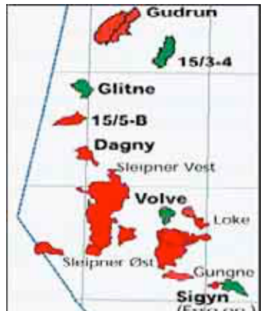

Figure content: map; block grid with outlines of fields and discoveries coloured green or red; labels Gudrun, 15/3-4, Glitne, 15/5-B, Dagny, Sleipner Vest, Volve, Loke, Sleipner Øst, Gungne, Sigyn (Esso op.).

Oil fields and discoveries are marked in green while gas/condensate is shown in red

#### 1.1.2 Licence matters

Production licence 046 was awarded in the third licensing round in 1976 with Statoil ASA as operator for blocks 15/8 and 15/9. The licence comprises the Sleipner Øst, Sleipner Vest, Gugne and Loke fields as well as non-commercial area (defined as PL 046 "outside").

The ownership distribution in Volve is the same as for Sleipner Øst and Loke, while large parts of the upside potential around Volve lie in the "outside" area, which has the same ownership distribution as the Gungne field, see figure 1.2 and table 1.1

*Table 1.1 – Ownership composition in PL 046 and Volve*

| | Sleipner Øst/ Loke /Volve | PL046 Outside (Incl. Gungne) |
|---|---|---|
| Statoil ASA | 49.6 % | 52.6 % |
| ExxonMobil Exp.& Prod. Norway AS | 30.4 % | 28.0 % |
| Norsk Hydro Produksjon a.s. | 10.0 % | 9.4 % |
| Total Norge AS | 10.0 % | 10.0 % |

<!-- page 7 -->
<!-- type: mixed -->

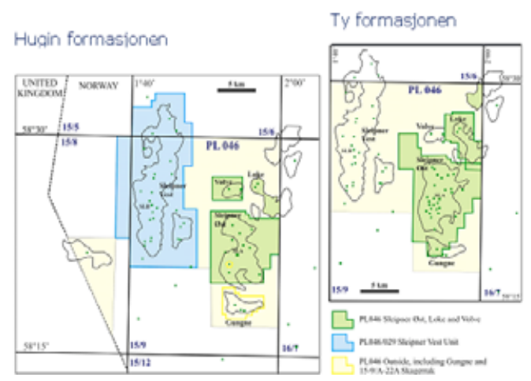

Figure content: two maps side by side, titled "Hugin formasjonen" and "Ty formasjonen"; block boundaries with block numbers, the United Kingdom/Norway border, scale bars of 5 km, field outlines labelled Sleipner Vest, Volve, Loke, Sleipner Øst and Gungne, well symbols; legend with three coloured area classes: PL046 Sleipner Øst, Loke and Volve; PL046/029 Sleipner Vest Unit; PL046 Outside, including Gungne.

### 1.2 Exploration history

The Volve field is a minor oil-bearing structure located centrally in block 15/9. Well 15/9-19SR proved oil in the structure in 1993, and since then 2 appraisal wells have been drilled. Well 15/9-19A was drilled in 1996 and proved a much thicker reservoir than the discovery well. Well 15/9-19B was drilled in 1997 in a segment outside the field, and here the reservoir was water-filled. Both wells in the oil zone have been production tested and showed good production properties.

### 1.3 Geological evaluation

The Volve field is a 2x3 km, fault-bounded structure in which a total of 27.5 million Sm3 of oil in place is expected to have been proven. The reservoir consists of the Hugin Formation of Middle Jurassic age and is developed in the area as a sandstone package of varying thickness. The reservoir lies in the interval 2750 – 3120 m depth below the sea surface. It consists of sandstone with a high net/gross ratio (93 %), a porosity of 21 % and a well-test permeability of approx. 1 Darcy. The water saturation in the oil zone is on average 20 %. No contacts have been penetrated in the field, which gives possibilities for an oil-water contact (OWC) considerably deeper than that used in the base model (OWC at 3120 m below sea level). The mapping of the field is based on ocean-bottom seismic data in which the following reflectors have been interpreted; intra Hod, Base Cretaceous, Base "Hot shale", Top Hugin, Base Hugin, and Top Zechstein. In addition, the many faults have been interpreted in detail.

There is still uncertainty associated with the interpretation of seismic data; this applies in particular to the western flank of Volve. Subsequent to the work on which this plan is based, further re-processing of the ocean-bottom seismic has been carried out. These data will be interpreted, and any adjustments to the reservoir model and optimisation of well paths will be made before the start of drilling.

### 1.4 Reservoir engineering and recovery aspects

In the reservoir engineering work, use has been made of a **dynamic reservoir simulation model based on the geological and seismic mapping.** The reservoir pressure is 340 bar at 3060 m, and the reservoir temperature here is 110°C. The oil has a varying gas/oil ratio (GOR) from 111 to 157 Sm3/Sm3 and correspondingly for the formation volume factor (Bo) from 1.33 to 1.45 m3/Sm3. The oil in the field is planned to be recovered by use of

<!-- page 8 -->
<!-- type: mixed -->

down-flank water injection with production wells placed high on the structure. It is expected to produce a total of approx. 11.4 million Sm3 of oil and 1.5 billion Sm3 of rich gas for export to the Sleipner A platform. This is based on an economic rate of minimum 2100 Sm3/d.

### 1.5 Production technology

The production engineering challenges in producing the oil in the Volve field are related to a high content of barium in the formation water, a high content of asphaltene in the oil, and production of water from the Utsira Formation by use of electric pumps, ESP (Electrical Submersible Pumps). Utsira water is used to avoid scale in the formation and the process equipment.

### 1.6 Drilling and well technology

The Volve field is planned to be developed with three oil production wells and three water injection wells. In addition, it is planned to drill two water production wells to the Utsira Formation for production of injection water.

Planned start of drilling on Volve is the turn of the year 2006/07. There is a risk of delayed start-up due to possible delay in the tow-out of the installation in wintertime.

Volve will have Christmas trees on the platform and has a drilling facility available in the production phase. This will give easy access to the wells for interventions, sidetrack drilling or drilling to nearby prospects.

The three production wells are planned to be completed with gas lift equipment.

The drilling location has been chosen to minimise the hazard of shallow gas, and to give drilling access to all identified prospects for Volve.

The drilling is planned with water-based mud in the top-hole sections, and with oil-based mud in the 8 ½" and 12 ¼" sections.

### 1.7 Development solution

The development solution (see figure 1.2) is based on lease of the existing jack-up platform Maersk Inspirer (MI), which was built as a drilling rig. The platform will be equipped with a process plant for separation and export of oil and gas and a wellhead area that makes it possible to tie back up to 13 wells in accordance with the contract on which this plan is based. The platform enables drilling or well intervention with simultaneous oil and gas production. The rig was completed at a yard in Korea in 2004 and has arrived in the North Sea. It will start on a contract on the English side before the Volve contract. The rig will thus be regarded as "warm" and run in as a drilling rig when it starts the work on Volve.

The gas will be exported to Sleipner A, while the oil will be exported to the storage vessel Navion Saga.

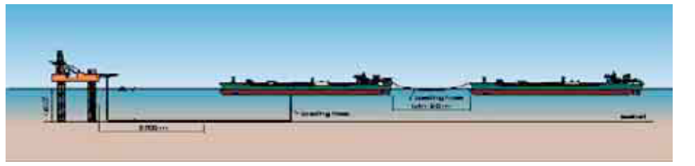

Figure content: schematic side view; jack-up platform standing on the seabed, a line along the seabed from the platform to a storage vessel, a second tanker connected to the storage vessel by a hose; labels for water depth, distance, loading hoses and seabed.

The process plant on the jack-up platform is designed for the following capacities.

| | | | |
|---|---|---|---|
| Oil production | 9 000 Sm3/d | Rich gas | 1.5 MSm3/d |
| Water treatment | 10 400 m3/d | Gas lift | 0.45 MSm3/d |
| Total liquid treatment | 13 000 m3/d | Water injection | 16 000 m3/d |

<!-- page 9 -->
<!-- type: text -->

The processed oil will be transferred to the storage vessel via a flexible 8" pipe. The storage vessel, with a capacity of i million barrels, is moored on the field by means of an STL buoy (Submerged Turret Loading) with 9 anchors. The vessel is leased from Navion Offshore Loading (NOL), a subsidiary of Teekay Norway. The gas is transferred in a 7.4" pipeline via subsea template D on the Sleipner Øst field and onwards to the SLA facilities. There the gas is processed and exported as dry gas to Europe and wet gas/condensate to Kårstø.

### 1.8 Operation and maintenance

Operation and maintenance of the production platform will be carried out by Maersk Contractors, which owns and operates the facility on behalf of Statoil as operator of PL046. Operation and maintenance of the storage vessel is carried out by Teekay Norway.

The supply and base services will be coordinated with corresponding services on the Sleipner fields so that economies of scale are achieved.

### 1.9 Health, safety and environment

The development and operation of Volve is based on the main objectives from Statoil's HSE poster and principles of zero environmentally harmful discharges.

The safety objective for the Volve development has its basis in the authorities' requirements and regulations, as well as in Statoil's own guidelines.

Consideration for health, safety and environment (HSE) has been central in the check-out of the recommended concept and the selection of suppliers, and forms the basis for further see-to-it activities.

Great emphasis has been placed on safe, sound solutions and on limiting the consequences should an accident occur. The installation manning consists of Maersk Contractor's own employees. Maersk Contractors' management systems are used as the basis to the greatest possible extent, supplemented by Statoil's field-specific additional requirements. Statoil places great emphasis on establishing good HSE work on board, and on ensuring that the authorities' and Statoil's requirements and objectives for health, safety and environment are met.

### 1.10 Organisation and execution

The exercise of Statoil's operator responsibility in the development phase will be handled by a dedicated organisational unit within the business area Technology and Projects (T&P).

There will be close cooperation with the Sleipner organisation throughout the project phase, since the licence responsibility for PL046 lies there. The production director for Sleipner is chairman of the management committee for PL046.

At production start, the plan is to transfer Volve to the Sleipner operations organisation in the business area Exploration and Production.

### 1.11 Decommissioning plan

When the licence owners and the authorities agree that the Volve field can no longer be operated economically, the contracts will be terminated by use of agreed mechanisms for cancellation, and the wells will be shut in. The actual removal of the installations and shutdown of wells will be carried out in accordance with applicable regulations. The regulations give guidelines for both shutdown of wells and removal of the installations.

The STL buoy with mooring system will be removed by means of an anchor-handling vessel. The oil and gas export pipelines will be considered for removal. Because the pipes are buried, this may be difficult. The alternative to removal and reuse will be to rock-dump the pipe ends.

### 1.12 Economic analyses and evaluations

Profitability analyses based on an oil price of 22 USD/barrel Brent Blend (estimated 18.70 USD/barrel for Volve oil) give a net present value of 2350 MNOK 2005 at 7% before tax and 443 MNOK 2005 at 8% after tax. If one takes as a basis a "forward" oil price of on average **35 USD/barrel Brent blend,** the profitability analysis shows a net present value of 1190 MNOK 2005 at 8% after tax.

The project is not robust at low prices and gives a negative net present value at an oil price of 15 USD/barrel Brent Blend. The break-even price at 8% after tax is 17.50 USD/barrel. The development concept

<!-- page 10 -->
<!-- type: text -->

with lease of a jack-up platform with associated storage vessel gives positive economics at low reserves (P90). In addition, the risk of cost overruns is reduced considerably because large parts of the concept have already been built.

### 1.13 Area evaluation

The Volve field lies in a typical gas/condensate-dominated area in the North Sea. In an area development, the selected development solution is assessed to be the best solution because an oil processing plant is then established in the Volve area. The access to its own drilling facility in addition opens for cost-effective exploration of the oil prospects in the area.

No concepts have been documented that can economically utilise existing infrastructure in the area, with the exception of gas export to the Sleipner A platform via the subsea template Sleipner D.

The platform is prepared for tying back more wells if discoveries are made in any of the mapped prospects in the vicinity. A decision on possible drilling of the nearby prospects in PL 046 will be taken at a later time.

<!-- page 11 -->
<!-- type: mixed -->

## 2 Exploration history

The Volve field is a minor oil-bearing structure located centrally in block 15/9. The block was awarded in the 3rd licensing round (1976). In the block, a total of **22 exploration and appraisal wells** have been drilled, and large quantities of gas/condensate have been proven in the Sleipner Vest, Sleipner Øst, Loke and Gungne fields. The gas/condensate fields have now been developed, and approx. 50 production wells have been drilled for this purpose.

**The Volve field was proven in 1993 with well 15/9-19SR.** The well was drilled from the Loke subsea template into a structure then called Theta Vest.

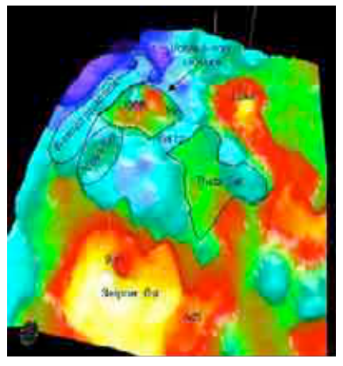

Figure content: colour-coded perspective view of a mapped horizon surface; outlined structures and prospects with name labels, among them Sleipner Øst; an arrow pointing to one of the outlined structures.

*Table 2.1 – Discovery wells and discoveries are listed below:*

| Well | Year | Discovery | Condensate/NGL/oil reserves (MSm3) | Gas reserves (GSm3) |
|---|---|---|---|---|
| 15/6-3 | 1974 | Sleipner Vest | 44 | 108 |
| 15/9-9 | 1981 | Sleipner Øst | 51 | 63 |
| 15/9-15 | 1982 | Gungne | 5 | 10 |
| 15/9-19SR | 1993 | Volve | 11.4 | 1.5 |

The purpose of the well was to produce gas/condensate from the Ty Formation [of Paleocene age]. The formation, however, proved to be water-filled, and **the well was then deepened down into the Hugin Formation of Middle Jurassic age.**

The Hugin Formation proved to be oil-filled and had a thickness of 18 metres in the well. The reservoir was production tested and gave an undersaturated 29° API oil. The test interval showed good production properties and flowed at rates up to 1358 Sm3/d and a productivity index of 143 Sm3/D/Bar.

**A new seismic dataset was acquired over the area in 1994 (ST9407)** and has since been reprocessed.

**In 1996, well 15/9-19A was drilled. The purpose of the well was to verify the resource base and to clarify the reservoir thickness and the oil/water contact.** The well was drilled as a sidetrack well from 19SR and encountered oil-filled reservoir. The reservoir, however, came in considerably deeper than expected and was much thicker (88 m). **No oil/water contact was observed in the well.** A production test gave rates up to 528 Sm3/d of 27° API oil and with a productivity index of 63 Sm3/D/Bar.

**Based on the positive information from the 15/19-19A well, top reservoir was reinterpreted on the seismic.** The understanding at that time was that this well had proven oil close to the spill point between the Volve structure and the Theta sør structure south-east of Volve.

<!-- page 12 -->
<!-- type: text -->

**In 1997, well 15/9-19B was therefore drilled in the saddle area between the two structures.** The purpose of the well was to find the oil/water contact and also to prove oil in Theta Sør. Top reservoir was, however, encountered very deep in the well and was water-filled. However, the thickness of the Hugin formation was greater than expected (approx. 120 m) and it had good porosity and permeability properties. **Pressure measurements indicated sealing between the well and the Volve structure and also between the well and Sleipner Øst and Loke** so that **15/19-19B gave a good eastern delineation of the Volve structure.**

**The acquisition of ocean-bottom seismic data was carried out in 2002 (ST0202).** The purpose was to improve the structural imaging and **reduce the uncertainty in the resource base.** The data set has given a large improvement compared with earlier data and forms the basis for the current mapping of resources.

<!-- page 13 -->
<!-- type: mixed -->

## 3 Geological evaluation

### 3.1 Summary

The Volve field is a 2x3 km, fault-bounded structure and was formed as a result of salt movements and extension during and immediately after the deposition of the reservoir. The reservoir consists of the Hugin formation of Middle Jurassic age and is developed in the area as a package of mainly sandstone. The depositional environment was tide-dominated, which has resulted in a large lateral extent of the sandstone layers. Oil only began to migrate into the structure approx. 5-10 million years ago. The oil was formed in the Sleipner Graben area approx. 10 km NW of Volve and migrated from the graben into the Volve structure.

The mapping of the field is based on new ocean-bottom seismic. Depth conversion has been carried out based on "stacking" velocities to top Cretaceous, and interval velocities in the following intervals: top Cretaceous-base Cretaceous, base Cretaceous-top Hugin, and top Hugin-base Hugin. **The interpretation uncertainty, especially on the west flank of the structure, is considerable,** while **the field is affected only to a small degree by the uncertainty in the depth conversion model.**

The reservoir interval lies at 2750 – 3120 m depth below the sea surface. It consists of sandstone with a high net/gross ratio (93 %), a porosity of 21 % and a well-test permeability of approx. 1 Darcy. The water saturation in the oil zone is on average 20 %. This gives an average hydrocarbon pore fraction of 15.6%. **No contacts have been penetrated in the field, which gives possibilities for an oil-water contact considerably deeper than what is now considered most likely** (OWC at 3120 m below sea level).

**Mapping of volume in place has been carried out in a 14-layer model using zone averages fitted to well values.** The layer model is based on the top and base reservoir surfaces from the seismic and on mapped fault planes. The outer, bounding faults of the field are modelled as inclined, while faults internal to the field are modelled as vertical. Possible additional volumes west of Volve and in Volve Sør have been incorporated in the volume calculation, while volumes in other prospects have been calculated in other contexts.

**An uncertainty study indicates higher P50 and mean volumes than those in the base model.** This is mainly because there is **greater probability of a deeper contact than of a shallower contact.** As regards the total uncertainty, **the contact uncertainty has the largest effect,** but there is also a **significant contribution from the uncertainty in seismic interpretation.** As a consequence of this uncertainty, depth-migrated data have been processed, and are to be used for optimisation of the well placement up to the start of drilling. In the reservoir engineering work, a dynamic reservoir simulation model based on the geological and seismic mapping has been used. The reservoir pressure is 340 bar at 3060 m and the reservoir temperature here is 110°C. The oil has a varying gas/oil ratio (GOR) from 111 to 157 Sm3/Sm3 (corrected for process simulations) and correspondingly for the formation volume factor (Bo) from 1.33 to 1.45 m3/Sm3.

*Table 3.1 – Uncertainty in volume in place (all figures in million Sm3)*

| | Base | Mean | P90 | P50 | P10 |
|---|---|---|---|---|---|
| Volve | 24.5 | 27.5 | 20.9 | 26.7 | 35.2 |

### 3.2 Seismic database and mapping

The seismic interpretation of the Volve field has been completed on a 4-component, 3D seismic data set (ST0202), which is an ocean-bottom seismic acquisition with considerably increased quality compared with conventional seismic. ST0202 has limited coverage and in the areas outside it ST98M3 has been used, a conventional 3D seismic data set, which is a "post stack" merge of in all 7 individual seismic data sets. The seismic coverage of the area is shown in figure 3.1. A zero-phase, trapezoid-wave signature has been used to calibrate the seismic with the well observations.

The Volve structure is structurally complex and for the geological evaluation it has been necessary to map the most important geological horizons in addition to top and base reservoir. Mapped horizons are Top Cretaceous, Top intra-

<!-- page 14 -->
<!-- type: mixed -->

Hod reflector, Base Cretaceous, Base "Hot shale", Top Hugin, Base Hugin, Top Zechstein (Top salt), and Top Rotliegendes. The purpose of the relatively extensive mapping has been to understand the tectonic and stratigraphic development as well as possible, and to prepare the ground for a good depth conversion. A seismic section along the 15/9-19SR well path is shown in figure 3.2 and illustrates the most important horizons.

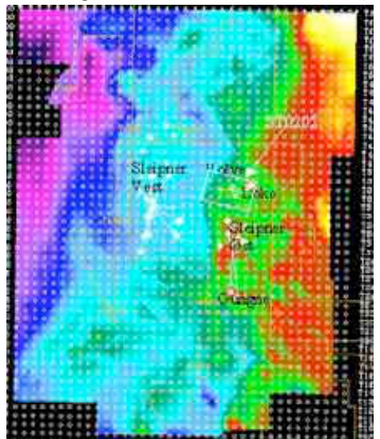

Figure content: colour-shaded map of the seismic coverage area on a black background with a dotted grid; a white outline box labelled ST0202; labels Sleipner Vest, Volve, Loke, Sleipner Øst and Gungne.

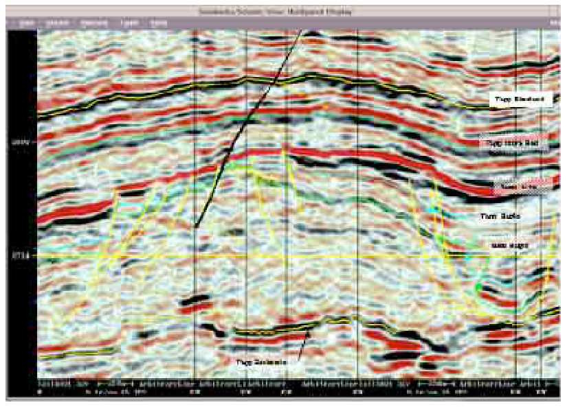

Figure content: seismic section in red, black and white amplitude display from an interpretation workstation window; interpreted horizons drawn as coloured lines with label boxes on the right-hand side and one label at the bottom; fault interpretations in yellow; a well path drawn as an inclined black line; vertical marker lines.

**During the work on the geological model for Volve, the seismic data have been depth-migrated.** Based on a quick assessment/interpretation of these data, no large deviations have been identified in relation to the documented model. But a further improvement of data quality has been confirmed, and **the new data will be interpreted before the start of drilling.** This may lead to optimisations of the reservoir model and changes to well paths etc.

<!-- page 15 -->
<!-- type: mixed -->

#### 3.2.1 Depositional environment, sedimentology and stratigraphy

The Hugin reservoir in the Sleipner area is very well known through a number of exploration and production wells. Extensive work has been put into semi-regional studies within biostratigraphy, sedimentology and sequence stratigraphy (see figure 3.3). On this basis a common zonation has been established for the area and this has also been used on Volve (see figure 3.4).

In the wells on Volve the Hugin formation consists of relatively clean sandstone deposited in shallow water in a tide-dominated system with an alternation of tidal channels, tidal flats and mouth bars. Compared with other tidal reservoirs, however, there are only few clay layers or other heterogeneities to be seen. The sandstone is dominated by quartz grains with only small amounts of clay and mica minerals. The reservoir temperature is around 110°C and thus smaller amounts of quartz cement have been formed between the grains.

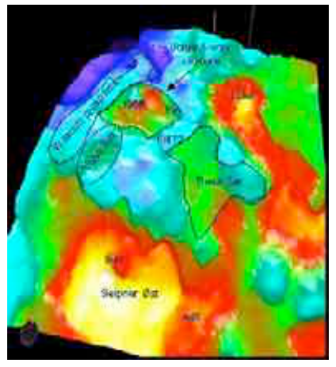

Figure content: perspective view of a colour-shaded depth surface on a black background; outlined areas with name labels, among them Sleipner Øst and Theta Sør; an arrow pointing to one outlined structure.

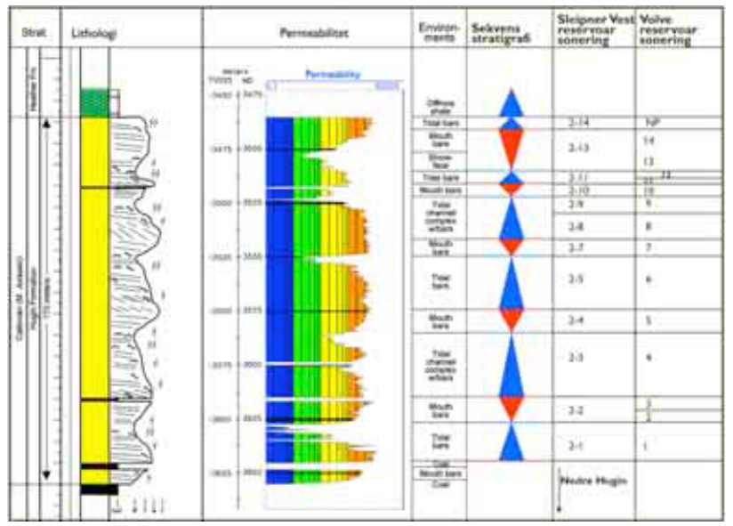

Figure content: well panel with columns for stratigraphy, lithology (lithology column with grain-size profile), permeability (colour-filled log against a depth scale), depositional environments (tidal bars, mouth bars, tidal channel complex, shoreface, offshore shale, coal), sequence stratigraphy (blue and red triangles), Sleipner Vest reservoir zonation and Volve reservoir zonation.

### 3.3 Tectonic and stratigraphic development

The structural development of Volve is, as in the rest of the Sleipner area, to a large degree controlled by salt movements which both affect the thickness of the Mesozoic reservoir units and have created the oil- and gas/condensate-bearing structures. In addition, Late Jurassic extensional tectonics have affected the area and, among other things, created the Sleipner graben system just west of Volve. A number of faults, especially on the west flank

<!-- page 16 -->
<!-- type: text -->

of Volve, have been formed as a combination of salt movements and extension

**The wells on Volve show large differences in the thickness of the Hugin reservoir (18-112 m)** and much effort has been put into understanding and predicting the thickness development. The studies show that the salt in the area formerly stood up in a number of diapirs, walls and pillows. As a function of increased precipitation in the Jurassic, these began to dissolve and thereby created large differences in subsidence when the Hugin reservoir was deposited. Dissolution of salt continued further in Late Jurassic time, and above the former salt structures basins are seen today at base Cretaceous level (salt collapse basins). Of salt there is little left in the area. (see figure 3.5).

In Callovian time, when the Hugin formation was deposited, Volve was in the middle of an area with mainly deposition of sand, while 5-10 km further north it was rather marine clay, and 5-10 km to the south it was delta-plain clay and siltstone as well as peat, that were deposited. Within the sand deposition area there were powerful tidal currents that could transport the sand around and move it to the areas with most subsidence. It thereby became possible to deposit a unit with thickness varying from 200 m on Sleipner Vest to 2 m on Loke with almost identical net/gross ratios.

The large differences in subsidence during and immediately after deposition of the reservoir led to the formation of many faults from the areas without salt (Triassic highs) down towards the collapse basins. These faults developed at a time when there was little overburden and thus little pressure onto the fault plane. The sand grains were therefore crushed only to a small degree in the faults, and this means that the potential for fault sealing is generally low as long as there is sand-to-sand contact. In addition, the faults are typically limited in length, so that even though the maximum throw is often large, there are flow paths around many of the faults. Despite the many faults internal to the field, the communication is therefore nevertheless assessed as good. This has been demonstrated by production in well test in 15/9-19SR and 15/9-19A. It is nevertheless clear that the flow paths in the field are not precisely determined and that measures such as reperforation, sidetrack drilling and new wells may be necessary to ensure optimal drainage of the field.

### 3.4 Geochemistry and migration history

The Volve field contains an undersaturated 27-29° API oil with a gas/oil ratio of 111 - 157 Sm3/Sm3. The oil is characterised by a high content of asphaltenes (2-6%), sulphur (2%), and aromatic components (52% C10+) and is relatively unusual compared with other North Sea oils. The oil was formed from a type II-S kerogen, which typically occurs in basins with little clay and sandstone and is thus characteristic of carbonate rocks.

In the Volve area, type II-S kerogen has been proven in the uppermost part of the Draupne formation, which has a very high "gamma-log" response, a very high content of organic material and which is a very rich source rock. The type II-S kerogen becomes mature and generates oil at significantly lower temperatures than other oil and gas kerogens. Thermal maturity modelling of the Sleipner Graben west and northwest of Volve shows that the uppermost part of the Draupne here started to generate oil only approx. 10 million years ago. Studies of fluid inclusions in Volve indicate that the structure only began to fill up approx. 5-6 million years ago. The studies also show that the migration from the source area into Volve must take place via sandstone layers in the Upper Jurassic package. The migration of gas/condensate into Sleipner Øst has followed a much longer route via Sleipner Vest and Gungne (see Figure 3.5). Gas/condensate can in the Volve and Theta Sør area probably not be found at a deeper level than what is now seen in Sleipner Øst.

<!-- page 17 -->
<!-- type: mixed -->

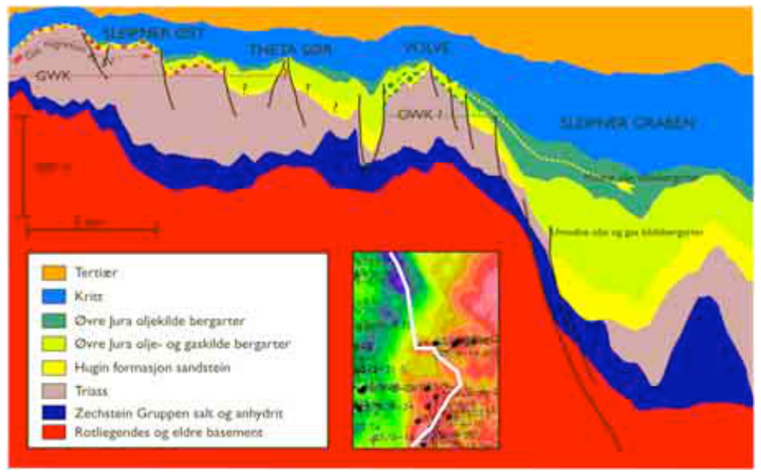

Figure content: geological cross-section with structures labelled Sleipner Øst, Theta Sør, Volve and Sleipner Graben; colour legend for Tertiary, Cretaceous, Upper Jurassic oil source rocks, Upper Jurassic oil and gas source rocks, Hugin formation sandstone, Triassic, Zechstein Group salt and anhydrite, Rotliegendes and older basement; faults drawn as lines; contact labels; vertical and horizontal scale bars; inset location map with the section line in white.

### 3.5 Petrophysical evaluation

**Data from logs and cores have been used to calculate net sand, porosity, permeability and hydrocarbon saturation in the Volve wells (15/9-19SR, 15/9-19A and 15/9-19BT2).** Data from production tests, fluid samples and formation pressure measurements have also been used in the general petrophysical interpretation, which is otherwise based on methods and algorithms used for evaluation of the Hugin formation elsewhere in the Sleipner area. In total there are 164 m of Hugin formation cores in the 3 wells. The wireline logs are of good quality, while formation pressure measurements have only been taken in 15/9-19BT2. The analysis of rock properties has been done well by well to ensure the best possible agreement between core and log data.

The porosity has been calculated by calibrating log data with values measured in the cores and then correcting to reservoir conditions.

The permeability has been calculated from a multivariable correlation between core permeability corrected to reservoir conditions and calculated porosity and shale volume.

Producible net sand has been determined from an iterative procedure in which manual picks of net sand in cored intervals have been used to determine cut-off criteria on cross-plots of log and core data. The final curves correspond approximately to a criterion of net sand if the porosity is greater than 10 % and the shale volume is less than 0.5 %.

Water saturation parameters have been determined from Archie's equation calibrated with data from core analysis. Averages for the 3 wells are shown in Table 3.2.

Pressure and temperature for the field have been determined to be 340 bar and 110° C at a reference depth of 3060 m below sea level.

<!-- page 18 -->
<!-- type: mixed -->

*Table 3.2 – Formation parameters from the petrophysical evaluation (well averages)*

| Well | Top (m TVD) | Base (m TVD) | Thickness (m) | Porosity | Permeability (mD) | Net sand | Water saturation |
|---|---|---|---|---|---|---|---|
| 15/9-19SR | 2864 | 2883 | 19 | 0.23 | 1923 | 1.00 | 0.19 |
| 15/9-19A | 3013 | 3101 | 88 | 0.20 | 522 | 0.93 | 0.21 |
| 15/9-19BT2 | 3149 | 3275 | 126 | 0.21 | 630 | 0.92 | ------ |

### 3.6 Geological model

For volume calculation purposes a geological model has been built based on the seismic mapping, sedimentological and stratigraphic understanding and the petrophysical evaluation. The framework for the model consists of the interpreted and depth-converted top and base reservoir surfaces, where 14 reservoir zones have been established using stratigraphic modelling based on regional isochores from the Sleipner area together with the well data. Figure 3.6 shows top Hugin reservoir. In the model the outer bounding faults of the field are modelled as inclined, while internal faults are modelled as vertical. The resolution of the grid is 25 m in the horizontal plane, while it is 1 m in the vertical plane.

Establishment of petrophysical parameter maps (net/gross, porosity and permeability) was done using geostatistical prediction (kriging). As neither geological nor petrophysical evidence could establish significant lateral or vertical trends, such an approach will give maps that honour the well data within a given correlation distance and that have average values in other areas. This gives relatively smooth maps that are well suited for volume calculation purposes, but that do not capture the full scale of reservoir heterogeneities.

Water saturation was calculated on a grid cell by grid cell basis. The calculation is based on a summation of irreducible water saturation and Leverett J-function water saturation and therefore takes as its starting point the grid cell permeability and the height above free water level. As oil/water contact, the most likely contact was used, which is 3120 m below sea level.

For volume calculation the field was divided into a number of areas. The areas differ particularly in the seismic uncertainty. **Base volume has been calculated for each area and afterwards summed for the main areas.**

Volume in place in Volve and nearby prospects is given in table 3.3.

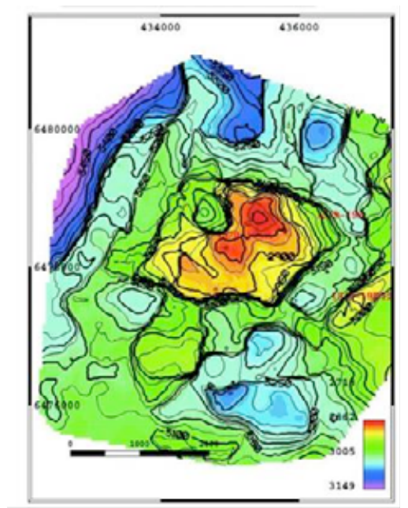

Figure content: colour-filled depth contour map with fault traces as thick black lines; map coordinates along the frame; well labels in red; scale bar; colour scale for depth.

<!-- page 19 -->
<!-- type: mixed -->

*Table 3.3 – Volume in place in Volve and nearby prospects. (GRV; gross rock volume, NRV; net rock volume, HCPV; hydrocarbon pore volume, STOOIP; "Stock tank oil originally in place" = oil in place at surface conditions)*

| Area | GRV (million m3) | NRV (million m3) | Pore volume (million m3) | HCPV (million m3) | STOOIP (million Sm3) |
|---|---|---|---|---|---|
| Volve 4-way closure | 217.4 | 201.7 | 40.3 | 34.1 | 24.5 |
| Volve Sør | 57.6 | 52.5 | 10.4 | 8.2 | 5.9 |
| Other prospects | 5.2 | 4.7 | 0.9 | 0.6 | 0.4 |
| Total | 280.1 | 258.9 | 51.7 | 42.9 | 30.8 |

### 3.7 Uncertainty calculation

The uncertainty study is based on specified uncertainties in seismic interpretation, depth conversion, petrophysical variables and the expansion factor (Bo). The uncertainties have been combined to give a probability distribution for the quantity of oil in place at surface conditions (STOOIP), see table 3.4, which gives the range of oil in place in Volve together with mapped prospects.

*Table 3.4 – Results of the uncertainty study (CV is coefficient of variation)*

| | Base (million Sm3) | Mean (million Sm3) | P90 (million Sm3) | P50 (million Sm3) | P10 (million Sm3) | Standard deviation | CV |
|---|---|---|---|---|---|---|---|
| East | 19.9 | 19.2 | 15.9 | 19.1 | 22.8 | 2.6 | 14 |
| West | 4.6 | 8.3 | 3.4 | 7.5 | 14.6 | 4.3 | 52 |
| Volve closure | 24.5 | 27.5 | 20.9 | 26.7 | 35.2 | 5.5 | 20 |
| Prospects | 6.3 | 13.8 | 5.0 | 9.9 | 30.0 | 11.6 | 84 |
| Risked prospects | 3.9 | 9.4 | 0.2 | 6.7 | 24.3 | 11.1 | 118 |
| Total | 30.8 | 41.3 | 27.2 | 36.4 | 64.7 | 15.8 | 38 |
| Total risked volume | 28.4 | 36.9 | 23.0 | 32.8 | 58.2 | 14.8 | 40 |

The uncertainty in gross rock volume has been handled by means of stochastic modelling of the uncertainties in seismic interpretation and depth conversion. For each run, values have been drawn from each area and these values have resulted in a new set of top and base reservoir maps. Volume in this model has then been calculated, and in all 2500 models have been run.

**Since no wells have encountered a contact, there is large uncertainty in the level of the oil/water contact.** Therefore 3 different models for contact have been established, and through a weighting of these the probability of various discrete contacts has been specified (see table 3.5). **The probability is greatest for a contact 5-35 m below the oil-down-to situation in well 15/9-19A (3101m),** but **the possibility of significantly deeper contacts is also opened up.**

*Table 3.5 – Probability of various contacts*

| Possible OWC (m) | Probability % |
|---|---|
| 3105 | 24 |
| 3120 | 21 |
| 3135 | 28 |
| 3170 | 14 |
| 3260 | 7 |
| 3330 | 6 |

**The uncertainty in petrophysical values is low** by virtue of good data from the wells and a good knowledge of the distribution of sandstone and shale in the Hugin reservoir in the area around Volve. The uncertainty is assessed at +/- 12 % on the hydrocarbon

<!-- page 20 -->
<!-- type: mixed -->

pore fraction (HCPF) correlated for all zones and areas of the field (see table 3.6 ).

*Table 3.6 – Uncertainty in hydrocarbon pore fraction*

| | P90 | Mode | P10 |
|---|---|---|---|
| HCPF | 0.132 | 0.15 | 0.168 |

The uncertainty in the Bo factor, which is used for conversion of hydrocarbon pore volume to surface volume, is shown in table 3.7. The input is based on oil and gas analyses from 2 wells in the oil zone and on assessments of how representative they are for the structure.

*Table 3.7 – Uncertainty in Bo factor (m3/Sm3)*

| Bo | 1.27 | 1.365 | 1.385 | 1.415 | 1.5 |
|---|---|---|---|---|---|
| Probability | 5 % | 25 % | 40 % | 25 % | 5 % |

Sensitivities have been studied to assess which factors contribute most to the uncertainty picture (figure 3-7). Overall, it is the possibility of a deeper contact that is the most important factor. This also applies to the Volve structure seen in isolation, even though the uncertainty here is overall smaller and **the uncertainty in seismic interpretation is relatively significant.** Uncertainty in petrophysics, depth conversion and Bo factor is less important. **For the prospects around Volve there is also a large uncertainty related to whether they contain oil or not (risk factor).**

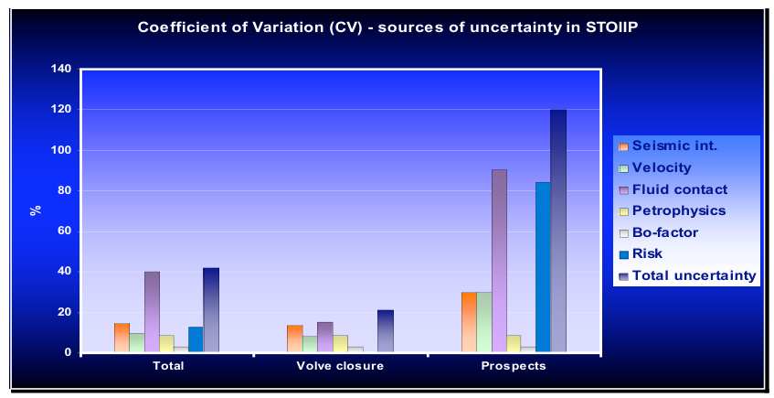

Figure content: grouped bar chart titled "Coefficient of Variation (CV) - sources of uncertainty in STOIIP"; y-axis % from 0 to 140; x-axis groups Total, Volve closure, Prospects; series Seismic int., Velocity, Fluid contact, Petrophysics, Bo-factor, Risk, Total uncertainty.

<!-- page 21 -->
<!-- type: mixed -->

## 4 Reservoir engineering and recovery aspects

### 4.1 Introduction

In the reservoir engineering work, a dynamic reservoir simulation model has been used, based on the geological and seismic mapping prepared in 2002/03. The model has 14 layers with reservoir parameters in each layer based on petrophysical analysis of the three wells. The top of the Volve reservoir is 2750 m below mean sea level (MSL). The reservoir pressure is 340 bar at 3060 m MSL and the reservoir temperature increases with depth from 106 to 110°C. The oil/water contact (OWC) is set at 3120 m MSL. The oil has a varying gas/oil ratio (GOR) from 111 to 157 Sm3/Sm3 (corrected for process simulations) and correspondingly for the Bo factor from 1.33 to 1.45 m3/Sm3. Based on fluid properties and test results the reservoir is divided into two non-communicating segments, with a northern and a southern part.

### 4.2 Well testing

Four well tests have been carried out on the Volve field. The main results from the oil production tests are shown in Table 4.1. The highest production rate was 1 358 Sm3/d with a calculated productivity index of 142.5 Sm3/d/ bar, and the average permeability was 1300 md. This shows that the reservoir has very good production properties. A comprehensive interpretation of the production tests has been carried out to supplement the geological modelling of volumes and faults. The result of this work has been important in the establishment of the dynamic reservoir model.

*Table 4.1 – Results from well tests*

| Well | Test | Year | P (bar) / Depth (m) (TVD MSL) | Max rate (Sm3/d) | PI (Sm3/d/bar) | Permeability (md) | Skin |
|---|---|---|---|---|---|---|---|
| 15/9-19SR | DST 1 | 1993 | 317 / 2719.9 | 1358 | 142.5 | 1300 | 0.85 |
| 15/9-19A | DST 2A | 1997 | | 300 | | | |
| | DST 2B | 1997 | 335 / 2986.7 | 528 | 62.8 | 670 | 7.4 |

### 4.3 Fluid data

Reservoir fluid was collected during the production tests and the main data are shown in Table 4.2. The PVT properties indicate most likely two systems and this is implemented in the reservoir model.

*Table 4.2 – Fluid properties*

| PROPERTIES | 15/9-19A | 15/9-19SR |
|---|---|---|
| Saturation pressure at bubble point [bar] | 235.5 | 273.8 |
| Viscosity at bubble point [mPa s] | 0.79 | 0.55 |
| Single flash Bo at bubble point [m3/Sm3] | 1.39 | 1.5 |
| Single flash gas-oil ratio [Sm3/Sm3] | 111.8 | 159.1 |
| CO2 [mol%] | 1.6 | 4.9 |

<!-- page 22 -->
<!-- type: mixed -->

### 4.4 Production strategy

The simulation model has been used to establish a **drainage strategy for the field** and to prepare production profiles. Volve is planned to be produced from **three producers high on the structure together with three water injectors that are placed on the flanks.** Throughout the production period the reservoir pressure is expected to be higher than the bubble point of the oil, because pressure support is supplied through water injection. Gas lift is included to ensure start-up of wells after maintenance. The **two non-communicating segments will be developed with dedicated production and injection wells.** Water injection contributes pressure support, but in addition the dip of the reservoir (10°-20°) and gravity mean that the water will distribute itself well along the flanks and thereby contribute to a rapid and efficient displacement of the oil. Figure 4.1 shows well and platform locations.

In the western parts of the field, fault throws may be larger than assumed and reduce the communication in the reservoir. It is assumed that drilling of a near-horizontal well through the faults can improve the drainage of the reservoir. In addition, the model shows good communication in the north-south direction, so that the water injector can give good displacement of oil towards the horizontal producer.

An update of the reservoir model will, however, be made based on depth-migrated seismic data, and if necessary the well paths will be optimised based on new reservoir information.

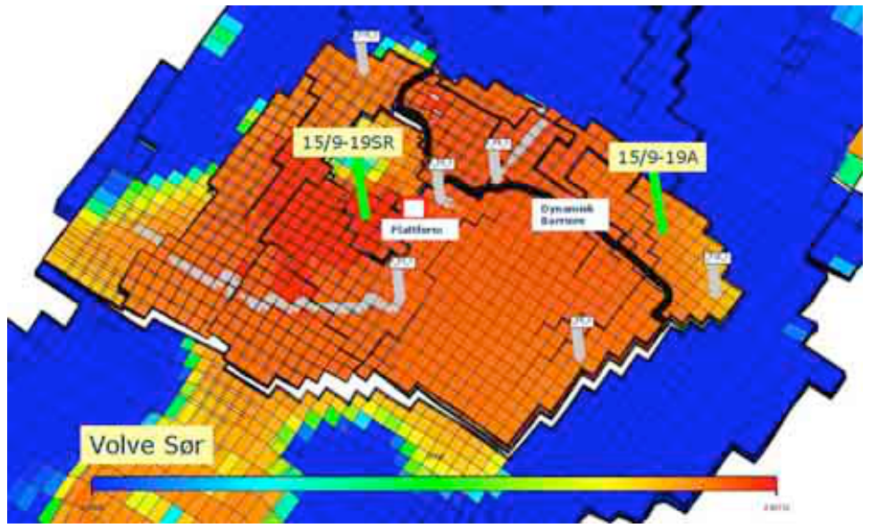

Figure content: 3D view of the reservoir model grid, cells coloured on a scale from blue to red with a colour bar at the bottom; well paths drawn as grey lines with small label boxes (not legible); labels 15/9-19SR, 15/9-19A, Plattform (platform), Dynamisk barriere [?] (dynamic barrier), Volve Sør.

### 4.5 Production forecasts

The **proposed drilling programme takes account of reservoir uncertainties in the reservoir model. One producer is made ready for production start, while the rest of the wells are drilled during the production period.** This enables collection of dynamic data that help to optimise the placement of the remaining wells.

Production constraints for the field and for individual wells are given in Table 4.3 and Table 4.4. A

<!-- page 23 -->
<!-- type: mixed -->

regularity of 94 % has been used as the basis for calculating the production profiles.

Gas lift is included to ensure start-up of wells after maintenance, and secures production if the communication in the reservoir is poorer than assumed.

*Table 4.3 – Field constraints*

| | |
|---|---|
| Assumed production start | March 2007 |
| Liquid capacity | 13 000 Sm3/d |
| Oil capacity | 9 000 Sm3/d |
| Gas capacity | 1.5 M Sm3/d |
| Water injection capacity | 16 000 Sm3/d |
| Maximum water cut | 0.80 |
| Max gas lift rate | 0.45 MSm3/d |

The assumed production start of March 2007 is based on the contract with Maersk. Because of weather risk during tow-out, production start may be postponed.

*Table 4.4 – Well constraints*

| | |
|---|---|
| Oil rate | 2 500-4 500 Sm3/d |
| Minimum oil rate | 100 Sm3/d |
| Minimum wellhead pressure | 40 bar |
| Max gas lift rate | 0.15 MSm3/d |

#### 4.5.1 Forecast for oil production

**The field will be started up when the first well has been made ready, and after a start-up period of approx. 1 year the field will produce at plateau rate.** The plateau rate of 9 000 Sm3/d will last about 19 months. Production declines because of increasing water rate. Cumulative oil production until the minimum economic rate of 2 100 Sm3/d (given a Volve oil price of 18.7 USD/barrel) is reached is 11.4 MSm3. Oil rate and cumulative production are shown in Figure 4.2. This is based on **expected production (mean) estimated from the uncertainty study,** see chapter 4.6.

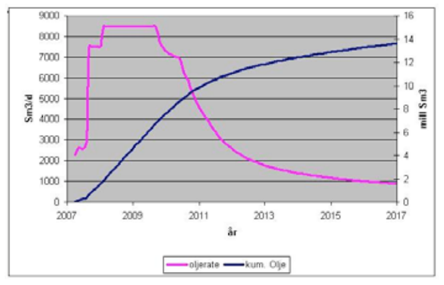

Figure content: line chart; x-axis years 2007–2017 (år); left axis Sm3/d, 0–9000; right axis mill Sm3, 0–16; series "oljerate" (oil rate) and "kum. Olje" (cumulative oil).

#### 4.5.2 Forecast for water production

Water production comes first and foremost from the injection water, which breaks through in the wells after about 2 years. At that time cumulative oil production is about 6 MSm3. The requirement for water from the Utsira formation for injection is approx. 12 000 Sm3/d. When water production increases, the requirement for Utsira water is reduced. Produced water and injected water are shown in Figure 4.3.

<!-- page 24 -->
<!-- type: mixed -->

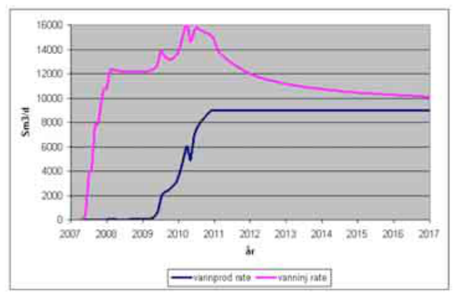

Figure content: line chart; x-axis years 2007–2017 (år); y-axis Sm3/d, 0–16000; series "vannprod rate" (water production rate) and "vanninj rate" (water injection rate).

#### 4.5.3 Forecast for gas production

Throughout the production period the reservoir pressure is expected to be higher than the bubble point of the oil. This means that **the gas production comes from dissolved gas and no free gas is formed.** Maximum gas production is expected to be 1.2-1.3 MSm3/d on plateau, see Figure 4.4.

Cumulative rich gas production is estimated at 1.5 GSm3.

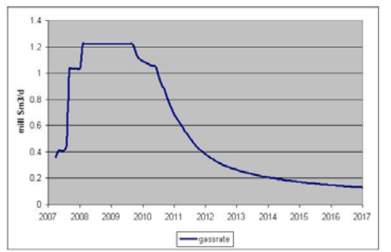

Figure content: line chart; x-axis years 2007–2017; y-axis mill Sm3/d, 0–1.4; series "gassrate" (gas rate).

### 4.6 Sensitivities and uncertainty analysis

The effect of permeability, oil in place, type of depositional environment, segment boundaries and variation in relative permeabilities as a function of wetting preference is included in the uncertainty calculations.

<!-- page 25 -->
<!-- type: mixed -->

Resources in place and permeability have the largest effect on recovery. An uncertainty analysis of the production profiles has been carried out with Monte Carlo simulation. Uncertainty in recovery factor includes vertical communication, type of depositional environment, horizontal communication and relative permeability. Gas lift secures production in the downside cases.

The result of the uncertainty analysis is summarised in Figure 4.5 and Table 4.5.

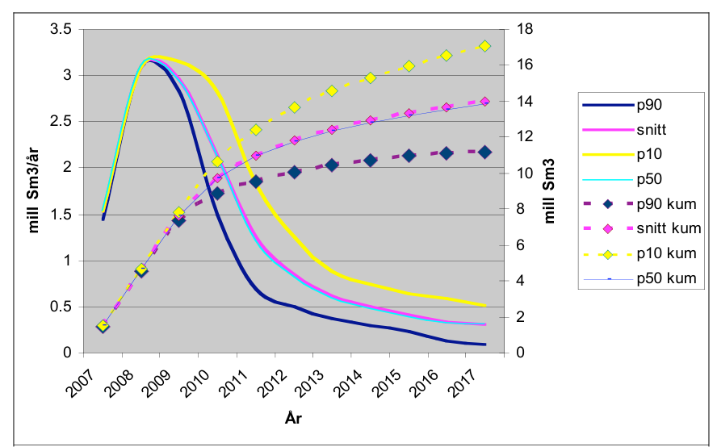

Figure content: line chart with two y-axes; x-axis years 2007–2017 (År); left axis mill Sm3/år, 0–3.5 (yearly production); right axis mill Sm3, 0–18 (cumulative production); series p90, snitt (mean), p10 and p50 as solid lines, and p90 kum, snitt kum, p10 kum and p50 kum (cumulative) as lines with markers.

*Table 4.5 – Result from uncertainty study; reserves and production profile based on min. oil rate of 2 100 Sm3/d*

| | Mean | p90 | p50 | p10 |
|---|---|---|---|---|
| Reserves (MSm3) | 11.40 | 9.0 | 11.35 | 15.31 |
| STOOIP (MSm3) | 27.50 | 20.9 | 26.70 | 35.2 |
| Year | Oil production (MSm3) | | | |
| March 2007 | 1.53 | 1.44 | 1.53 | 1.54 |
| 2008 | 3.10 | 3.10 | 3.10 | 3.10 |
| 2009 | 2.96 | 2.83 | 2.96 | 3.15 |
| 2010 | 2.14 | 1.49 | 2.13 | 2.82 |
| 2011 | 1.25 | 0.10 | 1.22 | 1.82 |
| 2012 | 0.40 | - | 0.40 | 1.25 |
| 2013 | - | - | - | 0.88 |
| 2014 | - | - | - | 0.75 |
| 2015 | - | - | - | - |
| Total | 11.40 | 9.00 | 11.35 | 15.31 |

Table 4.6 gives the expected sales products from the Volve gas, which is processed on Sleipner A and at Kårstø.

<!-- page 26 -->
<!-- type: mixed -->

*Table 4.6 – Expected sales products from gas*

| Expected sales products from the Volve gas | | | | |
|---|---|---|---|---|
| Year | Dry gas (million Sm3) | NGL (tonnes) | Condensate (tonnes) | Ethane (tonnes) |
| 06.03.2007 | 170 | 25 570 | 10 228 | 1 705 |
| 2008 | 371 | 55 608 | 22 243 | 3 707 |
| 2009 | 359 | 53 874 | 21 550 | 3 592 |
| 2010 | 272 | 40 844 | 16 338 | 2 723 |
| 2011 | 133 | 19 921 | 7 969 | 1 328 |
| 2012 | 33 | 5 015 | 2 006 | 334 |
| Total | 1 338 | 200 832 | 80 334 | 13 389 |

### 4.7 Data acquisition in the drilling and production phase

Not all details relating to data acquisition in the drilling and production phase have been decided. However, a need has been identified for all the usual logs in the reservoir section, which will be measured by means of equipment on the drill string in the drilling phase. Measurements will also be made for calibration of the seismic. Acquisition of bottom-hole pressure data both before production start and during the production phase will also be carried out by means of permanent pressure gauges placed in the wells. Production logging will be performed on the basis of well behaviour/assessment of need continuously in the production phase. Measurement of the well potential of the individual wells will be done by flow through the test separator monthly.

### 4.8 Methods for increased oil recovery

**Expected oil recovery from the field amounts to around 43 %.** With the chosen concept, a number of activities can be carried out to increase recovery.

- Drilling of new wells
- Drilling of sidetrack wells from wells with a high water production rate
- Shutting off intervals with a high water production rate
- Lowering the inlet pressure in the process plant
- Operating the field longer if new resources in the area can be phased in
- Better distribution of injected water in the reservoir through the use of smart wells

**Gas-based recovery methods such as water alternating gas injection (WAG) or simultaneous water and gas injection (SWAG) have been evaluated, but give little additional recovery.** At the same time, considerably increased investments on the platform are required. **A key element in a successful strategy for increased oil recovery is the access to own drilling equipment** so that the drainage of the field can be optimised at all times. The possibility of using gas lift in the wells has been implemented, and this will secure production in the event of poorer reservoir communication than expected.

<!-- page 27 -->
<!-- type: mixed -->

## 5 Production technology

### 5.1 Introduction

The production technology challenges of producing the oil in the Volve field are related to a high content of barium in the formation water, a high content of asphaltene in the oil, and production of water from the Utsira formation using electric pumps, ESP (Electrical Submersible Pumps). Produced water from the Utsira formation is used for injection in order to avoid scale.

Wax deposits or hydrates are not expected under normal production conditions. Hydrates can only form during shut-in of the wells.

The Hugin formation on the Volve field is a well-consolidated reservoir where there are no particular challenges related to sand production. The Utsira formation is poorly consolidated; open-hole screens are therefore planned here.

### 5.2 Well hydraulics

The pressure in the reservoir is to be maintained by water injection. With expected well and reservoir behaviour there should therefore be no need for artificial lift, but gas lift is nevertheless included to ensure start-up of wells after maintenance. Deviated wells are planned in the reservoir; this gives a relatively high productivity, which maintains a high bottom-hole pressure, which in turn reduces the need for artificial lift.

Reservoir simulations show that the well potential is of the order of 5 000 Sm3/d in liquid rate; calculations then show that it is optimal to install 7” tubing. Minimum wellhead pressure is 40 bar, while maximum wellhead temperature is estimated at approx. 100 degrees C.

### 5.3 Production chemistry

#### 5.3.1 Scale

The barium content of the formation water on Volve is uncertain, as there are no water samples from the Hugin formation. A water sample taken in well 15/9-19A from the Sleipner formation directly below the reservoir has a low content of barium, but the content of sulphate ions is of a magnitude that suggests that the sample has been contaminated with seawater. Uncontaminated water samples from the Hugin formation in Sleipner Vest show very high concentrations of barium and strontium. These samples are assumed to be representative of the Volve field; see Table 5.1 for water analyses.

*Table 5.1 – Water analyses*

| Ion | 15/9-19A | Sleipner Vest | Utsira | Seawater |
|---|---|---|---|---|
| Na (mg/l) | 44 610 | 44 620 | 10 800 | 11 150 |
| K (mg/l) | 1 790 | 2 740 | 200 | 420 |
| Mg (mg/l) | 2 240 | 1 740 | 650 | 1 410 |
| Ca (mg/l) | 7 240 | 8 380 | 430 | 435 |
| Sr (mg/l) | 290 | 355 | 10 | 6 |
| Ba (mg/l) | 27 | 510 | 1 | 0 |
| Fe (mg/l) | 0.1 | 2.5 | - | 0 |
| Cl (mg/l) | 94 560 | 92 050 | 18 800 | 20 310 |
| SO4 (mg/l) | 90 | 14 | 0 | 2 800 |
| HCO3 (mg/l) | 355 | 625 | 720 | 150 |
| Organic acids (mg/l) | 176 | 191 | - | 0 |
| TDS (mg/l) | 151 202 | 151 228 | 31 611 | 36 675 |

<!-- page 28 -->
<!-- type: text -->

Calculations show that there is a very large potential for precipitation when untreated seawater is injected. This is because a mixture of formation water and seawater will result in precipitation of barium and strontium sulphate. These precipitates can cause major problems in the reservoir, the well and the process equipment and should therefore be avoided. Utsira water will be injected together with produced water as pressure support in the reservoir.

The potential for precipitation of carbonate scale is assessed as moderate and will only be in the wellhead. It is therefore planned to make provision for injection of scale inhibitor in the wellhead.

#### 5.3.2 Hydrates

There is a potential for hydrates during production shutdown. A hydrate philosophy will be prepared with shutdown procedures and injection of chemicals (glycol and methanol)

#### 5.3.3 Emulsions

Characterisation studies indicate that relatively stable water-in-oil emulsions can be expected with water production. Without injection of emulsion breaker and coalescer in the process, the desired water quality will not be achieved. Injection of chemicals at the wellhead shall therefore be planned for, and electrical separation of water from the oil in the process equipment shall be included.

#### 5.3.4 Asphaltene precipitation

The Volve oil is undersaturated and contains quantities of asphaltenes. Studies show that there is a potential for asphaltene precipitation at pressure depletion 10 – 20 bar below initial reservoir pressure. Experience shows that precipitation of asphaltenes in the reservoir causes few problems. Precipitation in the well and the process must, on the other hand, be avoided, and downhole injection of asphaltene inhibitor is therefore planned. In addition, injection points in the upstream process should also be prepared.

#### 5.3.5 H2S

No H2S has been proven, and no measures are therefore planned with regard to H2S in the produced oil and gas quantities. Injection of Utsira water prevents souring of the reservoir.

#### 5.3.6 Wax

During normal production the temperature of the fluid will be higher than the wax appearance temperature (WAT). During shut-ins, however, some wax will form, but this is limited and is expected to be dissolved quickly on production.

### 5.4 Water handling

Analyses of the formation water show a large potential for barium and strontium precipitation when seawater and formation water are mixed. It has therefore been decided that seawater injection shall not be used for pressure maintenance in the reservoir.

Utsira water will therefore be produced for injection purposes; over time this will be mixed with a steadily increasing quantity of produced water, which is reinjected.

#### 5.4.1 Utsira water production

The Utsira water is to be produced by Electrical Submersible Pump (ESP). These pumps will be installed as part of the completion and mean that a water production rate of 8 000 Sm3/d per water producer can be achieved.

#### 5.4.2 Re-injection of produced water

Utsira water is injected from production start. On water breakthrough in the reservoir, produced water will be cleaned and reinjected together with the Utsira water. To avoid plugging of the reservoir, it is planned that the injection will take place at a pressure higher than the fracturing pressure in order to ensure good injectivity throughout the production period.

### 5.5 Gas handling

Under normal operating conditions all surplus gas will be exported to the Sleipner A

<!-- page 29 -->
<!-- type: text -->

platform via the Sleipner D template. Maximum export pressure from Volve is 100 bar for export to Sleipner A. This is based on simultaneous maximum production from the SLD wells and Volve, and a receiving pressure of 48 bar on Sleipner A.

In the event of production shutdown on Sleipner A, the gas from Volve will be injected via the D template into the Ty reservoir. Maximum injection pressure at the D template is 155 bar. The injection compressor, which is also used for gas lift, has the same capacity as the export compressor, 1.5 MSm3/d. Gas lift can be used if production declines as a result of reduced pressure or increased water content in the wells. The injection compressor therefore has sufficient capacity for simultaneous gas lift and injection in the D template, so that production does not need to be choked back during production shutdown on Sleipner A.

<!-- page 30 -->
<!-- type: mixed -->

## 6 Drilling and well technology

### 6.1 Introduction

**It is planned to drill 3 oil production wells, 3 water injection wells and 2 water production wells** to the Utsira formation. **The number of wells has been determined on the basis of the reserve base, drainage efficiency, planned production plateau and water injection requirement.**

The injectors are drilled with a deviation of maximum 30 degrees, while the producers are drilled horizontally or with high deviations through the reservoir.

The location of the drilling and production facility in relation to the reservoir has been chosen on the basis of minimising the risk of shallow gas, and of achieving the simplest possible well paths. In addition, the location lies within drilling reach of all identified prospects in the area. A wellhead module will be placed on the outside of the platform under the derrick. Provision will be made with well slots and manifolds for drilling of up to 13 wells. A further possibility for 2 more wells will be considered. The wells will be drilled through a simplified template with 3 x 5 well slots. The minimum distance (centre to centre) between the wells will be 1.5 m.

### 6.2 Drilling programme

Drilling is planned to start at the turn of the year 2006/2007 and planned to be finished in the 2nd quarter of 2008.

Table 6.1 gives a summary of the well paths. Optimisation of the drilling programme, including well paths and casing programme, will continue in close cooperation with the reservoir engineer until completion of the individual drilling and completion programmes.

*Table 6.1 – Summary of the planned well paths*

| Well | Start of deviation build-up [mTVD/mMD] | Stop of deviation build-up [mTVD/mMD] | Deviation build-up rate [degrees /30 m] | Sail angle [degrees] | Total depth [mTVD/mMD] |
|---|---|---|---|---|---|
| I-F10 | 300/300 | 634/649 | 2.5 | 29 | 3 228/3 618 |
| I-F15 | 300/300 | 479/481 | 2.5 | 15 | 3 110/3 206 |
| I-F5 | 300/300 | 570/577 | 2.5 | 23 | 3 125/3 355 |
| P-F2 | 300/300 2 168/2 268 2 862/3 813 | 486/490 2 867/3 332 2 891/4 049 | 3 3 3 | 19 91 75 | 3 081/4 804 |
| P-F9 | 300/300 2 186/2 209 | 409/409 2 804/3 010 | 2.5 3 | 9 73 | 2 991/3 641 |
| P-F5 | 300/300 2 190/2 231 | 483/485 2 871/3 130 | 2 3 | 12 78 | 2 959/3 538 |

The following casing is planned to be used on Volve:

- 30” casing
- 20” casing (in the oil production wells)
- 13 3/8” casing
- 10 ¾” x 9 5/8” casing
- 7” casing.

The water production wells to the Utsira formation are planned with 30” and 13 3/8” casing.

#### 6.2.1 Shallow gas

Based on data from the site survey, shallow gas assessments have been carried out for each specific well path. No signs of shallow gas were found in the area of the planned well

<!-- page 31 -->
<!-- type: mixed -->

locations. Based on shallow gas experience in the area, a pilot hole will nevertheless be drilled to investigate for shallow gas.

#### 6.2.2 Drilling fluid

Water-based drilling mud is planned to be used for all hole sections down to and including the 17 ½” section. In the two lower hole sections, 12¼” and 8½”, oil-based drilling mud is planned to be used because of the risk of unstable clay above the reservoir.

### 6.3 Drill cuttings handling

Oily drill cuttings are planned to be collected in containers for shipment to shore for destruction. In the further planning phase, efforts will be made to achieve a solution for injection of oily drill cuttings below the Utsira formation. This will depend on whether it is possible to find a technical solution for this with the chosen wellhead solution.

### 6.4 Completion

The production wells and the injection wells are planned to be completed with 7” production tubing. Sketches of wells and completions are shown in Figures 6.1 to 6.3.

#### 6.4.1 Downhole completion equipment

The oil production wells and the water injection wells are completed with production packers and safety valves in the production tubing.

The production wells are also planned to be completed with gas lift equipment including an annulus safety valve, a downhole pressure and temperature gauge and a downhole chemical line for continuous injection of asphaltene precipitation inhibitor (see Figure 6.1).

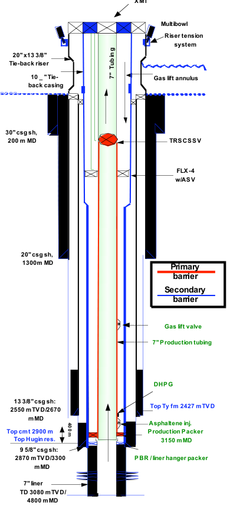

Figure content: well completion schematic (vertical section) with a legend for primary barrier and secondary barrier; labels from top to bottom: XMT, Multibowl, Riser tension system, 7" Tubing, 20" x 13 3/8" Tie-back riser, 10 ¾" Tie-back casing, Gas lift annulus, 30" csg sh 200 m MD, TRSCSSV, FLX-4 w/ASV, 20" csg sh 1300 m MD, Gas lift valve, 7" Production tubing, DHPG, 13 3/8" csg sh 2550 mTVD/2670 mMD, Top Ty fm 2427 mTVD, Asphaltene inj., Top cmt 2900 m, 400 m, Top Hugin res., Production Packer 3150 mMD, 9 5/8" csg sh 2870 mTVD/3300 mMD, PBR / liner hanger packer, 7" liner, TD 3080 mTVD/4800 mMD.

The two water production wells are planned to be completed with downhole electrically driven pumps to pump the water to the surface.

<!-- page 32 -->
<!-- type: mixed -->

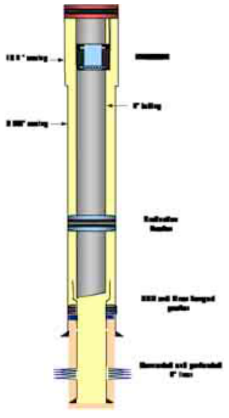

Figure content: well completion schematic (vertical section) showing casing strings, tubing, a packer and a perforated lower section; the labels in the figure are not legible.

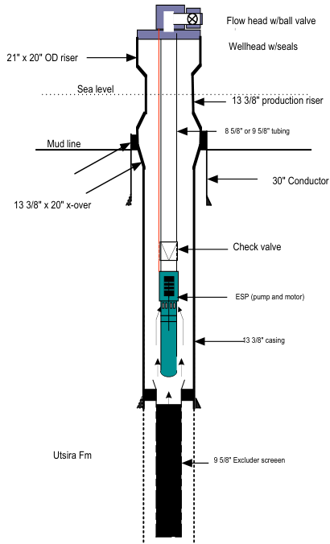

Figure content: well completion schematic (vertical section); labels: Flow head w/ball valve, Wellhead w/seals, 21" x 20" OD riser, Sea level, 13 3/8" production riser, 20" casing, 8 5/8" or 9 5/8" tubing, Mud line, 30" Conductor, 13 3/8" x 20" x-over, Check valve, ESP (pump and motor), 13 3/8" casing, Utsira Fm, 9 5/8" Excluder screeen.

#### 6.4.2 Sand control

The Hugin reservoir is well consolidated; there is therefore no need for any special sand control measures. One of the production wells is planned to be completed with pre-perforated casing through the reservoir. The two other production wells are planned to be cemented and perforated with oriented perforations in the reservoir. The injection wells will also be perforated with oriented perforations in the reservoir.

The Utsira formation is an extremely poorly consolidated sand. The two water production wells are planned to be completed with 9 5/8” open-hole screens through the Utsira formation.

#### 6.4.3 Wellhead, Christmas tree and riser system

The wells are planned to be developed with a two-part wellhead system in which the weight of the casing strings is hung off at the seabed. During the drilling phase, 30 and 20” drilling risers are planned to be used. After drilling has been completed, the wells will be secured and the drilling riser will be removed. Thereafter a 20” x 13 3/8” production riser with a wellhead at the surface will be installed. 10¾” casing is then tied back from the seabed to the surface. The production tubing will be hung off in the wellhead at the surface. One will thereby have surface safety valve trees with 6 3/8" dimension. Simple flow heads are planned to be used for the water producers.

#### 6.4.4 Drilling rig

The drilling and completion operations are carried out from the chosen development solution with the platform Mærsk Inspirer. This platform has a blowout preventer that is pressure-tested to 1 035 bar, which is more than sufficient for Volve.

<!-- page 33 -->
<!-- type: mixed -->

The largest hole diameter will be 37¼” for drilling of the top section. The rig is equipped with one top drive and three regular mud pumps and is built to be able to handle oil-based drilling mud for injection.

#### 6.4.5 Well control and emergency preparedness

Drilling, completion and other well maintenance will be carried out in accordance with Statoil's established procedures and routines and in compliance with the requirements of the authorities.

All drilling and completion operations will take place with two independent barriers against hydrocarbon-bearing formations.

### 6.5 Time and cost estimate

The time and cost estimates are based on earlier drilling operations in the area and other relevant field experience. The cost estimates are based on contract prices for lease of Mærsk Inspirer in drilling mode and in drilling and production mode respectively.

The drilling and completion costs include expected downtime, technical tolerance and waiting on weather. The time and cost estimate is shown in table 6.2.

*Table 6.2 - Time and cost estimate for drilling and completion, costs in MNOK 2005*

| | I5 | I10 | I15 | P5 | P9 | P2 | UP1 | UP2 | Technical tolerance | Total |
|---|---|---|---|---|---|---|---|---|---|---|
| Days drilling | 38 | 36 | 36 | 40 | 40 | 53 | 12.5 | 12.5 | 39 | 307 |
| Days completion | 19 | 19 | 19 | 22 | 24 | 23 | 10 | 10 | 19 | 165 |
| Installation of seabed template | - | - | - | - | - | - | - | - | - | 3 |
| Total number of days | 57 | 55 | 55 | 62 | 64 | 76 | 22.5 | 22.5 | 58 | 475 |
| Cost drilling [MNOK] | 88 | 66 | 65 | 132 | 91 | 113 | 25 | 25 | 69 | 674 |
| Cost completion [MNOK] | 33 | 33 | 33 | 70 | 52 | 56 | 24 | 24 | 31 | 356 |
| Installation of template | - | - | - | - | - | - | - | - | - | 6 |
| Total cost* | 121 | 99 | 98 | 202 | 143 | 169 | 49 | 49 | 100 | 1036 |

If changes in well targets are identified on the basis of a revised reservoir model that includes reprocessed seismic, the costs of the wells may change. Technical tolerance in the form of a geological or technical sidetrack is included with 99 MNOK 2005. These costs have been transferred to contingency costs in table 12.1.1.

<!-- page 34 -->
<!-- type: text -->

## 7 Description of the development solution

### 7.1 Introduction

Extensive evaluations have been carried out of many **development alternatives for Volve.** For the two most profitable development alternatives, **lease of a production vessel with subsea wells** or **a jack-up platform with a process module,** tenders were obtained from the market. The development solution that gives the best profitability for the Volve field is **a jack-up platform with a process plant, where rich gas is exported** to Sleipner A and the oil is exported by shuttle tanker via a storage vessel.

### 7.2 Alternative development

Development concepts based on both owning and leasing production facilities for Volve have been evaluated.

The following **alternative development concepts** have been evaluated in connection with a **lease concept:**

- Production and storage vessel (FPSO) with subsea wells
- Production and storage vessel (FPSO) with wellhead platform
- Jack-up platform with process module and storage vessel (FSU)

The following concepts have been evaluated with a view to **owning the production facility:**

- Platform with fixed steel jacket at the Volve location
- Platform with fixed steel jacket with tie-in of subsea wells on Volve
- Platform with fixed steel jacket connected to Sleipner A, with wellhead platform on Volve
- Modification of Sleipner A with subsea wells on Volve
- Subsea development of Volve tied in to Sleipner A

**Various gas export arrangements** have been evaluated:

- Export of rich gas to Sleipner A (SLA) via Loke or the SLD subsea template
- Export of rich gas to Sleipner T (SLT) via Alpha Nord
- Installation of a CO2 reduction plant for the Volve gas and export via Loke
- Deferred gas export by use of simultaneous water alternating gas inspection (SWAG)

The following **oil export options** exist for Volve:

- Export to Sleipner
- Export via shuttle tankers
- Export via the Forties pipeline system in the British sector

The alternative development solutions are evaluated in the **”Volve Field Development Concept Screening Report”** dated 20.11.2003. The recommended solution is given in the document **”Volve concept selection report”** dated 04.11.2004.

### 7.3 Basis for development

The basis for the development is the chosen drainage strategy, functional requirements, water depth, environmental and geotechnical conditions and available existing equipment.

#### 7.3.1 Functional requirements

The installations shall satisfy the authorities' requirements for fixed installations as well as Statoil's specifications and safety regulations. **Production is expected to last three to four years, while the design life is 10 years.**

#### 7.3.2 Water depth

The water depth at Volve is 90m.

#### 7.3.3 Environmental data

Environmental data (wind, wave height etc.) are given in ”Design basis and functional requirements” and are based on measured data in the Sleipner area.

#### 7.3.4 Geotechnical conditions

A soil investigation has been carried out on the field with regard to anchoring of the storage vessel and foundation for the jack-up platform. Soil investigations have not been

<!-- page 35 -->
<!-- type: mixed -->

carried out along the route of the gas export pipeline, but these will be carried out in good time before installation of pipelines.

### 7.4 Description of the chosen concept

#### 7.4.1 System description and design capacity

A jack-up platform shall be able to perform the following functions:

- Position and jack up the platform on location
- Drill and complete production and water injection wells in the Volve reservoir and water producers from the Utsira formation.
- Process the well stream to stable, water-free oil in accordance with specification
- Export surplus gas to Sleipner A via the Sleipner D template
- Treat produced water for reinjection
- Inject Utsira water and produced water into the Volve reservoir to maintain the reservoir pressure
- Export stable oil to the storage vessel
- Accommodate all personnel normally needed to operate and maintain production, utility and marine functions.

Table 7.1 describes the design capacities of the facility.

*Table 7.1 - Design capacity*

| The design capacity of the platform will be the following: | | |
|---|---|---|
| Total liquid handling: | 13 000 | Sm3/d |
| Oil rate: | 9 000 | Sm3/d |
| Max. water content | 80 | % |
| Gas compression rate: | 1.5 | MSm3/d |
| Gas export pressure: | 100 | bara |
| Gas injection pressure/gas lift: | 160 | bar |
| Water injection rate: | 5 000 – 16 000 | Sm3/d |
| Water injection pressure: | 330 | bara |
| Beds: | 120 | persons |

#### 7.4.2 The production platform

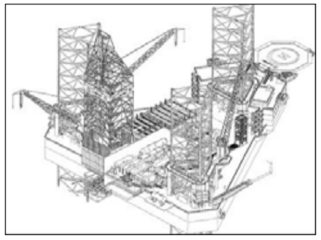

Figure content: isometric line drawing of a triangular jack-up rig seen from above, with three lattice legs, a drilling derrick, cranes, deck modules and a helideck at one corner; no axes or text labels.

Mærsk Inspirer is the second in the series of Maersk Contractors' newest generation of jack-up platforms. It was built in Korea and was completed in 2004. The rig is designed for a maximum water depth of 150 metres and will, when fully installed on Volve, be jacked up 26 metres above the sea. The rig is shaped as an equilateral triangle with a jack-up leg in each corner. The distance between each leg is approx. 70 metres. A process plant will be installed to process the well stream to stable oil and rich gas. The platform will have dry wellheads and will **throughout the entire production period have the possibility of drilling or well intervention.** The process plant will be located next to the drilling module, see figure 7.1

The living quarters, like the helideck and the lifeboats, are located on the outside of the jack-up leg at the greatest distance from the drilling and

<!-- page 36 -->
<!-- type: mixed -->

process module. The flare tower is located on the outside of the rig leg nearest the process module.

#### 7.4.3 Process plant and utility systems

The process plant will contain systems for separation and oil stabilisation, a fuel gas plant, a compression module for gas export, produced water treatment and water injection. (See figure 7.2) The separation plant consists of three separator stages; the first two are three-phase separators, while the third stage is a water separator. The pressures in the 1st and 2nd separator stages are 40 barg and 0.2 barg. A requirement of 5 minutes minimum residence time for the oil has been set because of strong oil/water emulsions. There are heating facilities upstream of the 2nd stage separator. Fuel gas is taken from the first separation stage. The fuel gas system has facilities for cooling, liquid knock-out and heating before distribution to consumers. The gas from the second separator stage is compressed to first-stage separator pressure and fed to the export compressors together with the gas from the first-stage separator.

One centrifugal compressor has the capacity to compress 1.5 MSm3/d of gas from a suction pressure of 40 bara to a discharge pressure of 100 bara.

The produced water treatment will consist of dedicated hydrocyclones and degassing tanks for the water streams from each separator. Produced water will, together with water from the Utsira formation, normally be reinjected into the reservoir for pressure support. After cleaning to specification and gas removal, the water can be dumped overboard if the water injection system is down. Gas from the degassers is sent to flare.

Power generation takes place in two 50% “dual” fuel gas turbine generators. Each generator has the capacity to supply all process consumers except the ESP and water injection pumps. If one of the generators is down, the water injection system can be driven by the generators in the drilling module if any drilling activity is stopped. The drilling module has 4 diesel generators.

Other utility systems include:

- Two 100 % heating medium circulation pumps and two 100% waste heat recovery units.
- Fresh water plant, capacity: 20 m3/h
- Seawater plant, capacity 347 m3/h
- Fire water, capacity: 1000 m3/h
- Compressed air, continuous capacity: 350 m3/h
- Diesel system
- Hydraulic system
- Nitrogen system
- Deluge, foam and halon systems for fire protection

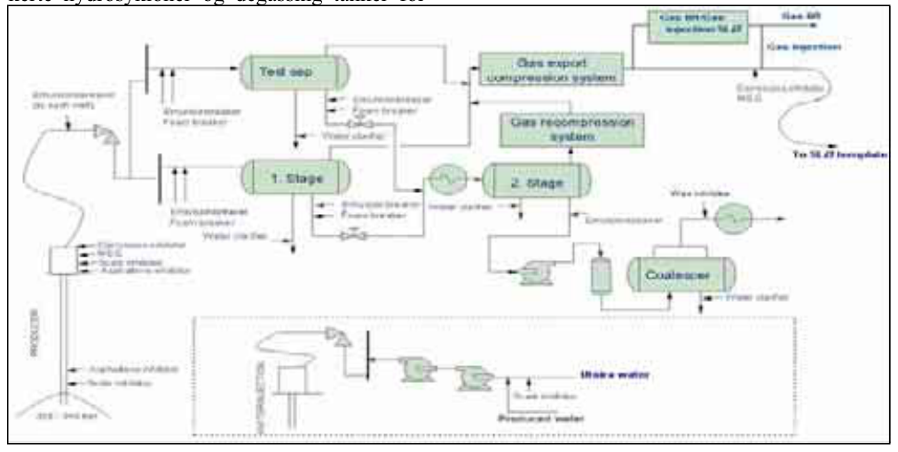

Figure content: process flow diagram; a producer well feeding a test separator and a 1. Stage separator, followed by a 2. Stage separator and a coalescer; boxes for gas export compression system, gas recompression system and gas lift/gas injection; outgoing lines labelled gas lift, gas injection and to the SLØ template; a water injection well supplied by pumps with Utsira water and produced water; chemical injection points labelled along the lines (emulsion breaker, foam breaker, water clarifier, scale inhibitor, wax inhibitor, asphaltene inhibitor, corrosion inhibitor, MEG).

<!-- page 37 -->
<!-- type: text -->

The maximum number of planned wells for Volve is 13 wells: 6 production wells, 5 water injection wells and two Utsira water wells.

#### 7.4.4 Export of oil

Stable oil is exported to the storage vessel "Navion Saga" via an 8” flexible export pipeline. The loading capacity corresponds to the production capacity of 9 000 Sm3/d. The storage vessel is moored to an STL buoy 2.5 km from the production rig and has a storage capacity of 1 million barrels of oil and an offloading capacity of 6000 Sm3/hour. The oil is fiscally metered on transfer from the storage vessel to shuttle tankers. The storage vessel is equipped with a VOC plant.

#### 7.4.5 Export of gas

The gas is exported to Sleipner A via the Sleipner D subsea template. A 5.5 km long 7.4” flexible pipeline will be installed from Volve to Sleipner D. The maximum design rate is 1.5 MSm3/d, while the highest expected rate is 1.2 MSm3/d. The gas that is exported is wet rich gas from the 1st and 2nd stage separators. The gas export line is insulated to avoid the gas being cooled down to the hydrate formation temperature in connection with the export to Sleipner. To prevent hydrate problems at low gas export rates towards the end of the field's life, methanol can be injected continuously. A procedure for hydrate handling will be prepared before production start.

#### 7.4.6 Gas lift/gas injection

To ensure a high production regularity for Volve, provision has been made for injection of the export gas from Volve into the SLØ wells in the event of a production shutdown on SLA. An injection compressor compresses the gas from the export compressor to the necessary injection pressure of approx. 160 barg in order to inject into the injection well, which has a maximum shut-in pressure of 130 barg. The compressor can also be used to gas-lift the production wells on Volve, which may become necessary for wells with a high water cut.

#### 7.4.7 Fiscal metering of oil and gas

The oil is fiscally metered on offloading from the storage vessel to the shuttle tankers. There will also be metering on the jack-up platform rig in order to have continuous control of the production rate, but this metering is not of fiscal quality. The metering accuracy will be better than ± 2 %.

The gas is fiscally metered in connection with export from Sleipner A. Because Volve and Sleipner A lie in the same licence with the same owners, fiscal metering of the gas will not be necessary before it is sent into the gas plant on Sleipner A. There will also be metering of the export gas on MI, but this metering is not of fiscal quality. Gas that is flared or used for power generation will be metered in accordance with the Norwegian Petroleum Directorate's requirements for calculation of CO2 tax.

#### 7.4.8 Modifications, installations and marine operations

Statoil will be responsible for all marine operations in connection with installation of the export systems for oil and gas on Volve.

The development of the Volve field is based on as many marine operations as possible having been completed when the platform and the storage vessel arrive at the field. The gas export pipe will be installed and connected to the Sleipner D template. The STL buoy with mooring and connection to the oil export pipeline will be installed. The STL buoy will be submerged, ready for pull-in and connection to the storage vessel.

The distance between Mærsk Insprer (MI) and Navion Saga will be approximately 2.5 km, while the distance from MI to Sleipner Øst is approximately 5.5 km. Both export pipelines will be buried.

Before MI can be installed and start production of oil and gas, the rig will be modified so that class inspection can be carried out on location if necessary.

<!-- page 38 -->
<!-- type: text -->

#### 7.4.9 Production chemicals

Provision will be made for the use of production chemicals to handle fluid-related issues. Mixing of produced water and Utsira water for injection may give a scaling potential that will require injection of scale inhibitor.

Provision is being made for injection of chemicals such as emulsion breaker, asphaltene inhibitor, wax inhibitor, antifoam, methanol, corrosion inhibitor, biocide and flocculant. There will most probably not be a need for continuous injection of all these chemicals, but the possibility of injection will be present. Oil-soluble chemicals will follow the oil product, while water-soluble chemicals will follow the produced water that is injected back into the reservoir.

The chemical discharges from Volve will thereby be minimal. A normal chemical consumption is expected on Volve compared with other oil fields.

#### 7.4.10 Testing and start-up

Offshore testing and start-up will be carried out by Maersk Contractors and tekay for the platform and the storage vessel respectively.

### 7.5 Regularity of produced oil

The regularity of produced oil is calculated at approx. 96 % for the process plant alone. The total regularity analysis for the whole facility is calculated at 94 %.

<!-- page 39 -->
<!-- type: text -->

## 8 Operation and maintenance

### 8.1 Introduction

Statoil is operator of Production Licence 046. In accordance with the joint operating agreement, the operator attends to the day-to-day management of the activity carried out in connection with the production licence on behalf of the owner group. The management committee is the highest body in the owner group, and the operator carries out its tasks in accordance with decisions of the management committee.

### 8.2 Organisation and manning

Volve will be part of Statoil's unit for Exploration and Production, Norway (UPN) and will be established within the existing Sleipner operations organisation. The organisation will be responsible for all activities in connection with operation and decommissioning of the field. In the operations phase the organisation will comprise 12-16 persons. Preparations for operation and start-up will be completed in the construction project.

Statoil, as operator, will normally be present on the field with only one representative during production. The representative safeguards the interests of Statoil and the other licensees that operations are carried out in an efficient manner that is sound with regard to safety and the environment

During drilling operations, Statoil will have a larger organisation on board as well as several representatives from our subcontractors.

The contractors will be given a large degree of independence, with associated delegation of responsibility and authority to carry out the assignment in accordance with the contract. The contractors will be the principal employer for their own and the subcontractors' personnel.

### 8.3 Operation of the facilities

Statoil's onshore organisation for Volve will take care of tasks related to the operation of the facilities in cooperation with the contractors. The contractors will be instructed by Statoil on production and injection plans as part of the reservoir management. All contact with authorities and partners will be carried out by Statoil.

Statoil will attend to the responsibility for standby vessel and oil spill response. Volve will be connected to Statoil's second-line emergency response centre at Sandsli. All logistics functions such as helicopter transport and supply service will also be attended to by Statoil.

Existing supply bases and the helicopter terminal in Stavanger, which are already used in the Sleipner area, will also be used for Volve. Provision shall also be made for efficient cooperation with Statoil's other units, other operators in the area and owners of the production facilities.

The contractors Maersk Contractors and Teekay will carry out all offshore activities in connection with operation of the production facility, such as processing, storage, fiscal metering and export, and will have the necessary support functions onshore. The operation will be carried out within the authorities' regulations and Statoil's requirements for health, safety and environment.

Monitoring and control of the process plant and other functions on board will take place from a central main control room. Normal operating manning on the platform is approx. 34 persons when drilling is finished, and normal operating manning on the storage vessel is approx. 14 persons.

### 8.4 Maintenance

Preparation and management of maintenance and inspection programmes in line with established procedures at Maersk Contractors and Teekay shall ensure that the facility meets operational standards in accordance with the requirements of the authorities and the company.

Maintenance and inspection activities shall be based on functional criticality assessed against safety and environment, production regularity and consequential costs. Optimisation of maintenance and inspection programmes is carried out to ensure that production targets are reached. To achieve this, a contract has been developed between Statoil (on behalf of PL046) and Maersk Contractors based on a compensation format that rewards high operating regularity, which is dependent on a high level of safety.

<!-- page 40 -->
<!-- type: text -->

## 9 Health, safety and environment

### 9.1 Introduction

Attitudes, activities and decisions at all levels in the organisation have an influence on HSE, and HSE management is an integrated part of the activities in the project and operations phases. The plans are to deliver a total production facility (platform, export system, storage vessel) that satisfies the authorities' HSE requirements as well as specific operator requirements that are included in the contract.

Some deviations from the requirements of the authorities have, however, been identified on the installations already built (platform and storage vessel). The identified deviations are handled in accordance with Statoil's procedures and will be raised with the Petroleum Safety Authority during the period in which this PDO is being processed.

Safety requirements comprise protection of human life and health as well as protection of facilities, production, knowledge and material assets. Environmental protection requirements comprise protection against pollution of, and unacceptable encroachments on, nature. HSE is taken into account in all technical, economic, operational and administrative activities both in Statoil and at OIC. In connection with the construction phase, the contractors are required to carry out various risk analyses, which may lead to corrective measures.

If changes and updates of the chosen technical solution are required, safety and environmental requirements will be given particular weight.

### 9.2 Description of objectives

The overall HSE objective for development and operation of Volve is that the activity shall not cause accidents, personal injuries, occupational illnesses, material losses or damage to the external environment.

The following sub-goals have been established:

- HSE shall be integrated in all relevant activities, strategies and plans
- Implement the objective of zero harm to people and the environment and zero accidents or losses (“the 0 philosophy”)
- ensure qualified personnel and sensible resource management
- ensure transfer of experience and close cooperation with corresponding projects
- ensure good communication between the project and partners/authorities
- set the same requirements for our suppliers as for Statoil's own employees.

### 9.3 Acceptance criteria and requirements

The technical solution is subject to risk assessments and is designed/verified so that the risk level satisfies the acceptance criteria of Statoil and the authorities.

Continuous efforts shall be made to develop solutions that will reduce the risk to personnel, the environment and material assets beyond the acceptance criteria.

### 9.4 Management of health, safety and environment

The Volve project manager has the overall responsibility for health, safety and environment in the development phase. An HSE programme has been prepared and will be updated and coordinated with the contractors' HSE programmes. Thereafter the programme will be revised at various milestones in order to obtain a common attitude to this in both the development phase and the operations phase.

A requirement has been set for the owner of the installation on Volve to establish its own HSE programme. Any subcontractors shall in addition be able to document their own HSE management system with an activity list.

### 9.5 Safety

#### 9.5.1 Principles

The following principles have been emphasised in the safety work:

- Mærsk Inspirer is a new facility, and there will be a focus on limiting the risk associated with this
- technical solutions will be assessed against best practice within safety
- systematic use of risk analyses and ”ALARP” principles in design

<!-- page 41 -->
<!-- type: text -->

- use of assumptions from risk analyses in the operations phase
- focus on high-risk activities and risk areas

#### 9.5.2 Risk analysis

In the preparation phase the Volve project has carried out a concept risk analysis, with the purpose of making the risk visible early in the project. The results show an average FAR on the field of 8.1, which is below Statoil's acceptance criterion of 10. It has been calculated that all main safety functions satisfy the 10^-4 criteria. The concept risk analysis is used as a basis for improving the risk picture and for focusing on high-risk activities in the modification phase.

A total risk analysis (TRA) is being carried out with the following main purposes:

- map the risk level after modifications for Volve have been implemented
- map which elements contribute most to the personnel risk on board
- map the need for modifications in order to satisfy Statoil's acceptance criteria
- ensure that modifications resulting from new design requirements are designed in a manner that is optimal with regard to safety.

The risk analysis will be updated in the subsequent modification work. In particular, there will be a focus on risk-reducing measures with regard to:

- Emergency preparedness and evacuation
- Fire and explosion
- Improved detection
- Implementation of ignition source disconnection
- Location of new equipment

#### 9.5.3 Safety strategies

A fire and explosion strategy has been prepared, as well as an evacuation, escape and rescue strategy, based on the relevant hazard and accident events. This shall be updated to include the process module in connection with modifications.

#### 9.5.4 Explosion

An explosion analysis based on the latest knowledge about explosions, with the latest version of simulation tools, will be carried out.

#### 9.5.5 Emergency preparedness

An emergency preparedness assessment for Volve has been carried out, but a detailed emergency preparedness analysis based on scenarios from the TRA will be prepared. The exact dimensioning of the accident preparedness on board will be done in accordance with the results from that analysis and will meet the requirements of the authorities and the operator.

The field-specific preparedness for handling any discharges of hydrocarbons to sea will be coordinated through NOFO with other fields in the area and will as a minimum be in accordance with recognised norms and will be made concrete in the further work.

#### 9.5.6 Safety in the further work

Follow-up of results, assumptions and recommendations from completed inspections and analyses will be an important activity in the coming modification phase. At the same time, detailed Hazop studies will be carried out for the modifications, which must be seen in connection with existing process and design solutions. Prioritised topics are:

- Preparation of the total risk analysis, including a thorough assessment of identified hazard and accident situations
- Preparation of the emergency preparedness analysis
- Performance of a detailed evacuation study
- Detailed reviews and modifications of the existing detection, emergency shutdown and fire water systems
- Risk and emergency preparedness analysis for drilling of wells
- Review of operation and maintenance routines for safety-critical equipment
- Focus on use of temporary equipment

Planned verification activities and technical reviews will be prioritised to ensure that all requirements are met.

<!-- page 42 -->
<!-- type: mixed -->

### 9.6 HSE aspects in connection with drilling and completion

Potential pollution from drilling and completion operations is related to:

- Discharge of drill cuttings and drilling fluids.
- Discharge of completion fluids
- Well clean-up
- Unwanted discharges

During drilling and completion operations, precautions shall at all times be taken to avoid blowouts, pollution, explosions and other events that are harmful to personnel, the installation and the external environment. In the selection of suppliers, the companies' attitude and ability to achieve good HSE results will be part of the evaluation.

### 9.7 Working environment

#### 9.7.1 Working environment assessments

Mærsk Inspirer has been carefully assessed with regard to working environment aspects. A conformity measurement has been carried out on Mærsk Inovator, which is the sister rig of Mærsk Inspirer, against applicable regulations. The working environment aspects that are given particular focus are:

- noise and vibrations
- access and accessibility
- material handling and transport routes
- stairs and ladders
- ventilation and air quality
- work and living areas

#### 9.7.2 Follow-up of working environment in the further work

Statoil has established working environment area requirements for individual rooms and areas on board the platform and the storage vessel. In the further work, emphasis will be placed on studies in which assessments of the deviations from the area requirements are evaluated in relation to criticality and functionality.

### 9.8 Environmental assessment of the chosen solution

According to Statoil's basic principles for environmental protection, all activities shall be carried out in such a way that the impact on the external environment is as small as possible and within technically and economically acceptable limits. Emissions to air and discharges to water shall be minimised, and the chemicals that are used and discharged shall be as little harmful to the environment as possible. Estimated emissions and discharges from the Volve field include those from drilling and production.

#### 9.8.1 Emissions to air

Emissions to air will primarily consist of CO2 and NOx from gas turbines and processing of oil. The main power supply will be from own power generation on board the platform.

In addition there will be some emissions of VOC related to storage and loading of oil, as well as diffuse emissions. Calculated maximum emission quantities to air in the production phase (applies to peak production for approx. 1½ years) are shown in table 9.1.

A conventional flare system with a pilot flame will be installed. During normal operation there will not be any production flaring, but there is the possibility of flaring gas on shutdown of the recompression compressor or the export compressor in order to avoid a production shutdown.

*Table 9.1 - Emission quantities of CO2, NOx and VOC to air (tonnes per year) in connection with production*

| Emission component | CO2 | NOX | VOC |
|---|---|---|---|
| tonnes per year | 93 600 | 375 | 990 |

In accordance with given requirements of the authorities, a plant for reduction of VOC will be installed on the storage vessel. Emissions to air from the drilling operations occur in connection with power generation from diesel engines on the drilling rigs and from well clean-up. Emission quantities to air in connection with drilling and completion of the wells are shown in table 9.2.

*Table 9.2 - Emission quantities of CO2, NOx and nmVOC to air (tonnes) in connection with drilling and completion of 8 wells*

| Emission component | CO2 | NOX | VOC |
|---|---|---|---|
| Tonnes | 20 500 | 450 | 32 |

<!-- page 43 -->
<!-- type: mixed -->

#### 9.8.2 Discharges to sea

Planned discharges to sea from the platform will be discharge of produced water only if the water injection plant is out of operation. In addition there will be discharges of drainage water, sanitary waste water, cooling water.

### Produced water:

Produced water volumes are expected to be relatively limited. The water will be injected together with Utsira water as pressure support in the reservoir. During operational disturbances smaller volumes will be discharged, but the water is cleaned with hydrocyclones to ensure that the discharges satisfy the current requirements of the authorities. Any water-soluble chemicals added in the process will follow the liquid phase.

### Drainage water:

Drainage water from areas not contaminated with oil will be led to sea, while drainage water from contaminated areas is led to a collection tank for reinjection. Oily drainage from high-pressure process equipment will be collected in a closed drain system and routed on to the separation process.

### Cooling water:

Seawater from cooling of oil and gas will be discharged to sea. The water will contain residues of hypochlorite.

### Discharge of drilling fluid and drill cuttings:

The drilling mud programme for Volve will be developed so that discharges to sea are minimised. Continuous discharges of drilling mud and drill cuttings to sea will only occur from drilling of the top sections of the wells, where water-based mud is used. Attempts will be made to reuse the drilling mud. There will be no discharge to sea of oil-based mud or cuttings. Cuttings with adhering oil-based mud are transported to shore for treatment and disposal, alternatively reinjected if practically possible.

Expected discharge of drill cuttings and drilling fluid from drilling of three production wells and three water injection wells is shown in table 9.3.

#### 9.8.3 Waste

A separate waste management plan shall be prepared for Volve. Measures to reduce the quantities of waste will be given focus, and sorting at source before final disposal will be carried out.

#### 9.8.4 Environmental risk analysis

An environmental risk analysis of Volve has been carried out to make sure that the chosen development and operating solutions are within Statoil's operation-specific acceptance criteria with regard to the environment.

The environmental risk for Volve is related to accidents that may lead to acute discharges of oil. In an accident, oil could float to the surface as a slick. Field preparedness for handling any discharges is being coordinated with the Sleipner installations and other fields in the area and will as a minimum be in accordance with recognised norms and will be made concrete in the further work.

The environmental risk analysis will be updated ahead of drilling operations.

*Table 9.3 - Planned discharge of water-based drilling fluid and cuttings drilled with water-based drilling fluid (m3)*

| 3 production wells – Drilling fluid | 3 production wells – Cuttings | 3 injection wells – Drilling fluid | 3 injection wells – Cuttings | 2 water producers – Drilling fluid | 2 water producers – Cuttings |
|---|---|---|---|---|---|
| 5673 | 1137 | 4485 | 2115 | 2304 | 710 |

#### 9.8.5 Impact assessment

In accordance with the Petroleum Act and guidelines laid down by the Ministry of Petroleum and Energy, an impact assessment has been prepared to describe effects on the environment, natural resources and society. The impact assessment has been submitted earlier to OED and is mainly based on the “Regional konsekvensutredning for Nordsjøen” prepared by Statoil in cooperation with other oil companies in 1999.

The regional impact assessment for the North Sea (RKU Nordsjøen) forms part of the documentation for the Volve impact assessment. Together, RKU Nordsjøen and the Volve KU cover the requirements for assessment of the effects of the Volve development.

<!-- page 44 -->
<!-- type: mixed -->

## 10 Organisation and execution

### 10.1 The project's management system

#### 10.1.1 Objectives and means

The development of Volve shall be carried out in accordance with Statoil's corporate document AR05 "Project development" and the guidelines defined in Norsok.

The project shall be managed by objectives, with particular emphasis placed on the handling of uncertainty. The project's main objectives are related to:

- Health, safety and environment
- Profitability
- Execution
- Quality

Important means of achieving the objectives are:

- Supplier selection and "see-to-it" activities
- Continuous focus on uncertainty elements related to the objectives that have been defined
- A comprehensive system of governing documents
- Quality as an integrated part of management responsibility at all levels
- Quality that is built into products and activities through the use of correct and documented management systems and routines.

#### 10.1.2 Documentation of the management system

The project's management system is based on:

- the authorities' acts and regulations
- concession terms and licence agreements
- Statoil's governing documents

The quality system for the project consists of:

- Assignment agreement between the Troll/Sleipner Operations Director and the T&P/Director for Projects
- Project agreement between the T&P/Director for Projects and the Volve Project Manager
- This PDO with supporting documentation and the Impact Assessment
- The contract with the supplier of the jack-up platform
- The contract with the supplier of the storage vessel (FSU)
- Project execution strategy (PGS)
- Project execution plan (PGP)
- The project's other governing documentation and plans
- Contracts with external suppliers (Statoil frame agreements)
- Agreements with internal suppliers (for example Sleipner B&B)
- Relevant procedures for operation on the Sleipner field.

### 10.2 Description of the organisation

#### 10.2.1 Operator responsibility

In accordance with the joint operating agreement, Statoil attends to the day-to-day management of the activities carried out in connection with Production Licence 046 on behalf of the owner group. The operator performs its tasks in accordance with decisions of the management committee, which is the supreme body of the owner group.

#### 10.2.2 Planning and development organisation

The day-to-day exercise of Statoil's operator responsibility for the planning and development of Volve is attended to by a project organisation. The project is organised with a core team that has the continuous, overall responsibility for planning and development of Volve until project close-out.

The project will to a large extent use the main suppliers' resources, in addition to having close cooperation with Statoil's competence units.

In connection with drilling planning and execution, a separate drilling project will be established with responsibility for finalising the wells. The drilling project will report to the Volve Project Manager.

Experience from the operations organisations of the Yme and Glitne fields has been and will be utilised in the planning and execution of the project.

Figure content: organisation chart without a caption on this page, cut off at the bottom edge of the page; boxes T&P/Director Projects, Volve Project Manager, HSE, Staff functions, Reservoir, Drilling, Development, Operations.

<!-- page 45 -->
<!-- type: text -->

*Figure 10.1 – The operator's organisation in the mobilisation phase* [figure not present in the source]

#### 10.2.3 Operations organisation

Statoil, as operator of Production Licence 046, is responsible for all activities towards the authorities and partners. Day-to-day operation and maintenance responsibility is regulated through the contract between the main supplier and Statoil. The installations shall be operated in accordance with the authority and company requirements in force at any time.

The onshore organisation for Volve is located in Stavanger, including operational support functions such as helicopter base and supply base. In the operations phase, Volve will be integrated with the Sleipner operations organisation.

#### 10.2.4 Coordination with other fields

The project will cooperate actively with the base organisations and other development and operations organisations in order to benefit from economies of scale in the entering into of contracts, shared services, technical support functions and transport.

Supply and base services as well as emergency preparedness will be coordinated with other Statoil fields in the southern part of the North Sea.

#### 10.2.5 Recruitment to the development and operations organisation

Recruitment to the core team has been carried out internally in cooperation with the resource owners in Statoil.

Recruitment of resources for the development and operations tasks is done by the main suppliers as agreed in the contract.

The operator has nominated a company representative with responsibility and authority to conduct all formal communication with the main suppliers.

In areas where there is a need for specialist competence, for example in the operator's "see-to-it" activities, the process owners and discipline leads in Statoil will be used.

#### 10.2.6 Competence needs and training measures

Statoil today has personnel with the competence to manage the planning and development of Volve. Through the contract, the main supplier has committed itself to providing competence and carrying out the training measures that are required and necessary to achieve the intentions of the contract in accordance with laws and rules.

#### 10.2.7 Personnel requirements

In the operations phase, the operator's onshore organisation will amount to about 16 man-years, plus the contractors' onshore organisation. Man-years related to offshore activity will be at 100 to 150 man-years, depending on the level of drilling activity on the platform.

The total employment corresponds to about 3 400 man-years; of these, 550 are direct man-years, 2 200 are at subcontractors and 650 will be consumption effects. Of the total employment effect in Norway in the period 2005 to 2012 of 3 400 man-years, the oil and gas industry will account for 15% of the employment, corresponding to 500 man-years. The largest activity is within business services and transport, with 950 and 600 man-years respectively.

It is assumed that Volve is operated from Stavanger.

<!-- page 46 -->
<!-- type: text -->

### 10.3 Relationship to industry and society

#### 10.3.1 Socio-economic consequences

Provision of the production facilities for Volve is carried out as a lease concept of partly existing facilities and new acquisitions through a main supplier.

The development of Volve is planned to be carried out in the period December 2004 to January 2007. Total investments are calculated at 1968 million NOK 2005, including drilling and completion of wells.

The assembly of the production facilities will take place at a Norwegian yard and will secure contracts for the Norwegian yard industry.

#### 10.3.2 Procurement

The choice of concept/contractor was based on market assessments carried out in the summer/autumn of 2004. It showed that only the chosen concept provides a basis for economically robust recovery of the Volve field, and the facility is planned to be secured for this purpose.

In its other procurements the project will make use of the company's total competence and market position, as well as the company's frame agreements and normal tendering routines.

#### 10.3.3 Application of research and development results

Statoil has an active and extensive engagement in research and development. In the design and choice of solutions, results from this research and development will be used to the extent that it is appropriate.

The development is based on known technology and has for that reason not defined any special technology development in the project execution phase.

### 10.4 Project execution plan

The project is based on the start-up of detailed engineering studies in connection with the entering into of letters of intent with the selected suppliers in December 2004. These studies form the basis for ordering equipment with long delivery time, and this equipment will be ordered upon the decision to submit the PDO. The following milestones apply to the progress of the project:

- Engineering and construction of the process plant: Feb. 2005 – May 2006
- Engineering and construction of the export system: Feb. 2005 – March 2006
- Installation of export pipeline and buoy: April – Oct. 2006
- Platform to yard: Sept. 2006
- Hook-up of the process plant: Oct. – Nov 2006
- Tow-out of the platform: Dec. 2006
- Production start: 1st half of 2007

According to the contract, tow-out of the platform will take place in December 2006. The weather risk during tow-out is the contractor's risk with regard to costs. Because of possible delays related to tow-out of the platform in wintertime and a generally tight execution plan, the licensees have assessed the risk of delays such that production start may be delayed, and have therefore indicated start-up during the 1st half-year. If the contractor keeps to its plans, expected start-up is March 2007.

### 10.5 Verification and follow-up of main contracts

From PDO submission, Statoil will continue with a Volve project team that has the overall responsibility, ref. chapter 10.2. In this team, led by the company's representative for the contracts, dedicated personnel will be responsible for verification and follow-up of the main contractor's activities in accordance with the project's supervision plan and Statoil's governing documents.

The team will focus on the suppliers' deliveries meeting requirements in accordance with the regulations. Through regular meetings and see-to-it activities, Statoil will follow up HSE, quality, progress and the execution plan of the contractors.

Close dialogue with the authorities, mainly the Petroleum Safety Authority, the Norwegian Petroleum Directorate and SFT, will be necessary.

<!-- page 47 -->
<!-- type: text -->

## 11 Decommissioning plan

### 11.1 Introduction

Production on Volve will be shut down when the project gives negative cash flow. Based on expected prices and the estimated production profile, this will happen after approx. 5 years of production.

The owners in Volve can terminate the contract for the hire of Mærsk Inspirer and Navion Saga with 6 months' notice, provided that the total time on the field is a minimum of 36 months. Based on the production development and oil price, the time of cancellation will change. Notice of cancellation of the contract in order to end Volve production will be raised with the authorities in good time. The main objective is to achieve the highest possible recovery from the field. The actual removal of the installations and shut-down of wells will be carried out in accordance with the regulations in force. The regulations give guidelines for both shut-down of wells and removal of the installations.

### 11.2 The production facilities

When the Volve field can no longer be operated economically, the wells will be shut down. The STL buoy with mooring system will be removed by means of an anchor-handling vessel.

Removal of the oil and gas export pipelines will be considered. Because the pipes are buried, this may be difficult. The alternative to removal and reuse will be to rock-dump the pipe ends.

The platform will plug the wells and remove production tubing and casing in accordance with the regulations in force.

The platform will secure the wells in accordance with existing regulations. When securing of the wells has been carried out, only drill cuttings containing water-based mud will remain on the seabed.

### 11.3 Costs of shut-down and removal

The total costs for plugging of wells are 93 million NOK2005.

Removal of the jack-up platform, risers, pipelines and anchors is estimated at 51 million NOK2005, based on today's rate level for the various vessels expected to be used.

<!-- page 48 -->
<!-- type: mixed -->

## 12 Economic analyses and evaluations

### 12.1 Costs of development and operation

The development costs have been prepared in accordance with Statoil's guidelines and are based on experience from earlier projects and tender/contract prices from the contractors/suppliers.

#### 12.1.1 Investments

The Volve lessees' investments are mainly related to well costs (drilling and completion) as well as purchase of pipelines, marine installations and mobilisation of the drilling and production platform and the storage vessel. Table 12.1 shows an overview of all the costs.

*Table 12.1 – Investments*

| Investments in million NOK2005 | |
|---|---|
| **Wells** | 937 |
| Mobilisation of platform | 291 |
| Export system including storage vessel | 391 |
| Project management costs including project reserve | 349 |
| Total | 1968 |

#### 12.1.2 Lease costs for production facilities

Lease costs for Mærsk Inspirer with associated equipment and operation of the plant are based on the contract price from Mærsk in the form of fixed day-rate compensation and a tariff for produced oil and gas, as well as an agreed mobilisation and demobilisation sum.

The costs are divided into four elements:

- investment element for the jack-up platform
- operating costs covering the contractor's crew as well as operation and maintenance
- investment element for the storage vessel
- operating costs for the storage vessel

The contract is based on a 3-year lease period with 6 months' notice of termination of the contract.

Both investment elements are stated in nominal USD, i.e. they will not be adjusted for inflation. The process plant on Mærsk Inspirer will be paid for via a unit tariff given in different currencies (NOK, EUR, USD/barrel of oil equivalent.)

The operating costs in the contracts are given in respective NOK, EUR, USD2004 and will be subject to wage/index adjustment. In addition, it is assumed that the storage vessel is hired by the owners in Volve. The storage vessel's lease costs are given in the contract with Teekay Norway. Lease costs to the contractor converted to USD/d are shown in Table 12.2.

*Table 12.2 – Lease costs to the contractor per day in the drilling/production period (not adjusted for inflation)*

| Lease of the jack-up platform Mærsk Inspirer / the storage vessel Navion Saga | |
|---|---|
| Investment element, platform | 92 500 USD NOM/day |
| Investment element, storage vessel | 38 590 USD NOM/day for 3 years, thereafter 18 076 USD NOM |
| Operation and maintenance costs, platform | 95 313 USD 2004/day (drilling phase) / 109 638 USD 2004/day (drilling & prod. phase) 72 467 USD 2004/day (production phase) |
| Operation and maintenance costs, storage vessel | 22 444 USD 2004/day |

*Table 12.3 – Lease costs to the contractor per barrel of oil equivalents (not adjusted for inflation)*

| Lease of process plant | 55 million barrels oe | 55 -65 million barrels oe | 65 -75 million barrels oe | 75 -85 million barrels oe | thereafter |
|---|---|---|---|---|---|
| | 2.75 USD nom/barrel oe | 2.25 USD nom/barrel oe | 2.0 USD nom/barrel oe | 1.75 USD nom/barrel oe | 1.50 USD nom/barrel oe |

<!-- page 49 -->
<!-- type: mixed -->

#### 12.1.3 The operator's operating costs

The following operating costs will have to be covered by the Volve owners in addition to the lease costs to the contractor, see Table 12.4.

*Table 12.4 – The operator's annual operating cost at plateau rate*

| Operating costs per 12 months of production in million NOK 2005 | |
|---|---|
| Logistics (helicopter, supply etc.) | 31 |
| The operator's operations organisation | 37 |
| Production chemicals | 12 |
| Well intervention costs | 27 |
| CO2 tax / NOx tax | 19 |
| Miscellaneous | 29 |
| Sum | 155 |

#### 12.1.4 Removal and plugging costs

When the Volve field has finished producing, that is, when the revenues are less than the expenses (before tax), the field's production will be terminated. Estimated costs that will be incurred to demobilise the production facility and secure the wells are shown in Table 12.5.

*Table 12.5 – Removal and plugging costs*

| Removal and plugging costs, million NOK 2005 | |
|---|---|
| Removal of jack-up / FSU / risers / pipelines | 51 |
| Plugging of wells | 92 |
| Total | 143 |

#### 12.1.5 Cost profile for the economic calculations

The estimated revenue profile is based on 94 % regularity. The expenses are assumed with the same regularity, but the day rate is included with 365 days per year. Total costs per year appear in Table 12.6.

*Table 12.6 – Costs per year, million NOK (nominal NOK)*

| | 2005 | 2006 | 2007 | 2008 | 2009 | 2010 | 2011 | 2012\*) | Total |
|---|---|---|---|---|---|---|---|---|---|
| Wells | 7 | 67 | 828 | 189 | | | | | **1091** |
| Mob., subsea equipment, project management | 156 | 720 | | | | | | | 876 |
| Unforeseen costs | | 76 | | | | | | | 76 |
| Total investment costs | 163 | **863** | **828** | 189 | | | | | **2043** |
| Lease of platform and FSU (investment) including tariff for process plant / | | | 508 | 734 | 717 | 513 | 384 | 142 | 2998 |
| Lease of platform and FSU (operation and maintenance) | | | 157 | 250 | 261 | 268 | 275 | 116 | 1327 |
| Statoil operating costs, onshore support | 5 | 32 | 170 | 165 | 167 | 168 | 173 | 74 | 954 |
| Decommissioning costs | | | | | | | | 61 | 61 |
| Plugging of wells | | | | | | | | 110 | 110 |
| Total operating costs | 5 | 32 | 835 | 1149 | 1145 | 949 | 832 | 503 | **5450** |
| Total costs | 168 | 895 | 1663 | 1338 | 1145 | 949 | 832 | 503 | 7493 |

\*) Expenses before tax are higher than revenues before tax in the month of May 2012. The expenses in Table 12.6 in 2012 are therefore for only 5 months of operation.

<!-- page 50 -->
<!-- type: mixed -->

### 12.2 Economic analyses

#### 12.2.1 Economic assumptions

The calculations have been carried out with economic assumptions as stated in Table 12.7.

*Table 12.7 – Economic assumptions*

| Economic assumptions | | |
|---|---|---|
| Expected oil price Brent blend | USD/barrel | 22 |
| Low price path | USD/barrel 2004 | 15 |
| "Forward" price path | USD/barrel nom. as of 15.12.04 | 35 average |
| Price penalty for Volve oil | USD/barrel 2004 | 3.3 |
| Exchange rate | NOK/USD | 6.75 |
| Inflation Norway and USA | | 2.5 % |
| Production start | March 2007 | |

A price reduction relative to Brent Blend is due to Volve having an oil of poorer technical quality and a small total volume. Because of the short production period on Volve, the economic production period is calculated from production per month. For the base case this results in an economic production period of 63 months (given an oil price of 18.70 2004USD/barrel in 2012).

#### 12.2.2 Profitability

Table 12.8 shows the profitability of the project. Net present value after tax is calculated on the total real cash flow to total capital as a consequence of debt financing (WACC).

The cash flows are discounted to mid-2005.

In the net present value calculations after tax, the investment-equivalent method has been used (the capital part of the lease rate in the committed period of 3 years).

*Table 12.8 – Profitability with expected price and 18.70 USD/barrel*

| Net present value (million NOK 2005) and internal rate of return | | | |
|---|---|---|---|
| | Before tax | After tax | After tax |
| Price path | NPV 7% | NPV 8% | IRR % |
| Expected oil price 18.7 USD/barrel | 2534 | 443 | 18.3 |
| "Forward" price 15.12.04 | 5565 | 1196 | 38.7 |

#### 12.2.3 The break-even price

The break-even price (NPP), both at 7% before tax and at 8% after tax, is calculated at 17.50 USD/barrel 2004 for Brent Blend quality.

#### 12.2.4 Cash-flow profile

The project's cash flow before tax is shown in Figure 12.1.

Before the project has produced for one year, the estimated cash flow is positive (early in the year 2007). This is due to rapid development and to the costs for lease of the platform and storage vessel not starting until production starts.

<!-- page 51 -->
<!-- type: mixed -->

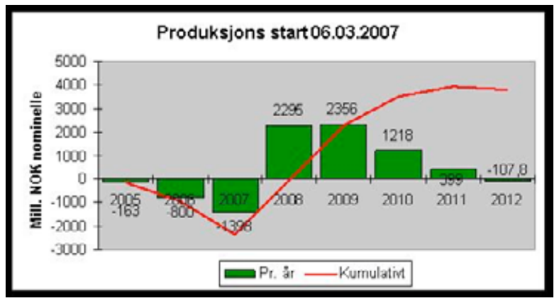

Figure content: combined bar and line chart titled "Produksjons start 06.03.2007"; x-axis years 2005–2012; y-axis Mill. NOK nominelle (million NOK nominal); green bars "Pr. år" (per year) with data labels, red line "Kumulativt" (cumulative).

### 12.3 Project uncertainty

#### 12.3.1 Uncertainty in the economic analyses

The most important factors affecting the result of the economic analyses are **uncertainty within reservoir, costs and market.**

Reservoir: Reservoir uncertainty is illustrated by using the p90 and p10 production profiles in the economic calculations. Risk related to scale deposition in the reservoir is assessed to result in production that lies within the p90 and p10 estimates and is not included as a separate sensitivity.

Costs: Uncertainty in the cost estimate is included in the economic calculations with an upside/downside of ± 300 MNOK. In addition, the effect of a possible need for more wells has been assessed.

Market: Uncertainty in the market is illustrated by showing the economic result with a **high price path of 35 USD/barrel** Brent blend and a **low price path of 15.0 USD/barrel Brent blend.**

#### 12.3.2 Sensitivity

The results of the most important sensitivities are summarised in Table 12.9.

Volve is sensitive to the oil price, and is slightly negative at the low price path. At today's prices the upside in the project is large.

*Table 12.9 – Sensitivities, economic calculations (net present value)*

| Net present value (million NOK2005) | | |
|---|---|---|
| | Before tax, NPV 7% | After tax, NPV 8% |
| Volve with expected oil price of 18.7 USD/barrel | 2534 | 443 |
| Reservoir | | |
| P90 production profile | 1520 | 203 |
| P10 production profile | 3677 | 718 |
| Costs | | |
| Investment costs + 300 million NOK | 2247 | 359 |
| Investment costs - 300 million NOK | 2822 | 526 |
| 2 extra wells | 2295 | 373 |
| Market | | |
| Price path 15 USD/barrel brent blend | -211 | -233 |
| Price path 35 USD/barrel Brent blend average "forward" 15.12.04 | 5565 | 1196 |

<!-- page 52 -->
<!-- type: mixed -->

## 13 Area evaluation

### 13.1 Introduction

**Volve has potential additional volumes in nearby structures** that lie both inside and outside the Volve defined area, ref. Figure 1.2. The availability of drilling and process equipment on Volve opens for cost-effective exploration, appraisal and production of oil in these structures. **Further exploration is assumed to be done late in the drilling phase or while the platform is producing at plateau, so that additional volume can be phased in when there is spare capacity.**

**In the development plan for Volve, only production and costs related to proven oil have been included,** exploration costs are kept outside the development plan.

### 13.2 Additional volumes and appraisal strategy

This documentation includes only **oil prospects and "leads" within drillable distance of the Volve installation,** see table and Figure 13.1

Volve Sør is a small but well-defined structural high between Volve and Sleipner Øst. There is a **high probability of further migration of oil from Volve into Volve Sør, so that the discovery probability becomes relatively high.** Given a discovery, the structure can be developed with one producer and one injector. The most obvious course is to drill a **dedicated exploration well from Volve with the possibility of completing the well as a producer, given a discovery.**

Theta Sør is a structure of a size similar to Volve. There is considerable uncertainty related to the possibility of migration into the structure, and the trap is moreover dependent on fault seal. There are also possibilities of segmentation of the structure, so that exploration must proceed stepwise, while at the same time there must be strong focus on exploration and appraisal wells being usable further as producer or injector wells.

West of Volve and Volve Sør, the Hugin Formation is mapped in a number of smaller and partly rotated fault blocks. The presence of oil here depends on an oil/water contact that lies considerably deeper than what has been observed so far. The discovery probability is therefore relatively low. The possibility of a deep contact can be appraised by means of a sidetrack on the injector well in the west. Given a discovery, 4-6 wells will be required to develop the western prospects.

On the western part of Volve the structure is onlapped by high-amplitude seismic reflectors internally in the Upper Jurassic package. Something similar is seen in the west on the Loke structure, where well 15/9-C-2AH has proven the presence of porous sandstone internally in the Draupne Formation. The migration of oil from the source area is moreover dependent on being able to take place in layers of sandstone internally in the Draupne Formation. There is therefore a certain probability that the amplitudes in the west represent oil-filled sandstone, but it has not been possible to produce a satisfactory set of maps, and therefore no volume has been calculated for this prospect either. The Upper Jurassic prospectivity is assumed to be appraised in the same sidetrack as mentioned above.

*Table 13.1 – Discovery probability*

| Prospect | Discovery probability | Resources | Risked resources |
|---|---|---|---|
| Volve Sør | 0.56 | 5.9 | 3.3 |
| Theta Sør | 0.22 | 27.5 | 6.1 |
| Western prospects | 0.20 | 30 | 6 |
| Total | - | 63.4 | 15.4 |

<!-- page 53 -->
<!-- type: figure -->

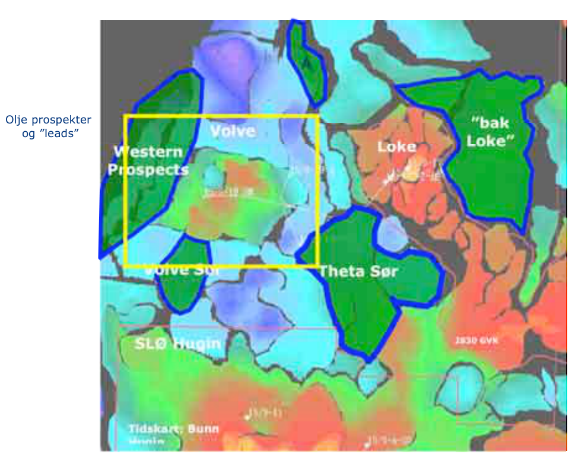

Figure content: colour-shaded map (time map, base Hugin) with green areas outlined in blue marking oil prospects and "leads" (legend "Olje prospekter og "leads""); a yellow rectangle around Volve; labels Volve, Western Prospects, Volve Sør, Theta Sør, Loke, "bak Loke", SLØ Hugin, A, 2830 GVK, and well names.
